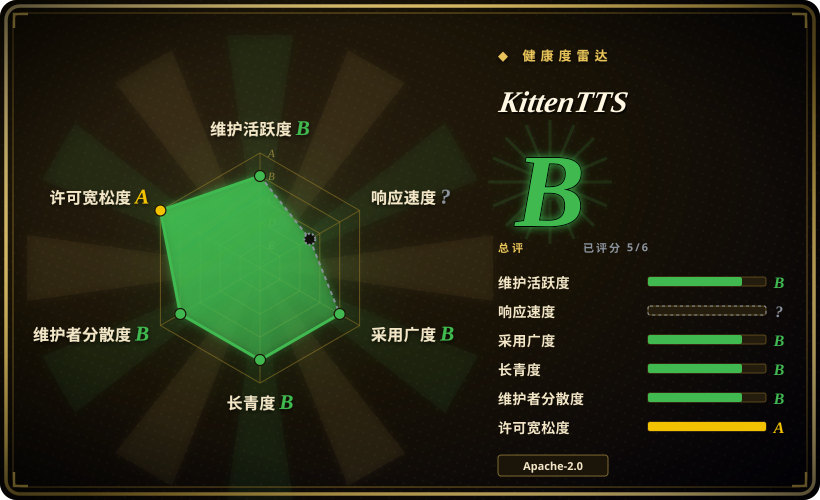
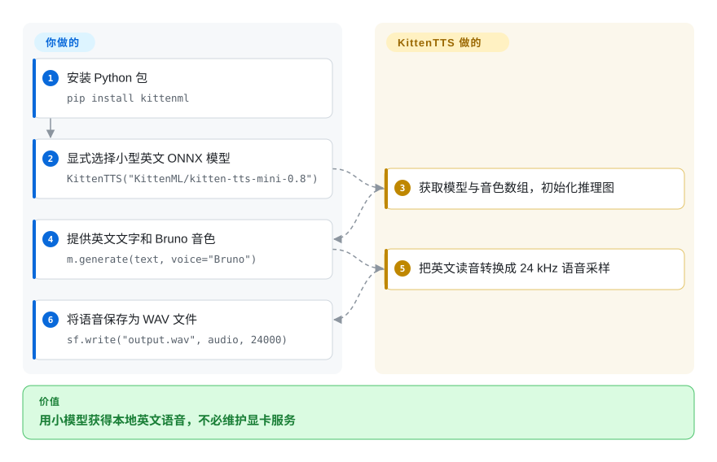
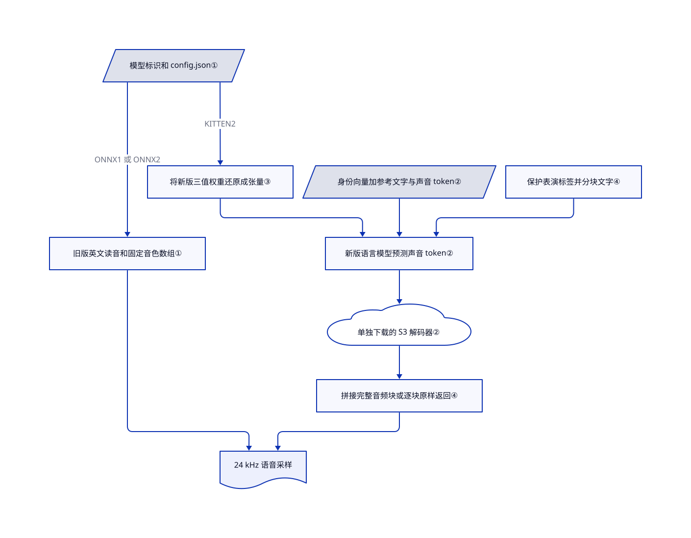

# KittenTTS

桌面程序只想读出提示，却得专门预留显卡。KittenTTS 用微型英文模型处理这类任务，也提供更大的声音克隆模型；两者的硬件和许可成本不同。

## 何时使用

你要给本地应用加语音通知或短旁白。“导出已完成”这类提示不值得维护显卡服务，几 GB 的模型又会挤占安装包预算。能接受八个固定英文音色时，选 0.8 ONNX 系列：模型有 1500 万到 8000 万参数，权重文件为 25–80 MB，源码提供明确的 CPU 路径。相比 8200 万参数的 Kokoro，它多了 1500 万参数档；代价是不提供多语言读音处理和参考录音克隆。

若你需要声音克隆或情绪标签，也能通过同一 Python 入口选择 KittenTTS 2。它是独立的 17 亿参数模型，不是微型 ONNX 模型的新功能。先接受其社区权重许可，再测所选后端；“CPU 实时”的宣传不能当作普通 PyTorch 推理的延迟承诺。

## 何时不用

- **商用克隆必须没有收入与融资门槛。** 优先看 [VoxCPM](voxcpm.zh.md)。KittenTTS 代码是 Apache-2.0，但 [KittenTTS 2 权重许可](https://huggingface.co/KittenML/kitten-tts-2/blob/1f00fee525c7b2e30bbe9ca9ba67529734fce9c9/LICENSE.md)要求商用登记。你或关联方合计年收入、累计融资任一超过 100 万美元，商业授权即终止，须另行申请。分发还要求保留声明、显示“Powered by KittenML”；向其他模型蒸馏能力也受限制。
- **想让 25 MB 的英文引擎直接读中日文。** 固定音色看 [Kokoro](https://github.com/hexgrad/kokoro) 的明确语言管线，多语言克隆看 VoxCPM。旧版读音器写死 `en-us`。新版虽有多语言参考音色，但英文文本规范化必须通过 `normalize=False` 关闭。克隆时提供对应语言的录音和文字稿，因为自动 Whisper 转录路径强制使用英文。
- **大模型还没写完句子，语音就必须开口。** 英文增量文本语音可评估 [VibeVoice-Realtime](vibevoice.zh.md)。KittenTTS 2 返回的是整块生成完的音频，不是逐个声音 token；短文本只返回一块。
- **小型 CPU 必须保证实时克隆。** 不需要克隆时，用旧版 KittenTTS 或 Kokoro。新版的快速 CPU 推荐指向独立的测试版 C++ 仓库；Python 包仍需要 PyTorch 和额外的声音解码权重。下载体积不等于内存峰值。
- **需要许可宽松的单人音色训练流程。** 评估 [GPT-SoVITS](gpt-sovits.zh.md)。本仓库提供推理和克隆，文件树没有新版训练管线。具备克隆功能也不等于获得了模仿他人声音的许可。

## 横向对比

| 替代品 | 是否收录 | 我们的评价 | 取舍 |
|---|---|---|---|
| [Kokoro](https://github.com/hexgrad/kokoro) | 未收录 | 小模型要覆盖明确的多语言管线，选 Kokoro；最在意 1500 万参数英文模型的体积，选旧版 KittenTTS。 | Kokoro 提供 8200 万参数模型和各语言的文本处理；KittenTTS 最小档牺牲了这部分覆盖。本次标签批次未收录。 |
| [VoxCPM](voxcpm.zh.md) | ✅ | 商用多语言克隆不能受收入或融资门槛限制，选 VoxCPM；只要微型 CPU 英文提示，选旧版 KittenTTS。 | VoxCPM 提供宽松权重许可和文字设计音色，但推理环境远重于旧版 ONNX。 |
| [GPT-SoVITS](gpt-sovits.zh.md) | ✅ | 要单人音色训练流程和网页界面，选 GPT-SoVITS；只需嵌入一个合成调用，选 KittenTTS。 | GPT-SoVITS 多出数据集和适配工具；KittenTTS 微型档不支持克隆，新版克隆则增加自定义权重许可。 |
| [VibeVoice](vibevoice.zh.md) | ✅ | 英文文字尚未全部到齐就要合成，选 VibeVoice-Realtime；更重视本地文件生成或参考音色克隆，选 KittenTTS。 | VibeVoice-Realtime 使用固定音色，不开放克隆；KittenTTS 2 的流式输出仍要等待完整音频块。 |

## 快速上手

按包清单和 PyPI 要求使用 Python 3.10 以上，不沿用 README 的旧版最低版本。执行 `pip install kittenml`，再显式选择 `KittenTTS("KittenML/kitten-tts-mini-0.8")`，走小模型 CPU 路径。你提供英文文字和 `Bruno` 等音色；`m.generate(text, voice="Bruno")` 返回音频采样，`sf.write("output.wav", audio, 24000)` 将其存盘。项目负责获取模型文件和合成，你负责播放、输入清理、版本固定与许可审查。标准安装还会拉取新版所需的 PyTorch；若部署体积敏感，[ONNX 指南](https://github.com/KittenML/KittenTTS/blob/d737634c7b91ee1589820ed74ff203494454db24/docs/onnx-models.md)给出了手动减少依赖的安装方式。

<!-- flow-steps:begin (generated from flows/kitten-tts.json by tools/flow_card.py — do not edit) -->

流程文字版

1. **你**：安装 Python 包 — `pip install kittenml`
2. **你**：显式选择小型英文 ONNX 模型 — `KittenTTS("KittenML/kitten-tts-mini-0.8")`
3. **KittenTTS**：获取模型与音色数组，初始化推理图
4. **你**：提供英文文字和 Bruno 音色 — `m.generate(text, voice="Bruno")`
5. **KittenTTS**：把英文读音转换成 24 kHz 语音采样
6. **你**：将语音保存为 WAV 文件 — `sf.write("output.wav", audio, 24000)`

**价值**：用小模型获得本地英文语音，不必维护显卡服务

<!-- flow-steps:end -->

## 技术要点

<!-- mechanism:begin (generated from mechanisms/kitten-tts.json by tools/mechanism_card.py; do not edit) -->

机制文字版

- 模型标识和 config.json①
- 旧版英文读音和固定音色数组①
- 将新版三值权重还原成张量③
- 身份向量加参考文字与声音 token②
- 保护表演标签并分块文字④
- 新版语言模型预测声音 token②
- 单独下载的 S3 解码器②
- 拼接完整音频块或逐块原样返回④
- 24 kHz 语音采样

- 模型标识和 config.json① → 旧版英文读音和固定音色数组①（ONNX1 或 ONNX2）
- 旧版英文读音和固定音色数组① → 24 kHz 语音采样
- 模型标识和 config.json① → 将新版三值权重还原成张量③（KITTEN2）
- 将新版三值权重还原成张量③ → 新版语言模型预测声音 token②
- 身份向量加参考文字与声音 token② → 新版语言模型预测声音 token②
- 保护表演标签并分块文字④ → 新版语言模型预测声音 token②
- 新版语言模型预测声音 token② → 单独下载的 S3 解码器②
- 单独下载的 S3 解码器② → 拼接完整音频块或逐块原样返回④
- 拼接完整音频块或逐块原样返回④ → 24 kHz 语音采样

<!-- mechanism:end -->

### 1. 同一入口分发到两套推理架构

- **解决：** 微型固定音色合成器与声音克隆模型的能力和成本不同。
- **做法：** 构造器读取模型仓库的 `config.json`。`ONNX1`／`ONNX2` 选择英文读音到波形的计算图及固定音色数组；`KITTEN2` 选择语音语言模型。按需导入隔离后端加载，按配置筛选文件，避免下载新版全部权重档位。
- **边界：** 共用构造器不会让 ONNX 获得克隆、情绪标签或多语言读音。按需导入也不会缩小默认安装的依赖集合；始终写明模型标识，因为无参数构造器仍默认选择旧版 nano。
- **源码：** [分发逻辑第 15–112 行](https://github.com/KittenML/KittenTTS/blob/d737634c7b91ee1589820ed74ff203494454db24/kittenml/get_model.py#L15-L112)、[英文 ONNX 输入第 43–115 行](https://github.com/KittenML/KittenTTS/blob/d737634c7b91ee1589820ed74ff203494454db24/kittenml/kittentts_legacy/onnx_model.py#L43-L115)。

### 2. 用说话人身份和参考语音双路控制新版

- **解决：** 只有文字，无法指定谁来读。
- **做法：** 新版把包含 512 个数的说话人身份向量映射到语言模型的首个输入位置。另一条路径把参考文字稿和编码后的录音放入提示。模型预测离散声音 token，再由 S3 解码器转成 24 kHz 采样。
- **边界：** 自动转录会加载 Whisper large-v3，并强制使用英文；非英文录音或资源受限机器应提供 `reference_text`。S3 解码器还会从 `ResembleAI/chatterbox-turbo` 单独下载权重，与 README 所说的全部权重位于单一仓库不符。
- **源码：** [身份注入和转录第 47–165 行](https://github.com/KittenML/KittenTTS/blob/d737634c7b91ee1589820ed74ff203494454db24/kittenml/kittentts2/speaker.py#L47-L165)、[参考提示第 10–56 行](https://github.com/KittenML/KittenTTS/blob/d737634c7b91ee1589820ed74ff203494454db24/kittenml/kittentts2/prompt.py#L10-L56)、[解码和下载](https://github.com/KittenML/KittenTTS/blob/d737634c7b91ee1589820ed74ff203494454db24/kittenml/kittentts2/vocoder.py)。

### 3. 压缩三值权重，不承诺三值运行内存

- **解决：** 权重只有三种取值，却用 16 位格式保存，浪费下载空间。
- **做法：** 新版压缩权重把五个三进制数装入一个字节，并保留每组缩放值。非三值张量原样保存。Torch 加载器将其还原为张量；`emb4` 另行量化密集的词嵌入，会引入损失。
- **边界：** 存储压缩不保证低内存或 CPU 运算快。README 推荐独立 C++ 后端来提高 CPU 速度。可选学生解码器也是用保真度换体积，不保证提速。
- **源码：** [三值压缩与还原第 1–120 行](https://github.com/KittenML/KittenTTS/blob/d737634c7b91ee1589820ed74ff203494454db24/kittenml/kittentts2/ternary.py#L1-L120)、[权重加载第 30–71 行](https://github.com/KittenML/KittenTTS/blob/d737634c7b91ee1589820ed74ff203494454db24/kittenml/kittentts2/weights.py#L30-L71)、[学生解码器取舍第 1–24 行](https://github.com/KittenML/KittenTTS/blob/d737634c7b91ee1589820ed74ff203494454db24/kittenml/kittentts2/student_flow.py#L1-L24)。

### 4. 保护表演标签，并限制每块生成长度

- **解决：** 文本规范化可能把表演指令读出来，长文本单次生成也可能重复或截断。
- **做法：** 新版在规范化前暂存十种情绪、十种声音事件和重读片段。它靠近句界切分文字，逐块生成与解码；非流式结果再裁去边缘静音，加入淡入淡出后拼接。
- **边界：** 未知括号内容会被改写，不会成为受支持的控制。分句器识别西文标点，不识别中文句号。流式输出返回未经同样拼接处理的完整音频块；情绪引导仍是测试版，不是精确表演指令。
- **源码：** [标签保护第 30–82 行及分块拼接第 270–411 行](https://github.com/KittenML/KittenTTS/blob/d737634c7b91ee1589820ed74ff203494454db24/kittenml/kittentts2/text.py)、[生成与流式输出第 468–570 行](https://github.com/KittenML/KittenTTS/blob/d737634c7b91ee1589820ed74ff203494454db24/kittenml/kittentts2/model.py#L468-L570)。

## 技术栈

- Python 包 `kittenml`、setuptools、NumPy 和 SoundFile；旧版用 ONNX Runtime，以及经 `phonemizer` 调用的 espeak-ng。
- 新版使用 PyTorch、Transformers、S3 声音 token 和从 Chatterbox 衍生的内置解码器。可选 MLX 面向 Apple Silicon，可选 vLLM 面向 Linux CUDA 机器。
- 旧版有 1500 万、4000 万和 8000 万参数档，共八种固定音色。新版有 17 亿参数，支持参考录音克隆，不限于这八种音色。

## 依赖

- Python ≥3.10，由两份包清单和 [PyPI 0.9.6 元数据](https://pypi.org/project/kittenml/0.9.6/)共同确认。默认依赖包括 Torch ≥2.6、torchaudio、Transformers ≥4.55、ONNX Runtime、espeak 加载器和 phonemizer。
- 旧版权重和音色数组来自 Hugging Face。Mini-0.8 模型卡声明 Apache-2.0，但模型树没有独立 LICENSE 文件；登记许可时保留模型卡及修订号。
- 新版下载选定的语言模型、音色、说话人嵌入，以及独立的 Chatterbox 解码器。不给克隆文字稿时还会加载 Whisper large-v3。规划离线部署前，须准备齐全部文件。
- README 估计新版 CPU 需约 6 GB 内存，CUDA 需约 8 GB 空闲显存；这些是上游估计，本次未测。MLX 使用 Mac 显卡，不能算纯 CPU 性能证据。
- 截至 2026-10-22，语言证据存在冲突：GitHub 宣传 20 种语言、47 种音色，详细指南却描述十种语言。固定版本的 [HF 模型卡](https://huggingface.co/KittenML/kitten-tts-2/blob/1f00fee525c7b2e30bbe9ca9ba67529734fce9c9/README.md)列出 16 种命名语言，[音色清单](https://huggingface.co/KittenML/kitten-tts-2/blob/1f00fee525c7b2e30bbe9ca9ba67529734fce9c9/voices/voices.json)含 115 项。应以选定文件的清单为准，不把统一语言数量当保证。

## 运维难度

**固定旧版英文集成较低，新版中等。** 旧版不需数据库、显卡或托管语音接口，但一体化安装远大于模型文件。新版增加多个权重来源、后端硬件要求、自定义商用条款和音频验收。分别固定 Python 包与模型快照：构造器没有模型修订参数，但接受准备好的本地模型目录。不要加载不可信的可选学生权重，加载器使用 `torch.load(..., weights_only=False)`。

## 健康度与可持续性

- **维护，2026-10-22：** 默认分支在 2026-10-21 更新，PyPI 0.9.6 也于当天上传。GitHub 最新发布仍是 2026-02-24 的 0.8.1，不能据此判断当前包版本。[发布历史](https://github.com/KittenML/KittenTTS/releases)与 [PyPI](https://pypi.org/project/kittenml/0.9.6/)支持这一区分。
- **治理与支持：** KittenML 是组织账号，商业支持由 Stellon Labs 承接。贡献者接口列出六人，首位账号占已列 71 次贡献中的 46 次。所读文件树没有治理或安全政策文件。这是厂商主导，不是基金会治理。
- **年龄与耐久性：** 仓库创建于 2025-08-05，约 14 个月，仍有更新。[推断：依据仓库年龄和近期发布] 这些证据说明当前有人维护，但林迪先验仍弱；应固定已验收文件，不依赖长期路线稳定。
- **采用与风险：** 16285 星、970 个分叉说明受到关注，不等于生产验证。自动许可轴读取仓库元数据，不能覆盖新版权重的独立商用限制。包与 README 的 Python 要求、语言数量、模型音色数量，以及额外解码器下载，都需要源码交叉核对。

## 存疑（未验证）

- [未验证：任务明确排除模型运行和权重下载] 本次没有测 CPU 实时速度、新版内存峰值、克隆相似度或多语言音质。上游说法需要在选定后端、语言与机器上复测。
- [未验证：旧版 HF 文件树没有独立许可正文] Mini-0.8 模型卡声明 Apache-2.0，但本次没有独立确认该声明之外的分发义务。不能不经核对就推广到全部旧版权重。
- [未验证：上游文档相互冲突，且没有运行合成] 20 语言宣传不是测试矩阵。115 项音色清单和 16 语言模型卡只能证明参考素材存在，不能证明每种语言都稳定生成。
- [推断：依据年龄、发布及厂商控制权，不是支持承诺] 当前仍在维护，但长期耐久性尚未得到证明。
