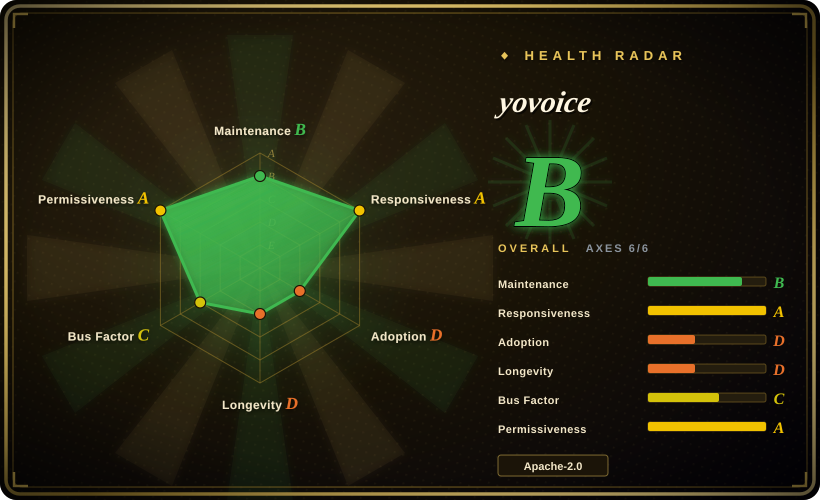
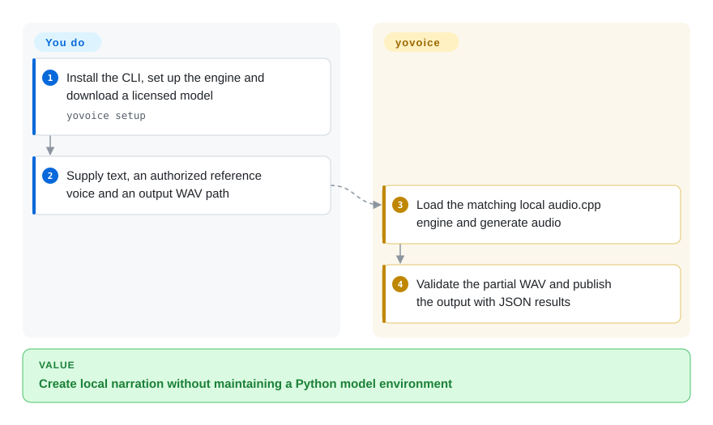
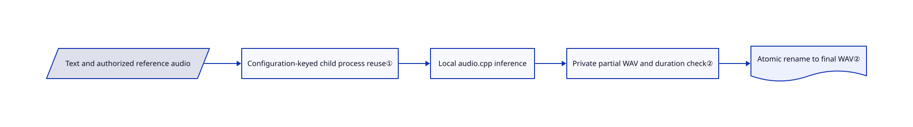

# yovoice

You want to compare cloned narration takes and songs without maintaining a Python model stack; yovoice wraps local audio.cpp inference in a desktop workbench, CLI and MCP service.

## When to use

You prepare narration or story dialogue from text, need to compare multiple takes, and want speech, song and MIDI tools in one local project. Choose yovoice over model-only libraries when packaged native inference and a creator interface save more work than a custom Python integration. Against desktop peers, choose its native audio.cpp packaging and music/score workflow when those matter more than VoiceStudio's dubbing-oriented Python backend or Voicebox's dictation-and-agent voice loop. Local generation is available, but its optional assistant can send prompts to a configured cloud model; the README's blanket privacy slogan does not describe every mode.

## When NOT to use

- Need a trainable voice-cloning pipeline? Choose [GPT-SoVITS](gpt-sovits.md), rather than this inference workbench.
- Need a Python library inside your service? Choose [Coqui TTS](coqui-ai-tts.md), accepting its distinct code and weight licenses.
- Need to isolate one permissively licensed speech model? Choose [VoxCPM](voxcpm.md) and review that model directly. yovoice's Apache code license does not cover all installed weights.
- Need parallel high-throughput jobs? Use a serving engine: yovoice shares one inference slot and rejects concurrent API work as busy.
- Need video dubbing and audiobook workflows in a multi-engine desktop? Compare [VoiceStudio](voicestudio.md) first; it trades a heavier Python backend and AGPL app license for that scope, with separate model-license restrictions.
- Need hotkey dictation plus agent speech rather than songs or MIDI? Compare [Voicebox](voicebox.md); its Python-backed MIT app covers that loop, but the indexed snapshot warns about release cadence, local API authentication and macOS-only auto-paste.

## Comparison

| Alternative | In index | Our verdict | Tradeoff |
| --- | --- | --- | --- |
| [VoiceStudio](voicestudio.md) | ✅ | Choose VoiceStudio for dubbing/audiobook workflows; choose yovoice when native audio.cpp packaging and songs/MIDI are the reason to install a studio. | VoiceStudio uses a Python model backend under AGPL, versus yovoice's Go/native workbench under Apache-2.0; neither clears all weight licenses. Its indexed 2026-10-01 snapshot reports frequent releases but one-maintainer risk and hardware restrictions, including no local Intel Mac backend and NVIDIA-only Windows GPU support. yovoice's desktop targets Apple Silicon macOS 14+ and Windows x64 and has only a month's history; no quality or speed winner was measured. |
| [Voicebox](voicebox.md) | ✅ | Choose Voicebox for hotkey dictation plus cloned agent speech through MCP; choose yovoice for speech, song and score creation without a Python model stack. | Voicebox combines Tauri with a Python backend under MIT; yovoice uses native hosts and audio.cpp under Apache-2.0. Both still need separately reviewed weights and suitable compute. The indexed September Voicebox snapshot flags cooling releases, GPU/model-cache requirements, an unauthenticated local API and macOS-only auto-paste; it is not a live re-verification of that project. |
| [GPT-SoVITS](gpt-sovits.md) | ✅ | Choose GPT-SoVITS for adaptation and training; choose yovoice for packaged local creation and take review. | Training control versus easier desktop inference and broader music tooling. |
| [Coqui TTS](coqui-ai-tts.md) | ✅ | Choose Coqui for Python integration; choose yovoice to avoid managing a Python inference environment. | Library flexibility versus a Go/native application with curated models. |
| [VoxCPM](voxcpm.md) | ✅ | Choose VoxCPM directly for a model-centric speech service; choose yovoice when that model belongs inside a larger audio project. | Direct model control versus project history, editing and multiple engines. |

## Quick start

Download the CLI archive for your platform and keep its `tools/` directory beside the executable. Run `yovoice setup`, download a listed model, then supply text and, for cloning, an authorized reference voice. The documented `yovoice generate --model index-2.5-q8 --text-file narration.txt --reference voice.wav --output narration.wav` writes WAV and JSON results; you provide hardware, model downloads and voice rights. Close the desktop app first or use a separate data directory, because it holds the same exclusive lock. Review each model license before commercial output. See [CLI usage](https://github.com/leemysw/yovoice/blob/86f683559f027b8471d2a7655d8291139d1de4a0/docs/cli.md).

<!-- flow-steps:begin (generated from flows/yovoice.json by tools/flow_card.py — do not edit) -->

Text version of the flow

1. **You**: Install the CLI, set up the engine and download a licensed model — `yovoice setup`
2. **You**: Supply text, an authorized reference voice and an output WAV path
3. **yovoice**: Load the matching local audio.cpp engine and generate audio
4. **yovoice**: Validate the partial WAV and publish the output with JSON results

**Value**: Create local narration without maintaining a Python model environment

<!-- flow-steps:end -->

## Key techniques

<!-- mechanism:begin (generated from mechanisms/yovoice.json by tools/mechanism_card.py; do not edit) -->

Text version of the mechanism

- Text and authorized reference audio
- Configuration-keyed child process reuse①
- Local audio.cpp inference
- Private partial WAV and duration check②
- Atomic rename to final WAV②

- Text and authorized reference audio → Configuration-keyed child process reuse①
- Configuration-keyed child process reuse① → Local audio.cpp inference
- Local audio.cpp inference → Private partial WAV and duration check②
- Private partial WAV and duration check② → Atomic rename to final WAV②

<!-- mechanism:end -->

### 1. Reuse a local engine only when its configuration matches

- **Problem:** Reloading weights wastes time, but reusing the wrong model process produces incorrect behavior.
- **How:** The Go engine builds a key from executable, model, backend and options, reuses a matching live child, otherwise starts audio.cpp on loopback and waits for health.
- **Limits:** The mutex serializes inference. Separate CLI invocations reload models; persistent service use is a different deployment choice.
- **Source:** [Engine lifecycle](https://github.com/leemysw/yovoice/blob/86f683559f027b8471d2a7655d8291139d1de4a0/internal/engine/engine.go#L88-L239).

### 2. Validate audio before publishing the output file

- **Problem:** Cancellation or malformed engine output should not leave an apparently complete WAV.
- **How:** Generation writes a private `.part` file, verifies its duration, checks cancellation and renames it to the final output; deferred cleanup removes partial residue.
- **Limits:** A valid audio file does not prove voice similarity, pronunciation or consent.
- **Source:** [Generation output path](https://github.com/leemysw/yovoice/blob/86f683559f027b8471d2a7655d8291139d1de4a0/internal/engine/engine.go#L242-L301).

## Tech stack

React/TypeScript UI, Go service and SQLite, Swift macOS host and C# Windows host. audio.cpp and FFmpeg run as child processes; scores use go-meltysynth.

## Dependencies

Desktop targets Apple Silicon macOS 14+ and Windows x64; CLI additionally documents Linux x64. Downloaded engine/model packages and suitable GPU drivers or CPU resources are required. Optional cloud assistant accounts are separate. NOTICE discloses an ocho binary whose source is not public.

## Ops difficulty

**Medium.** Manage large model files, driver/runtime compatibility, database backups and the single-owner data directory. Some weights are noncommercial; the bundled IndexTTS agreement adds scale and downstream-use conditions. Apache-2.0 on the app is not blanket commercial clearance.

## Health & viability

- On 2026-10-18, v0.2.1 was released October 16; tests and frequent development are visible, with the owner leading contributions.
- Created September 2026, it has roughly one month of history. [推断：依据是仓库年龄与发布记录] Packaging is useful, but long-term support and upgrade stability are not established.
- Third-party notices distinguish application code, native components and model licenses; preserve that separation in redistribution.

## Caveats (unverified)

- [未验证：本批禁止运行上游] Generation quality, resource requirements for each model and desktop privacy behavior were not measured.
- [未验证：ocho 源码未公开] The bundled assistant binary's implementation is not reproducible from this repository.
- [未验证：仅使用已收录页面快照，未重跑两款桌面工具] VoiceStudio and Voicebox comparisons use their dated index entries, not new upstream or hardware verification; no voice-quality, speed or current release-cadence ranking is asserted.
- [推断：依据是仓库年龄与发布记录] Long-term maintenance remains unproven.
