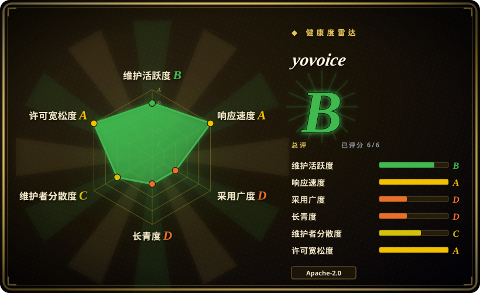
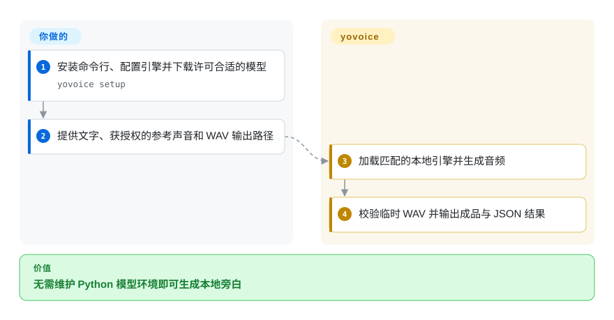
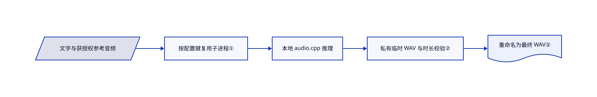

# yovoice

你想比较克隆旁白和歌曲版本，却不想维护 Python 模型环境。yovoice 把本地 audio.cpp 推理接成桌面工作台、命令行和 MCP 服务。

## 何时使用

你要把文本做成旁白或角色对白，比较多个生成版本，还想在同一项目中处理歌曲与 MIDI。比起单独模型库，若打包的原生推理和创作界面能省下更多集成工作，可以选 yovoice。与桌面同类相比，原生 audio.cpp 打包及音乐、乐谱流程更重要时选它；优先配音的 Python 工作台可看 VoiceStudio，优先听写与 agent 语音循环可看 Voicebox。音频能够本地生成，但可选助手会向配置的云模型发提示词；说明中笼统的隐私口号不适用于所有模式。

## 何时不用

- 要可训练的克隆流程，选 [GPT-SoVITS](gpt-sovits.zh.md)，而非推理工作台。
- 要在服务中嵌 Python 开发库，选 [Coqui TTS](coqui-ai-tts.zh.md)，并另审代码与权重许可。
- 要隔离一个宽松许可的语音模型，直接选 [VoxCPM](voxcpm.zh.md)。应用的 Apache 许可不覆盖所有下载权重。
- 要并行高吞吐任务，选服务引擎。yovoice 共用一个推理槽，并发 API 任务会被拒为忙碌。
- 要多引擎桌面的视频配音和有声书流程，先比较 [VoiceStudio](voicestudio.zh.md)。它用更重的 Python 后端与 AGPL 应用许可换取该范围，模型许可仍另审。
- 要快捷键听写加 agent 发声，而非歌曲和 MIDI，先比较 [Voicebox](voicebox.zh.md)。它用 Python 后端和 MIT 应用覆盖该循环；已收录快照同时提醒发布节奏、本地接口认证和仅 macOS 自动粘贴的边界。

## 横向对比

| 替代品 | 是否收录 | 我们的评价 | 取舍 |
| --- | --- | --- | --- |
| [VoiceStudio](voicestudio.zh.md) | ✅ | 要视频配音和有声书选 VoiceStudio；安装工作台的关键是原生 audio.cpp 与歌曲、MIDI 时选 yovoice。 | 前者是 AGPL 应用加 Python 模型后端，后者是 Apache-2.0 的 Go 与原生工作台，两者均不统一放行权重许可。其 2026-10-01 索引快照显示发布频繁，但有单作者和硬件限制，包括 Intel Mac 不能本地跑后端、Windows GPU 仅支持 NVIDIA。yovoice 桌面限定 Apple Silicon macOS 14+ 与 Windows x64，历史约一月；未测音质或速度胜负。 |
| [Voicebox](voicebox.zh.md) | ✅ | 要快捷键听写加 MCP 克隆声音回复选 Voicebox；要不维护 Python 模型栈的语音、歌曲与乐谱创作选 yovoice。 | 前者用 Tauri 加 Python，应用许可 MIT；后者用原生宿主加 audio.cpp，许可 Apache-2.0，均需另审权重与算力。Voicebox 的 9 月索引快照提示发布降温、显卡与模型缓存需求、本地 API 无认证，以及自动粘贴仅 macOS；这不是本轮对其上游的重新核验。 |
| [GPT-SoVITS](gpt-sovits.zh.md) | ✅ | 要适配训练选 GPT-SoVITS；要打包的本地创作与版本对比选 yovoice。 | 训练控制，对比桌面推理和更广的音乐工具。 |
| [Coqui TTS](coqui-ai-tts.zh.md) | ✅ | 要 Python 集成选 Coqui；要避开 Python 推理环境管理选 yovoice。 | 库的灵活性，对比 Go 与原生应用的精选模型。 |
| [VoxCPM](voxcpm.zh.md) | ✅ | 模型为中心的语音服务直接选 VoxCPM；要把模型纳入音频项目则选 yovoice。 | 直接模型控制，对比历史、编辑与多引擎界面。 |

## 快速上手

下载平台对应的命令行压缩包，让 `tools/` 与程序放在一起。运行 `yovoice setup`，下载列表中的模型，再提供文字；克隆声音还需获授权的参考音频。文档示例 `yovoice generate --model index-2.5-q8 --text-file narration.txt --reference voice.wav --output narration.wav` 返回 WAV 和 JSON 结果，你负责硬件、模型下载及声音权利。先退出桌面应用，或另用数据目录，因为两者共用独占锁。商用前逐个审模型许可。来源为[命令行用法](https://github.com/leemysw/yovoice/blob/86f683559f027b8471d2a7655d8291139d1de4a0/docs/cli.md)。

<!-- flow-steps:begin (generated from flows/yovoice.json by tools/flow_card.py — do not edit) -->

流程文字版

1. **你**：安装命令行、配置引擎并下载许可合适的模型 — `yovoice setup`
2. **你**：提供文字、获授权的参考声音和 WAV 输出路径
3. **yovoice**：加载匹配的本地引擎并生成音频
4. **yovoice**：校验临时 WAV 并输出成品与 JSON 结果

**价值**：无需维护 Python 模型环境即可生成本地旁白

<!-- flow-steps:end -->

## 技术要点

<!-- mechanism:begin (generated from mechanisms/yovoice.json by tools/mechanism_card.py; do not edit) -->

机制文字版

- 文字与获授权参考音频
- 按配置键复用子进程①
- 本地 audio.cpp 推理
- 私有临时 WAV 与时长校验②
- 重命名为最终 WAV②

- 文字与获授权参考音频 → 按配置键复用子进程①
- 按配置键复用子进程① → 本地 audio.cpp 推理
- 本地 audio.cpp 推理 → 私有临时 WAV 与时长校验②
- 私有临时 WAV 与时长校验② → 重命名为最终 WAV②

<!-- mechanism:end -->

### 1. 配置一致才复用本地引擎

- **解决：** 反复加载权重很慢，但复用错误模型进程会改变结果。
- **做法：** Go 引擎按程序、模型、后端与选项构造键，只复用一致且存活的子进程，否则在回环地址启动 audio.cpp 并等待健康检查。
- **边界：** 互斥锁让推理串行；独立命令行调用会重载模型，常驻服务是另一部署选择。
- **源码：** [引擎生命周期](https://github.com/leemysw/yovoice/blob/86f683559f027b8471d2a7655d8291139d1de4a0/internal/engine/engine.go#L88-L239)。

### 2. 校验音频后才发布最终文件

- **解决：** 取消任务或引擎返回坏数据，不应留下看似完整的 WAV。
- **做法：** 先写私有 `.part` 文件，校验时长、检查取消，再重命名为最终文件；延迟清理删除残留。
- **边界：** 文件有效不证明音色相似、读音正确或取得本人同意。
- **源码：** [生成输出路径](https://github.com/leemysw/yovoice/blob/86f683559f027b8471d2a7655d8291139d1de4a0/internal/engine/engine.go#L242-L301)。

## 技术栈

React 和 TypeScript 界面、Go 服务与 SQLite、Swift macOS 宿主和 C# Windows 宿主。audio.cpp 与 FFmpeg 以子进程运行，乐谱用 go-meltysynth。

## 依赖

桌面支持 Apple Silicon macOS 14+ 和 Windows x64；命令行另支持 Linux x64。需要引擎、模型包及匹配驱动或 CPU 资源。可选云助手账号另配。声明注明 ocho 二进制源码未公开。

## 运维难度

**中等。** 管理模型大文件、驱动与运行时、数据库备份及独占数据目录。部分权重限非商业使用；内附 IndexTTS 协议另有规模和下游使用条件，应用 Apache 许可不是全面商用放行。

## 健康度与可持续性

- 截至 2026-10-18，v0.2.1 于 10 月 16 日发布，有测试和频繁开发，提交主要由作者带动。
- 仓库创建于 2026 年 9 月，历史约一月。[推断：依据是仓库年龄与发布记录] 打包能力有价值，但长期支持与升级稳定性尚未建立。
- 第三方声明区分应用、原生组件和模型许可，分发时应保留这种区分。

## 存疑（未验证）

- [未验证：本批禁止运行上游] 未测生成质量、逐模型资源需求和桌面隐私行为。
- [未验证：ocho 源码未公开] 仓库无法复现内附助手二进制的实现。
- [未验证：仅使用已收录页面快照，未重跑两款桌面工具] VoiceStudio 和 Voicebox 比较使用各自有日期的索引条目，未重新核验上游与硬件，不裁决音质、速度或当前发布节奏胜负。
- [推断：依据是仓库年龄与发布记录] 长期维护仍未获证明。
