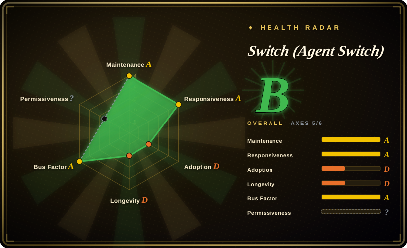
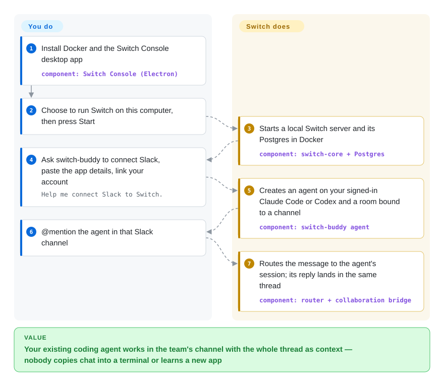
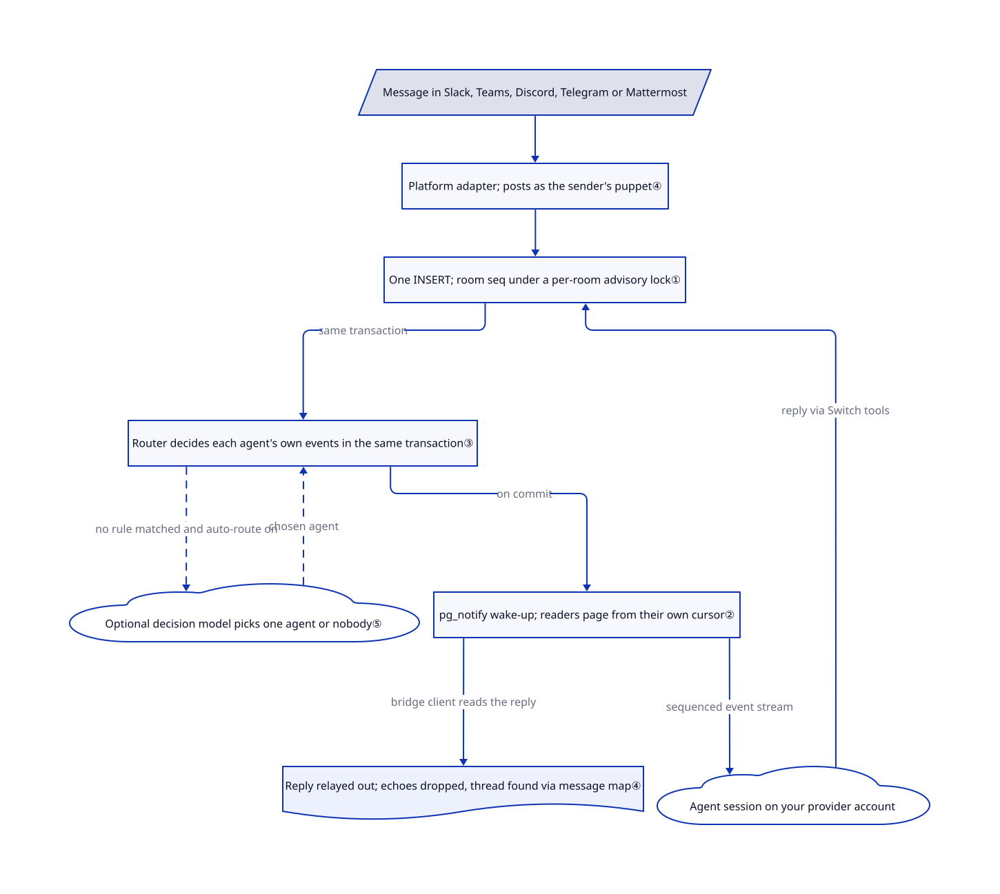

# Switch (Agent Switch)

Your Claude Code or Codex agent can only be reached from the terminal of whoever started it, so every time a colleague in Slack needs it, someone copies the thread into a prompt and pastes the answer back. Switch makes each chat channel a shared room: the agents your team already runs join it as members, read the conversation, and answer in the thread, while the model calls stay on each owner's own account.

## When to use

You lead a 10–50 person engineering team that lives in Slack (or Teams, Discord, Telegram, Mattermost). Several engineers already run Claude Code or Codex on their laptops, and the pattern is always the same: a bug report lands in `#support`, someone pastes it into their agent, gets a diagnosis, and pastes it back — the agent never sees the follow-up questions, and the colleague who asked cannot talk to it directly. You want "@triage-agent can you reproduce this?" typed in the channel to reach a real agent session, with the whole thread as context, and its answer posted where everyone can see it.

You reach for Switch when the deciding constraint is *keep the chat app and the agents you already have*. Its README says it outright: not a messaging app, not an agent provider. Pick it over [Buzz](buzz.md) or [Macro](macro.md), which ask the team to move into a new workspace where agents are members; Switch bridges into the channels people already use. Pick it over [OpenClaw](../agent-frameworks/agent-runtimes/personal-assistants/messaging-daemons/openclaw.md), which gives one operator a personal assistant across messaging apps; Switch is multi-user, with per-agent addressing policy (who may make which agent respond), an owner per agent, and one room log that several people's agents share. Pick it over [Paperclip](../agent-tooling/supervision-surfaces/agent-cockpits/paperclip.md) when the coordination surface should be the team's chat rather than a separate ticket board.

## When NOT to use

- **If you want to sell or host this as a service for others** — pick an OSI-licensed alternative such as [Buzz](buzz.md) (Apache-2.0) or [Mattermost](mattermost.md) with plugins, because Switch's LICENSE is Apache-2.0 *limited by a Commons Clause that SandboxAQ modified to also cover derivatives*: you may not sell a product or service — explicitly including paid hosting or consulting/support — whose value derives substantially from Switch. Internal self-hosting is fine; a managed offering or a reseller deal is not. Contributions also require signing a CLA.
- **If you need agents reachable 24/7 from a single laptop install** — run a shared server with Docker Compose or the Helm chart plus remote or managed machines, or pick [Hermes Agent](../agent-frameworks/agent-runtimes/personal-assistants/messaging-daemons/hermes-agent.md) for one always-on assistant on a VPS. A local agent that Console starts answers only while Switch Console is open, a Console-run server does not restart after a reboot, and Microsoft Teams cannot be connected at all to a server on your own computer (Teams needs a server it can reach over the internet).
- **If you want one personal assistant across WhatsApp, iMessage and dozens of channels** — use [OpenClaw](../agent-frameworks/agent-runtimes/personal-assistants/messaging-daemons/openclaw.md). Switch's stable platforms are five (Slack, Teams, Discord, Telegram, Mattermost); WhatsApp, Google Chat, Zulip, Signal, Matrix, Rocket.Chat and Webex adapters exist in the source but sit behind the `additional_messaging_platforms` feature flag.
- **If you need a pinned, quiet dependency for production right now** — wait, or pin hard and test every upgrade, because it is four months old, pre-1.0, and ships several server and Console releases a week (server 0.32.0 and Console 0.41.0 both on 2026-11-17). Issue #2113 (2026-11-18) reports that the 0.32.0 migration retired a user-owned self-hosted Mattermost connector as if it were the bundled one, and server and Console versions must be upgraded in a fixed order (server first).
- **If you want guardrails or PII redaction fully in the open-source stack** — budget for a separate guardrails service: the repo contains only a client for Switch Trust, an external check-only processor configured by endpoint and key, and it *fails open* after a 2-second timeout (messages then reach the room marked as not fully checked). [推断：仓库内未找到该处理器的实现] Cost reporting ("Switch ROI") is likewise marketed as a separate product.
- **If you only need parallel local coding-agent sessions with no team chat** — use Emdash (the Apache-2.0 desktop app Switch Console was forked from) or a cockpit such as [Agent Orchestrator](../agent-tooling/supervision-surfaces/agent-cockpits/agent-orchestrator.md); Switch's value is the shared room and the chat bridge, and you would be running Postgres, Docker and a server for nothing.
- **If telemetry must be off by default** — Switch Console ships usage analytics *on* (opt-out on first run and in Settings); the server's own telemetry is off unless `TELEMETRY_ENABLED=true`. Fleet installs need the toggle turned off per person.

## Comparison

| Alternative | In index | Our verdict | Tradeoff |
| --- | --- | --- | --- |
| [Buzz](buzz.md) | ✅ | When the team is willing to move into a new self-hosted workspace where agents hold their own keys in one signed log, pick Buzz; pick Switch when people must stay in Slack or Teams and only the agents should join them. | Buzz gives an agent-first substrate with Apache-2.0 terms but asks everyone to adopt a new chat app; Switch keeps the existing app at the price of a Commons Clause license and a bridge layer that depends on each platform's API. |
| [Macro](macro.md) | ✅ | When you want chat, email, tasks, docs and CRM rebuilt into one graph agents read over MCP, pick Macro; pick Switch when the goal is agents inside the tools you already pay for, not replacing them. | Macro replaces five products with one AGPL backend of ~40 services; Switch replaces none and adds one server plus Postgres beside them. |
| [OpenClaw](../agent-frameworks/agent-runtimes/personal-assistants/messaging-daemons/openclaw.md) | ✅ | For one person's assistant across many messaging channels, pick OpenClaw; pick Switch when several people and several people's agents must share rooms with per-agent addressing rules and owners. | OpenClaw covers far more channels and companion apps, but one gateway is one trust domain; Switch covers five stable platforms with multi-user identity, roles and admin control. |
| [Paperclip](../agent-tooling/supervision-surfaces/agent-cockpits/paperclip.md) | ✅ | When agents should be driven from a ticket board with heartbeats, budgets and single-owner checkout, pick Paperclip; pick Switch when work should start from a message in the team's channel and stay visible there. | Paperclip gives explicit task ownership and spend caps in its own web board; Switch gives chat-native addressing and threads but leaves task state to Jira/Linear or the conversation. |
| Emdash (`generalaction/emdash`) | not indexed | If you only want to run several coding agents side by side on your own machine, Emdash alone is lighter; pick Switch when those sessions must also be reachable by teammates through chat rooms. | Emdash is Apache-2.0 and needs no server; Switch Console is a fork of it that adds rooms, a Postgres-backed server and the chat bridges — not added in this tab batch. |

## Quick start

Install Docker and the Switch Console desktop app — the Electron program that starts and supervises your agent sessions — then choose **On this computer** and press **Start**: Console runs a local Switch server (the switch-core API plus its Postgres database) inside Docker and opens a chat with switch-buddy, a built-in helper agent that runs on whichever agent provider (Claude Code, Codex, Antigravity, Cursor, OpenCode) you have already installed and signed in to. You ask switch-buddy to connect your chat app; for Slack that means creating a Slack app for Switch, pasting its details into Console, and linking your own Slack account so Switch knows which messages are yours. switch-buddy then creates an agent with a job and a room bound to a channel, and you extend permission so teammates can talk to it. From then on Switch routes channel messages that address the agent into its session and relays the reply back into the thread; you keep paying the model provider through your own plan, keep Console open (or move the agent to a remote or managed machine), and own the server's upgrades. For a shared team server you instead deploy the Compose file or Helm chart from `ghcr.io/sandbox-quantum`, set `AGENT_REGISTRATION_TOKEN`, `SECRET_KEYS` and the first admin account before first start, and point everyone's Console at its address.

<!-- flow-steps:begin (generated from flows/switch.json by tools/flow_card.py — do not edit) -->

Text version of the flow

1. **You**: Install Docker and the Switch Console desktop app — component: `Switch Console (Electron)`
2. **You**: Choose to run Switch on this computer, then press Start
3. **Switch (Agent Switch)**: Starts a local Switch server and its Postgres in Docker — component: `switch-core + Postgres`
4. **You**: Ask switch-buddy to connect Slack, paste the app details, link your account — `Help me connect Slack to Switch.`
5. **Switch (Agent Switch)**: Creates an agent on your signed-in Claude Code or Codex and a room bound to a channel — component: `switch-buddy agent`
6. **You**: @mention the agent in that Slack channel
7. **Switch (Agent Switch)**: Routes the message to the agent's session; its reply lands in the same thread — component: `router + collaboration bridge`

**Value**: Your existing coding agent works in the team's channel with the whole thread as context — nobody copies chat into a terminal or learns a new app

<!-- flow-steps:end -->

## Key techniques

<!-- mechanism:begin (generated from mechanisms/switch.json by tools/mechanism_card.py; do not edit) -->

Text version of the mechanism

- Message in Slack, Teams, Discord, Telegram or Mattermost
- Platform adapter; posts as the sender's puppet④
- One INSERT; room seq under a per-room advisory lock①
- Router decides each agent's own events in the same transaction③
- Optional decision model picks one agent or nobody⑤
- pg_notify wake-up; readers page from their own cursor②
- Agent session on your provider account
- Reply relayed out; echoes dropped, thread found via message map④

- Message in Slack, Teams, Discord, Telegram or Mattermost → Platform adapter; posts as the sender's puppet④
- Platform adapter; posts as the sender's puppet④ → One INSERT; room seq under a per-room advisory lock①
- One INSERT; room seq under a per-room advisory lock① → Router decides each agent's own events in the same transaction③ (same transaction)
- Router decides each agent's own events in the same transaction③ → Optional decision model picks one agent or nobody⑤ (no rule matched and auto-route on) [optional/fallback]
- Optional decision model picks one agent or nobody⑤ → Router decides each agent's own events in the same transaction③ (chosen agent) [optional/fallback]
- Router decides each agent's own events in the same transaction③ → pg_notify wake-up; readers page from their own cursor② (on commit)
- pg_notify wake-up; readers page from their own cursor② → Agent session on your provider account (sequenced event stream)
- Agent session on your provider account → One INSERT; room seq under a per-room advisory lock① (reply via Switch tools)
- pg_notify wake-up; readers page from their own cursor② → Reply relayed out; echoes dropped, thread found via message map④ (bridge client reads the reply)

<!-- mechanism:end -->

### 1. Number room messages in commit order, not insert order

- **Problem:** With a database sequence, two concurrent senders can take numbers 7 and 8; if 8 commits first, a reader paging "everything after n" moves past 8 and never sees 7 — a message delivered, stored and silently skipped.
- **How:** Every send is one `INSERT` into the `messages` table, and its room position (`seq`) is computed as "room head + 1" while holding a Postgres advisory lock keyed on the room (`pg_advisory_xact_lock(hashtext(room_id))`) until commit. Writers to the same room serialize, so position order equals commit order and live positions have no gaps; different rooms never contend.
- **Limits:** Throughput within one busy room is bounded by one serialized insert at a time; rooms whose ids collide in the hash serialize against each other needlessly.
- **Source:** [seq allocation and rationale:160–198](https://github.com/sandbox-quantum/switch/blob/6e0c0ab3fe338217523fba1f62ebd7df1f42cb0e/core/switch_core/db/stores/message_store.py#L160-L198), [architecture note on the Postgres bus](https://github.com/sandbox-quantum/switch/blob/6e0c0ab3fe338217523fba1f62ebd7df1f42cb0e/CLAUDE.md).

### 2. Use NOTIFY as a wake-up call, never as the delivery

- **Problem:** Postgres `LISTEN/NOTIFY` is not durable, not replayable and lost on a dropped connection, so building delivery on it would drop messages.
- **How:** An `AFTER INSERT` trigger sends only `{room_id, seq, id, type}` on a channel; one long-lived listener connection per process wakes the subscribers of that room, and each subscriber then reads the rows after its own cursor, 200 at a time. Wake-ups coalesce to the highest position per room while a handler is busy, and a reconnect wakes every room, so a lost notification only delays a read.
- **Limits:** Presence (an agent going busy) still travels on an in-process bus, so with several server replicas a presence change reaches only clients on the same replica; the dedicated listener connection is outside the pool and must be kept alive.
- **Source:** [listener design:1–30](https://github.com/sandbox-quantum/switch/blob/6e0c0ab3fe338217523fba1f62ebd7df1f42cb0e/core/switch_core/messages/notify.py#L1-L30), [wake everything on reconnect:268–270](https://github.com/sandbox-quantum/switch/blob/6e0c0ab3fe338217523fba1f62ebd7df1f42cb0e/core/switch_core/messages/notify.py#L268-L270), [notify trigger:60–93](https://github.com/sandbox-quantum/switch/blob/6e0c0ab3fe338217523fba1f62ebd7df1f42cb0e/core/switch_core/db/notify_ddl.py#L60-L93).

### 3. Decide which agents a message is for inside the writer's transaction

- **Problem:** A consumer per agent per process, each asking "is this for me?" after the fact, lost messages when a process stopped between storing and deciding, and multiplied database work by agents × processes.
- **How:** Every room row goes through one router in the transaction that writes it: it reads the room's agent members, aliases, role leases and the addressing policy (by name, alias, role, plus who may make that agent respond) before taking the room lock, inserts the row, then stores each addressed agent's own events in `agent_events`, numbered per agent in commit order. The row and its routing commit together or not at all; refusals or offline notices are posted after commit.
- **Limits:** During a rolling deploy, older processes still route rows themselves and may post replies twice until they are gone; a failure for one agent is logged and the row still commits for the others.
- **Source:** [router design and transaction order:1–55](https://github.com/sandbox-quantum/switch/blob/6e0c0ab3fe338217523fba1f62ebd7df1f42cb0e/core/switch_core/delivery/router.py#L1-L55), [addressing rules](https://github.com/sandbox-quantum/switch/blob/6e0c0ab3fe338217523fba1f62ebd7df1f42cb0e/core/switch_core/delivery/addressing.py).

### 4. Bridge chat platforms with puppets, echo filters and a two-way message map

- **Problem:** Relaying between a chat platform and an internal room easily loops (a message relayed in gets relayed back out), duplicates agents as fake users, and loses threads on edits and replies.
- **How:** Each platform user gets a puppet participant that posts into the room; on the way out, messages from the bridge's own client and from human puppets are skipped, and on the way in, a message whose sender name is a registered Switch agent is dropped as an echo. A `bridge_message_map` table, unique in both directions per bridge, maps Switch event ids to external post ids so replies, edits and deletes land on the right thread; adapters for Slack, Discord, Telegram and Mattermost dial out, while Teams needs an inbound HTTP listener.
- **Limits:** The inbound echo filter matches by sender name, so a third-party bot with the same name as a Switch agent would be dropped; each platform's capabilities and admin approval constrain what the bridge can do (Switch cannot create Telegram chats, for example).
- **Source:** [outbound skip rules:3513–3530](https://github.com/sandbox-quantum/switch/blob/6e0c0ab3fe338217523fba1f62ebd7df1f42cb0e/core/switch_core/bridges/collaboration/collaboration_core.py#L3513-L3530), [inbound echo drop:1478–1490](https://github.com/sandbox-quantum/switch/blob/6e0c0ab3fe338217523fba1f62ebd7df1f42cb0e/core/switch_core/bridges/collaboration/collaboration_core.py#L1478-L1490), [message map:2705–2735](https://github.com/sandbox-quantum/switch/blob/6e0c0ab3fe338217523fba1f62ebd7df1f42cb0e/core/switch_core/db/models.py#L2705-L2735), [life of a message](https://github.com/sandbox-quantum/switch/blob/6e0c0ab3fe338217523fba1f62ebd7df1f42cb0e/docs/official/internals/life-of-a-message.md).

### 5. Let a small model pick the responder only when it is sure

- **Problem:** In a room with several agents, a message that tags nobody either reaches no one or, worse, gets answered by an agent it was not meant for — the failure people notice most.
- **How:** With the `decision_routing` flag on (it requires `follow_the_conversation`), an unaddressed message goes to a stateless decision service that puts the room context to a small model as one multiple choice — each candidate agent plus "none". An agent is picked only if its confidence clears a threshold (0.6 in the authors' evaluation) or, with `DECISION_MIN_LEAD`, if it leads the runner-up by that margin; "none" on top picks nobody.
- **Limits:** Off by default behind feature flags; the default Strands Decider 4B needs a 24 GB GPU and 32 GiB RAM and is built on Gemma 4 whose terms apply to the deployer, while the CPU Qwen option made more wrong picks in the authors' own 100-scenario test.
- **Source:** [pick rule:274–300](https://github.com/sandbox-quantum/switch/blob/6e0c0ab3fe338217523fba1f62ebd7df1f42cb0e/decision/switch_decision/app.py#L274-L300), [model choice and evaluation](https://github.com/sandbox-quantum/switch/blob/6e0c0ab3fe338217523fba1f62ebd7df1f42cb0e/decision/README.md), [feature flag dependency:49–65](https://github.com/sandbox-quantum/switch/blob/6e0c0ab3fe338217523fba1f62ebd7df1f42cb0e/core/switch_core/feature_flags.py#L49-L65).

## Tech stack

- **Server (`core/`)** — Python, async throughout: FastAPI + uvicorn, SQLAlchemy 2 async over asyncpg, Alembic migrations, Pydantic settings, `fastmcp` for the agent-facing MCP server, and per-platform SDKs (`slack-sdk`, `mattermostdriver`, `discord-py`, `python-telegram-bot`).
- **Message bus** — PostgreSQL itself: an append-only `messages` table, per-room advisory locks for ordering, and `LISTEN/NOTIFY` triggers for wake-ups. No Matrix, Kafka or Redis (Switch ran on a Matrix homeserver earlier; the column names survive as wire identifiers).
- **Switch Console (`console/`)** — Electron + TypeScript desktop app (pnpm workspace, Drizzle migrations for its local SQLite state), a fork of Emdash, with a shared SDK session host per provider and an agent controller for managed machines.
- **Gateway (`gateway/`)** — React 19 + MUI + Vite operator dashboard.
- **Decision service (`decision/`)** — a stateless FastAPI app that asks a small model (Strands Decider 4B on GPU, or Qwen3.5-4B on llama.cpp CPU) which agent should answer an unaddressed message.
- **Deploy** — Docker Compose (standalone and local), a Helm chart and Terraform under `deploy/`.

## Dependencies

- **To try it locally:** Docker (Desktop, Rancher Desktop or Homebrew), Switch Console, and at least one supported agent CLI installed and signed in to its provider (Claude Code, Codex, Antigravity, Cursor or OpenCode). Model usage is billed to that provider account; Switch never holds the model credential.
- **For a team server:** a Linux host for Compose or a Kubernetes namespace for Helm, PostgreSQL (bundled or external), a TLS-terminating reverse proxy or ingress, and the required secrets (`AGENT_REGISTRATION_TOKEN`, `SECRET_KEYS` with ≥32-character keys, admin email/password). Optional: your OIDC provider for sign-in, WorkOS for organization directories.
- **Per chat platform:** an app registration in that platform, usually approved by its workspace admin; Teams additionally needs a Microsoft 365 admin and an internet-reachable server.
- **Optional:** an NVIDIA GPU with 24 GB (L4 class) and 32 GiB host RAM for the default auto-route model, or a CPU llama.cpp profile; a Switch Trust endpoint for guardrails.

## Ops difficulty

**Low to try, medium-to-high to run for a team.** The local path is a desktop install plus Docker, and switch-buddy walks you through the chat-app setup. A shared deployment is a real service: a server name that can never change after first start, secrets that must exist before boot, a public address (`GATEWAY_PUBLIC_URL`) so chat links work, ingress that keeps streaming connections alive, and a fixed upgrade order (server before anyone's Console). Release cadence is several versions a week and the upgrade notes carry migrations that move rooms and connectors, so plan to pin a version and read the changelog before each bump. Each chat platform adds its own app registration and admin approval.

## Health & viability

- **Maintenance (2026-11-18): very active.** Default branch pushed 2026-11-17; server v0.32.0, agent controller v0.32.0 and Console v0.41.0 all released on 2026-11-17, with canary builds in between; 2,676 commits on the default branch in four months.
- **Governance & backing:** an organization repo owned by SandboxAQ (SB Technology, Inc.), with ten named code owners who are all company accounts and a CLA assistant on every PR; the top contributors (560, 512, 343, 326 commits) are staff, so the roadmap is one vendor's. [推断：依据是 CODEOWNERS 与贡献者账号名] External issues do arrive (e.g. #2113 from a self-hosting user), but outside code contributions are rare so far.
- **Age / Lindy:** created 2026-07-16 — four months old. The Lindy prior gives no support yet; the bet is on the vendor continuing to fund it.
- **Adoption:** ~4.5k stars and 354 forks in four months, plus a Product Hunt "#1 Product of the Day" launch — a launch signal, not evidence of production use. No package-registry footprint (it ships as containers and desktop installers).
- **Risk flags:** source-available license (Apache-2.0 + modified Commons Clause, extended to derivatives) with a CLA, which lets the vendor relicense future versions; a hosted "Switch Cloud" is announced as coming soon and guardrails/cost reporting are positioned as separate products, an open-core shape [推断：依据是 README 与官方文档的产品表述]; Console telemetry is on by default.

## Caveats (unverified)

- [未验证：未部署运行] The message path, auto-start of sessions and Slack round trip were read from source and the bundled docs at commit `6e0c0ab`, not observed in a live deployment.
- [推断：仓库内未找到该处理器的实现] Switch Trust's guardrails processor appears to be a separate service not included in this repository; only the client and settings are here.
- [推断：依据是 README 与官方文档的产品表述] Switch Cloud, Switch Trust and Switch ROI suggest an open-core business model; which future features stay in the source-available repo is not stated.
- [未验证：作者报告的评测] The decision model's 92/100 routing accuracy versus Qwen's 88/100 is the authors' measurement on their own 100 scenarios; not rerun here.
- [推断：依据是 CODEOWNERS 与贡献者账号名] Contributor and code-owner accounts appear to be SandboxAQ staff; employment was not confirmed individually.
- [未验证：未做法律审查] Whether adding a Commons Clause on top of the Apache-2.0 Emdash code Switch Console was forked from restricts the Emdash-derived parts themselves is a legal question not reviewed here; the NOTICE keeps Emdash's Apache-2.0 attribution.
- [未验证：未逐一测试] The seven additional messaging platforms behind `additional_messaging_platforms` and the ten additional agent providers behind `additional_agent_providers` were not tested and may be incomplete.
- [推断：依据是 health.py 原始值 `license_unparsed`] The health radar's license axis is `?` because the license is not an SPDX id the scorer can parse, not because the license is clean; read the Risk flags bullet for the Commons Clause restriction.
