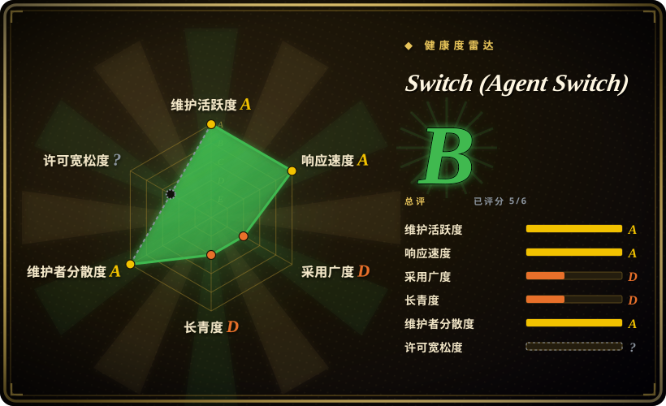
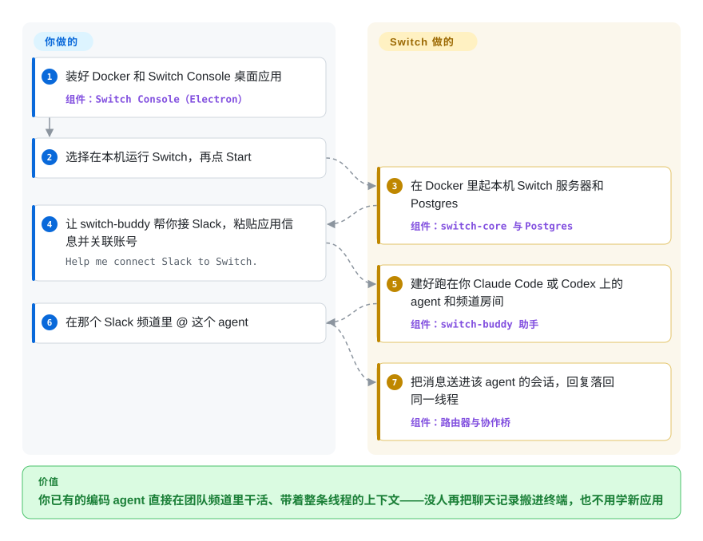
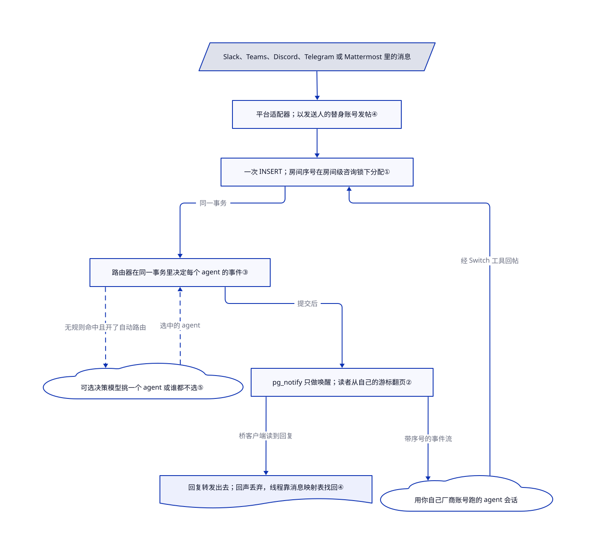

# Switch (Agent Switch)

你的 Claude Code 或 Codex agent 只能从启动它的那个人的终端里找到，同事在 Slack 里一要用，就得有人把整段讨论复制进提示词、再把回答贴回去。Switch 把每个聊天频道变成一个共享房间：团队已经在跑的 agent 作为成员加进来，读得到对话、直接在线程里回复，而模型调用仍记在各自主人自己的账号上。

## 何时使用

你带一个 10–50 人的工程团队，大家整天泡在 Slack 里（或 Teams、Discord、Telegram、Mattermost）。好几位工程师已经在笔记本上跑 Claude Code 或 Codex，套路总是一样：`#support` 里来了个 bug 报告，有人把它贴进自己的 agent，拿到诊断，再贴回频道——agent 看不到后续追问，提问的同事也没法直接跟它说话。你想要的是：在频道里打一句“@triage-agent 能复现一下吗？”，就真的进到一个 agent 会话里，带着整条线程当上下文，答案也贴在所有人都看得见的地方。

当决定性约束是“聊天应用不换、已有的 agent 也不换”时，你会选 Switch。它的 README 写得很直白：不是聊天应用，也不是 agent 提供方。和 [Buzz](buzz.zh.md) 或 [Macro](macro.zh.md) 比，那两个要求团队搬进一个让 agent 当成员的新工作区；Switch 则是桥接进大家已经在用的频道。和 [OpenClaw](../agent-frameworks/agent-runtimes/personal-assistants/messaging-daemons/openclaw.zh.md) 比，OpenClaw 给一个人做跨聊天应用的私人助手；Switch 是多用户的，每个 agent 有主人、有寻址策略（谁能让哪个 agent 回应），几个人的 agent 共用同一条房间日志。和 [Paperclip](../agent-tooling/supervision-surfaces/agent-cockpits/paperclip.zh.md) 比，当协作入口应该是团队聊天、而不是另一块工单看板时，选 Switch。

## 何时不用

- **如果你想把它当作服务卖给别人或替别人托管**——选 OSI 许可的替代品，比如 [Buzz](buzz.zh.md)（Apache-2.0）或加插件的 [Mattermost](mattermost.zh.md)。Switch 的 LICENSE 是 Apache-2.0，*外加一条 SandboxAQ 改过、明确覆盖衍生作品的 Commons Clause*：你不能出售价值主要来自 Switch 的产品或服务，条款里明确包括收费托管和咨询／支持。公司内部自托管没问题；做托管服务或转售不行。贡献代码还要先签 CLA。
- **如果你需要从一台笔记本装好就能 7×24 找到 agent**——用 Docker Compose 或 Helm chart 部署共享服务器，再配远程或托管机器；或者选 [Hermes Agent](../agent-frameworks/agent-runtimes/personal-assistants/messaging-daemons/hermes-agent.zh.md)，在 VPS 上跑一个常驻助手。Console 启动的本机 agent 只在 Switch Console 开着时才回应，Console 起的服务器重启电脑后不会自己起来，Microsoft Teams 也根本接不到你自己电脑上的服务器（Teams 需要一个它能从公网访问的服务器）。
- **如果你要的是一个横跨 WhatsApp、iMessage 和几十个渠道的私人助手**——用 [OpenClaw](../agent-frameworks/agent-runtimes/personal-assistants/messaging-daemons/openclaw.zh.md)。Switch 稳定支持的平台只有五个（Slack、Teams、Discord、Telegram、Mattermost）；WhatsApp、Google Chat、Zulip、Signal、Matrix、Rocket.Chat 和 Webex 的适配器在源码里，但藏在 `additional_messaging_platforms` 功能开关后面。
- **如果你现在就要一个能钉死、少折腾的生产依赖**——再等等，或者严格锁版本、每次升级都测。它才四个月、pre-1.0，每周发好几个服务器和 Console 版本（服务器 0.32.0 和 Console 0.41.0 都在 2026-11-17 发布）。Issue #2113（2026-11-18）报告 0.32.0 的迁移把用户自己的自托管 Mattermost 连接器当成内置的给退役了；而且服务器和 Console 必须按固定顺序升级（先服务器）。
- **如果你要求护栏和个人信息脱敏完全在开源栈里**——得另外准备护栏服务：仓库里只有 Switch Trust 的客户端，它对接一个按地址和密钥配置的外部只检查处理器，2 秒超时后*放行*（消息照样进房间，只是标记为未完整检查）。[推断：仓库内未找到该处理器的实现] 成本报表（“Switch ROI”）同样作为单独产品推广。
- **如果你只想在本机并行跑几个编码 agent 会话、用不到团队聊天**——用 Emdash（Switch Console 分叉自的 Apache-2.0 桌面应用），或者 [Agent Orchestrator](../agent-tooling/supervision-surfaces/agent-cockpits/agent-orchestrator.zh.md) 这类驾驶舱；Switch 的价值在共享房间和聊天桥，不用这些就等于白跑 Postgres、Docker 和一个服务器。
- **如果遥测必须默认关闭**——Switch Console 的使用统计默认*开启*（首次运行和设置里可关）；服务器自己的遥测默认关，除非设 `TELEMETRY_ENABLED=true`。批量装机时要逐人把开关关掉。

## 横向对比

| 替代品 | 是否收录 | 我们的评价 | 取舍 |
| --- | --- | --- | --- |
| [Buzz](buzz.zh.md) | ✅ | 团队愿意搬进一个新的自托管工作区、让 agent 在同一条签名日志里持有自己的密钥，选 Buzz；人必须留在 Slack 或 Teams、只让 agent 加进来时，选 Switch。 | Buzz 给的是 agent 原生的底座，Apache-2.0 条款，但要所有人换聊天应用；Switch 保住原有应用，代价是 Commons Clause 许可和一层依赖各平台 API 的桥。 |
| [Macro](macro.zh.md) | ✅ | 想把聊天、邮件、任务、文档和 CRM 重建成一张 agent 通过 MCP 读取的图，选 Macro；目标是让 agent 进到你已经付费的工具里、而不是替换它们，选 Switch。 | Macro 用一个约 40 个服务的 AGPL 后端替换五个产品；Switch 什么都不替换，只在旁边加一个服务器和 Postgres。 |
| [OpenClaw](../agent-frameworks/agent-runtimes/personal-assistants/messaging-daemons/openclaw.zh.md) | ✅ | 一个人的助手横跨许多聊天渠道，选 OpenClaw；几个人和几个人各自的 agent 要共用房间、按 agent 设寻址规则和主人时，选 Switch。 | OpenClaw 覆盖的渠道和配套应用多得多，但一个网关就是一个信任域；Switch 稳定平台只有五个，换来多用户身份、角色和管理员管控。 |
| [Paperclip](../agent-tooling/supervision-surfaces/agent-cockpits/paperclip.zh.md) | ✅ | 要用工单看板驱动 agent，带心跳、预算和单人认领，选 Paperclip；工作应该从团队频道里的一条消息开始、并一直在那里可见，选 Switch。 | Paperclip 在自己的网页看板里给出明确的任务归属和花费上限；Switch 给的是聊天原生的寻址和线程，任务状态留给 Jira／Linear 或对话本身。 |
| Emdash（`generalaction/emdash`） | 未收录 | 只想在自己机器上并排跑几个编码 agent，单用 Emdash 更轻；这些会话还要让队友通过聊天房间找到时，选 Switch。 | Emdash 是 Apache-2.0、不需要服务器；Switch Console 是它的分叉，加了房间、Postgres 支撑的服务器和聊天桥——本批次标签收录未加入。 |

## 快速上手

先装 Docker 和 Switch Console 桌面应用（启动并看管你 agent 会话的 Electron 程序），选 **On this computer** 再点 **Start**：Console 会在 Docker 里跑一个本机 Switch 服务器（switch-core API 加它的 Postgres 数据库），然后打开和 switch-buddy 的对话——这是一个内置助手 agent，跑在你已经装好并登录的 agent 提供方上（Claude Code、Codex、Antigravity、Cursor、OpenCode 任选）。你让 switch-buddy 帮你接聊天应用；以 Slack 为例，就是给 Switch 建一个 Slack 应用、把应用信息粘进 Console、再关联你自己的 Slack 账号，让 Switch 知道哪些消息是你发的。接着 switch-buddy 建好一个有具体职责的 agent 和一个绑定频道的房间，你再放开权限让队友能跟它说话。此后 Switch 负责把频道里点名这个 agent 的消息送进它的会话、把回复转回线程；你继续用自己的套餐付模型费用，保持 Console 开着（或把 agent 挪到远程／托管机器上），并负责服务器升级。要给团队用共享服务器，则改为部署 `ghcr.io/sandbox-quantum` 上的 Compose 文件或 Helm chart，首次启动前设好 `AGENT_REGISTRATION_TOKEN`、`SECRET_KEYS` 和第一个管理员账号，再让每个人的 Console 指向它的地址。

<!-- flow-steps:begin (generated from flows/switch.json by tools/flow_card.py — do not edit) -->

流程文字版

1. **你**：装好 Docker 和 Switch Console 桌面应用 — 组件：`Switch Console（Electron）`
2. **你**：选择在本机运行 Switch，再点 Start
3. **Switch (Agent Switch)**：在 Docker 里起本机 Switch 服务器和 Postgres — 组件：`switch-core 与 Postgres`
4. **你**：让 switch-buddy 帮你接 Slack，粘贴应用信息并关联账号 — `Help me connect Slack to Switch.`
5. **Switch (Agent Switch)**：建好跑在你 Claude Code 或 Codex 上的 agent 和频道房间 — 组件：`switch-buddy 助手`
6. **你**：在那个 Slack 频道里 @ 这个 agent
7. **Switch (Agent Switch)**：把消息送进该 agent 的会话，回复落回同一线程 — 组件：`路由器与协作桥`

**价值**：你已有的编码 agent 直接在团队频道里干活、带着整条线程的上下文——没人再把聊天记录搬进终端，也不用学新应用

<!-- flow-steps:end -->

## 技术要点

<!-- mechanism:begin (generated from mechanisms/switch.json by tools/mechanism_card.py; do not edit) -->

机制文字版

- Slack、Teams、Discord、Telegram 或 Mattermost 里的消息
- 平台适配器；以发送人的替身账号发帖④
- 一次 INSERT；房间序号在房间级咨询锁下分配①
- 路由器在同一事务里决定每个 agent 的事件③
- 可选决策模型挑一个 agent 或谁都不选⑤
- pg_notify 只做唤醒；读者从自己的游标翻页②
- 用你自己厂商账号跑的 agent 会话
- 回复转发出去；回声丢弃，线程靠消息映射表找回④

- Slack、Teams、Discord、Telegram 或 Mattermost 里的消息 → 平台适配器；以发送人的替身账号发帖④
- 平台适配器；以发送人的替身账号发帖④ → 一次 INSERT；房间序号在房间级咨询锁下分配①
- 一次 INSERT；房间序号在房间级咨询锁下分配① → 路由器在同一事务里决定每个 agent 的事件③（同一事务）
- 路由器在同一事务里决定每个 agent 的事件③ → 可选决策模型挑一个 agent 或谁都不选⑤（无规则命中且开了自动路由）〔可选／兜底〕
- 可选决策模型挑一个 agent 或谁都不选⑤ → 路由器在同一事务里决定每个 agent 的事件③（选中的 agent）〔可选／兜底〕
- 路由器在同一事务里决定每个 agent 的事件③ → pg_notify 只做唤醒；读者从自己的游标翻页②（提交后）
- pg_notify 只做唤醒；读者从自己的游标翻页② → 用你自己厂商账号跑的 agent 会话（带序号的事件流）
- 用你自己厂商账号跑的 agent 会话 → 一次 INSERT；房间序号在房间级咨询锁下分配①（经 Switch 工具回帖）
- pg_notify 只做唤醒；读者从自己的游标翻页② → 回复转发出去；回声丢弃，线程靠消息映射表找回④（桥客户端读到回复）

<!-- mechanism:end -->

### 1. 按提交顺序给房间消息编号，而不是按插入顺序

- **解决：** 用数据库序列时，两个并发发送者可能拿到 7 和 8；如果 8 先提交，按“n 之后的全部”翻页的读者会越过 8，再也看不到 7——一条已送达、已存储却被悄悄跳过的消息。
- **做法：** 每次发送就是向 `messages` 表做一次 `INSERT`，房间位置（`seq`）按“房间头 + 1”计算，同时持有一把以房间为键、直到提交才释放的 Postgres 咨询锁（`pg_advisory_xact_lock(hashtext(room_id))`）。同一房间的写入串行，于是位置顺序等于提交顺序、在线位置没有空洞；不同房间互不争用。
- **边界：** 单个繁忙房间的吞吐受限于一次一个的串行插入；哈希撞车的两个房间会白白互相等待。
- **源码：** [seq 分配与理由第 160–198 行](https://github.com/sandbox-quantum/switch/blob/6e0c0ab3fe338217523fba1f62ebd7df1f42cb0e/core/switch_core/db/stores/message_store.py#L160-L198)、[Postgres 总线的架构说明](https://github.com/sandbox-quantum/switch/blob/6e0c0ab3fe338217523fba1f62ebd7df1f42cb0e/CLAUDE.md)。

### 2. NOTIFY 只当叫醒铃，从不当投递

- **解决：** Postgres 的 `LISTEN/NOTIFY` 不持久、不可重放、断线即丢，把投递建在它上面就会丢消息。
- **做法：** 一个 `AFTER INSERT` 触发器只在频道上发 `{room_id, seq, id, type}`；每个进程一条长期监听连接，叫醒该房间的订阅者，订阅者再从自己的游标往后读，每次 200 行。处理器忙时，叫醒信号按房间合并成最高位置；重连时叫醒所有房间，所以丢一条通知最多只是推迟一次读取。
- **边界：** 在线状态（比如 agent 变忙）仍走进程内总线，多副本时只有同一副本上的客户端能收到；专用监听连接不在连接池里，需要单独保活。
- **源码：** [监听器设计第 1–30 行](https://github.com/sandbox-quantum/switch/blob/6e0c0ab3fe338217523fba1f62ebd7df1f42cb0e/core/switch_core/messages/notify.py#L1-L30)、[重连时全部唤醒第 268–270 行](https://github.com/sandbox-quantum/switch/blob/6e0c0ab3fe338217523fba1f62ebd7df1f42cb0e/core/switch_core/messages/notify.py#L268-L270)、[通知触发器第 60–93 行](https://github.com/sandbox-quantum/switch/blob/6e0c0ab3fe338217523fba1f62ebd7df1f42cb0e/core/switch_core/db/notify_ddl.py#L60-L93)。

### 3. 在写入者的事务里决定消息是给哪些 agent 的

- **解决：** 每个进程为每个 agent 起一个消费者、事后各自问“这条是给我的吗？”，进程在存储和判定之间停掉就会丢消息，数据库工作量还按 agent 数 × 进程数放大。
- **做法：** 每条房间记录都在写它的那个事务里经过同一个路由器：先在拿房间锁之前读出房间的 agent 成员、别名、角色租约和寻址策略（按名字、别名、角色，以及谁有权让这个 agent 回应），再插入记录，然后把每个被点名 agent 自己的事件存进 `agent_events`，按 agent 以提交顺序编号。记录和它的路由结果要么一起提交，要么都不提交；拒绝或离线提示在提交后再发。
- **边界：** 滚动发布期间，旧版本进程仍自己路由，可能把回复发两遍，直到旧进程下线；某个 agent 的失败只记日志，记录对其他 agent 照常提交。
- **源码：** [路由器设计与事务顺序第 1–55 行](https://github.com/sandbox-quantum/switch/blob/6e0c0ab3fe338217523fba1f62ebd7df1f42cb0e/core/switch_core/delivery/router.py#L1-L55)、[寻址规则](https://github.com/sandbox-quantum/switch/blob/6e0c0ab3fe338217523fba1f62ebd7df1f42cb0e/core/switch_core/delivery/addressing.py)。

### 4. 用替身账号、回声过滤和双向消息映射桥接聊天平台

- **解决：** 在聊天平台和内部房间之间转发，很容易形成回环（转进来的消息又被转出去），把 agent 复制成假用户，回复和编辑时丢线程。
- **做法：** 每个平台用户对应一个替身参与者，由它往房间里发帖；往外转时，跳过桥自身客户端和人类替身发的消息；往里转时，发送者名字是已注册 Switch agent 的消息当作回声丢掉。`bridge_message_map` 表在每个桥内双向唯一，把 Switch 事件 id 和外部帖子 id 互相映射，让回复、编辑、删除落到正确的线程上；Slack、Discord、Telegram、Mattermost 的适配器主动外连，Teams 则需要一个入站 HTTP 监听。
- **边界：** 入站回声过滤按发送者名字匹配，第三方机器人若与 Switch agent 同名会被误丢；桥能做什么受各平台能力和管理员审批限制（比如 Switch 无法自己创建 Telegram 群聊）。
- **源码：** [出站跳过规则第 3513–3530 行](https://github.com/sandbox-quantum/switch/blob/6e0c0ab3fe338217523fba1f62ebd7df1f42cb0e/core/switch_core/bridges/collaboration/collaboration_core.py#L3513-L3530)、[入站回声丢弃第 1478–1490 行](https://github.com/sandbox-quantum/switch/blob/6e0c0ab3fe338217523fba1f62ebd7df1f42cb0e/core/switch_core/bridges/collaboration/collaboration_core.py#L1478-L1490)、[消息映射表第 2705–2735 行](https://github.com/sandbox-quantum/switch/blob/6e0c0ab3fe338217523fba1f62ebd7df1f42cb0e/core/switch_core/db/models.py#L2705-L2735)、[一条消息的旅程](https://github.com/sandbox-quantum/switch/blob/6e0c0ab3fe338217523fba1f62ebd7df1f42cb0e/docs/official/internals/life-of-a-message.md)。

### 5. 只在小模型有把握时才让它挑回应者

- **解决：** 一个房间里有好几个 agent 时，一条谁都没点名的消息要么没人接，要么更糟——被一个不该回的 agent 抢答，这是大家最容易注意到的失败。
- **做法：** 打开 `decision_routing` 开关后（它依赖 `follow_the_conversation`），未点名的消息被发给一个无状态决策服务，由小模型把房间上下文当作一道选择题来答——每个候选 agent 加一个“none”。只有某个 agent 的置信度过阈值（作者评测里是 0.6），或设了 `DECISION_MIN_LEAD` 时领先第二名达到该差值，才会选中它；“none”排第一就谁都不选。
- **边界：** 默认藏在功能开关后面；默认的 Strands Decider 4B 需要 24 GB 显存的 GPU 和 32 GiB 内存，且基于 Gemma 4，其条款约束部署者；CPU 上的 Qwen 选项在作者自己的 100 个场景测试里错选更多。
- **源码：** [挑选规则第 274–300 行](https://github.com/sandbox-quantum/switch/blob/6e0c0ab3fe338217523fba1f62ebd7df1f42cb0e/decision/switch_decision/app.py#L274-L300)、[模型选择与评测](https://github.com/sandbox-quantum/switch/blob/6e0c0ab3fe338217523fba1f62ebd7df1f42cb0e/decision/README.md)、[功能开关依赖第 49–65 行](https://github.com/sandbox-quantum/switch/blob/6e0c0ab3fe338217523fba1f62ebd7df1f42cb0e/core/switch_core/feature_flags.py#L49-L65)。

## 技术栈

- **服务器（`core/`）**——Python，全程异步：FastAPI + uvicorn，基于 asyncpg 的 SQLAlchemy 2 异步，Alembic 迁移，Pydantic 配置，面向 agent 的 MCP 服务器用 `fastmcp`，再加各平台 SDK（`slack-sdk`、`mattermostdriver`、`discord-py`、`python-telegram-bot`）。
- **消息总线**——就是 PostgreSQL 本身：只追加的 `messages` 表，房间级咨询锁保证顺序，`LISTEN/NOTIFY` 触发器负责唤醒。没有 Matrix、Kafka 或 Redis（Switch 早期跑在 Matrix homeserver 上，相关列名作为线上标识保留了下来）。
- **Switch Console（`console/`）**——Electron + TypeScript 桌面应用（pnpm 工作区，本地 SQLite 状态用 Drizzle 迁移），分叉自 Emdash，每个提供方共用一套 SDK 会话宿主，另有给托管机器用的 agent 控制器。
- **Gateway（`gateway/`）**——React 19 + MUI + Vite 的运维面板。
- **决策服务（`decision/`）**——无状态 FastAPI 应用，问一个小模型（GPU 上的 Strands Decider 4B，或 llama.cpp CPU 上的 Qwen3.5-4B）未点名的消息该由哪个 agent 回答。
- **部署**——`deploy/` 下有 Docker Compose（独立版和本地版）、Helm chart 和 Terraform。

## 依赖

- **本机试用：** Docker（Desktop、Rancher Desktop 或 Homebrew 安装均可）、Switch Console，以及至少一个已安装并登录的受支持 agent CLI（Claude Code、Codex、Antigravity、Cursor 或 OpenCode）。模型用量记在该提供方账号上；Switch 从不持有模型凭据。
- **团队服务器：** Compose 用的一台 Linux 主机或 Helm 用的一个 Kubernetes 命名空间，PostgreSQL（内置或外部），做 TLS 终结的反向代理或 ingress，以及必需的密钥（`AGENT_REGISTRATION_TOKEN`、每个至少 32 字符的 `SECRET_KEYS`、管理员邮箱／密码）。可选：你的 OIDC 提供方做登录，WorkOS 做组织目录。
- **每个聊天平台：** 在该平台注册一个应用，通常要工作区管理员批准；Teams 还需要 Microsoft 365 管理员和一个公网可达的服务器。
- **可选：** 默认自动路由模型需要 24 GB 显存（L4 级）的 NVIDIA GPU 和 32 GiB 主机内存，或改用 CPU 的 llama.cpp 配置；护栏需要一个 Switch Trust 端点。

## 运维难度

**试用低，给团队长期运行中到高。** 本机路径就是装桌面应用加 Docker，聊天应用的配置有 switch-buddy 一步步带。共享部署则是正经服务：首次启动后服务器名永远不能改，启动前必须备好密钥，要设公网地址（`GATEWAY_PUBLIC_URL`）聊天里的链接才能用，ingress 要保住流式连接，升级顺序固定（先服务器、再各人的 Console）。发版节奏是每周好几个版本，升级说明里常有搬迁房间和连接器的迁移，所以要锁版本、每次升级前读 changelog。每接一个聊天平台，就多一次应用注册和管理员审批。

## 健康度与可持续性

- **维护（2026-11-18）：非常活跃。** 默认分支 2026-11-17 有推送；服务器 v0.32.0、agent 控制器 v0.32.0 和 Console v0.41.0 都在 2026-11-17 发布，中间还有 canary 构建；四个月里默认分支有 2,676 次提交。
- **治理与背书：** SandboxAQ（SB Technology, Inc.）名下的组织仓库，十位代码所有者全是公司账号，每个 PR 都有 CLA 机器人把关；提交最多的几位（560、512、343、326 次）是员工，路线图归一家厂商。[推断：依据是 CODEOWNERS 与贡献者账号名] 外部 issue 确实有人提（比如自托管用户提的 #2113），但目前外部代码贡献很少。
- **年龄／Lindy：** 2026-07-16 创建，四个月。Lindy 先验暂时给不了支撑；押的是厂商会持续投入。
- **采用度：** 四个月约 4.5k 星、354 个 fork，外加 Product Hunt“当日第一”发布——这是发布信号，不是生产使用的证据。没有包管理器足迹（以容器镜像和桌面安装包发布）。
- **风险信号：** 源码可见许可（Apache-2.0 + 改过且覆盖衍生作品的 Commons Clause），外加 CLA，厂商可以给未来版本换许可；托管版“Switch Cloud”标着即将推出，护栏和成本报表作为单独产品定位，呈 open-core 形态 [推断：依据是 README 与官方文档的产品表述]；Console 遥测默认开启。

## 存疑（未验证）

- [未验证：未部署运行] 消息路径、会话自动启动和 Slack 往返都是从提交 `6e0c0ab` 的源码和随仓库文档读出来的，没在实际部署里观察。
- [推断：仓库内未找到该处理器的实现] Switch Trust 的护栏处理器看起来是独立服务、不在本仓库；这里只有客户端和设置。
- [推断：依据是 README 与官方文档的产品表述] Switch Cloud、Switch Trust 和 Switch ROI 暗示 open-core 商业模式；哪些未来功能会留在源码可见的仓库里，官方没说。
- [未验证：作者报告的评测] 决策模型 92/100 对 Qwen 88/100 的路由准确率，是作者在自己 100 个场景上的测量，这里没有重跑。
- [推断：依据是 CODEOWNERS 与贡献者账号名] 贡献者和代码所有者账号看起来是 SandboxAQ 员工，未逐一确认雇佣关系。
- [未验证：未做法律审查] 在 Switch Console 所分叉的 Apache-2.0 Emdash 代码之上加 Commons Clause，是否能约束源自 Emdash 的那部分本身，是法律问题，这里没审；NOTICE 保留了 Emdash 的 Apache-2.0 署名。
- [未验证：未逐一测试] `additional_messaging_platforms` 后面的七个额外聊天平台和 `additional_agent_providers` 后面的十个额外 agent 提供方没有测过，可能不完整。
- [推断：依据是 health.py 原始值 `license_unparsed`] 健康度雷达的许可轴是 `?`，原因是该许可不是评分器能解析的 SPDX 标识，并不代表许可干净；Commons Clause 的限制请看“风险信号”那一条。
