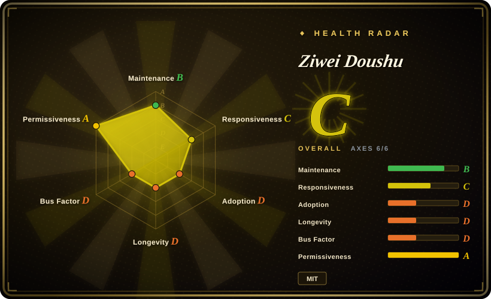
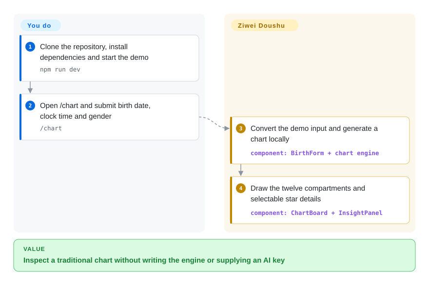
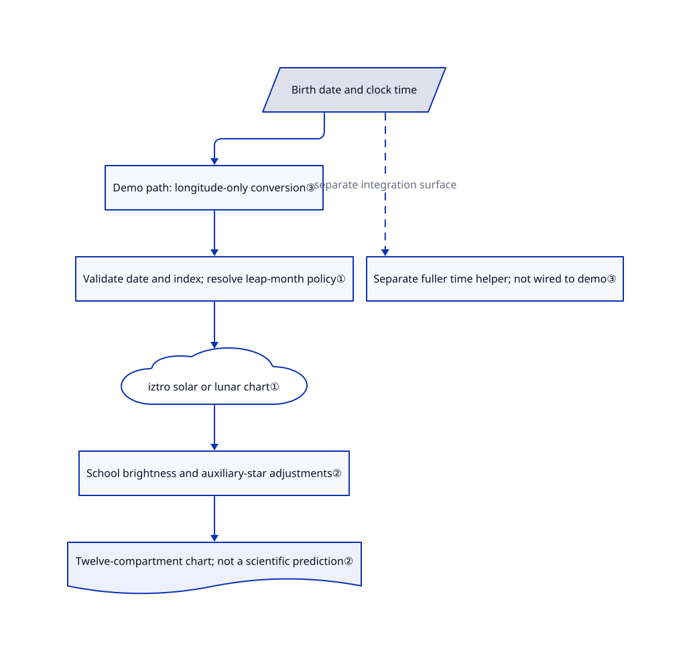

# Ziwei Doushu

Two traditional charting tools put the same birth date in different boxes. Ziwei Doushu adds explicit calendar conventions and star-table adjustments around iztro, with a browser demo to inspect the resulting chart.

## When to use

You are building a Chinese cultural-learning or entertainment application. A leap-month birth gives different charts across tools, and you need to inspect which convention caused the difference. You reuse this repository's TypeScript engine and tables rather than rebuilding its school-specific adjustments on bare iztro. Its demo draws the twelve chart compartments, while you own input normalization, validation and the product interface. These compartments and star labels are traditional rules, not measured properties of a person's future.

You can also use its released interpretation text as synthetic cultural-language material. Do not confuse many generated readings with many observed life outcomes: [the dataset license](https://github.com/Renhuai123/ziwei-doushu/blob/1059c347231c636bd86ddb78fd8ed430d5de8d2a/DATASET-LICENSE#L47-L56) describes rule-generated text and disclaims prediction, diagnosis and advice.

## When NOT to use

- **You need medical, financial or relationship decisions grounded in evidence.** Use qualified professional advice and relevant empirical data instead of any astrology package. Reproducing a traditional chart does not validate its predictions; the dataset expressly disclaims that use.
- **You only need calendar conversion.** Choose [lunar-javascript](https://github.com/6tail/lunar-javascript) directly; this repository adds chart conventions, UI and content that your date utility does not need.
- **You want a published, multilingual charting package without this snapshot's overlays.** Choose [iztro](https://github.com/SylarLong/iztro); this repository's private package and Chinese chart assembly are source-reuse material, not an npm distribution.
- **You need a reusable React chart component.** Choose [react-iztro](https://github.com/SylarLong/react-iztro) instead of adopting this entire Next.js demo. Its component includes dynamic period and flying-star displays; this engine's main assembly deliberately omits some flying-transformation fields.
- **You expect the commercial website after setting an API key.** Use the author's hosted [metisziwei.com](https://metisziwei.com/) if its terms suit you, or build your own backend. The open tree has no API routes and `STAR_DB` is empty; neither API-key configuration nor the released dataset restores the missing interpretation generator.
- **Boundary-time correctness is non-negotiable without integration work.** Start from iztro with your own normalized input and boundary tests. The demo form applies longitude correction but does not wire in the equation-of-time helper, the separate daylight-saving helper or a late-night date shift; [open PR #37](https://github.com/Renhuai123/ziwei-doushu/pull/37) identifies inconsistent date handling. Unknown runtime gender values also map to female, as [issue #38](https://github.com/Renhuai123/ziwei-doushu/issues/38) and current source show.
- **All shipped content must be commercially reusable under MIT.** Prefer code-only iztro/react-iztro and separately cleared content. This repository's MIT covers code, its data has attribution terms, and Ni Haixia quotations are excluded from the data grant and carry a noncommercial notice. The [notice](https://github.com/Renhuai123/ziwei-doushu/blob/1059c347231c636bd86ddb78fd8ed430d5de8d2a/docs/tianji-ziwei/LICENSE.md) reserves original rights to the lecturer's heirs.

## Comparison

| Alternative | In index | Our verdict | Tradeoff |
|---|---|---|---|
| [iztro](https://github.com/SylarLong/iztro) | not indexed | Pick iztro for a documented npm charting API with multilingual output; pick this snapshot when its explicit school tables and cultural-text assets justify owning the integration. | Avoid the Next.js demo and its application conventions, but build the extra table adjustments yourself; not added in this tab batch. |
| [react-iztro](https://github.com/SylarLong/react-iztro) | not indexed | Pick react-iztro when an existing React app needs a chart component with period navigation and flying-star display; pick this repository to modify its engine-plus-demo source together. | Component props are a narrower integration surface; this snapshot exposes more application source but leaves commercial features absent; not added in this tab batch. |
| [lunar-javascript](https://github.com/6tail/lunar-javascript) | not indexed | Pick lunar-javascript for solar/lunar dates and calendrical fields without a twelve-compartment chart; pick this repository only when chart assembly is the actual requirement. | Smaller task scope without a web application, but no substitute for the Ziwei chart engine or its display; not added in this tab batch. |

## Quick start

Clone the repository, run `npm install`, then `npm run dev`, as documented in the [quick start](https://github.com/Renhuai123/ziwei-doushu/blob/1059c347231c636bd86ddb78fd8ed430d5de8d2a/README.md#L258-L284). Open `/chart` and submit a birth date, clock time and the form's gender field; the page calls the local engine and draws the chart in the browser. Basic charting needs no API key, database or AI service. For embedding, reuse `lib/ziwei/` from a pinned revision: `hour` means a two-hour branch index from 0 to 11, not a clock hour. You must reconcile the demo's time-conversion gaps before relying on boundary inputs, and supply your own backend, prompts and privacy controls for AI features. This intake reviewed source only; it did not install or execute the upstream application.

<!-- flow-steps:begin (generated from flows/ziwei-doushu.json by tools/flow_card.py — do not edit) -->

Text version of the flow

1. **You**: Clone the repository, install dependencies and start the demo — `npm run dev`
2. **You**: Open /chart and submit birth date, clock time and gender — `/chart`
3. **Ziwei Doushu**: Convert the demo input and generate a chart locally — component: `BirthForm + chart engine`
4. **Ziwei Doushu**: Draw the twelve compartments and selectable star details — component: `ChartBoard + InsightPanel`

**Value**: Inspect a traditional chart without writing the engine or supplying an AI key

<!-- flow-steps:end -->

## Key techniques

<!-- mechanism:begin (generated from mechanisms/ziwei-doushu.json by tools/mechanism_card.py; do not edit) -->

Text version of the mechanism

- Birth date and clock time
- Demo path: longitude-only conversion③
- Separate fuller time helper; not wired to demo③
- Validate date and index; resolve leap-month policy①
- iztro solar or lunar chart①
- School brightness and auxiliary-star adjustments②
- Twelve-compartment chart; not a scientific prediction②

- Birth date and clock time → Demo path: longitude-only conversion③
- Birth date and clock time → Separate fuller time helper; not wired to demo③ (separate integration surface) [optional/fallback]
- Demo path: longitude-only conversion③ → Validate date and index; resolve leap-month policy①
- Validate date and index; resolve leap-month policy① → iztro solar or lunar chart①
- iztro solar or lunar chart① → School brightness and auxiliary-star adjustments②
- School brightness and auxiliary-star adjustments② → Twelve-compartment chart; not a scientific prediction②

<!-- mechanism:end -->

### 1. Resolve calendar policy before delegating chart generation

- **Problem:** The same leap-month date can select different month conventions and therefore different traditional charts.
- **How:** `resolveEffectiveLunarDate` supports split, previous, next and original-month policies. `generateChart` validates real solar dates and branch indexes, then chooses iztro's solar or lunar entry path and records the effective policy in the returned birth information.
- **Limits:** The default is split, not universally the lecturer's preferred convention. Calendar validity does not establish predictive validity, and the wrapper does not reject invalid runtime gender values.
- **Source:** [Policy resolution](https://github.com/Renhuai123/ziwei-doushu/blob/1059c347231c636bd86ddb78fd8ed430d5de8d2a/lib/ziwei/algorithm.ts#L137-L194), [validation and dispatch](https://github.com/Renhuai123/ziwei-doushu/blob/1059c347231c636bd86ddb78fd8ed430d5de8d2a/lib/ziwei/algorithm.ts#L444-L492), [default](https://github.com/Renhuai123/ziwei-doushu/blob/1059c347231c636bd86ddb78fd8ed430d5de8d2a/lib/ziwei/school-config.ts#L71-L90).

### 2. Apply school tables while assembling a separate chart representation

- **Problem:** Raw iztro star positions and brightness labels do not necessarily match the chosen traditional school.
- **How:** The wrapper merges iztro star groups into twelve compartments, looks up brightness through one selected school table, adjusts selected auxiliary stars, and records opposite-compartment borrowing for empty main-star compartments. The default brightness school became QS on 2026-10-20.
- **Limits:** School selection is module-level mutable state, so isolate or control it when embedding for multiple users. The v4 dataset used the older XD2 default and is not a byte-for-byte oracle for current output; the main chart assembly also leaves flying-school transformation fields out.
- **Source:** [School state](https://github.com/Renhuai123/ziwei-doushu/blob/1059c347231c636bd86ddb78fd8ed430d5de8d2a/lib/ziwei/algorithm.ts#L91-L119), [assembly and adjustments](https://github.com/Renhuai123/ziwei-doushu/blob/1059c347231c636bd86ddb78fd8ed430d5de8d2a/lib/ziwei/algorithm.ts#L494-L639), [dataset mismatch notice](https://github.com/Renhuai123/ziwei-doushu/blob/1059c347231c636bd86ddb78fd8ed430d5de8d2a/README.md#L69).

### 3. Separate time correction from the chart engine

- **Problem:** Longitude and a late-night date rollover can move the input across a traditional two-hour boundary.
- **How:** `true-solar-time.ts` implements a NOAA-style equation-of-time approximation plus four minutes per longitude degree from 120°E, preserves day offsets and resolves the selected late-night rule. It returns correction components rather than silently rewriting the original birth record.
- **Limits:** The fuller helper assumes an East-8 clock baseline; it is not an international timezone database. The demo form and share helper instead use simpler longitude-only code, and `generateChart` consumes an already resolved branch index, so copying the engine alone does not wire these corrections together.
- **Source:** [Fuller correction helper](https://github.com/Renhuai123/ziwei-doushu/blob/1059c347231c636bd86ddb78fd8ed430d5de8d2a/lib/ziwei/true-solar-time.ts#L73-L149), [demo conversion](https://github.com/Renhuai123/ziwei-doushu/blob/1059c347231c636bd86ddb78fd8ed430d5de8d2a/components/BirthForm.tsx#L34-L40), [unchanged submitted date](https://github.com/Renhuai123/ziwei-doushu/blob/1059c347231c636bd86ddb78fd8ed430d5de8d2a/components/BirthForm.tsx#L142-L149), [share conversion](https://github.com/Renhuai123/ziwei-doushu/blob/1059c347231c636bd86ddb78fd8ed430d5de8d2a/lib/ziwei/share.ts#L20-L47).

## Tech stack

- TypeScript engine around iztro `^2.5.8` and lunar-javascript `^1.7.3`; school tables and pattern rules are local source files.
- Next.js `^16.3.8`, React `^19.2.5`, Tailwind CSS 3 and Framer Motion 11 in the demo manifest.
- Nine `tsx` regression scripts are chained by `npm test`; the integrity test constructs 768 charts and checks structural invariants, not real-world prediction accuracy.

## Dependencies

- Node.js/npm for the demo build; upstream CI uses Node 22 and `npm ci`. A browser runs the charting path.
- No running PostgreSQL, Redis or LLM is needed for basic charting, despite `pg`, `ioredis` and an AI SDK appearing in the manifest. The corresponding production backend is absent.
- Optional released data uses zstd-compressed JSON Lines; upstream documents `zstd -d --long=27 year-1990.jsonl.zst`. Its reported full uncompressed size is 56.6 GB; budget storage before extracting.
- The demo [root layout](https://github.com/Renhuai123/ziwei-doushu/blob/1059c347231c636bd86ddb78fd8ed430d5de8d2a/app/layout.tsx#L39-L50) mounts Vercel Analytics and Speed Insights. Review these integrations before making an offline-only or no-telemetry promise.

## Ops difficulty

**Low for inspecting the demo; medium for a dependable product.** The basic path has no service credentials, but input conventions and boundary cases need integration tests. You own deployment, upgrades, sensitive birth-data handling and any authentication or paid AI features. Sharing helpers put birth information in URL parameters, so do not publish another person's data without consent. The repository is not a complete self-hosted replacement for the commercial site.

## Health & viability

- **Maintenance, 2026-10-21:** created 2026-05-01, not archived, pushed 2026-10-20; the visible releases are dataset v4.0-13d on October 15 and engine-2026.10.03 on October 3. [The maintainer](https://github.com/Renhuai123/ziwei-doushu/blob/1059c347231c636bd86ddb78fd8ed430d5de8d2a/README.md#L378-L384) explicitly promises periodic engine snapshots, not full-time open-product maintenance.
- **Governance and adoption:** user-owned; the contributor API lists Renhuai123 with 48 contributions and each other listed account with one. The 5,397 stars and 1,059 forks show repository attention, not evidence of production deployment or forecasting validity.
- **Durability verdict:** [推断：based on a roughly six-month repository history and maintainer-led snapshot policy] useful as a pinned engine reference, but too young to claim a strong age-and-continued-maintenance prior. Plan to own fixes rather than assume a response SLA.
- **Risk:** open issue #38 and open PR #37 expose runtime input and demo time-boundary gaps. MIT code and CC BY data are separate from third-party noncommercial quotations; do not read the automated license grade as legal clearance for every asset.

## Caveats (unverified)

- [未验证：upstream execution was prohibited for this intake] Install, build, browser behavior and regression results were not reproduced; commands and implementation claims come from the pinned source.
- [未验证：release archives were not downloaded or decompressed] Dataset counts, 56.6 GB expanded size and correspondence with the unpublished interpretation generator are upstream reports, not independently audited measurements. The README explicitly warns that the current default differs.
- [未验证：the quotation notice supplies no rights-holder permission] Its CC BY-NC-SA notice does not itself establish authority to license the original lecture words; clear those rights before bulk redistribution or commercial use.
- [推断：short history and the documented snapshot policy] Long-term maintenance durability remains unproven; popularity does not remove the need to own integration fixes.
