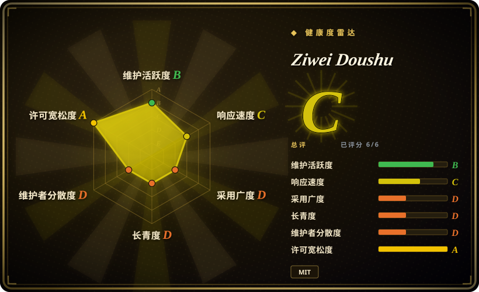
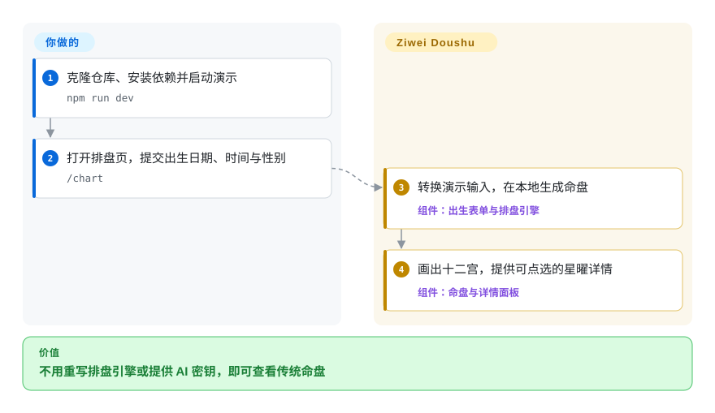
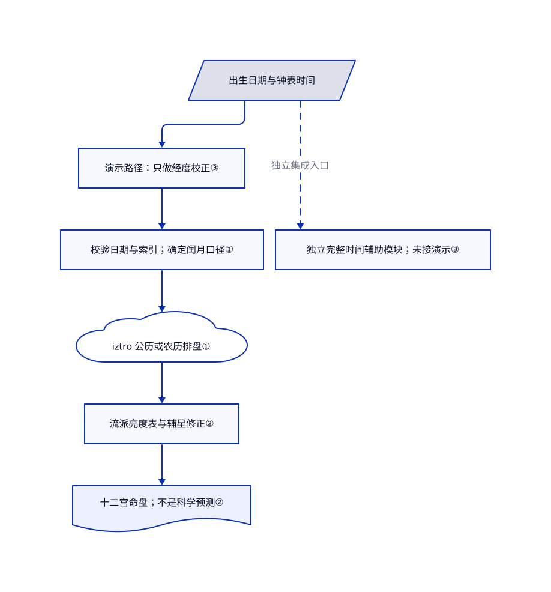

# Ziwei Doushu

同一个出生日期，两个排盘工具却把星放进不同格子。这个项目在 iztro 之上明确历法口径、调整星曜表，并提供浏览器演示，方便查清差异来自哪条规则。

## 何时使用

你在做传统文化学习或娱乐应用。一个闰月生日在不同软件里排出不同结果，你需要查明是哪种月份口径导致差异。你复用这里的 TypeScript 引擎和表格，不必在裸 iztro 上重写流派修正。演示界面负责画出十二宫，也就是命盘中的十二个格子；输入归一化、校验和产品界面仍由你负责。这些星曜与宫位属于传统规则，不是对个人未来的科学测量。

你也可以把发布的解读文本用于合成文化语料。大量生成文本不等于大量真实人生观测：[数据许可](https://github.com/Renhuai123/ziwei-doushu/blob/1059c347231c636bd86ddb78fd8ed430d5de8d2a/DATASET-LICENSE#L47-L56)明确说明，内容由规则批量生成，不构成预测、诊断或建议。

## 何时不用

- **你要据此做医疗、投资或关系决定。** 应改用合格专业人员的意见与相关实证数据，而不是任何占卜软件。复现传统排盘规则，不等于证明预测有效；数据许可也明确排除了这类用途。
- **你只需要公历、农历转换。** 直接选 [lunar-javascript](https://github.com/6tail/lunar-javascript)。本项目额外带入排盘口径、界面与内容，不适合只做日期工具。
- **你要公开发布、多语言的排盘包，不想接管应用修正层。** 选 [iztro](https://github.com/SylarLong/iztro)。这里是私有包形态的源码快照，中文命盘装配层不是可直接依赖的 npm 发行包。
- **你只想给已有 React 应用加命盘组件。** 选 [react-iztro](https://github.com/SylarLong/react-iztro)，不用搬整套 Next.js 演示。它提供运限切换与飞星展示；本项目的主排盘装配已主动省去部分飞化字段。
- **你以为填好 API 密钥就能复刻商业站。** 若条款合适，可直接用作者的 [metisziwei.com](https://metisziwei.com/)，否则自行实现后端。开源树没有 API 路由，`STAR_DB` 为空；配置密钥或下载数据集，都不会恢复缺失的解读生成器。
- **边界时刻必须直接算对，且你不准备补集成。** 从 iztro 配合自己的输入归一化和边界测试起步。演示表单只做经度校正，未接均时差辅助函数、独立的夏令时模块或晚子时换日；[待合并修改 #37](https://github.com/Renhuai123/ziwei-doushu/pull/37)记录了日期处理不一致。运行时非法性别值也会按女性处理，[议题 #38](https://github.com/Renhuai123/ziwei-doushu/issues/38)与当前源码一致。
- **你要求所有随包内容都能按 MIT 商用。** 优先选只含代码的 iztro／react-iztro，再单独取得内容授权。本仓库代码是 MIT，数据需要署名，倪海厦引文不在数据授权范围内，另有非商业声明。[引文声明](https://github.com/Renhuai123/ziwei-doushu/blob/1059c347231c636bd86ddb78fd8ed430d5de8d2a/docs/tianji-ziwei/LICENSE.md)保留了讲者继承人的原始权利。

## 横向对比

| 替代品 | 是否收录 | 我们的评价 | 取舍 |
|---|---|---|---|
| [iztro](https://github.com/SylarLong/iztro) | 未收录 | 要有文档的 npm 排盘接口和多语言输出，选 iztro；只有明确需要这里的流派表与文化文本资产，才值得接管本快照。 | 不带 Next.js 演示与应用口径，但额外表格修正由你补；not added in this tab batch。 |
| [react-iztro](https://github.com/SylarLong/react-iztro) | 未收录 | 已有 React 应用只缺带运限切换、飞星展示的命盘组件，选 react-iztro；需要一起改引擎与演示源码，才选本项目。 | 组件参数的接入面更窄；本快照暴露更多应用源码，却没有商业站的完整功能；not added in this tab batch。 |
| [lunar-javascript](https://github.com/6tail/lunar-javascript) | 未收录 | 只查公历、农历与历法字段，选 lunar-javascript；真正要组装十二宫命盘时，才选本项目。 | 不必引入网页应用，但它不能替代紫微排盘引擎与命盘展示；not added in this tab batch。 |

## 快速上手

按[快速开始](https://github.com/Renhuai123/ziwei-doushu/blob/1059c347231c636bd86ddb78fd8ed430d5de8d2a/README.md#L258-L284)克隆仓库，运行 `npm install`，再运行 `npm run dev`。打开 `/chart`，填写出生日期、钟表时间和表单性别字段，页面就会调用本地引擎，在浏览器里画盘。基础排盘不需要 API 密钥、数据库或 AI 服务。要嵌入自己的应用，应固定源码版本并复用 `lib/ziwei/`；其中 `hour` 是零至十一的双小时时辰索引，不是钟表小时。你需要先补齐演示的时间转换缺口，再处理边界输入；AI 功能还要自行实现后端、提示词和隐私控制。本次只读源码，没有安装或执行上游应用。

<!-- flow-steps:begin (generated from flows/ziwei-doushu.json by tools/flow_card.py — do not edit) -->

流程文字版

1. **你**：克隆仓库、安装依赖并启动演示 — `npm run dev`
2. **你**：打开排盘页，提交出生日期、时间与性别 — `/chart`
3. **Ziwei Doushu**：转换演示输入，在本地生成命盘 — 组件：`出生表单与排盘引擎`
4. **Ziwei Doushu**：画出十二宫，提供可点选的星曜详情 — 组件：`命盘与详情面板`

**价值**：不用重写排盘引擎或提供 AI 密钥，即可查看传统命盘

<!-- flow-steps:end -->

## 技术要点

<!-- mechanism:begin (generated from mechanisms/ziwei-doushu.json by tools/mechanism_card.py; do not edit) -->

机制文字版

- 出生日期与钟表时间
- 演示路径：只做经度校正③
- 独立完整时间辅助模块；未接演示③
- 校验日期与索引；确定闰月口径①
- iztro 公历或农历排盘①
- 流派亮度表与辅星修正②
- 十二宫命盘；不是科学预测②

- 出生日期与钟表时间 → 演示路径：只做经度校正③
- 出生日期与钟表时间 → 独立完整时间辅助模块；未接演示③（独立集成入口）〔可选／兜底〕
- 演示路径：只做经度校正③ → 校验日期与索引；确定闰月口径①
- 校验日期与索引；确定闰月口径① → iztro 公历或农历排盘①
- iztro 公历或农历排盘① → 流派亮度表与辅星修正②
- 流派亮度表与辅星修正② → 十二宫命盘；不是科学预测②

<!-- mechanism:end -->

### 1. 先确定历法口径，再委托底层排盘

- **解决：** 同一个闰月日期采用不同月份归属，会排出不同的传统命盘。
- **做法：** `resolveEffectiveLunarDate` 支持分半、归前月、归后月和保留闰月。`generateChart` 校验公历日期与时辰索引，再选择 iztro 的公历或农历入口，并把有效口径写回结果中的出生信息。
- **边界：** 默认是分半，不等于始终采用讲者偏好的口径。日期有效不代表预测有效；包装层也没有拒绝运行时非法性别值。
- **源码：** [口径解析](https://github.com/Renhuai123/ziwei-doushu/blob/1059c347231c636bd86ddb78fd8ed430d5de8d2a/lib/ziwei/algorithm.ts#L137-L194)、[校验与分派](https://github.com/Renhuai123/ziwei-doushu/blob/1059c347231c636bd86ddb78fd8ed430d5de8d2a/lib/ziwei/algorithm.ts#L444-L492)、[默认值](https://github.com/Renhuai123/ziwei-doushu/blob/1059c347231c636bd86ddb78fd8ed430d5de8d2a/lib/ziwei/school-config.ts#L71-L90)。

### 2. 装配命盘时应用流派表

- **解决：** iztro 原始星曜位置和亮度标签，不一定符合所选传统流派。
- **做法：** 包装层把底层星曜组合成十二宫，统一查所选流派的亮度表，再调整部分辅星。主星空缺的宫位还会记录借用对宫主星的信息。默认亮度在 2026-10-20 改为 QS，也就是《斗数全书》表。
- **边界：** 流派选择保存在模块级可变状态里，多用户嵌入时需隔离或控制。v4 数据集使用旧的 XD2 默认表，不能直接当作当前输出的逐字基准；主排盘装配也未输出飞星派的部分四化字段。
- **源码：** [流派状态](https://github.com/Renhuai123/ziwei-doushu/blob/1059c347231c636bd86ddb78fd8ed430d5de8d2a/lib/ziwei/algorithm.ts#L91-L119)、[装配与修正](https://github.com/Renhuai123/ziwei-doushu/blob/1059c347231c636bd86ddb78fd8ed430d5de8d2a/lib/ziwei/algorithm.ts#L494-L639)、[数据集口径差异](https://github.com/Renhuai123/ziwei-doushu/blob/1059c347231c636bd86ddb78fd8ed430d5de8d2a/README.md#L69)。

### 3. 把时间校正与排盘内核分开

- **解决：** 经度偏差与深夜换日，可能让输入跨过传统双小时时辰边界。
- **做法：** `true-solar-time.ts` 用 NOAA 形式的均时差近似，加上相对东经一百二十度、每度四分钟的经度修正。它保留跨日偏移，按晚子时规则解析日期，并返回各项修正量，不悄悄改写原始出生记录。
- **边界：** 完整辅助模块以东八区钟表时间为基准，不是国际时区数据库。演示表单和分享辅助函数仍使用更简单的经度校正；`generateChart` 接收已换算的时辰索引，复制内核不会自动接通完整校正链。
- **源码：** [完整辅助函数](https://github.com/Renhuai123/ziwei-doushu/blob/1059c347231c636bd86ddb78fd8ed430d5de8d2a/lib/ziwei/true-solar-time.ts#L73-L149)、[演示换算](https://github.com/Renhuai123/ziwei-doushu/blob/1059c347231c636bd86ddb78fd8ed430d5de8d2a/components/BirthForm.tsx#L34-L40)、[日期原样提交](https://github.com/Renhuai123/ziwei-doushu/blob/1059c347231c636bd86ddb78fd8ed430d5de8d2a/components/BirthForm.tsx#L142-L149)、[分享换算](https://github.com/Renhuai123/ziwei-doushu/blob/1059c347231c636bd86ddb78fd8ed430d5de8d2a/lib/ziwei/share.ts#L20-L47)。

## 技术栈

- TypeScript 排盘内核依赖 iztro `^2.5.8` 和 lunar-javascript `^1.7.3`。流派表与格局规则存在本地源码中。
- 演示清单使用 Next.js `^16.3.8`、React `^19.2.5`、Tailwind CSS 3 和 Framer Motion 11。
- `npm test` 串联九个 `tsx` 回归脚本。完整性测试构造七百六十八张盘，检查结构不变量，不检验现实预测准确率。

## 依赖

- 演示构建需要 Node.js 与 npm。上游 CI 使用 Node 22 和 `npm ci`，浏览器执行排盘路径。
- 基础排盘不需要运行 PostgreSQL、Redis 或大模型。虽然清单有 `pg`、`ioredis` 和 AI SDK，但对应生产后端未开源。
- 可选发布数据是 zstd 压缩的逐行 JSON。文档解压命令为 `zstd -d --long=27 year-1990.jsonl.zst`。上游报告全量解压后为 56.6 GB，解压前先预留空间。
- 演示的[根布局](https://github.com/Renhuai123/ziwei-doushu/blob/1059c347231c636bd86ddb78fd8ed430d5de8d2a/app/layout.tsx#L39-L50)挂载 Vercel Analytics 与 Speed Insights。承诺完全离线或无遥测前，应先检查这些集成。

## 运维难度

**查看演示低，做可靠产品中等。** 基础路径不需要服务密钥，但输入口径和边界情况需要集成测试。部署、升级、敏感生辰信息处理，以及身份认证和付费 AI 功能都由你承担。分享辅助函数会把出生信息放进网址参数，未经同意不要公开他人信息。这个仓库不是商业站的完整自托管替代品。

## 健康度与可持续性

- **维护，截至 2026-10-21：** 仓库于 2026-05-01 创建，未归档，最近推送在 2026-10-20。可见发布包括十月十五日的 v4.0-13d 数据集，以及十月三日的 engine-2026.10.03。[维护者说明](https://github.com/Renhuai123/ziwei-doushu/blob/1059c347231c636bd86ddb78fd8ed430d5de8d2a/README.md#L378-L384)明确表示，只定期同步引擎，不承诺全职维护完整开源产品。
- **治理与采用：** 仓库归个人账号所有。贡献者接口中，Renhuai123 有四十八次贡献，其他所列账号各一次。星标 5,397、分叉 1,059，只能说明仓库关注度，不能证明生产部署或占卜有效。
- **持续性判断：** [推断：依据约六个月的仓库历史与维护者主导的快照政策] 可固定版本作为引擎参考，但尚无强的长期存续信号。应准备接管修复，而不是依赖响应时限。
- **风险：** 未关闭议题 #38 与未合并修改 #37 暴露了运行时输入、演示时间边界缺口。MIT 代码、CC BY 数据与第三方非商业引文分开授权；自动许可评分不等于所有资产都已完成权利清理。

## 存疑（未验证）

- [未验证：本次任务禁止执行上游] 没有复现安装、构建、浏览器行为和回归结果；命令与机制说明来自固定版本源码。
- [未验证：未下载或解压发布归档] 数据规模、解压后 56.6 GB，以及与闭源解读生成器的对应关系，均为上游报告，没有独立审计。README 已明确提示当前默认口径不同。
- [未验证：引文声明未附原权利人许可] CC BY-NC-SA 声明本身，不能证明整理者有权授权原课程文字；批量再分发或商用前仍需清理权利。
- [推断：依据短历史与文档中的快照维护政策] 长期维护能力尚未证明，关注度不能替代自行接管集成修复。
