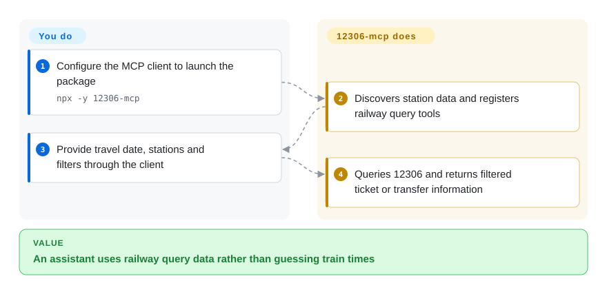
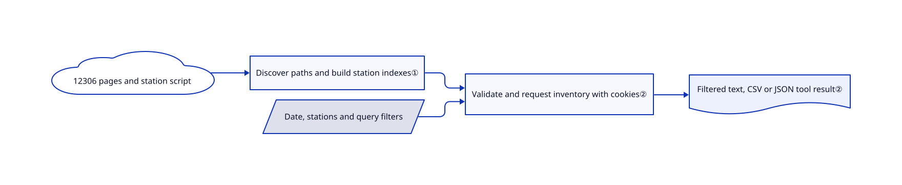

# 12306-mcp

An assistant invents train times when it cannot check railway inventory. This server exposes Chinese station, direct-ticket, transfer and calling-point queries as model tools backed by 12306.

## When to use

You are building a Chinese travel assistant and a user asks for high-speed trains tomorrow morning, including transfers. Browser automation makes you copy station codes and navigate tables on every turn. Choose this server when your client speaks MCP and you want typed rail queries with filtering and text/CSV/JSON results. It searches; it does not buy or reserve tickets.

## When NOT to use

- Need exact-station or overnight transfer results without manual checking? Use the official 12306 interface. Open [issue #72](https://github.com/Joooook/12306-mcp/issues/72) reports same-city station leakage and boarding-date errors on this exact reviewed commit; the code derives dates from `start_train_date` and applies generic filters without rechecking endpoint identity before the limit. Treat affected answers as leads, not a travel plan.
- Need payment, reservation or final availability confirmation? Use the official 12306 app/site; no registered tool implements an order workflow.
- Prefer Python scripts to an MCP process? Use the same author's 12306-skill, which exposes equivalent query operations through a CLI.
- Need website actions beyond rail queries? Use [Playwright MCP](../web-automation/playwright-family/playwright-mcp.md), with explicit authorization for account actions.
- Need a contracted stable API? Use an authorized data provider or the official user-facing service. This server extracts station assets and endpoint paths from HTML; page changes can prevent startup.

## Comparison

| Alternative | In index | Our verdict | Tradeoff |
|---|---|---|---|
| Official 12306 app/site | not a repo | Choose the official service for booking and final confirmation; choose this server to integrate read-only rail search into an assistant. | Transaction authority versus programmable query tools; the consumer app/site is not a source repository. |
| [12306-skill](https://github.com/Joooook/12306-skill) | not indexed | Choose the skill for Python/CLI-first agents; choose this server for clients already consuming MCP tools. | Python requests and local cache versus Node/MCP transport. Not added in this tab batch. |
| [Playwright MCP](../web-automation/playwright-family/playwright-mcp.md) | ✅ | Choose Playwright for page workflows beyond the query API; choose this server for direct structured ticket searches. | Browser flexibility costs context and UI handling; narrow rail tools instead depend on upstream page/API shapes. |

## Quick start

On Node 18+, configure your MCP client to launch `npx -y 12306-mcp`. Ask the client to resolve the Shanghai-time date and station names, then call `get-tickets` or the transfer tool with filters. The server retrieves and formats inventory; your client supplies the model and presents the result. Set a result limit and verify availability in 12306 before purchase. HTTP/SSE mode uses `--port`; prefer local stdio unless you add network access controls.

<!-- flow-steps:begin (generated from flows/12306-mcp.json by tools/flow_card.py — do not edit) -->

Text version of the flow

1. **You**: Configure the MCP client to launch the package — `npx -y 12306-mcp`
2. **12306-mcp**: Discovers station data and registers railway query tools
3. **You**: Provide travel date, stations and filters through the client
4. **12306-mcp**: Queries 12306 and returns filtered ticket or transfer information

**Value**: An assistant uses railway query data rather than guessing train times

<!-- flow-steps:end -->

## Key techniques

<!-- mechanism:begin (generated from mechanisms/12306-mcp.json by tools/mechanism_card.py; do not edit) -->

Text version of the mechanism

- 12306 pages and station script
- Discover paths and build station indexes①
- Date, stations and query filters
- Validate and request inventory with cookies②
- Filtered text, CSV or JSON tool result②

- 12306 pages and station script → Discover paths and build station indexes①
- Discover paths and build station indexes① → Validate and request inventory with cookies②
- Date, stations and query filters → Validate and request inventory with cookies②
- Validate and request inventory with cookies② → Filtered text, CSV or JSON tool result②

<!-- mechanism:end -->

### 1. Discover station assets and query paths at startup

- **Problem:** A model should not guess telecodes or changing 12306 endpoint paths.
- **How:** Startup reads official pages, extracts the station JavaScript and query paths, then builds indexes by telecode, city and station name. Separate tools expose these mappings.
- **Limits:** Extraction requires specific page patterns and network access before tools become ready; station ambiguity still requires user clarification.
- **Source:** [Indexes](https://github.com/Joooook/12306-mcp/blob/ff6439da6f63d7d72181abea4568abd69878c600/src/index.ts#L28-L106), [page extraction](https://github.com/Joooook/12306-mcp/blob/ff6439da6f63d7d72181abea4568abd69878c600/src/index.ts#L1540-L1593).

### 2. Reduce inventory before returning tool text

- **Problem:** Raw ticket tables are large, and callers can request past dates or nonexistent stations.
- **How:** The ticket tool validates date/stations, obtains query cookies, fetches inventory and applies train/time/sort/count filters before formatting text, CSV or JSON.
- **Limits:** Availability is a query snapshot, not a reserved seat. Station/date normalization has an open correctness report (#72); request validation does not ensure returned rows match exact endpoints or overnight boarding dates. Cookies and upstream requests can fail.
- **Source:** [Ticket tool](https://github.com/Joooook/12306-mcp/blob/ff6439da6f63d7d72181abea4568abd69878c600/src/index.ts#L973-L1156), [date source](https://github.com/Joooook/12306-mcp/blob/ff6439da6f63d7d72181abea4568abd69878c600/src/index.ts#L365-L408), [generic filters](https://github.com/Joooook/12306-mcp/blob/ff6439da6f63d7d72181abea4568abd69878c600/src/index.ts#L498-L548).

## Tech stack

TypeScript compiled to JavaScript, MCP SDK, Axios, Zod, date-fns/time-zone helpers and `mcp-http-server`. The package's test command launches the server rather than an assertion-based test suite.

## Dependencies

Node 18+, access to 12306 web/query hosts, and an MCP client with its own model provider. Inspector debugging requires Node 22.19+. No database or account credentials are configured by the documented query setup.

## Ops difficulty

**Low locally, medium for reliability.** Stdio avoids public-service operations. Upstream page/API drift, cookie/network errors and result-size control remain your burden. HTTP access control needs separate review; the README calls this educational software.

## Health & viability

- On 2026-10-18, latest release v0.3.10 dated to 2026-07-30; push metadata was 2026-07-31. The April 2025 repository is not archived but has slowed recently.
- `Joooook` dominates the contributor snapshot, with small external contributions. Actual MIT text is copyright 2025 Jok.
- [推断] Eighteen months of history does not stabilize an unofficial rail integration. Keep it replaceable rather than treating it as a ticketing system of record.

## Caveats (unverified)

- [未验证] No live 12306 requests or bookings were performed; current reachability and inventory correctness were not tested.
- [未验证] The live examples in issue #72 were not independently rerun; this review confirmed the reported date source and missing endpoint post-filter in the pinned code, not the current train inventory.
- [推断] Future reliability depends on undocumented upstream page/API shapes and concentrated maintenance.
