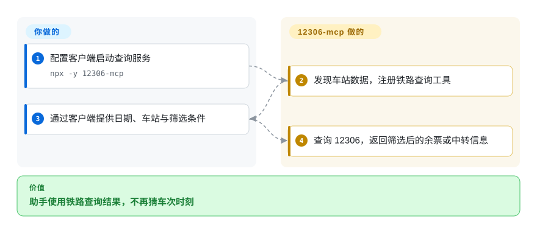

# 12306-mcp

助手查不到铁路余票，就容易编造车次和时刻。这个服务把站名、直达余票、中转方案与经停站查询封装成模型工具，实际访问 12306 数据。

## 何时使用

你在做中文出行助手，用户要查明早高铁，也想比较中转。浏览器自动化每轮都要翻表格、抄站码。若客户端支持 MCP，选这个服务可直接查票、筛选，并返回文字、CSV 或 JSON。它只查询，不下单、不占座。

## 何时不用

- 精确站点或跨午夜中转结果不能人工复核时，使用官方 12306 界面。公开[议题 #72](https://github.com/Joooook/12306-mcp/issues/72) 针对本次审阅提交，报告同城站混入与上车日错误；源码从 `start_train_date` 推导日期，并在截断前只做通用筛选，没有重新检查结果起终点。受影响回答只能当线索，不能直接作行程。
- 要支付、预订或最终余票确认时，使用官方 12306 应用或网站。注册工具没有订单流程。
- 偏向 Python 脚本而非 MCP 进程时，选同作者的 12306-skill；它通过命令行提供同类查询。
- 要执行铁路查询之外的网页操作时，选 [Playwright MCP](../web-automation/playwright-family/playwright-mcp.zh.md)，并对账号操作单独授权。
- 要有合同保证的稳定接口时，选获授权的数据提供商或官方用户服务。这里从 HTML 提取车站资源与接口路径，页面变化可能让启动失败。

## 横向对比

| 替代品 | 是否收录 | 我们的评价 | 取舍 |
|---|---|---|---|
| 官方 12306 应用／网站 | 非仓库 | 要订票和最终确认时用官方服务；要给助手集成只读铁路查询时用本项目。 | 交易权威换可编程查询工具；面向消费者的应用／网站不是源码仓库。 |
| [12306-skill](https://github.com/Joooook/12306-skill) | 未收录 | Python／命令行助手选技能版；客户端已有 MCP 工具时选本服务。 | Python 请求与本地缓存换 Node／MCP 传输；本批标签未安排收录。 |
| [Playwright MCP](../web-automation/playwright-family/playwright-mcp.zh.md) | ✅ | 查询接口之外的页面流程选 Playwright；直接结构化查票选本服务。 | 浏览器更灵活，但更费上下文和界面处理；专用铁路工具则依赖上游页面与接口格式。 |

## 快速上手

在 Node 18 以上环境，把 MCP 客户端配置为启动 `npx -y 12306-mcp`。让客户端先确认上海时区日期与站名，再带筛选条件调用 `get-tickets` 或中转工具。服务负责抓取并格式化余票，客户端负责模型调用与结果呈现。设置返回条数，购买前仍在 12306 核对。传入 `--port` 可开 HTTP／SSE；没有另加网络访问控制时，优先本地标准输入输出。

<!-- flow-steps:begin (generated from flows/12306-mcp.json by tools/flow_card.py — do not edit) -->

流程文字版

1. **你**：配置客户端启动查询服务 — `npx -y 12306-mcp`
2. **12306-mcp**：发现车站数据，注册铁路查询工具
3. **你**：通过客户端提供日期、车站与筛选条件
4. **12306-mcp**：查询 12306，返回筛选后的余票或中转信息

**价值**：助手使用铁路查询结果，不再猜车次时刻

<!-- flow-steps:end -->

## 技术要点

<!-- mechanism:begin (generated from mechanisms/12306-mcp.json by tools/mechanism_card.py; do not edit) -->

机制文字版

- 12306 页面与车站脚本
- 发现路径并建立车站索引①
- 日期、车站与查询筛选
- 校验参数，带 Cookie 请求余票②
- 筛选后的文字、CSV 或 JSON 工具结果②

- 12306 页面与车站脚本 → 发现路径并建立车站索引①
- 发现路径并建立车站索引① → 校验参数，带 Cookie 请求余票②
- 日期、车站与查询筛选 → 校验参数，带 Cookie 请求余票②
- 校验参数，带 Cookie 请求余票② → 筛选后的文字、CSV 或 JSON 工具结果②

<!-- mechanism:end -->

### 1. 启动时发现车站资源与查询路径

- **解决：** 不应让模型猜电报码和变动的 12306 接口路径。
- **做法：** 启动时读取官方页面，提取车站脚本与查询路径，再按电报码、城市和站名建索引。独立工具把映射暴露给客户端。
- **边界：** 提取依赖特定页面模式，工具就绪前就需要网络；站名歧义仍需用户确认。
- **源码：** [索引](https://github.com/Joooook/12306-mcp/blob/ff6439da6f63d7d72181abea4568abd69878c600/src/index.ts#L28-L106)、[页面提取](https://github.com/Joooook/12306-mcp/blob/ff6439da6f63d7d72181abea4568abd69878c600/src/index.ts#L1540-L1593)。

### 2. 先缩减余票，再返回工具文字

- **解决：** 原始余票表很大，调用者也可能传入过去日期或不存在的车站。
- **做法：** 工具校验日期和车站，获取查询 Cookie，请求余票后按车种、时间、排序和条数过滤，再格式化成文字、CSV 或 JSON。
- **边界：** 余票只是查询快照，不是预留座位。站点与日期归一化仍有公开正确性问题，参数校验不保证返回行符合精确起终点或跨夜上车日。Cookie 与上游请求都可能失败。
- **源码：** [查票工具](https://github.com/Joooook/12306-mcp/blob/ff6439da6f63d7d72181abea4568abd69878c600/src/index.ts#L973-L1156)、[日期来源](https://github.com/Joooook/12306-mcp/blob/ff6439da6f63d7d72181abea4568abd69878c600/src/index.ts#L365-L408)、[通用筛选](https://github.com/Joooook/12306-mcp/blob/ff6439da6f63d7d72181abea4568abd69878c600/src/index.ts#L498-L548)。

## 技术栈

TypeScript 编译为 JavaScript，依赖 MCP SDK、Axios、Zod、date-fns 时区工具与 `mcp-http-server`。包里的测试命令实际启动服务，不是有断言的测试套件。

## 依赖

Node 18 以上、可访问 12306 网页和查询域名的网络，以及有自己模型提供商的 MCP 客户端。Inspector 调试要求 Node 22.19 以上。文档查询配置不需要数据库或账号凭据。

## 运维难度

**本地低，保持可靠为中。** 标准输入输出不需要公网服务运维。上游页面与接口变化、Cookie／网络错误和结果体量仍需你处理。HTTP 访问控制要单独审查；README 定位为学习用途。

## 健康度与可持续性

- 截至 2026-10-18，最新版本 v0.3.10 发布于 2026-07-30，推送记录停在 2026-07-31。仓库创建于 2025 年 4 月，未归档，但近期更新放缓。
- 贡献者快照以 `Joooook` 为主，外部提交较少。MIT 实文署名为 2025 Jok。
- [推断] 十八个月历史不能保证非官方铁路集成稳定。应把它当可替换适配器，不当票务事实系统。

## 存疑（未验证）

- [未验证] 本次没有访问真实 12306 查询或订票；当前可达性和余票准确性未实测。
- [未验证] 没有独立重跑议题 #72 的实时样例；本次只在固定源码中确认其所指日期来源与缺少结果端点过滤，不确认当前余票。
- [推断] 未来可靠性依赖未承诺稳定的上游页面／接口，以及集中的维护者。
