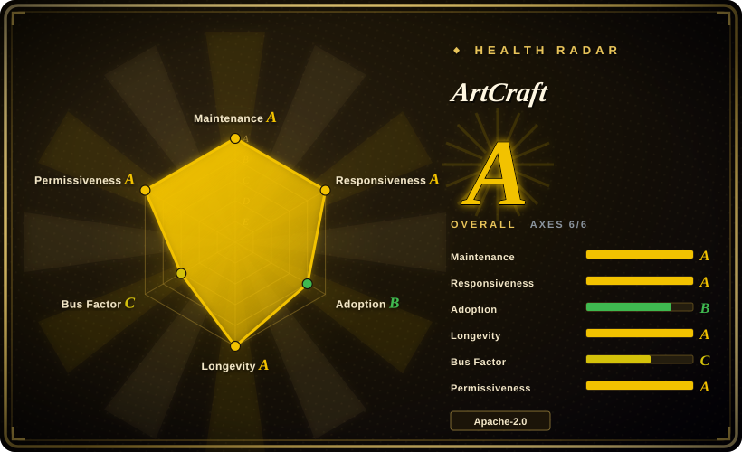
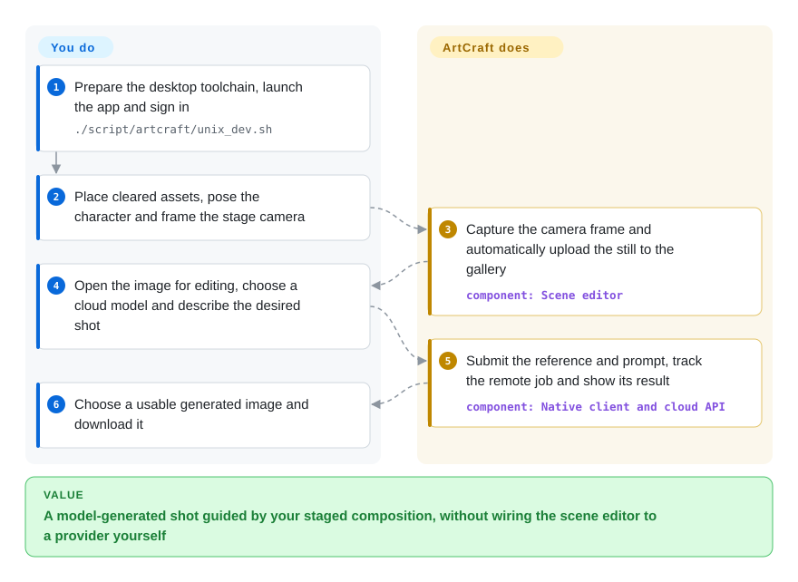
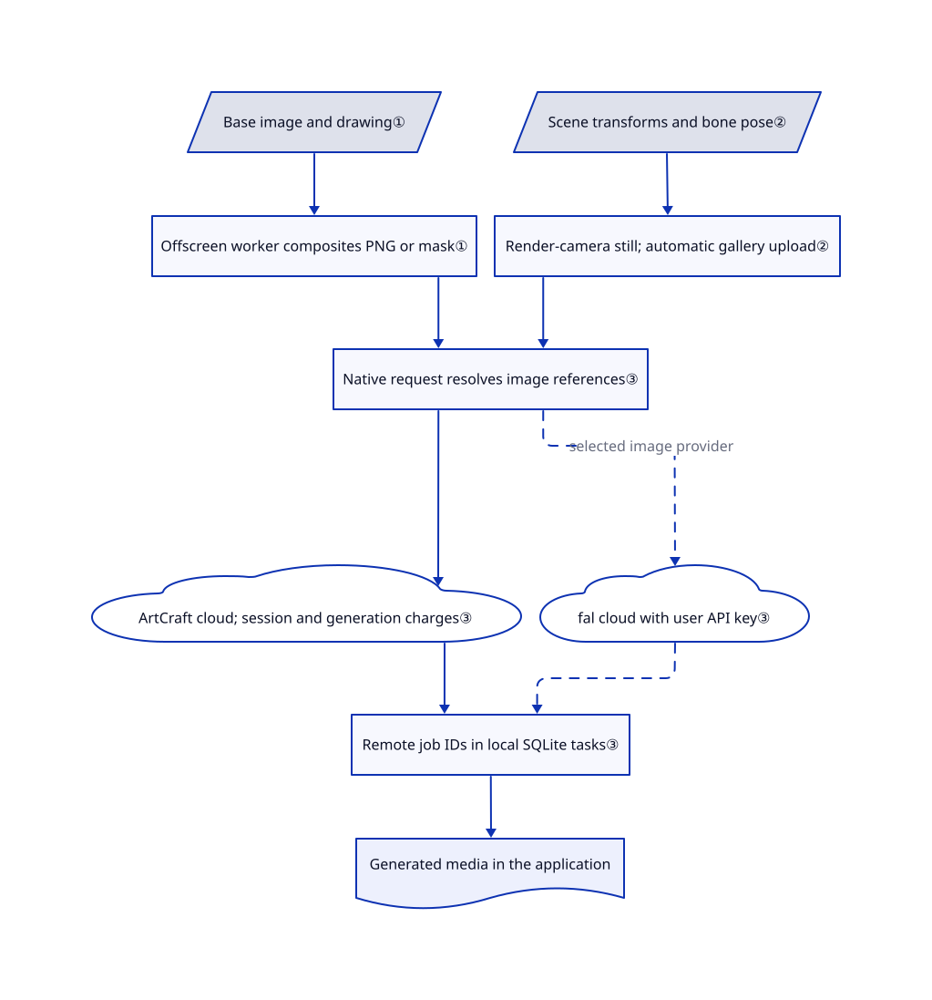

# ArtCraft

You ask for the same character beside the same window, but each generated shot moves the camera and furniture. ArtCraft lets you place objects, pose characters and frame a 3D scene before sending a reference image to a cloud model.

## When to use

You are a concept artist or filmmaker preparing several shots of one room. Rewriting “camera on the left, actor near the door” keeps changing the composition. You want to place the camera and props yourself, then use that composition as the starting point for generated imagery. ArtCraft combines a layered drawing canvas, a 3D staging editor and image/video provider controls in one desktop application.

Pick it over a node-based inference tool when arranging the picture matters more than designing the model pipeline. Pick it over Blender when your destination is a model-generated shot, not a physically rendered scene or a finished animation rig. You keep responsibility for asset rights, cloud accounts, generation charges and choosing usable results. Visual references guide generation; they do not guarantee matching identities or geometry.

## When NOT to use

- **Your material must never leave the workstation.** Use [ComfyUI](../on-device-ml/local-image-generation/comfyui.md) with local weights and offline operation instead. ArtCraft's normal generation path calls its hosted API; scene captures auto-upload to the gallery. Even the fal image route resolves media tokens through ArtCraft and can record prompts there. Selecting another provider is not an offline mode.
- **You need an entirely permissive, commercially forkable service stack.** Use local ComfyUI for an owned generation pipeline, or Blender for deterministic 3D work. This repository's authored desktop code is MIT OR Apache-2.0, but the separate public [artcraft-services](https://github.com/storytold/artcraft-services) backend has a custom non-OSI license. It prohibits commercial software sales, competing products and removing paid-service/community links. The desktop grant does not relicense that backend.
- **You plan to redistribute the clone or bundle its demo assets in a product.** Start with Blender and your own cleared assets, or remove/replace the excluded ArtCraft material before distribution. [NOTICE](https://github.com/storytold/artcraft/blob/800217ed04d10fc12706c28e6e91ae2a6b286092/NOTICE) grants no rights to bundled Nintendo sounds, memes, certain skyboxes, one MMD motion file or Mixamo animation renders. Fonts, icons and the vendored HTTP plugin also retain their own licenses; trademarks are excluded.
- **You need a reproducible inference graph or local checkpoint control.** Choose ComfyUI. ArtCraft exposes provider/model choices and visual references, while the hosted service controls generation and catalog availability. Its README marks some advertised models disabled or restricted.
- **You need exact 3D geometry, final rigging or guaranteed shot continuity.** Choose Blender. ArtCraft's local staging data can preserve object transforms and pose, but the final cloud-generated pixels need not preserve them.
- **You only want a managed browser workflow.** Choose [Runway Creative](https://runwayml.com) instead of maintaining a desktop build. That is a hosted product, not a repository; it also requires accepting cloud processing and its pricing.

## Comparison

| Alternative | In index | Our verdict | Tradeoff |
|---|---|---|---|
| [ComfyUI](../on-device-ml/local-image-generation/comfyui.md) | ✅ | Choose ComfyUI when local models, saved inference graphs or offline client work decide; choose ArtCraft when posing and camera placement should lead a cloud-generation workflow. | ComfyUI needs model files, suitable hardware and node maintenance; ArtCraft avoids operating local inference but adds provider accounts, billing and service dependence. |
| [Blender](https://github.com/blender/blender) | not indexed | Choose Blender for exact scene geometry and deterministic rendering; choose ArtCraft to turn a visually staged reference into an AI-generated shot without assembling the integration yourself. | Blender owns a much broader 3D production pipeline but requires more production work and separate AI integration; not added in this tab batch. |
| [Runway Creative](https://runwayml.com) | not a repo | Choose Runway Creative for a managed browser-based generation/editing workspace; choose ArtCraft when inspecting or modifying the desktop client and staging a 3D reference are decisive. | Runway Creative is a hosted commercial product, not its research repositories. ArtCraft exposes client source, but that does not make its cloud models local or its full backend permissively licensed. |

## Quick start

Use the Windows/macOS releases, or follow the [desktop development guide](https://github.com/storytold/artcraft/blob/800217ed04d10fc12706c28e6e91ae2a6b286092/_docs/dev_setup.md) for Rust, Node.js 20+ and Tauri 2 prerequisites. On macOS/Linux, `./script/artcraft/unix_dev.sh` starts the frontend and native desktop together; it installs frontend dependencies when Vite is absent, so review it before running. Sign in to ArtCraft and arrange your own assets, camera and character pose in the 3D stage; Capture creates a still and automatically uploads it to your gallery. Open that image's lightbox, choose an editing/generation destination, select an available model and supply the prompt; ArtCraft submits the remote job and presents the result for download. You supply cleared assets, credentials and the generation budget; the app supplies composition tools, references and job tracking, not free local inference. The separate Rust-only `artcraft-native` frontend currently documents image/video/audio creation, while its other tools are placeholders; it is not a replacement for this staging workflow.

<!-- flow-steps:begin (generated from flows/artcraft.json by tools/flow_card.py — do not edit) -->

Text version of the flow

1. **You**: Prepare the desktop toolchain, launch the app and sign in — `./script/artcraft/unix_dev.sh`
2. **You**: Place cleared assets, pose the character and frame the stage camera
3. **ArtCraft**: Capture the camera frame and automatically upload the still to the gallery — component: `Scene editor`
4. **You**: Open the image for editing, choose a cloud model and describe the desired shot
5. **ArtCraft**: Submit the reference and prompt, track the remote job and show its result — component: `Native client and cloud API`
6. **You**: Choose a usable generated image and download it

**Value**: A model-generated shot guided by your staged composition, without wiring the scene editor to a provider yourself

<!-- flow-steps:end -->

## Key techniques

<!-- mechanism:begin (generated from mechanisms/artcraft.json by tools/mechanism_card.py; do not edit) -->

Text version of the mechanism

- Base image and drawing①
- Offscreen worker composites PNG or mask①
- Scene transforms and bone pose②
- Render-camera still; automatic gallery upload②
- Native request resolves image references③
- ArtCraft cloud; session and generation charges③
- fal cloud with user API key③
- Remote job IDs in local SQLite tasks③
- Generated media in the application

- Base image and drawing① → Offscreen worker composites PNG or mask①
- Offscreen worker composites PNG or mask① → Native request resolves image references③
- Scene transforms and bone pose② → Render-camera still; automatic gallery upload②
- Render-camera still; automatic gallery upload② → Native request resolves image references③
- Native request resolves image references③ → ArtCraft cloud; session and generation charges③
- Native request resolves image references③ → fal cloud with user API key③ (selected image provider) [optional/fallback]
- ArtCraft cloud; session and generation charges③ → Remote job IDs in local SQLite tasks③
- fal cloud with user API key③ → Remote job IDs in local SQLite tasks③ [optional/fallback]
- Remote job IDs in local SQLite tasks③ → Generated media in the application

<!-- mechanism:end -->

### 1. Bake drawings and masks away from the interface thread

- **Problem:** Flattening large drawings or creating an edit mask can block the editing interface.
- **How:** A worker receives transferred image bitmaps and draws them into an offscreen canvas. It composites base and marker images into PNG, or returns PNG mask bytes, then closes the transferred bitmaps even after an error.
- **Limits:** This prepares reference pixels; it does not run the image model. The worker requires browser bitmap and offscreen-canvas support, and large dimensions still consume memory.
- **Source:** [Worker request/result handling](https://github.com/storytold/artcraft/blob/800217ed04d10fc12706c28e6e91ae2a6b286092/frontend/libs/components/pagedraw/src/lib/utilities/generatePipeline.ts#L17-L117), [compositing and cleanup](https://github.com/storytold/artcraft/blob/800217ed04d10fc12706c28e6e91ae2a6b286092/frontend/libs/components/pagedraw/src/lib/utilities/generatePipeline.worker.ts#L38-L78).

### 2. Preserve the staged scene, then capture the chosen camera

- **Problem:** A written prompt cannot precisely express prop placement or reproduce the same character pose between drafts.
- **How:** Scene serialization records object transforms, material settings and bone pose. Capture switches to the render camera and creates a PNG; the completion dialog uploads that image and opens the shared lightbox for further editing or generation.
- **Limits:** Serialized media tokens still need their assets resolved. Image capture uploads automatically, while recorded video waits for an explicit upload; the resulting reference does not constrain every pixel a cloud model produces.
- **Source:** [Scene and pose serialization](https://github.com/storytold/artcraft/blob/800217ed04d10fc12706c28e6e91ae2a6b286092/frontend/libs/components/pagescene/src/lib/proxy/storyteller_proxy_scene.ts#L32-L120), [camera capture](https://github.com/storytold/artcraft/blob/800217ed04d10fc12706c28e6e91ae2a6b286092/frontend/libs/components/pagescene/src/lib/actions/recordOutput.ts#L10-L76), [upload behavior](https://github.com/storytold/artcraft/blob/800217ed04d10fc12706c28e6e91ae2a6b286092/frontend/libs/components/pagescene/src/lib/comps/CompletionModal/CompletionModal.tsx#L27-L77).

### 3. Separate native job tracking from remote generation

- **Problem:** Closing a desktop window should not erase the identity of an already accepted paid job.
- **How:** The native Omni dispatcher authenticates, resolves image references, adds an idempotency token and posts to the selected modality's generation endpoint. It deduplicates returned job tokens and inserts pending tasks into the local SQLite task database. The fal image path instead submits through its API-key client, with optional ArtCraft prompt recording.
- **Limits:** This is not a local inference engine or an exactly-once guarantee. If persisting an accepted Omni job fails, the dispatcher logs the error and still reports acceptance to avoid encouraging duplicate submissions. API keys are saved as plain files; provider sessions and service availability remain external dependencies.
- **Source:** [Omni submission and task persistence](https://github.com/storytold/artcraft/blob/800217ed04d10fc12706c28e6e91ae2a6b286092/crates/desktop/artcraft/src/core/commands/generate/omni/dispatch.rs#L39-L100), [job-token deduplication](https://github.com/storytold/artcraft/blob/800217ed04d10fc12706c28e6e91ae2a6b286092/crates/desktop/artcraft/src/core/commands/generate/omni/dispatch.rs#L136-L173), [fal route and prompt recording](https://github.com/storytold/artcraft/blob/800217ed04d10fc12706c28e6e91ae2a6b286092/crates/desktop/artcraft/src/core/commands/generate/generate_image/providers/artcraft_router/handle_api_providers.rs#L52-L177), [API-key persistence](https://github.com/storytold/artcraft/blob/800217ed04d10fc12706c28e6e91ae2a6b286092/crates/desktop/artcraft/src/core/providers/credentials/payload/api_key.rs#L17-L26).

## Tech stack

- Rust workspace; Tauri 2 desktop shell, Tokio and HTTP clients; SQLite task storage through SQLx.
- React 18 and TypeScript frontend; Nx/Vite builds, Three.js scene tools, Konva drawing, Zustand and signals for state.
- A second egui Rust frontend lives in `artcraft-native`; its feature coverage differs from the default Tauri app.
- The public services companion uses Actix Web, MySQL, Redis, Elasticsearch and S3-compatible storage. It is a separate deployment and license, not a bundled desktop database server.

## Dependencies

- **Normal desktop use:** ArtCraft's hosted API and account for first-party generation, media library and uploads; available credits/model access as required by the service. Other providers require their own compatible account or API key. No local model weights ship with the desktop workflow.
- **Build:** Rust/Cargo, Node.js/npm and Tauri 2 with platform prerequisites. The manifest also documents native wreq build prerequisites such as CMake, pkg-config and LLVM. Linux is a source-build route; the README links stable installers for Windows/macOS.
- **Self-hosting:** [Services setup](https://github.com/storytold/artcraft-services/blob/e57ee3d63ac478a24149384bf1473ef97aa067f8/_docs/dev_setup.md) requires database, cache, search, object storage and chosen-provider credentials. Desktop host configuration can point to localhost, but `SQLX_OFFLINE=true` only removes the build-time database requirement; it does not eliminate runtime services.
- **Data and credentials:** Provider keys reside under the application's credentials directory as plain files. Signed-in activity reporting sends platform/version/session-duration and generation counters to ArtCraft; see [activity thread](https://github.com/storytold/artcraft/blob/800217ed04d10fc12706c28e6e91ae2a6b286092/crates/desktop/artcraft/src/services/storyteller/threads/storyteller_activity_thread.rs#L58-L109). This source review is not a complete traffic audit.

## Ops difficulty

**Medium for a desktop user; high for a self-hosted service fork.** Installers reduce build work, but you still manage paid providers, model availability, sensitive account files and cloud media. Source builds add native and JavaScript toolchains. Operating the backend adds MySQL migrations, Redis, Elasticsearch, object storage, workers and credentials under a restrictive separate license. The [server guide](https://github.com/storytold/artcraft-services/blob/e57ee3d63ac478a24149384bf1473ef97aa067f8/_docs/dev_setup_server.md) still has a setup TODO; do not treat it as a turnkey private deployment.

## Health & viability

- **Maintenance, checked 2026-10-22:** latest listed release is `artcraft-v0.41.0` on 2026-09-26; `main` was pushed on 2026-10-21 and the reviewed desktop config says `0.42.0`. Pin a release or commit rather than equating development code with the last installer.
- **Governance and backing:** the repository belongs to the Storytold organization. The contributors endpoint returned four contributors, led by `echelon`; no root governance, security or contributor-policy document appeared in the reviewed tree. This is vendor-directed development, not evidence of foundation governance.
- **Age and Lindy:** GitHub creation dates to 2022-03-31, about 4.6 years before verification. [推断：the current repository separates desktop and services] That age supports project continuity, not proof that today's split architecture or every provider integration has been stable for 4.6 years.
- **Adoption:** GitHub reported about 35.3k stars and 5.6k forks on 2026-10-22. Those counts show interest, not verified studio deployment or image quality; use the machine radar as measured signals rather than a production-readiness verdict.
- **Relicensing history:** [commit 8abde75](https://github.com/storytold/artcraft/commit/8abde75133d2d66fe73b8184eaec8372efae2abf) replaced the desktop's fair-source license with MIT OR Apache-2.0 on 2026-10-10. The scorer nevertheless records `relicense_36mo: false`; that measurement misses this documented change. Its license A also records no content license and does not clear the excluded assets. The commit explicitly reports unresolved provenance for avatars, default covers, some character images and the day skybox.
- **Service risk:** the separate backend retains non-OSI restrictions, and image/video generation still relies on remote providers. The permissive desktop license alone does not establish operational independence. See the [desktop license](https://github.com/storytold/artcraft/blob/800217ed04d10fc12706c28e6e91ae2a6b286092/LICENSE-MIT) and [backend restrictions](https://github.com/storytold/artcraft-services/blob/e57ee3d63ac478a24149384bf1473ef97aa067f8/LICENSE.md).

## Caveats (unverified)

- [未验证：static review only; no installation, compilation, login or paid generation] End-to-end desktop startup, output quality, processing costs and provider availability were not reproduced.
- [未验证：no isolated service deployment was authorized] Public backend code and setup docs were inspected, but completeness of a private self-hosted installation was not demonstrated.
- [未验证：no full rights-clearance or network audit] NOTICE explicitly withholds rights to listed assets; this review does not certify every bundled file, every provider's usage terms or all outbound traffic.
- [未验证：the 2026-10-10 relicensing commit explicitly reports unresolved asset provenance] Rights to avatars, default covers, `characters/img*.png` and the day skybox remain unconfirmed in this review; they are not cleared for redistribution by the desktop license badge.
- [推断：repository creation predates the currently documented desktop/services split] Repository age is not a measured stability record for the current architecture.
