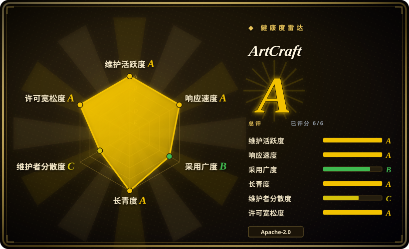
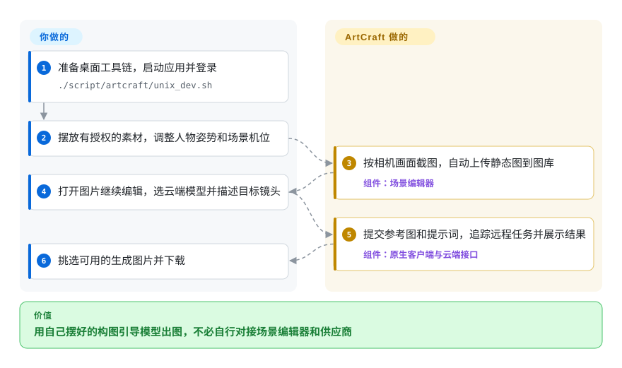
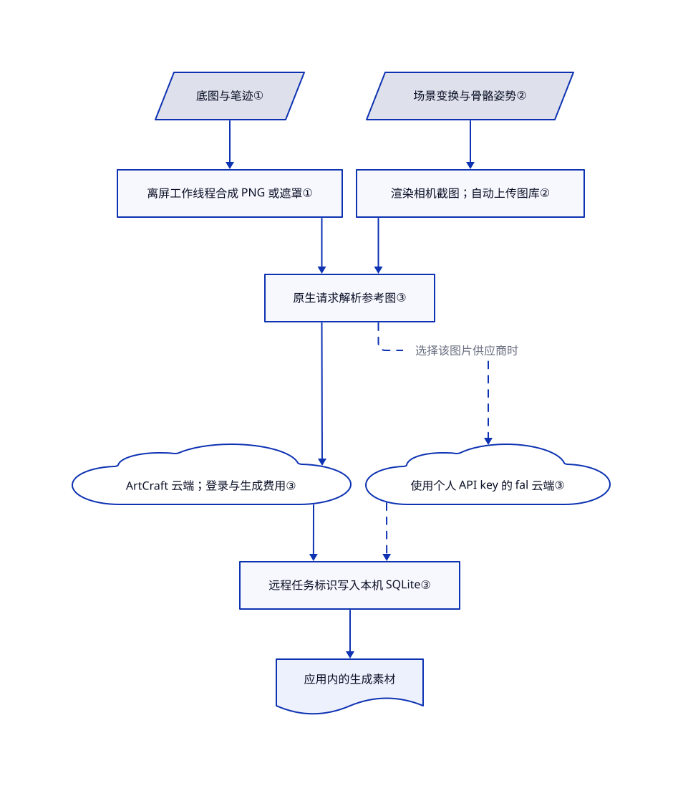

# ArtCraft

你要同一个人物站在同一扇窗旁，生成结果却总换机位和家具。ArtCraft 让你先摆道具、调姿势、定镜头，再把画面交给云端模型生成。

## 何时使用

你是概念美术师或影视创作者，要给同一个房间设计多个镜头。反复写“相机在左，人物靠门”，构图仍会变。你想自己摆相机和道具，再拿构图作为生成图片的起点。ArtCraft 把分层画布、三维场景编辑器和图片／视频模型入口放进同一个桌面应用。

如果你更在乎怎么摆画面，而非怎么连接模型步骤，可优先考虑它而非节点式推理工具。如果终点是模型生成的镜头，而非物理渲染或完整角色绑定，可优先考虑它而非 Blender。素材授权、云端账号、生成费用和结果筛选仍由你负责。参考图只提供引导，不保证人物身份和几何结构一致。

## 何时不用

- **客户素材绝不能离开本机。** 改用加载本地权重并离线运行的 [ComfyUI](../../on-device-ml/local-image-generation/comfyui.zh.md)。ArtCraft 的常规生成路径调用托管接口，场景截图会自动上传图库。即使用 fal 生成图片，也会通过 ArtCraft 解析素材标识，并可能记录提示词。换供应商不等于离线。
- **你要整套服务都能按宽松许可商业分叉。** 自有生成管线可选本地 ComfyUI，确定性三维制作可选 Blender。本仓库作者的桌面代码采用 MIT OR Apache-2.0，但另一个公开的 [artcraft-services](https://github.com/storytold/artcraft-services) 后端采用自定义非 OSI 许可。它禁止商业销售软件、开发竞品和删除付费服务／社区链接。桌面许可不覆盖后端。
- **你准备分发整个克隆，或把演示素材打进产品。** 可从 Blender 配自有授权素材开始，或先替换 ArtCraft 排除授权的文件。[NOTICE](https://github.com/storytold/artcraft/blob/800217ed04d10fc12706c28e6e91ae2a6b286092/NOTICE) 不授予任天堂音效、表情图、部分天空盒、一个 MMD 动作文件及 Mixamo 动画渲染图的使用权。字体、图标和内置 HTTP 插件另有许可，商标也不在宽松授权内。
- **你需要可重跑的推理图或本地模型控制。** 选 ComfyUI。ArtCraft 提供供应商、模型和视觉参考入口，生成过程和可用模型仍由云服务控制。README 已将部分宣传中的模型标为停用或受限。
- **你需要精确几何、完整绑定或必然一致的镜头。** 选 Blender。ArtCraft 的场景数据能保存物体变换和姿势，但云端生成的最终像素未必遵守它们。
- **你只要托管网页工作台。** 选 [Runway Creative](https://runwayml.com)，不用维护桌面构建。它是托管产品，不是代码仓库；同样要接受云端处理和相应定价。

## 横向对比

| 替代品 | 是否收录 | 我们的评价 | 取舍 |
|---|---|---|---|
| [ComfyUI](../../on-device-ml/local-image-generation/comfyui.zh.md) | ✅ | 本地模型、保存推理图或客户素材离线要求决定选型时选 ComfyUI；希望先摆姿势和机位，再交云模型出图时选 ArtCraft。 | ComfyUI 要准备模型、硬件并维护节点；ArtCraft 不用自运维推理，但增加云账号、费用与服务依赖。 |
| [Blender](https://github.com/blender/blender) | 未收录 | 需要精确场景几何和确定性渲染时选 Blender；希望摆好视觉参考后直接生成镜头，不自行拼接接口时选 ArtCraft。 | Blender 覆盖更完整的三维制作，但制作投入更大，AI 接入另做；本轮标签批次不新增。 |
| [Runway Creative](https://runwayml.com) | 非仓库 | 要托管的网页生成／编辑工作台时选 Runway Creative；要检查或修改桌面源码，并以三维参考控制构图时选 ArtCraft。 | 此处比较的是商业托管产品，不是 Runway 的研究仓库。ArtCraft 开放客户端，不代表模型能本地运行，也不代表后端采用宽松许可。 |

## 快速上手

可用 Windows／macOS 发布包，或按[桌面开发指南](https://github.com/storytold/artcraft/blob/800217ed04d10fc12706c28e6e91ae2a6b286092/_docs/dev_setup.md)准备 Rust、Node.js 20+ 和 Tauri 2。macOS／Linux 用 `./script/artcraft/unix_dev.sh` 同时启动前端与原生桌面；缺少 Vite 时它会安装前端依赖，执行前应先检查。登录 ArtCraft 后，在三维场景中摆自有素材、相机和人物姿势；Capture 会截图并自动上传图库。在图片预览窗选择编辑或生成去向，选可用模型并输入提示词，应用提交远程任务并展示可下载的结果。你提供授权素材、凭据和预算，应用提供构图工具、参考图与任务追踪，不提供免费的本机推理。另一个纯 Rust 前端 `artcraft-native` 当前只明确交付图片／视频／音频生成，其余工具为占位，不能代替这里的场景工作流。

<!-- flow-steps:begin (generated from flows/artcraft.json by tools/flow_card.py — do not edit) -->

流程文字版

1. **你**：准备桌面工具链，启动应用并登录 — `./script/artcraft/unix_dev.sh`
2. **你**：摆放有授权的素材，调整人物姿势和场景机位
3. **ArtCraft**：按相机画面截图，自动上传静态图到图库 — 组件：`场景编辑器`
4. **你**：打开图片继续编辑，选云端模型并描述目标镜头
5. **ArtCraft**：提交参考图和提示词，追踪远程任务并展示结果 — 组件：`原生客户端与云端接口`
6. **你**：挑选可用的生成图片并下载

**价值**：用自己摆好的构图引导模型出图，不必自行对接场景编辑器和供应商

<!-- flow-steps:end -->

## 技术要点

<!-- mechanism:begin (generated from mechanisms/artcraft.json by tools/mechanism_card.py; do not edit) -->

机制文字版

- 底图与笔迹①
- 离屏工作线程合成 PNG 或遮罩①
- 场景变换与骨骼姿势②
- 渲染相机截图；自动上传图库②
- 原生请求解析参考图③
- ArtCraft 云端；登录与生成费用③
- 使用个人 API key 的 fal 云端③
- 远程任务标识写入本机 SQLite③
- 应用内的生成素材

- 底图与笔迹① → 离屏工作线程合成 PNG 或遮罩①
- 离屏工作线程合成 PNG 或遮罩① → 原生请求解析参考图③
- 场景变换与骨骼姿势② → 渲染相机截图；自动上传图库②
- 渲染相机截图；自动上传图库② → 原生请求解析参考图③
- 原生请求解析参考图③ → ArtCraft 云端；登录与生成费用③
- 原生请求解析参考图③ → 使用个人 API key 的 fal 云端③（选择该图片供应商时）〔可选／兜底〕
- ArtCraft 云端；登录与生成费用③ → 远程任务标识写入本机 SQLite③
- 使用个人 API key 的 fal 云端③ → 远程任务标识写入本机 SQLite③〔可选／兜底〕
- 远程任务标识写入本机 SQLite③ → 应用内的生成素材

<!-- mechanism:end -->

### 1. 把画布合成和遮罩处理移出界面线程

- **解决：** 大画布压平和生成局部编辑遮罩时，容易卡住编辑界面。
- **做法：** 工作线程接收转移来的位图，在离屏画布上绘制。它把底图与笔迹合成 PNG，或返回 PNG 遮罩字节；即使报错也会关闭转移来的位图。
- **边界：** 这只准备参考像素，不执行生成模型。它依赖浏览器的位图与离屏画布支持，大尺寸仍会占用内存。
- **源码：** [工作线程请求与结果处理](https://github.com/storytold/artcraft/blob/800217ed04d10fc12706c28e6e91ae2a6b286092/frontend/libs/components/pagedraw/src/lib/utilities/generatePipeline.ts#L17-L117)、[合成与资源释放](https://github.com/storytold/artcraft/blob/800217ed04d10fc12706c28e6e91ae2a6b286092/frontend/libs/components/pagedraw/src/lib/utilities/generatePipeline.worker.ts#L38-L78)。

### 2. 保存布景，再按选定机位截图

- **解决：** 文字提示难以精确表达道具位置，也难在多次草稿间复用同一姿势。
- **做法：** 场景序列化记录物体变换、材质设置和骨骼姿势。Capture 切到渲染相机后生成 PNG；完成窗口上传图片，并打开通用预览窗，继续编辑或生成。
- **边界：** 保存的素材标识仍需解析到真实素材。静态图会自动上传，录制视频则等待手动上传；参考图不能硬约束云模型生成的每个像素。
- **源码：** [场景与姿势序列化](https://github.com/storytold/artcraft/blob/800217ed04d10fc12706c28e6e91ae2a6b286092/frontend/libs/components/pagescene/src/lib/proxy/storyteller_proxy_scene.ts#L32-L120)、[相机截图](https://github.com/storytold/artcraft/blob/800217ed04d10fc12706c28e6e91ae2a6b286092/frontend/libs/components/pagescene/src/lib/actions/recordOutput.ts#L10-L76)、[上传行为](https://github.com/storytold/artcraft/blob/800217ed04d10fc12706c28e6e91ae2a6b286092/frontend/libs/components/pagescene/src/lib/comps/CompletionModal/CompletionModal.tsx#L27-L77)。

### 3. 本机追踪任务，远程执行生成

- **解决：** 已付费提交的任务，不应因关闭桌面窗口而丢失标识。
- **做法：** 原生 Omni 调度器验证登录、解析参考图、补充幂等标识，再调用相应媒体类型的生成接口。它去重返回的任务标识，将待处理任务写入本机 SQLite 数据库。fal 图片路径改走自有 API key 客户端，并可在 ArtCraft 记录提示词。
- **边界：** 它不是本地推理引擎，也不保证任务恰好执行一次。若已接单任务写库失败，调度器记录错误但仍返回已接受，以免诱导用户重复提交。API key 以普通文件保存；供应商会话和服务可用性仍由外部决定。
- **源码：** [Omni 提交与任务落库](https://github.com/storytold/artcraft/blob/800217ed04d10fc12706c28e6e91ae2a6b286092/crates/desktop/artcraft/src/core/commands/generate/omni/dispatch.rs#L39-L100)、[任务标识去重](https://github.com/storytold/artcraft/blob/800217ed04d10fc12706c28e6e91ae2a6b286092/crates/desktop/artcraft/src/core/commands/generate/omni/dispatch.rs#L136-L173)、[fal 路径与提示词记录](https://github.com/storytold/artcraft/blob/800217ed04d10fc12706c28e6e91ae2a6b286092/crates/desktop/artcraft/src/core/commands/generate/generate_image/providers/artcraft_router/handle_api_providers.rs#L52-L177)、[API key 保存](https://github.com/storytold/artcraft/blob/800217ed04d10fc12706c28e6e91ae2a6b286092/crates/desktop/artcraft/src/core/providers/credentials/payload/api_key.rs#L17-L26)。

## 技术栈

- Rust 工作区，Tauri 2 桌面外壳、Tokio 和 HTTP 客户端，通过 SQLx 使用 SQLite 任务库。
- React 18 与 TypeScript 前端，Nx／Vite 构建，Three.js 场景工具、Konva 画布，Zustand 与 signals 管理状态。
- `artcraft-native` 是另一套 egui 纯 Rust 前端，功能范围不同于默认 Tauri 应用。
- 公开的配套服务使用 Actix Web、MySQL、Redis、Elasticsearch 和兼容 S3 的对象存储。它独立部署、独立授权，不是桌面附带的数据库服务器。

## 依赖

- **常规桌面使用：** 第一方生成、图库和上传使用 ArtCraft 托管接口与账号，还要有服务要求的额度和模型权限。其他供应商需要相应账号或 API key。桌面工作流不附带本地模型权重。
- **构建：** Rust／Cargo、Node.js／npm、Tauri 2 及平台依赖。清单另列出 wreq 的 CMake、pkg-config、LLVM 等原生构建要求。Linux 走源码构建；README 的稳定安装包入口面向 Windows／macOS。
- **自托管：** [服务设置指南](https://github.com/storytold/artcraft-services/blob/e57ee3d63ac478a24149384bf1473ef97aa067f8/_docs/dev_setup.md)要求数据库、缓存、搜索、对象存储和所选供应商凭据。桌面端可配置本地服务地址，但 `SQLX_OFFLINE=true` 只免除构建时数据库要求，不免除运行时服务。
- **数据与凭据：** 供应商 key 以普通文件存放在应用凭据目录。登录后的活动上报包含平台、版本、会话时长和生成次数，见[活动线程](https://github.com/storytold/artcraft/blob/800217ed04d10fc12706c28e6e91ae2a6b286092/crates/desktop/artcraft/src/services/storyteller/threads/storyteller_activity_thread.rs#L58-L109)。本次源码阅读不是完整流量审计。

## 运维难度

**桌面使用为中，自托管服务分叉为高。** 安装包降低构建负担，但仍要管理付费供应商、模型可用性、敏感账号文件和云端素材。源码构建还要维护原生与 JavaScript 工具链。后端增加 MySQL 迁移、Redis、Elasticsearch、对象存储、工作进程和凭据，并受独立限制性许可约束。[服务指南](https://github.com/storytold/artcraft-services/blob/e57ee3d63ac478a24149384bf1473ef97aa067f8/_docs/dev_setup_server.md)仍有配置 TODO，不应当成开箱即用的私有部署方案。

## 健康度与可持续性

- **维护情况，核于 2026-10-22：** 最近列出的版本为 2026-09-26 发布的 `artcraft-v0.41.0`；主分支于 2026-10-21 推送，所读桌面配置已写 `0.42.0`。应固定发布版或提交，不要把开发分支当成最近安装包。
- **治理与支持：** 仓库由 Storytold 组织持有。贡献者接口返回四位贡献者，以 `echelon` 为主；所读目录树没有根级治理、安全或贡献政策文件。这是厂商主导开发，不是基金会治理的证据。
- **年龄与林迪信号：** GitHub 创建时间为 2022-03-31，验证时约 4.6 年。[推断：当前仓库已将桌面与服务拆分] 这个年龄支持项目仍在延续，不证明今天的拆分架构或每条供应商路径已稳定运行 4.6 年。
- **采用信号：** GitHub 于 2026-10-22 返回约 3.53 万 star 和 5600 次 fork。它们说明关注度，不证明影棚落地或图片质量；机器雷达是信号汇总，不是生产可用性裁决。
- **许可变更：** [提交 8abde75](https://github.com/storytold/artcraft/commit/8abde75133d2d66fe73b8184eaec8372efae2abf)于 2026-10-10 将桌面端从 fair-source 改为 MIT OR Apache-2.0。评分器仍记录 `relicense_36mo: false`，漏掉了这次有据可查的变更。许可轴的 A 也未记录内容许可，不代表排除素材获准使用。该提交明确说头像、默认封面、部分角色图片和白天天空盒的来源尚未确认。
- **服务风险：** 独立后端仍有限制性非 OSI 条款，图片／视频生成仍依赖远程供应商。只看桌面宽松许可，不能推导出服务独立性。见[桌面许可](https://github.com/storytold/artcraft/blob/800217ed04d10fc12706c28e6e91ae2a6b286092/LICENSE-MIT)和[后端限制](https://github.com/storytold/artcraft-services/blob/e57ee3d63ac478a24149384bf1473ef97aa067f8/LICENSE.md)。

## 存疑（未验证）

- [未验证：仅静态阅读，未安装、编译、登录或付费生成] 未复现桌面完整启动、输出质量、处理费用和供应商可用性。
- [未验证：未获授权搭建隔离服务] 已读取公开后端源码结构和设置文档，但未证明完整的私有自托管环境能工作。
- [未验证：未做全量权利清理与网络审计] NOTICE 明确不授权列出的素材；本次阅读不为所有文件、供应商使用条款及全部外发流量背书。
- [未验证：2026-10-10 的改许可提交明确表示素材来源未清] 本次未确认头像、默认封面、`characters/img*.png` 和白天天空盒的权利，不应凭桌面许可徽章分发这些素材。
- [推断：仓库创建早于当前文档中的桌面／服务拆分] 仓库年龄不是现有架构的实测稳定性记录。
