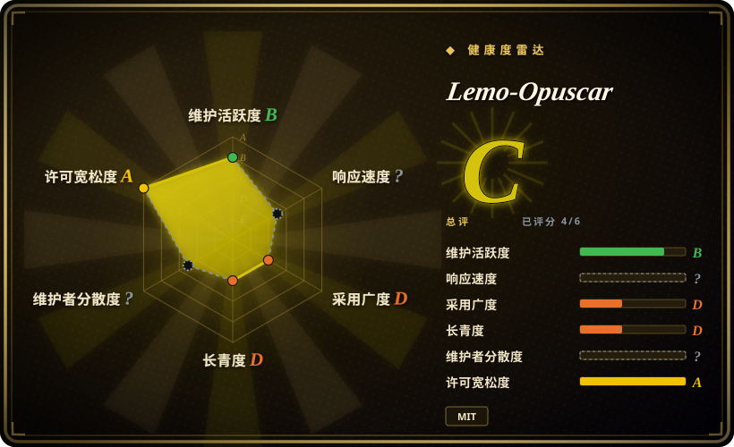
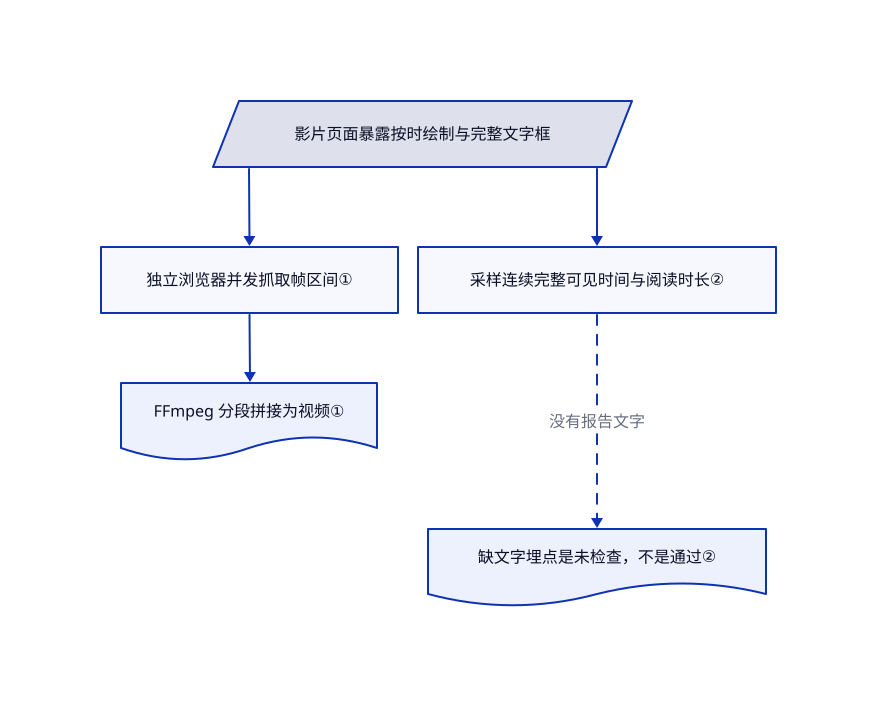

# Lemo-Opuscar

你想拍水彩故事或有证据的卫星短片，却不想逐帧手画，也不想赌视频模型能写对文字。Lemo-Opuscar 把风格指南和代码渲染工具交给编程助手，生成镜头、声音与成片。

## 何时使用

你已经用编程助手，有短片主题和视觉风格，也愿意检查生成过程。相比让视频模型给一个不透明片段，你希望保留可编辑的 Canvas、WebGL 代码，配上旁白、音乐；事实类影片还要保留来源。若缺的是美术指导和风格库，而不只是 HTML 转视频引擎，选它而非 HyperFrames；若要固定技术解说风格与审批点，则看 anything2explainer。

## 何时不用

- **只缺渲染已有构图的引擎：** 选 [HyperFrames](../render-engines/hyperframes.zh.md)；本包额外引入导演指令、风格选择、音频制作和独立共享库。
- **要成熟 React 视频平台与云渲染：** 在许可允许时选 [Remotion](../render-engines/remotion.zh.md)；Lemo-Opuscar 是年轻的浏览器逐帧工具，不是同级渲染服务。
- **要严格固定风格的解说流程：** 可看 [anything2explainer](anything2explainer.zh.md)，但其非商业许可是约束。Lemo 的多风格与助手自由裁量，换来较低的导演过程重复性。
- **要写实生成素材或剪已有片段：** 分别考虑 Runway 等视频生成服务，或 DaVinci Resolve 等编辑器；这些是闭源产品，不属于本包的代码绘片路线。
- **不允许自动更新库和安装依赖：** 先审查并固定 setup 流程，不直接沿用默认技能。它会克隆或更新共享库，并按层安装依赖；单个技能文件不是完整安装。

## 横向对比

| 替代品 | 是否收录 | 我们的评价 | 取舍 |
|---|---|---|---|
| [HyperFrames](../render-engines/hyperframes.zh.md) | ✅ | 已有制片流程，只缺 HTML 渲染引擎，选 HyperFrames；需要复用美术指导和风格提示词，选 Lemo。 | Lemo 包含风格、配音配乐和复核约定；HyperFrames 是更通用的 Apache-2.0 引擎。 |
| [Remotion](../render-engines/remotion.zh.md) | ✅ | React 团队做参数化视频产品与云端渲染，选 Remotion；助手用浏览器绘制导演短片，选 Lemo。 | Remotion 引擎基础设施更深，并有商业许可要求；Lemo 更小、本地渲染且年轻得多。 |
| [anything2explainer](anything2explainer.zh.md) | ✅ | 固定动态图形解说和明确审批点，选 anything2explainer；故事需要绘画、卡通或实证影像风格，选 Lemo。 | Lemo 的代码文档为 MIT，外观多样；对方流程更窄，但有非商业限制。 |

## 快速上手

Claude Code 文档路线是添加 `lemomo-ai/lemo-opuscar` 市场，再安装 `lemo-opuscar@lemolab`；其他助手可复制技能目录。先审查 setup：首次使用会把共享库取到 `~/lemo-opuscar`，并按需安装工具层。你准备 Node 20 及以上、FFmpeg、Python 3.11 及以上或 uv，以及编程助手模型、题材、素材和授权。指定风格并决定是否先批准分镜后，助手读取导演、技术和风格指南，在起始目录创建影片工程并渲染 MP4。你仍需核事实、素材权利和最终音画；中文 edge-tts 旁白需要联网，即使画面本地渲染。

<!-- flow-steps:begin (generated from flows/lemo-opuscar.json by tools/flow_card.py — do not edit) -->

流程文字版

1. **你**：安装技能，提供系统工具与影片主题
2. **Lemo-Opuscar**：获取共享库，读取导演与风格指南
3. **你**：选风格、给素材，并决定是否审批分镜
4. **Lemo-Opuscar**：编写并渲染带声音和字幕的影片工程

**价值**：项目目录中留下可编辑代码影片和最终 MP4

<!-- flow-steps:end -->

## 技术要点

<!-- mechanism:begin (generated from mechanisms/lemo-opuscar.json by tools/mechanism_card.py; do not edit) -->

机制文字版

- 影片页面暴露按时绘制与完整文字框
- 独立浏览器并发抓取帧区间①
- 采样连续完整可见时间与阅读时长②
- FFmpeg 分段拼接为视频①
- 缺文字埋点是未检查，不是通过②

- 影片页面暴露按时绘制与完整文字框 → 独立浏览器并发抓取帧区间①
- 独立浏览器并发抓取帧区间① → FFmpeg 分段拼接为视频①
- 影片页面暴露按时绘制与完整文字框 → 采样连续完整可见时间与阅读时长②
- 采样连续完整可见时间与阅读时长② → 缺文字埋点是未检查，不是通过②（没有报告文字）〔可选／兜底〕

<!-- mechanism:end -->

### 1. 让每帧只由时间决定

- **解决：** 动画若依赖播放历史或未固定随机数，并行抓帧会出错。
- **做法：** 页面暴露 `window.render(t)` 和时长。每个工作进程独占浏览器，直接定位帧时间，将 JPEG 送给 FFmpeg；最后拼接分段并改名为成片。输出锁拒绝并发写同一文件。
- **边界：** 确定性是作者必须遵守的页面契约，渲染器不会证明它。浏览器、GPU 差异和缺资源仍要复核。
- **源码：** [抓帧工作进程与输出锁](https://github.com/lemomo-ai/lemo-opuscar/blob/a7fc26940f0031b5ac906b61993bb49dc4ff260f/core/render/video.mjs#L17-L71)、[页面契约](https://github.com/lemomo-ai/lemo-opuscar/blob/a7fc26940f0031b5ac906b61993bb49dc4ff260f/TECHNIQUE.md#L33-L93)。

### 2. 检查屏幕文字是否来得及读

- **解决：** 视频即使渲染成功，字幕也可能一闪而过，关键数字还可能出画。
- **做法：** `readcheck` 沿时间采样页面报告的完整文字框，按中日韩与拉丁字符分别计算阅读时间并加缓冲；缺少文字埋点时返回“未检查”，而不是通过。
- **边界：** 文字与边框由页面自己报告，漏报或错报仍会隐藏缺陷。指南仍要求看联系表，并带声音正常速度看完整片。
- **源码：** [阅读时间检查器](https://github.com/lemomo-ai/lemo-opuscar/blob/a7fc26940f0031b5ac906b61993bb49dc4ff260f/core/render/readcheck.mjs#L1-L51)、[复核循环](https://github.com/lemomo-ai/lemo-opuscar/blob/a7fc26940f0031b5ac906b61993bb49dc4ff260f/TECHNIQUE.md#L124-L149)。

## 健康度与可持续性

- **2026-10-18：** 创建于 9 月 26 日，只有 22 天，仍在提交。把风格目录当可复用素材，不要当稳定多年的生产依赖。
- LemoLab 是署名权利人，贡献列表几乎由 `lemomo-ai` 主导。风格库受关注不代表已有独立生产复现。
- 代码和文档为 MIT；样片与静帧另用 CC BY 4.0；第三方素材保留自己的许可和署名要求，不能把根 MIT 扩到全部画廊媒体。
- 提示词明确针对作者选用的模型调校。跨模型效果和宣称的制作时间，不是工具保证。

## 存疑（未验证）

- [未验证：本次禁止运行上游工具与模型] 未复现成片质量、渲染性能、跨模型效果，以及 README 的 30–60 分钟制作估计。
- [推断：依据是主动更新共享库的安装流程] 要重复生产，应固定库和工具版本，不让默认更新在两部影片之间改变它们。
