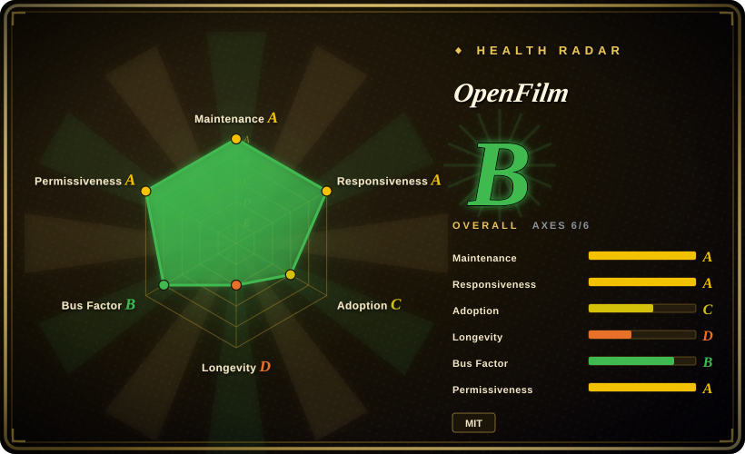
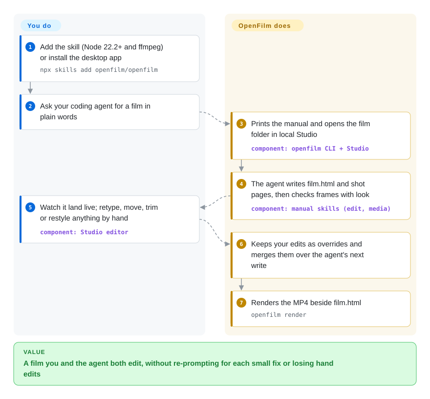
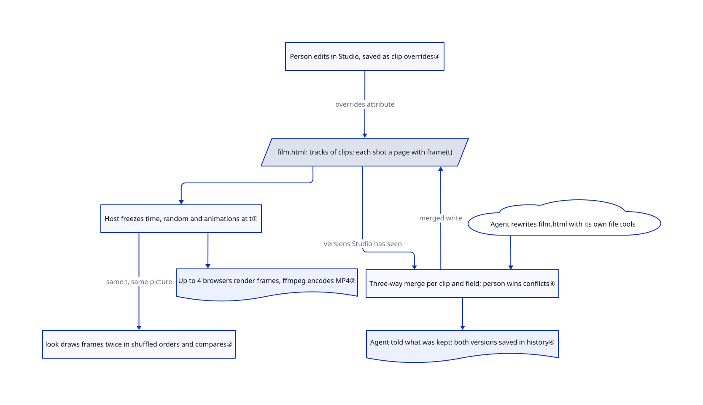

# OpenFilm

Your coding agent hands back a launch video in which one title is misspelled; asking it to fix the word re-renders the whole shot, and if you fix it yourself the agent's next pass writes over your change. OpenFilm keeps the film as an HTML project that the agent and you edit live in a local editor, and merges your hand edits over the agent's later rewrites.

## When to use

You already use Claude Code or Codex, and you need a 20–60 second launch, explainer or social clip with music, voice-over and subtitles. You want the agent to do most of the work — find footage and music, write each shot, cut them together — but you know you will want to touch it yourself: the title reads `Aura Pod` instead of `Aura Pods`, the logo sits 40 px too low, a subtitle line breaks mid-word. With a render-only pipeline every such fix is another prompt and another full render, and the agent sometimes "fixes" the layout around your request.

OpenFilm gives the agent a CLI and manual for writing the film as `film.html` plus one web page per shot, and gives you Studio, a local timeline editor that shows each change as the agent makes it. Your edits in Studio are stored as per-clip `overrides` rather than in the page's code, and a three-way merge keeps them when the agent later rewrites the file. Choose it over [HyperFrames](../render-engines/hyperframes.md) or [Remotion](../render-engines/remotion.md) when the deciding need is a person and an agent editing the same film without overwriting each other; those are render engines where your only lever is code or another prompt. Choose it over [OpenMontage](open-montage.md) when you would rather direct and retouch inside an editor than run a prompt-to-render pipeline.

## When NOT to use

- **You only need a renderer for a CI or batch pipeline (50 variants, no person in the loop):** use [HyperFrames](../render-engines/hyperframes.md) (Apache-2.0, framework-free HTML, a longer release history) or [Remotion](../render-engines/remotion.md) (React, cloud rendering, own license). OpenFilm's distinctive part is Studio and the person-edit merge; without a human editor you are carrying a desktop-shaped tool for no gain.
- **You need a dependency you can pin and forget:** the repo is six weeks old (created 2026-10-04), sixteen npm versions have shipped since 2026-10-03, and the README on `main` already describes 0.4 features (Screening and Color editors, plugins, the Community) that are not in the released v0.3.2 and still sit in open PR #496. Pin `openfilm@0.3.2` or choose Remotion, which has six years of releases behind it.
- **Headless Linux rendering with WebGL:** issue #458 (open as of 2026-11-18) reports every WebGL context lost in the first second on headless Linux, giving white frames in `look` and `render`; the desktop app ships only for macOS and Windows. For a Linux render farm prefer HyperFrames or Remotion and verify WebGL there first.
- **Air-gapped or no-egress environments:** the built-in music, sound effects, voice samples, emoji stickers, local models and template examples are not in the npm package; they are fetched from `openfilm.dev/library` on first use. Library search also posts your query text to `openfilm.dev` unless you turn it off in Settings → Services, and media generation needs your own provider keys or a paid OpenFilm balance. Bring your own assets into HyperFrames if nothing may leave the machine.
- **Long-form, multi-camera or colorist work by a post team:** use DaVinci Resolve or Premiere Pro (closed products), or [OpenCut](../../media-processing/video-editing/opencut.md) for an open-source browser editor. OpenFilm's timeline exports to FCP/Premiere/Resolve, but its center of gravity is short, code-drawn films.
- **Topic-to-stock-footage shorts with no agent and no editing:** use [MoneyPrinterTurbo](moneyprinter-turbo.md), a self-hosted WebUI/API appliance.
- **Shipping a rebranded fork:** the code is MIT, but `TRADEMARK.md` forbids publishing a modified product, hosted service or package under the OpenFilm name or logo; plan your own name from day one.

## Comparison

| Alternative | In index | Our verdict | Tradeoff |
|---|---|---|---|
| [HyperFrames](../render-engines/hyperframes.md) | ✅ | Pick HyperFrames for an automated HTML-to-MP4 pipeline that no person edits; pick OpenFilm when someone must retouch the agent's film in an editor and keep those edits across later agent passes. | HyperFrames is Apache-2.0 with a larger skill set and an AWS Lambda path; OpenFilm adds Studio, overrides and a three-way merge but is younger and carries a local server. |
| [Remotion](../render-engines/remotion.md) | ✅ | Pick Remotion for a React team building parameterized or programmatic video products; pick OpenFilm when the author is a coding agent plus a non-programmer who edits on a timeline. | Remotion has deep engine and cloud-render infrastructure under a company license with an eligibility gate; OpenFilm is MIT but pre-1.0 and has no hosted render service. |
| [OpenMontage](open-montage.md) | ✅ | Pick OpenMontage when you want an AI assistant to research, script, generate assets and render a full video from one prompt; pick OpenFilm when you want to watch, point at and hand-edit each shot as it is made. | OpenMontage covers more of the pipeline upfront and is AGPL-3.0; OpenFilm keeps a smaller agent manual and puts its effort into the shared editing surface. |
| [Lemo-Opuscar](lemo-opuscar.md) | ✅ | Pick Lemo-Opuscar when named art styles and directing guides are the value and the agent alone produces the film; pick OpenFilm when the deliverable needs a person's edits on a timeline. | Lemo is a skill-pack with style libraries and reading-time checks; OpenFilm is an application with a desktop app, a local server and an editor. |
| [OpenCut](../../media-processing/video-editing/opencut.md) | ✅ | Pick OpenCut for a person cutting existing footage in a browser NLE with no agent; pick OpenFilm when an agent writes the shots and the person refines them. | OpenCut is human-first editing of recorded media; OpenFilm treats every shot as code an agent can rewrite, which only pays off when an agent does the bulk of the work. |

## Quick start

Two entry points reach the same Studio. The desktop app (macOS and Windows, from GitHub Releases) bundles everything, including a built-in agent; alternatively, with Node 22.2+ and ffmpeg installed, add the skill to your own coding agent with `npx skills add openfilm/openfilm` and ask for a film in plain words, as the README's example does ("Make a 20-second launch video for my CLI, with music."). The skill tells the agent to run `npx -y openfilm@latest`, which prints a short manual; the agent then runs `openfilm open <folder>` to start Studio — the local editor server on 127.0.0.1 — writes `film.html` and one page per shot, and checks its work with `openfilm look`, which draws a contact sheet of frames. You watch the film fill in, and point at a clip or change text, position, timing or color yourself; OpenFilm keeps those edits through the agent's later writes and `openfilm render` produces the MP4 beside `film.html`. Your responsibilities: keys for any media service you connect (ElevenLabs, OpenAI, fal and others, or an OpenFilm account balance), rights to the footage and music, and checking the final cut.

<!-- flow-steps:begin (generated from flows/openfilm.json by tools/flow_card.py — do not edit) -->

Text version of the flow

1. **You**: Add the skill (Node 22.2+ and ffmpeg) or install the desktop app — `npx skills add openfilm/openfilm`
2. **You**: Ask your coding agent for a film in plain words
3. **OpenFilm**: Prints the manual and opens the film folder in local Studio — component: `openfilm CLI + Studio`
4. **OpenFilm**: The agent writes film.html and shot pages, then checks frames with look — component: `manual skills (edit, media)`
5. **You**: Watch it land live; retype, move, trim or restyle anything by hand — component: `Studio editor`
6. **OpenFilm**: Keeps your edits as overrides and merges them over the agent's next write
7. **OpenFilm**: Renders the MP4 beside film.html — `openfilm render`

**Value**: A film you and the agent both edit, without re-prompting for each small fix or losing hand edits

<!-- flow-steps:end -->

## Key techniques

<!-- mechanism:begin (generated from mechanisms/openfilm.json by tools/mechanism_card.py; do not edit) -->

Text version of the mechanism

- film.html: tracks of clips; each shot a page with frame(t)
- Host freezes time, random and animations at t①
- look draws frames twice in shuffled orders and compares②
- Up to 4 browsers render frames, ffmpeg encodes MP4②
- Person edits in Studio, saved as clip overrides③
- Agent rewrites film.html with its own file tools
- Three-way merge per clip and field; person wins conflicts④
- Agent told what was kept; both versions saved in history④

- film.html: tracks of clips; each shot a page with frame(t) → Host freezes time, random and animations at t①
- Host freezes time, random and animations at t① → look draws frames twice in shuffled orders and compares② (same t, same picture)
- Host freezes time, random and animations at t① → Up to 4 browsers render frames, ffmpeg encodes MP4②
- Person edits in Studio, saved as clip overrides③ → film.html: tracks of clips; each shot a page with frame(t) (overrides attribute)
- Agent rewrites film.html with its own file tools → Three-way merge per clip and field; person wins conflicts④
- film.html: tracks of clips; each shot a page with frame(t) → Three-way merge per clip and field; person wins conflicts④ (versions Studio has seen)
- Three-way merge per clip and field; person wins conflicts④ → Agent told what was kept; both versions saved in history④
- Three-way merge per clip and field; person wins conflicts④ → film.html: tracks of clips; each shot a page with frame(t) (merged write)

<!-- mechanism:end -->

### 1. Freeze every clock a page can read

- **Problem:** A shot drawn with CSS keyframes, `requestAnimationFrame` or random particles shows a different picture each time it is scrubbed or rendered in parallel.
- **How:** Before any page script runs, the reference host injects a prelude that replaces `performance.now()`, `requestAnimationFrame` timestamps, `Date` and `Math.random` with values derived from the frame's `t`, and pauses CSS/Web Animations at `t` after each `frame(t)` call. A separate patch nudges every video seek 1 ms forward so a seek at a frame boundary lands inside the requested frame.
- **Limits:** Timers, accumulated state and tweens that record their start values still break the rule; the spec tells authors to avoid them but the host cannot. GPU and rasterization differences mean repeated frames are compared with a tolerance, not byte for byte.
- **Source:** [Seek patch and frozen clock](https://github.com/openfilm/openfilm/blob/589953539de2c8c8c119e29f9c6033c1e90ed1fd/packages/openfilm/src/host.mjs#L14-L28), [the one rule](https://github.com/openfilm/openfilm/blob/589953539de2c8c8c119e29f9c6033c1e90ed1fd/packages/openfilm/SPEC.md).

### 2. Let the agent check determinism before it claims success

- **Problem:** An agent that says the film works without having looked at it ships white frames and order-dependent glitches.
- **How:** `openfilm look` draws a sample of frames twice, each pass in its own shuffled order, compares the pairs with a block-difference threshold, and warns if every frame is identical or if text is cut off in two or more frames. `openfilm render` then draws frames in up to four parallel browsers, optionally averaged over a shutter for motion blur, and pipes them to ffmpeg.
- **Limits:** A sheet samples twelve frames by default, not every frame; `look --full` on the rendered file is a separate step. Two passes that are both wrong in the same way pass, as issue #458 showed with all-white WebGL frames on headless Linux.
- **Source:** [Two shuffled passes](https://github.com/openfilm/openfilm/blob/589953539de2c8c8c119e29f9c6033c1e90ed1fd/packages/openfilm/src/look.mjs#L100-L116), [parallel render](https://github.com/openfilm/openfilm/blob/589953539de2c8c8c119e29f9c6033c1e90ed1fd/packages/openfilm/src/render.mjs#L1-L2), [worker cap](https://github.com/openfilm/openfilm/blob/589953539de2c8c8c119e29f9c6033c1e90ed1fd/packages/openfilm/src/render.mjs#L415-L443).

### 3. Store hand edits outside the page's code

- **Problem:** If retyping a title in the editor rewrites the shot's JavaScript, the agent's next rewrite of that page silently removes the change.
- **How:** A Studio edit inside a page becomes an `overrides` JSON entry on the clip in `film.html`: a CSS selector plus translate, scale, rotate, style or replacement text. After each frame the host applies the entries to matching elements and remembers the previous values so a removed override leaves nothing behind.
- **Limits:** An override finds its element only by selector; if the agent restructures the page and the selector no longer matches, the edit stops applying (Studio tracks `found` per entry). Only DOM elements can be edited this way, so the manual tells agents to keep editable content out of canvas pixels.
- **Source:** [Override application and restore](https://github.com/openfilm/openfilm/blob/589953539de2c8c8c119e29f9c6033c1e90ed1fd/packages/openfilm/src/overrides.mjs#L1-L73), [overrides in the format](https://github.com/openfilm/openfilm/blob/589953539de2c8c8c119e29f9c6033c1e90ed1fd/packages/openfilm/SPEC.md).

### 4. Merge the agent's whole-file writes three ways

- **Problem:** Agents rewrite `film.html` from a copy they read minutes ago, which would undo every timeline edit the person made since.
- **How:** Studio keeps the versions of `film.html` it has seen, infers which one the agent's copy started from (the closest), and merges per clip, field, style key and override entry: changes made only by the agent are taken, changes made only by the person stay, and on a conflict the person's value wins. Both the agent's text and the merge are kept in project history, and the agent is told what was kept in its next `openfilm` command or chat message.
- **Limits:** Which copy the agent read is inferred, never known; with two agents writing, the code documents cases it cannot tell apart, and older versions past the history caps are assumed to be the person's. A write cut off mid-tag is left alone until it is complete.
- **Source:** [Merge policy](https://github.com/openfilm/openfilm/blob/589953539de2c8c8c119e29f9c6033c1e90ed1fd/packages/openfilm/studio/server/person-edits.mjs#L1-L30), [three-way units](https://github.com/openfilm/openfilm/blob/589953539de2c8c8c119e29f9c6033c1e90ed1fd/packages/openfilm/studio/server/person-merge.mjs#L1-L12), [settle and keep aside](https://github.com/openfilm/openfilm/blob/589953539de2c8c8c119e29f9c6033c1e90ed1fd/packages/openfilm/studio/server/film.mjs#L83-L112).

## Tech stack

Node.js in a pnpm workspace: GitHub counts about 6.4 MB TypeScript (the React editor and desktop chat) and 5.5 MB JavaScript (the CLI, host and server as `.mjs` with JSDoc types). `packages/openfilm` holds the `openfilm` CLI, the film-format reader, the reference host on `playwright-core` driving headless Chromium, ffmpeg-based render and loudness checks, and Studio's server; Studio's editor is React 19 + Vite + Tailwind. `apps/desktop` is Electron, with chat that drives Claude Code and Codex over the Agent Client Protocol and a built-in agent on Pi (`@earendil-works/pi-coding-agent`). Media providers (ElevenLabs, OpenAI, Google, fal, Azure, Cartesia, Groq, Pexels, Pixabay, Tavily and others) are one file each under `studio/server/providers/`.

## Dependencies

- **Node 22.2+** for the npm package (22.18+ to build from source), **ffmpeg** on the PATH, and a headless Chromium that Playwright downloads on first use.
- **Network to `openfilm.dev`** for the published library parts (music, sounds, voice samples, emoji, local models, examples), for library search ranking unless turned off, and for desktop update checks in the official build.
- **Media service keys** you supply (or an OpenFilm account balance) for voice-over, music, image and video generation, transcription and web search; nothing is generated without one.
- **A coding agent** (Claude Code, Codex or another) for the skill path; the desktop app can bring its own agent with your model key.

## Ops difficulty

**Low to medium** for a single user. The desktop app or `npx` path needs no server setup: Studio is a per-machine process on 127.0.0.1 (port 4747) that answers only requests carrying a key it creates at launch, and projects live in a folder library (`~/Movies/OpenFilm/Projects` by default on macOS). The cost is upkeep: weekly 0.x releases, an update command that restarts Studio, platform-specific issues in the tracker (Windows rename locks, macOS export failures, headless-Linux WebGL), and media keys stored on the machine. There is no multi-user or hosted deployment story.

## Health & viability

- **2026-11-18 — maintenance:** very active; v0.3.2 shipped on 2026-11-09 after sixteen npm versions in about six weeks, default-branch commits landing daily, and a 0.4 release PR (#496) with 155 changesets open.
- **Governance and bus factor:** an organization account (`openfilm`, created 2026-10-02), but commits are concentrated: `riverisbuilding` 129 and `WEBGRS` 53 of the top-15 tally, then a long tail. Every PR is maintainer-reviewed and squash-merged; no CLA. Who funds the project beyond the paid OpenFilm account service is not stated.
- **Age and Lindy:** about six weeks old. 8.1k stars and 795 forks on a repo that young are attention, not proof of durability; under the Lindy prior this is a high-variance bet until it survives several release cycles.
- **Adoption:** the `openfilm` npm package recorded 42,365 downloads in the last month as measured by the health scorer on 2026-11-18, and the README is translated into 22 languages. Real production use beyond the authors' demos was not found.
- **Risk flags:** MIT code with a separate trademark policy; library assets are CC0 except Microsoft Fluent Emoji (MIT). The free tool relies on `openfilm.dev` for library assets and offers a paid media account, so part of the experience is tied to a vendor service that could change terms.

## Caveats (unverified)

- [未验证：本次未运行上游工具] Film quality, render speed, the determinism checks in practice and the desktop app's built-in agent were not exercised; claims above come from source and docs.
- [推断：依据是 main 分支 README 与 PR #496 的内容对比] Features named in the current README (Screening and Color editors, plugins, Community) appear to be unreleased in v0.3.2; verify against the version you install.
- [未验证：未找到公开说明] How OpenFilm's hosted service is funded and whether the library host will stay free is not documented.
- [推断：依据是 issue 列表中 Windows 与 macOS 导出报错] Platform reliability outside the maintainers' machines is still settling; issues #452, #478 and #497 report export or playback failures.
- [未验证：未检查 openfilm.dev 服务端] What the OpenFilm service logs from library search queries and media runs was not checked.
