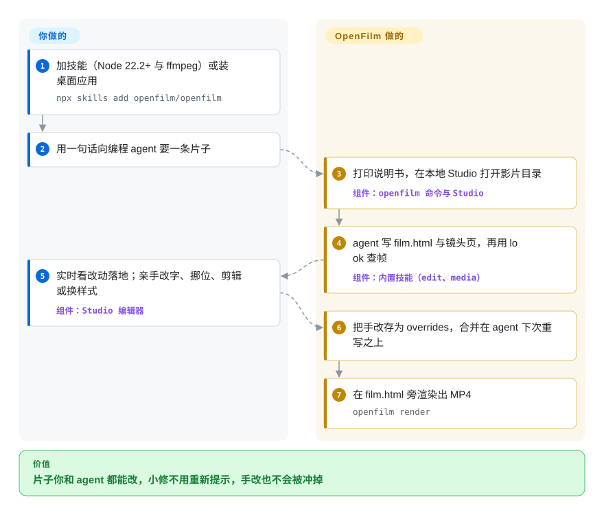

# OpenFilm

编程 agent 交回来的发布视频里有个标题拼错了：让它改一个词，整个镜头要重新渲染；你自己动手改了，agent 下一轮又把它覆盖掉。OpenFilm 把片子存成一个 HTML 工程，agent 和你在本地编辑器里同时改，你手改的地方会合并保留在 agent 之后的重写之上。

## 何时使用

你平时就用 Claude Code 或 Codex，现在要一条 20–60 秒的发布片、讲解片或社媒短片，带配乐、旁白和字幕。你希望大部分活由 agent 做——找素材和音乐、写每个镜头、剪到一起——但你清楚最后一定要亲手动几下：标题写成了 `Aura Pod` 而不是 `Aura Pods`，logo 低了 40 像素，某行字幕在单词中间断开。只靠渲染管线的话，每个这样的小修都是再提示一次、再整条渲染一次，agent 还可能顺手把你没让动的布局也“修”了。

OpenFilm 给 agent 一套命令行和说明书，让它把片子写成 `film.html` 加每个镜头一个网页；给你的是 Studio——本地时间线编辑器，agent 每改一处你都实时看到。你在 Studio 里的改动存成每个片段的 `overrides`，不写进网页代码；agent 之后重写文件时，三方合并会保住这些改动。决定性的需求是“人和 agent 改同一条片子而不互相覆盖”时，选它而不是 [HyperFrames](../render-engines/hyperframes.zh.md) 或 [Remotion](../render-engines/remotion.zh.md)——那两个是渲染引擎，你手里只有代码或再提示一次。比起 [OpenMontage](open-montage.zh.md)，如果你更想在编辑器里边看边导、边看边修，而不是跑一条从提示到成片的流水线，也选 OpenFilm。

## 何时不用

- **只要一个给 CI 或批量任务用的渲染器（一周 50 个变体，没人介入）：** 用 [HyperFrames](../render-engines/hyperframes.zh.md)（Apache-2.0、纯 HTML、发布历史更长）或 [Remotion](../render-engines/remotion.zh.md)（React、云渲染、自有许可证）。OpenFilm 的独特之处是 Studio 和人工改动合并；没有人在编辑器里改，你就白背了一个桌面形态的工具。
- **需要一个能锁版本后长期不管的依赖：** 仓库才六周（2026-10-04 创建），2026-10-03 起 npm 已发了 16 个版本；`main` 上的 README 已经在介绍 0.4 的功能（Screening 与 Color 编辑器、插件、Community），这些不在已发布的 v0.3.2 里，还挂在未合并的 PR #496。要么锁定 `openfilm@0.3.2`，要么选有六年发布历史的 Remotion。
- **在无头 Linux 上渲染 WebGL 镜头：** issue #458（截至 2026-11-18 仍开着）报告无头 Linux 上头一秒创建的 WebGL 上下文全部丢失，`look` 和 `render` 出白帧；桌面应用也只发 macOS 和 Windows 版。Linux 渲染农场优先考虑 HyperFrames 或 Remotion，并先验证 WebGL。
- **内网隔离或不允许外发：** 内置的音乐、音效、配音样本、emoji 贴纸、本地模型和模板示例都不在 npm 包里，首次使用时从 `openfilm.dev/library` 下载；素材库搜索默认还会把你的查询文字发到 `openfilm.dev`，除非在 Settings → Services 里关掉；生成媒体要用你自己的服务商 key 或付费的 OpenFilm 余额。什么都不能出机器时，用自备素材配 HyperFrames。
- **后期团队做长片、多机位或专业调色：** 用 DaVinci Resolve 或 Premiere Pro（闭源产品），或开源浏览器剪辑器 [OpenCut](../../media-processing/video-editing/opencut.zh.md)。OpenFilm 的时间线能导出到 FCP、Premiere、Resolve，但它的重心是代码绘制的短片。
- **从主题直接出素材拼接短视频，不要 agent 也不要剪辑：** 用自托管 WebUI／API 一体的 [MoneyPrinterTurbo](moneyprinter-turbo.zh.md)。
- **想换个牌子发自己的分支：** 代码是 MIT，但 `TRADEMARK.md` 禁止用 OpenFilm 名称或 logo 发布修改版产品、托管服务或软件包；一开始就要想好自己的名字。

## 横向对比

| 替代品 | 是否收录 | 我们的评价 | 取舍 |
|---|---|---|---|
| [HyperFrames](../render-engines/hyperframes.zh.md) | ✅ | 没有人参与编辑的自动化 HTML 转 MP4 流水线选 HyperFrames；需要有人在编辑器里修 agent 的片子、并在之后几轮 agent 修改中保住这些改动时选 OpenFilm。 | HyperFrames 是 Apache-2.0，技能更多，还有 AWS Lambda 渲染路径；OpenFilm 多了 Studio、overrides 和三方合并，但更年轻，还要跑一个本地服务。 |
| [Remotion](../render-engines/remotion.zh.md) | ✅ | React 团队做参数化、程序化视频产品选 Remotion；作者是编程 agent 加一个只会拖时间线的非程序员时选 OpenFilm。 | Remotion 引擎和云渲染基础设施更深，但公司许可证有资格门槛；OpenFilm 是 MIT，却还在 1.0 之前，也没有托管渲染服务。 |
| [OpenMontage](open-montage.zh.md) | ✅ | 想让 AI 助手从一句提示一路调研、写稿、生成素材并渲染整片，选 OpenMontage；想边做边看、指着某个镜头说改、或亲手改，选 OpenFilm。 | OpenMontage 前段流程覆盖更多，许可证是 AGPL-3.0；OpenFilm 的 agent 说明书更短，力气花在人机共用的编辑界面上。 |
| [Lemo-Opuscar](lemo-opuscar.zh.md) | ✅ | 价值在命名画风和导演指南、由 agent 独立出片时选 Lemo-Opuscar；成片需要人在时间线上修改时选 OpenFilm。 | Lemo 是技能包，自带风格库和阅读时长检查；OpenFilm 是应用，有桌面端、本地服务和编辑器。 |
| [OpenCut](../../media-processing/video-editing/opencut.zh.md) | ✅ | 人在浏览器里剪已有素材、不用 agent，选 OpenCut；agent 写镜头、人来精修，选 OpenFilm。 | OpenCut 是以人为主的录制素材剪辑；OpenFilm 把每个镜头当成 agent 可重写的代码，只有大部分活交给 agent 时才划算。 |

## 快速上手

两个入口通向同一个 Studio。桌面应用（macOS 和 Windows，从 GitHub Releases 下载）把所需的都打包了，连内置 agent 也有；另一条路是装好 Node 22.2+ 和 ffmpeg，用 `npx skills add openfilm/openfilm` 把技能加进你自己的编程 agent，然后用一句话要片子，比如 README 里的例子“Make a 20-second launch video for my CLI, with music.”。技能让 agent 运行 `npx -y openfilm@latest`，它会打印一份简短说明书；agent 接着运行 `openfilm open <folder>` 启动 Studio（监听 127.0.0.1 的本地编辑器服务），写 `film.html` 和每个镜头的网页，再用 `openfilm look` 检查——它会画出一张帧缩略图拼版。你看着片子一点点成形，可以指着某个片段让它改，也可以自己改文字、位置、时长或颜色；OpenFilm 在 agent 之后的写入中保住这些改动，`openfilm render` 在 `film.html` 旁边输出 MP4。你要负责的：接入媒体服务的 key（ElevenLabs、OpenAI、fal 等，或 OpenFilm 账户余额）、素材和音乐的版权、以及最终成片的检查。

<!-- flow-steps:begin (generated from flows/openfilm.json by tools/flow_card.py — do not edit) -->

流程文字版

1. **你**：加技能（Node 22.2+ 与 ffmpeg）或装桌面应用 — `npx skills add openfilm/openfilm`
2. **你**：用一句话向编程 agent 要一条片子
3. **OpenFilm**：打印说明书，在本地 Studio 打开影片目录 — 组件：`openfilm 命令与 Studio`
4. **OpenFilm**：agent 写 film.html 与镜头页，再用 look 查帧 — 组件：`内置技能（edit、media）`
5. **你**：实时看改动落地；亲手改字、挪位、剪辑或换样式 — 组件：`Studio 编辑器`
6. **OpenFilm**：把手改存为 overrides，合并在 agent 下次重写之上
7. **OpenFilm**：在 film.html 旁渲染出 MP4 — `openfilm render`

**价值**：片子你和 agent 都能改，小修不用重新提示，手改也不会被冲掉

<!-- flow-steps:end -->

## 技术要点

<!-- mechanism:begin (generated from mechanisms/openfilm.json by tools/mechanism_card.py; do not edit) -->

机制文字版

- film.html：轨道与片段；每个镜头是带 frame(t) 的网页
- 宿主把时间、随机数与动画钉在 t①
- look 按两种乱序各画一遍并比对②
- 最多 4 个浏览器并发出帧，ffmpeg 编码 MP4②
- 人在 Studio 手改，存为片段 overrides③
- agent 用自己的文件工具重写 film.html
- 按片段与字段三方合并；冲突时人的值胜出④
- 告诉 agent 保留了什么；两版都存进历史④

- film.html：轨道与片段；每个镜头是带 frame(t) 的网页 → 宿主把时间、随机数与动画钉在 t①
- 宿主把时间、随机数与动画钉在 t① → look 按两种乱序各画一遍并比对②（同一 t 同一画面）
- 宿主把时间、随机数与动画钉在 t① → 最多 4 个浏览器并发出帧，ffmpeg 编码 MP4②
- 人在 Studio 手改，存为片段 overrides③ → film.html：轨道与片段；每个镜头是带 frame(t) 的网页（overrides 属性）
- agent 用自己的文件工具重写 film.html → 按片段与字段三方合并；冲突时人的值胜出④
- film.html：轨道与片段；每个镜头是带 frame(t) 的网页 → 按片段与字段三方合并；冲突时人的值胜出④（Studio 见过的版本）
- 按片段与字段三方合并；冲突时人的值胜出④ → 告诉 agent 保留了什么；两版都存进历史④
- 按片段与字段三方合并；冲突时人的值胜出④ → film.html：轨道与片段；每个镜头是带 frame(t) 的网页（合并后写回）

<!-- mechanism:end -->

### 1. 把网页能读到的时钟全部钉住

- **解决：** 用 CSS 关键帧、`requestAnimationFrame` 或随机粒子画的镜头，每次拖动预览或并行渲染时画面都不一样。
- **做法：** 在网页脚本运行前，参考宿主注入一段前置脚本，把 `performance.now()`、`requestAnimationFrame` 时间戳、`Date` 和 `Math.random` 换成由当前帧 `t` 推出的值，并在每次 `frame(t)` 之后把 CSS／Web 动画暂停在 `t`。另一段补丁把每次视频跳转往后挪 1 毫秒，让落在帧边界上的跳转落进所要的那一帧。
- **边界：** 定时器、累积状态、记录起始值的补间动画仍会破坏规则；规范要求作者避开，宿主管不了。GPU 和光栅化差异使重复帧只能按容差比较，不能逐字节相同。
- **源码：** [跳转补丁与冻结时钟](https://github.com/openfilm/openfilm/blob/589953539de2c8c8c119e29f9c6033c1e90ed1fd/packages/openfilm/src/host.mjs#L14-L28)、[唯一规则](https://github.com/openfilm/openfilm/blob/589953539de2c8c8c119e29f9c6033c1e90ed1fd/packages/openfilm/SPEC.md)。

### 2. 让 agent 先查确定性，再说做好了

- **解决：** agent 没看过就说片子没问题，交出去的可能是白帧或依赖绘制顺序的错乱。
- **做法：** `openfilm look` 把抽样帧画两遍，每遍用各自的乱序，按分块差异阈值逐对比较；如果所有帧都一样，或文字在两帧以上被截断，就给出警告。`openfilm render` 再用最多四个并行浏览器出帧，可按快门做运动模糊平均，交给 ffmpeg 编码。
- **边界：** 拼版默认只抽 12 帧，不是每一帧；对成片逐帧检查要另跑 `look --full`。两遍错得一模一样也会通过，issue #458 中无头 Linux 上 WebGL 全白就是这样。
- **源码：** [两遍乱序绘制](https://github.com/openfilm/openfilm/blob/589953539de2c8c8c119e29f9c6033c1e90ed1fd/packages/openfilm/src/look.mjs#L100-L116)、[并行渲染](https://github.com/openfilm/openfilm/blob/589953539de2c8c8c119e29f9c6033c1e90ed1fd/packages/openfilm/src/render.mjs#L1-L2)、[并发上限](https://github.com/openfilm/openfilm/blob/589953539de2c8c8c119e29f9c6033c1e90ed1fd/packages/openfilm/src/render.mjs#L415-L443)。

### 3. 手改存在网页代码之外

- **解决：** 如果在编辑器里改个标题就改写了镜头的 JavaScript，agent 下次重写这个网页时会悄悄把改动抹掉。
- **做法：** 在 Studio 里对网页内元素的修改，变成 `film.html` 中该片段上的一条 `overrides` JSON：一个 CSS 选择器加位移、缩放、旋转、样式或替换文字。每画完一帧，宿主把这些条目套到匹配的元素上，并记住原值，撤掉一条改动时不留痕迹。
- **边界：** 改动只靠选择器找元素；agent 重构网页后选择器对不上，改动就不再生效（Studio 为每条记录是否找到）。只有 DOM 元素能这样改，所以说明书要求 agent 别把可编辑内容画进 canvas 像素。
- **源码：** [应用与还原改动](https://github.com/openfilm/openfilm/blob/589953539de2c8c8c119e29f9c6033c1e90ed1fd/packages/openfilm/src/overrides.mjs#L1-L73)、[格式中的 overrides](https://github.com/openfilm/openfilm/blob/589953539de2c8c8c119e29f9c6033c1e90ed1fd/packages/openfilm/SPEC.md)。

### 4. 对 agent 的整文件写入做三方合并

- **解决：** agent 常拿几分钟前读到的副本整份重写 `film.html`，会把人在这期间做的时间线修改全部撤销。
- **做法：** Studio 保存它见过的各版 `film.html`，推断 agent 的副本最接近哪一版，再按片段、字段、样式键和 overrides 条目逐项合并：只有 agent 改的取 agent 的，只有人改的保留人的，双方改得不同则人的值胜出。agent 的原文和合并结果都存进项目历史，并在 agent 的下一个 `openfilm` 命令或下一条聊天消息里告诉它保留了什么。
- **边界：** agent 读的是哪一版只能推断，无法确知；两个 agent 同时写时，代码注释列出了分不清的情形；超出历史保留上限的旧版本一律按人的改动处理。写到一半、断在标签中间的文件会先放着，等写完整再合并。
- **源码：** [合并策略](https://github.com/openfilm/openfilm/blob/589953539de2c8c8c119e29f9c6033c1e90ed1fd/packages/openfilm/studio/server/person-edits.mjs#L1-L30)、[三方合并单元](https://github.com/openfilm/openfilm/blob/589953539de2c8c8c119e29f9c6033c1e90ed1fd/packages/openfilm/studio/server/person-merge.mjs#L1-L12)、[落盘与留档](https://github.com/openfilm/openfilm/blob/589953539de2c8c8c119e29f9c6033c1e90ed1fd/packages/openfilm/studio/server/film.mjs#L83-L112)。

## 技术栈

pnpm 工作区里的 Node.js：GitHub 统计约 6.4 MB TypeScript（React 编辑器与桌面聊天）和 5.5 MB JavaScript（命令行、宿主与服务端，写成带 JSDoc 类型的 `.mjs`）。`packages/openfilm` 包含 `openfilm` 命令行、影片格式解析器、基于 `playwright-core` 驱动无头 Chromium 的参考宿主、基于 ffmpeg 的渲染与响度检查，以及 Studio 服务端；Studio 编辑器用 React 19、Vite、Tailwind。`apps/desktop` 是 Electron，聊天面板通过 Agent Client Protocol 驱动 Claude Code 和 Codex，内置 agent 基于 Pi（`@earendil-works/pi-coding-agent`）。媒体服务商（ElevenLabs、OpenAI、Google、fal、Azure、Cartesia、Groq、Pexels、Pixabay、Tavily 等）在 `studio/server/providers/` 下各占一个文件。

## 依赖

- **Node 22.2+**（npm 包；从源码构建要 22.18+）、PATH 上的 **ffmpeg**，以及 Playwright 首次使用时下载的无头 Chromium。
- **能访问 `openfilm.dev` 的网络**：下载素材库的发布部分（音乐、音效、配音样本、emoji、本地模型、示例），素材库搜索排序（可关闭），官方构建的桌面端更新检查。
- **你提供的媒体服务 key**（或 OpenFilm 账户余额），用于配音、配乐、图像与视频生成、转写和网页搜索；没有 key 就不会生成任何东西。
- **一个编程 agent**（Claude Code、Codex 或其他），走技能路径时需要；桌面应用可以用你的模型 key 带自己的 agent。

## 运维难度

单人使用时**低到中**。桌面应用或 `npx` 路径不用搭服务器：Studio 是每台机器一个、监听 127.0.0.1（端口 4747）的进程，只响应携带它启动时生成的密钥的请求；工程存在一个文件夹库里（macOS 默认 `~/Movies/OpenFilm/Projects`）。代价在维护：0.x 每周发版、更新命令会重启 Studio、各平台问题仍在 issue 里（Windows 重命名被锁、macOS 导出失败、无头 Linux WebGL），媒体 key 存在本机。没有多用户或托管部署方案。

## 健康度与可持续性

- **2026-11-18 维护：** 非常活跃；v0.3.2 于 2026-11-09 发布，此前约六周里 npm 已发 16 个版本，默认分支每天都有提交，0.4 的发布 PR（#496，含 155 个 changeset）尚未合并。
- **治理与巴士系数：** 属于组织账号（`openfilm`，2026-10-02 创建），但提交高度集中：前 15 名统计里 `riverisbuilding` 129 次、`WEBGRS` 53 次，之后是长尾。每个 PR 都由维护者审后 squash 合并；不需要签 CLA。除了付费的 OpenFilm 账户服务外，项目靠什么维持没有说明。
- **年龄与 Lindy：** 约六周大。这么年轻的仓库拿到 8.1k star、795 fork，说明的是关注度，不是耐久性；按 Lindy 先验，在它熬过几个发布周期之前，这是高方差的押注。
- **采用度：** `openfilm` npm 包最近一个月下载 42,365 次（健康度评分于 2026-11-18 测得），README 译成 22 种语言。没有找到作者演示之外的真实生产使用案例。
- **风险信号：** 代码 MIT，另有商标政策；素材库为 CC0，Microsoft Fluent Emoji 部分为 MIT。免费工具依赖 `openfilm.dev` 提供素材，同时提供付费媒体账户，所以部分体验绑在一个厂商服务上，条款可能变化。

## 存疑（未验证）

- [未验证：本次未运行上游工具] 成片质量、渲染速度、确定性检查的实际效果和桌面应用的内置 agent 都没有实际跑过；上文结论来自源码和文档。
- [推断：依据是 main 分支 README 与 PR #496 的内容对比] 当前 README 提到的功能（Screening 与 Color 编辑器、插件、Community）看来不在 v0.3.2 中；以你实际安装的版本为准。
- [未验证：未找到公开说明] OpenFilm 托管服务的资金来源、素材库下载是否会一直免费，均无文档说明。
- [推断：依据是 issue 列表中 Windows 与 macOS 导出报错] 维护者机器之外的平台稳定性仍在磨合；issue #452、#478、#497 报告了导出或播放失败。
- [未验证：未检查 openfilm.dev 服务端] OpenFilm 服务会记录素材库搜索查询和媒体任务中的哪些内容，没有核查。
