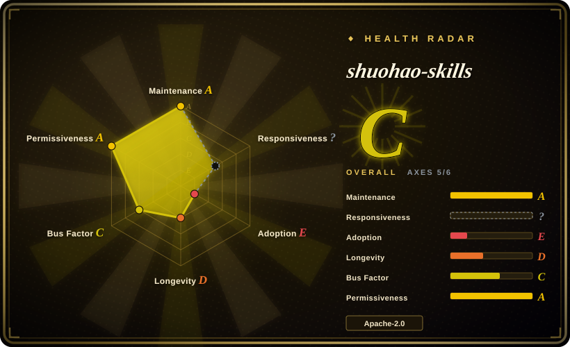
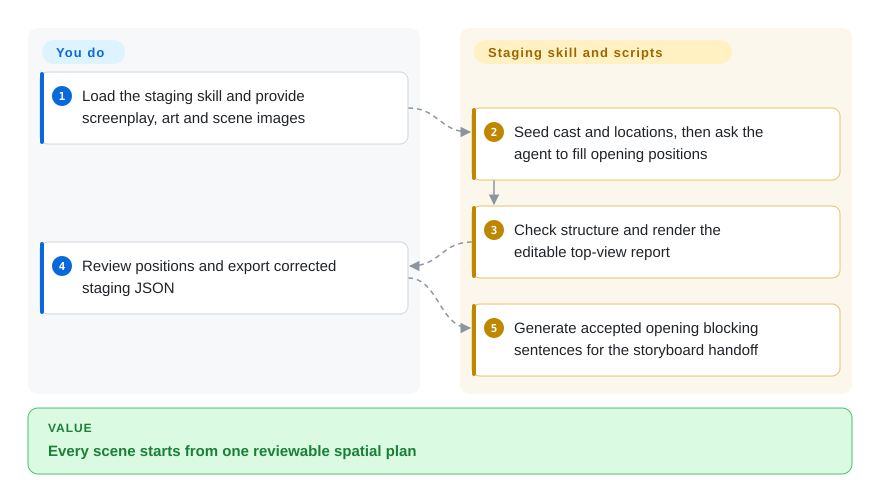
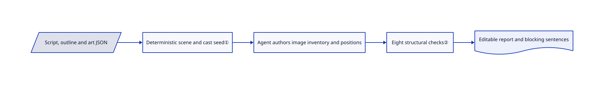

# shuohao-skills

Your generated drama keeps changing who sits where between shots; this collection turns a novel into shared character, art, script, staging and storyboard records before production.

## When to use

You are adapting a Chinese-first short drama and character identities, props and opening positions drift between independently generated clips. Pick these skills for structured pre-production records and executable checks rather than a one-command video generator. An agent authors the creative content, scripts validate its structure, and you approve the material before paying for image or video generation.

## When NOT to use

- Need a finished explanatory film rather than drama preparation? Choose [OpenMontage](open-montage.md).
- Need a product promo from real UI captures? Choose [video-shotcraft](video-shotcraft.md), not a novel-adaptation workflow.
- Need deterministic timeline rendering? Choose [Remotion](../render-engines/remotion.md); this collection is not a rendering engine.
- Need fully English character data without adaptation? Use a custom workflow instead: the character validator explicitly rejects English in some authored fields, despite English report interfaces.

## Comparison

| Alternative | In index | Our verdict | Tradeoff |
| --- | --- | --- | --- |
| [OpenMontage](open-montage.md) | ✅ | Choose OpenMontage for a whole video pipeline; choose shuohao-skills for character and staging continuity in short drama. | Broader production automation versus specialized reviewable preparation. |
| [video-shotcraft](video-shotcraft.md) | ✅ | Choose video-shotcraft for product footage and shot recipes; choose this collection when a novel must become scenes and consistent cast. | UI-grounded promo assets versus narrative and spatial planning. |
| [Remotion](../render-engines/remotion.md) | ✅ | Choose Remotion to render a coded timeline; choose these skills to prepare drama material for external generators. | A rendering runtime versus prompts, JSON contracts and validators; Remotion's separate license still matters if added downstream. |

## Quick start

Review a pinned checkout and expose only the selected skill directory to an agent that reads `SKILL.md`; the provided installer symlinks into Claude Code or Codex and makes later pulls immediately active. Supply a source story and let the agent produce each stage's JSON and report. Node 18+ standard-library scripts seed records, validate them and render HTML, while creative decisions and generation costs remain yours. For staging, provide `script.json`, optionally art and scene images, then review the draggable report and export corrected JSON. Its blocking sentences must still be copied into the storyboard: automatic staging import is not implemented. See [usage](https://github.com/eternityspring/shuohao-skills/blob/d28a9c539b40523d081794b25ff9113016bd98e0/skills/novel-staging/SKILL.md).

<!-- flow-steps:begin (generated from flows/shuohao-skills.json by tools/flow_card.py — do not edit) -->

Text version of the flow

1. **You**: Load the staging skill and provide screenplay, art and scene images
2. **shuohao-skills**: Seed cast and locations, then ask the agent to fill opening positions
3. **shuohao-skills**: Check structure and render the editable top-view report
4. **You**: Review positions and export corrected staging JSON
5. **shuohao-skills**: Generate accepted opening blocking sentences for the storyboard handoff

**Value**: Every scene starts from one reviewable spatial plan

<!-- flow-steps:end -->

## Key techniques

<!-- mechanism:begin (generated from mechanisms/shuohao-skills.json by tools/mechanism_card.py; do not edit) -->

Text version of the mechanism

- Script, outline and art JSON
- Deterministic scene and cast seed①
- Agent authors image inventory and positions
- Eight structural checks②
- Editable report and blocking sentences

- Script, outline and art JSON → Deterministic scene and cast seed①
- Deterministic scene and cast seed① → Agent authors image inventory and positions
- Agent authors image inventory and positions → Eight structural checks②
- Eight structural checks② → Editable report and blocking sentences

<!-- mechanism:end -->

### 1. Seed known facts instead of asking the model to invent them

- **Problem:** Rebuilding a scene roster by prose can change cast or location identities.
- **How:** Staging seed copies episode, scene, location and cast from script JSON, resolves names from the outline, and leaves placement fields empty for the agent.
- **Limits:** It copies supplied facts; it does not verify the source story or infer visually correct furniture.
- **Source:** [Seed implementation](https://github.com/eternityspring/shuohao-skills/blob/d28a9c539b40523d081794b25ff9113016bd98e0/skills/novel-staging/scripts/novel-staging.mjs#L358-L383).

### 2. Separate structural checks from visual judgment

- **Problem:** A plausible staging paragraph can omit a character or overlap people at one position.
- **How:** Eight code-defined gates check object shape, cast, placement and extras; generated blocking text follows accepted structured positions. Prompt-derived locations remain distinct from picture-derived ones.
- **Limits:** Missing script input weakens cast verification, and a valid box is not proof that the object exists in the image. The agent and human still judge the image.
- **Source:** [Validation and blocking](https://github.com/eternityspring/shuohao-skills/blob/d28a9c539b40523d081794b25ff9113016bd98e0/skills/novel-staging/scripts/novel-staging.mjs#L395-L506).

## Health & viability

- As of 2026-10-18, the August-created repository had October commits and several contributors, but no tagged releases.
- The author documents spare-time maintenance; self-tests exist, while README says there is no CI. [推断：依据是维护说明和短历史] Use pinned revisions rather than treating linked skills as a stable product.
- Apache-2.0 and NOTICE name the project; external image and video providers keep their own pricing and usage rules.

## Caveats (unverified)

- [未验证：本批禁止运行上游] Validators, HTML interactions and generation quality were not executed or benchmarked.
- [推断：依据是维护说明和短历史] Long-term maintenance remains uncertain; current activity alone is not a Lindy signal.
