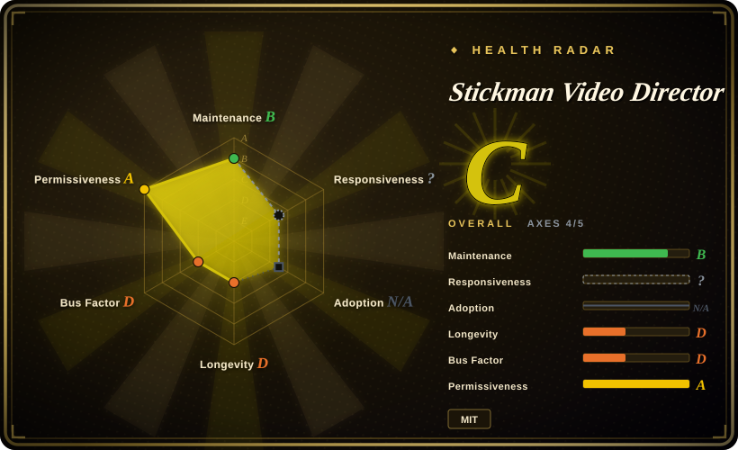
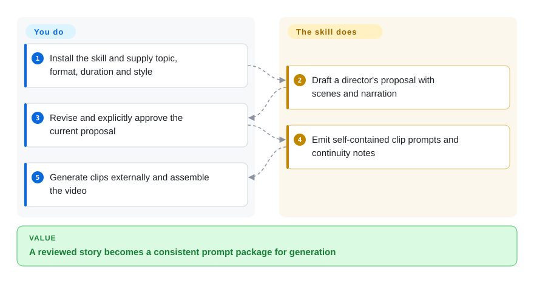
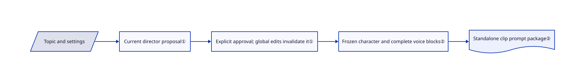

# Stickman Video Director

Six generated clips show six slightly different characters and narrators. This skill freezes a director-approved plan and repeats complete character and voice instructions in each standalone clip prompt.

## When to use

You make a short educational or everyday-life video and want stick figures rather than stock footage. Starting directly in a video generator leaves you rewriting the same scene, character and narrator descriptions across clips. Choose this pack when the missing piece is a consistent storyboard and prompt package with an approval stop, not a renderer or editor. It offers four style families and six visual options, including monochrome, modern, prehistoric comedy and colorful everyday storytelling.

## When NOT to use

- **You expect a finished MP4 from one invocation.** Choose [anything2explainer](anything2explainer.md) for an orchestrated code-rendered explainer; this skill stops at prompts and editing notes.
- **Text must be exact and every frame reproducible.** Choose [HyperFrames](../render-engines/hyperframes.md); generated footage is stochastic and this pack normally forbids visible words inside generated clips.
- **You already direct clips yourself and need a generation interface.** Use Google Flow directly. This repository adds planning instructions, not a video model or an API integration.
- **Exact voice identity is mandatory.** Use a continuous external narration track in your editor; repeated voice text is a prompt-level consistency aid, not a guaranteed shared voice asset.

## Comparison

| Alternative | In index | Our verdict | Tradeoff |
|---|---|---|---|
| [anything2explainer](anything2explainer.md) | ✅ | Choose it for a whole code-rendered explainer pipeline; choose this pack for short generative stick-figure storyboards. | More production automation versus narrower prompt-only adoption; the alternative has noncommercial toolkit terms. |
| [HyperFrames](../render-engines/hyperframes.md) | ✅ | Choose HyperFrames for editable exact text and deterministic graphics; choose this pack for generative character scenes without writing animation code. | Browser-based rendering versus model variability and manual assembly. |
| Google Flow | not a repo | Use Flow alone if you already own the directing method; add this skill when continuity and approval discipline are missing. | Hosted commercial generation service, not a repository; generation costs remain separate. |

## Quick start

Copy `skills/directing-stickman-videos/` into your agent's skill directory, then supply a topic, aspect ratio, duration and style. Missing ratio or style must be confirmed before planning; unspecified duration defaults to 60 seconds. The agent writes a director's proposal and waits for your approval before emitting independent English clip prompts. Submit those prompts to your chosen generation service and assemble clips and subtitles in an editor yourself. The pack needs no model API or MCP setup of its own, but your assistant and video-generation service have separate access requirements and costs.

<!-- flow-steps:begin (generated from flows/stickman-video-director.json by tools/flow_card.py — do not edit) -->

Text version of the flow

1. **You**: Install the skill and supply topic, format, duration and style
2. **Stickman Video Director**: Draft a director's proposal with scenes and narration
3. **You**: Revise and explicitly approve the current proposal
4. **Stickman Video Director**: Emit self-contained clip prompts and continuity notes
5. **You**: Generate clips externally and assemble the video

**Value**: A reviewed story becomes a consistent prompt package for generation

<!-- flow-steps:end -->

## Key techniques

<!-- mechanism:begin (generated from mechanisms/stickman-video-director.json by tools/mechanism_card.py; do not edit) -->

Text version of the mechanism

- Topic and settings
- Current director proposal①
- Explicit approval; global edits invalidate it①
- Frozen character and complete voice blocks②
- Standalone clip prompt package②

- Topic and settings → Current director proposal①
- Current director proposal① → Explicit approval; global edits invalidate it①
- Explicit approval; global edits invalidate it① → Frozen character and complete voice blocks②
- Frozen character and complete voice blocks② → Standalone clip prompt package②

<!-- mechanism:end -->

### 1. Invalidate approval when global choices change

- **Problem:** An approved topic can be mistaken for approval of a later storyboard or a different layout.
- **How:** The skill separates proposal and production phases. Changes to ratio, duration, style, narration or global direction require a recomposed proposal and renewed explicit approval.
- **Limits:** These are instructions followed by the host model, not an enforced state machine or payment authorization system.
- **Source:** [Setup and approval rules](https://github.com/kaomei/stickman-video-director/blob/5841335db851b5f0352cf77955147393b97beabc/skills/directing-stickman-videos/SKILL.md#L12-L39).

### 2. Freeze complete continuity blocks in every independent prompt

- **Problem:** A separate generation job cannot resolve “same narrator” from a previous job's context.
- **How:** The voice reference requires a complete approved profile in every clip, including accent, timbre, register, pace and recording treatment. The production contract also carries first/last-frame state and character anchors into self-contained prompts.
- **Limits:** Text equality does not guarantee visual or audio equality. The reference asks for listening checks and says its accepted three-clip voice test is sample-specific.
- **Source:** [Voice contract](https://github.com/kaomei/stickman-video-director/blob/5841335db851b5f0352cf77955147393b97beabc/skills/directing-stickman-videos/references/voice-continuity.md#L11-L39), [prompt assembly](https://github.com/kaomei/stickman-video-director/blob/5841335db851b5f0352cf77955147393b97beabc/skills/directing-stickman-videos/references/omni-flash-prompt-contract.md#L18-L49).

## Health & viability

- **2026-10-18 — young personal collection.** Created August 3, with recent October style and continuity changes; no GitHub releases in the retrieved release list.
- **Maintenance concentration.** The contributor snapshot lists kaomei alone. Two months of history provides little Lindy evidence despite visible examples and stars.
- **License and verification.** The MIT file names Stickman Video Director contributors. The tree contains actual skill references, scenario fixtures and verification scripts, not only showcase media.
- **Adoption judgment.** Useful as a readable directing template; provider behavior and continued maintenance remain outside the skill's control.

## Caveats (unverified)

- [未验证：未调用付费视频服务] Clip quality, audio continuity and current availability of the upstream-named Omni Flash generation path were not reproduced.
- [推断：依据是提示词约束而非运行时门禁] Host models may skip approval or continuity instructions; keep a human review before paid generation.
