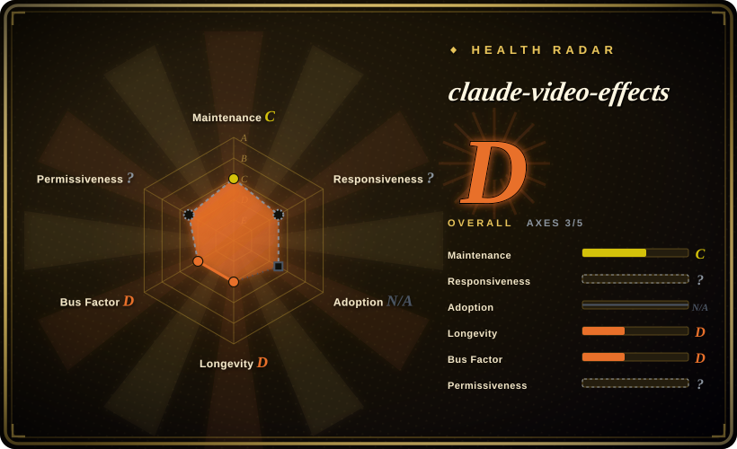
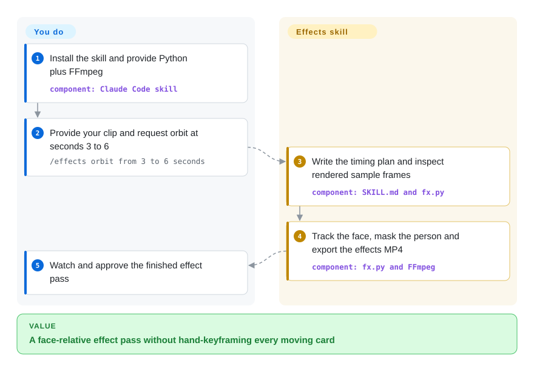
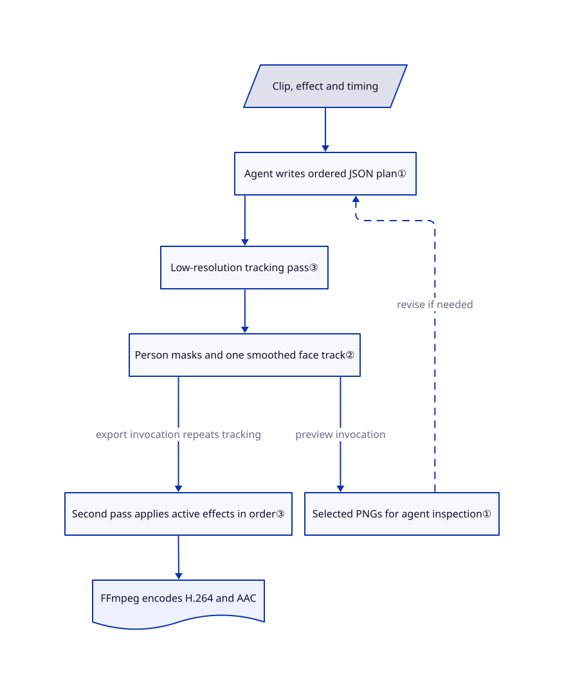

# claude-video-effects

Your talking-head clip needs a word behind your head or cards orbiting your face, not another full edit. This skill turns a named effect and time range into a local render with person-shaped masking.

## When to use

You make short talking-head videos and already have the take you want to publish. At seconds 3–6, you want screenshots circling your head without hiding your face; manually drawing masks and keyframes would take longer than the edit. Give Claude Code the clip, the effect name and timing. The skill supplies 45 registered starter effects, a JSON timing plan, preview-frame instructions and a Python renderer.

Choose it over a full production workflow when the missing piece is one decorative pass on existing footage. You trade custom composition freedom for ready-made face-relative layouts, without SeeCut's video-judge account or video-use's hosted transcription requirement. Word-triggered timing is optional; the renderer itself accepts explicit seconds. [Sources: usage and limits](https://github.com/Vibha-Ramprakash/claude-video-effects/blob/99c9a3393ee14d39bea155a05c73dc069f02f16f/README.md#L23-L40), [skill workflow](https://github.com/Vibha-Ramprakash/claude-video-effects/blob/99c9a3393ee14d39bea155a05c73dc069f02f16f/SKILL.md#L18-L39).

## When NOT to use

- **You need to select takes, remove pauses and build the story.** Choose [video-use](video-use.md) for transcript-led cutting. These effects decorate the input timeline rather than select its content.
- **You need a whole motion-polished short with a separate video critic and editable layered delivery.** Choose [SeeCut](seecut.md), subject to its account and noncommercial-license constraints. Here, the same agent inspects selected PNGs; there is no enforced independent quality score.
- **You need arbitrary branded layouts or a reusable React video application.** Choose [Remotion](../render-engines/remotion.md) and review its commercial license. This project's preset functions are narrower than a general composition framework.
- **You must preserve a high-frame-rate master or bit-identical audio.** Use [FFmpeg](../../media-processing/video-audio/transcoding-and-pipelines/ffmpeg.md) with an explicit export policy. The renderer limits working frame rate around 30 fps and encodes H.264 video plus AAC audio, despite README wording that audio stays as it was.
- **You need finished captions and sound design.** Use an editor such as CapCut, the closed-source app recommended by upstream, alongside the effect pass. The skill explicitly leaves both jobs to you.
- **You cannot allow a skill to install packages or fetch speech models.** Use an approved, pre-provisioned FFmpeg pipeline instead. Setup creates a virtual environment and installs unpinned Python packages; optional word timing can install faster-whisper and obtain Whisper weights. Installing this skill is not a sandbox boundary.

## Comparison

| Alternative | In index | Our verdict | Tradeoff |
|---|---|---|---|
| [SeeCut](seecut.md) | ✅ | Choose claude-video-effects for a named face-tracked overlay on an otherwise finished take; choose SeeCut when the whole short needs a video-watching critique loop and layered editor handoff. | Smaller local Python effect surface here; SeeCut adds a broader production loop, an external judge account and a noncommercial license. |
| [video-use](video-use.md) | ✅ | Choose video-use when deciding which words and takes survive is the main job; choose claude-video-effects when those decisions are finished and a timed visual flourish is missing. | video-use organizes cuts around hosted transcripts; this project offers preset animation and optional local word timing, not story assembly. |
| [Remotion](../render-engines/remotion.md) | ✅ | Choose Remotion when developers must author reusable custom scenes in React; choose claude-video-effects when its built-in orbit, spotlight or headline layouts already match the task. | Remotion supplies a wider composition ecosystem with its own license conditions; this skill supplies tracking and presets but no general visual authoring studio. |

## Quick start

The documented install is `git clone https://github.com/Vibha-Ramprakash/claude-video-effects ~/.claude/skills/effects`, followed by restarting Claude Code. Give it a video and enter `/effects orbit from 3 to 6 seconds`; provide your own screenshots and real numbers when a preset needs them. The agent runs setup, writes the timing plan, checks sample PNG frames and invokes the renderer, which writes an effects MP4 next to the source under the skill's naming convention. You supply Python, FFmpeg and approval for dependency installation; setup handles the virtual environment, while word-based timing can add a speech package and download models. You still pay for your agent access, approve visual quality and watch the whole output before publishing; preview inspection is an instruction, not a machine-enforced acceptance gate. [Install](https://github.com/Vibha-Ramprakash/claude-video-effects/blob/99c9a3393ee14d39bea155a05c73dc069f02f16f/README.md#L9-L38), [setup](https://github.com/Vibha-Ramprakash/claude-video-effects/blob/99c9a3393ee14d39bea155a05c73dc069f02f16f/scripts/setup.sh), [optional transcription](https://github.com/Vibha-Ramprakash/claude-video-effects/blob/99c9a3393ee14d39bea155a05c73dc069f02f16f/scripts/words.py).

<!-- flow-steps:begin (generated from flows/claude-video-effects.json by tools/flow_card.py — do not edit) -->

Text version of the flow

1. **You**: Install the skill and provide Python plus FFmpeg — component: `Claude Code skill`
2. **You**: Provide your clip and request orbit at seconds 3 to 6 — `/effects orbit from 3 to 6 seconds`
3. **claude-video-effects**: Write the timing plan and inspect rendered sample frames — component: `SKILL.md and fx.py`
4. **claude-video-effects**: Track the face, mask the person and export the effects MP4 — component: `fx.py and FFmpeg`
5. **You**: Watch and approve the finished effect pass

**Value**: A face-relative effect pass without hand-keyframing every moving card

<!-- flow-steps:end -->

## Key techniques

<!-- mechanism:begin (generated from mechanisms/claude-video-effects.json by tools/mechanism_card.py; do not edit) -->

Text version of the mechanism

- Clip, effect and timing
- Agent writes ordered JSON plan①
- Low-resolution tracking pass③
- Person masks and one smoothed face track②
- Selected PNGs for agent inspection①
- Second pass applies active effects in order③
- FFmpeg encodes H.264 and AAC

- Clip, effect and timing → Agent writes ordered JSON plan①
- Agent writes ordered JSON plan① → Low-resolution tracking pass③
- Low-resolution tracking pass③ → Person masks and one smoothed face track②
- Person masks and one smoothed face track② → Selected PNGs for agent inspection① (preview invocation)
- Selected PNGs for agent inspection① → Agent writes ordered JSON plan① (revise if needed) [optional/fallback]
- Person masks and one smoothed face track② → Second pass applies active effects in order③ (export invocation repeats tracking)
- Second pass applies active effects in order③ → FFmpeg encodes H.264 and AAC

<!-- mechanism:end -->

### 1. Inspect a few frames before paying for the full render

- **Problem:** An effect can run successfully while placing unreadable text across the speaker's face.
- **How:** The skill tells the agent to save an effects JSON plan, render selected PNG frames with `--still`, inspect them and adjust timing or layout before exporting video.
- **Limits:** The same agent judges its own draft; neither the script nor the prompt supplies a numeric pass threshold or an independent reviewer. Still mode still runs the first tracking pass over the clip.
- **Source:** [Plan, preview and export instructions](https://github.com/Vibha-Ramprakash/claude-video-effects/blob/99c9a3393ee14d39bea155a05c73dc069f02f16f/SKILL.md#L27-L39), [tracking before still-frame selection](https://github.com/Vibha-Ramprakash/claude-video-effects/blob/99c9a3393ee14d39bea155a05c73dc069f02f16f/scripts/fx.py#L2197-L2237).

### 2. Combine a person mask with one smoothed face track

- **Problem:** A floating card should disappear behind the speaker rather than cover their face as they move.
- **How:** MediaPipe supplies a per-frame person mask, refined against image edges and blended with the previous mask. YuNet chooses the face with the largest area-times-confidence score; missing positions are interpolated and smoothed forward and backward. Layer blending multiplies opacity by the inverse person mask for behind-person effects, or applies a face-region guard when requested.
- **Limits:** This is one selected face, not persistent multi-person identity tracking. Missing detections fall back to mask geometry or a fixed estimated position; the preview rule does not guarantee perfect hair edges or prevent every face overlap.
- **Source:** [Tracker and smoothing](https://github.com/Vibha-Ramprakash/claude-video-effects/blob/99c9a3393ee14d39bea155a05c73dc069f02f16f/scripts/fx.py#L2093-L2141), [opacity masking](https://github.com/Vibha-Ramprakash/claude-video-effects/blob/99c9a3393ee14d39bea155a05c73dc069f02f16f/scripts/fx.py#L118-L156), [no-track fallback](https://github.com/Vibha-Ramprakash/claude-video-effects/blob/99c9a3393ee14d39bea155a05c73dc069f02f16f/scripts/fx.py#L2208-L2209).

### 3. Separate tracking from ordered effect composition

- **Problem:** Several overlapping effects need a common face position and a predictable application order.
- **How:** A first low-resolution pass stores masks for effect windows and gathers face positions. A second output-resolution pass applies active preset functions in JSON order and pipes RGB frames into FFmpeg, mapping the input's first audio stream when present.
- **Limits:** Masks remain in memory for active windows, so this is not a constant-memory streaming design. The export uses overwrite mode, H.264 and AAC; it does not preserve original audio bytes, and the encoder exit status is not checked before printing `Done`.
- **Source:** [Plan parsing and two-pass pipeline](https://github.com/Vibha-Ramprakash/claude-video-effects/blob/99c9a3393ee14d39bea155a05c73dc069f02f16f/scripts/fx.py#L2177-L2241), [frame-rate handling](https://github.com/Vibha-Ramprakash/claude-video-effects/blob/99c9a3393ee14d39bea155a05c73dc069f02f16f/scripts/fx.py#L2070-L2090).

## Health & viability

- **As of 2026-10-28:** created on October 22 and pushed on October 27; no releases or tags were returned by the API. The contributor endpoint lists one contributor with seven contributions. Treat it as a six-day-old source snapshot, not a versioned dependency with a demonstrated support cadence.
- **Backing and Lindy:** a user-owned repository with no governance or funding document in the reviewed tree. [推断: based on six-day age and the single-contributor API result] It is useful as an inspectable preset collection, but there is not yet enough maintenance history for a durability bet.
- **Adoption:** 251 stars and 71 forks were visible on the verification date; the issues API returned no issues or pull requests. These counts do not establish production use or support responsiveness. Metadata still says 36 effects, while source registration and README enumerate 45.
- **Licensing:** root LICENSE grants MIT to the author's work and explicitly excludes bundled fonts/models from that grant. Model provenance notices name OpenCV and MediaPipe; font notices include OFL and Apache terms. Anton and Montserrat have only short OFL notices in this tree, so do not treat the root MIT file as complete redistribution clearance for every binary asset. [Root license](https://github.com/Vibha-Ramprakash/claude-video-effects/blob/99c9a3393ee14d39bea155a05c73dc069f02f16f/LICENSE), [asset notice](https://github.com/Vibha-Ramprakash/claude-video-effects/blob/99c9a3393ee14d39bea155a05c73dc069f02f16f/models/NOTICE.md), [Anton notice](https://github.com/Vibha-Ramprakash/claude-video-effects/blob/99c9a3393ee14d39bea155a05c73dc069f02f16f/fonts/OFL-Anton.txt), [Montserrat notice](https://github.com/Vibha-Ramprakash/claude-video-effects/blob/99c9a3393ee14d39bea155a05c73dc069f02f16f/fonts/OFL-Montserrat.txt).

## Caveats (unverified)

- [未验证: upstream execution and dependency installation prohibited for this task] No video was rendered here; visual fidelity, operating-system compatibility, processing speed and the README's first-run estimate were not reproduced.
- [未验证: no model or font binaries downloaded for a rights audit] Bundled model/font attribution was read, but binary provenance and complete redistribution compliance were not independently established. Anton and Montserrat notices do not contain the full OFL text.
- [推断: based on six-day age and the single-contributor API result] Continued maintenance is unproven; the project is better treated as a pinned, reviewable preset source than as a long-term supported editing platform.
- [未验证: no cross-host execution] The documented skill entry point targets Claude Code. Reuse of the Python renderer does not prove automatic skill discovery or equivalent permissions in Kilo or OpenCode.
