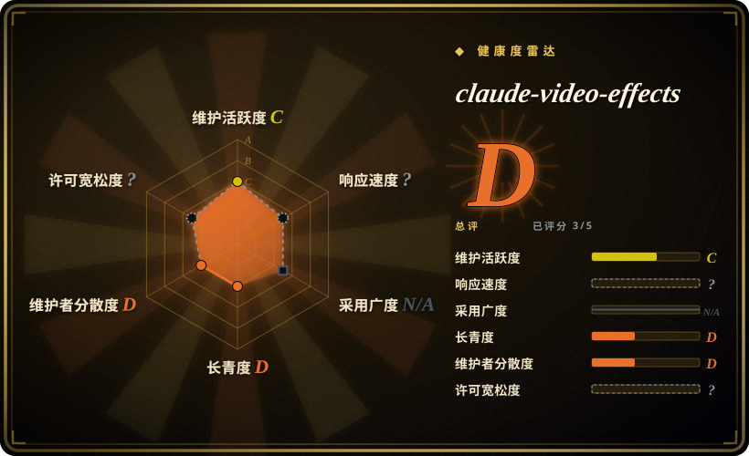
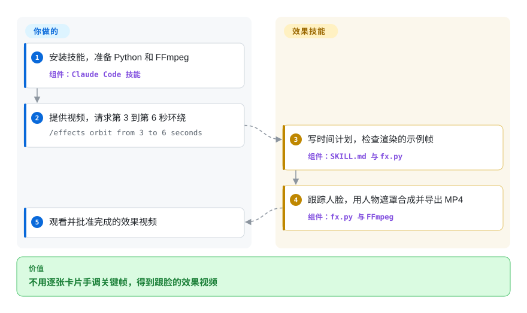
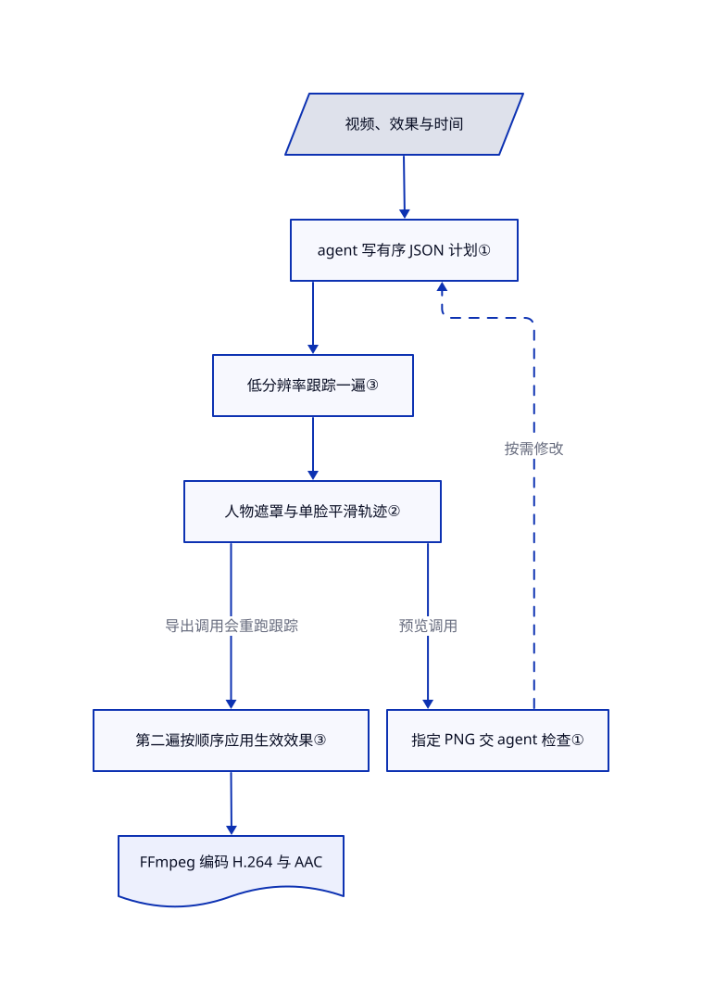

# claude-video-effects

口播已经剪好，只差脑后大字或绕脸转动的卡片。这份技能按效果名和时间段本地渲染，用人物轮廓遮住本该位于身后的图层。

## 何时使用

你在做口播短视频，已经选好要发布的那条素材。第 3 到第 6 秒，你想让截图绕着头转，又不挡住脸；手动画遮罩和关键帧，比这次小改本身更费时。把视频、效果名和时间交给 Claude Code，技能提供 45 个已注册的基础效果、JSON 时间计划、抽帧预览指令和 Python 渲染脚本。

缺的是现成素材上的一层装饰时，选它而非完整制片流程。代价是放弃任意构图，换来预设的跟脸布局；不需要 SeeCut 的看片评委账号，也不硬依赖 video-use 的托管转写。按词触发是可选功能，渲染器本身接受明确秒数。[使用路径与限制](https://github.com/Vibha-Ramprakash/claude-video-effects/blob/99c9a3393ee14d39bea155a05c73dc069f02f16f/README.md#L23-L40)、[技能流程](https://github.com/Vibha-Ramprakash/claude-video-effects/blob/99c9a3393ee14d39bea155a05c73dc069f02f16f/SKILL.md#L18-L39)。

## 何时不用

- **还要挑素材、去停顿、重组叙事。** 选 [video-use](video-use.zh.md) 做转写驱动的剪辑。本项目给输入时间轴加装饰，不替你决定保留哪些内容。
- **要整条动效精剪、独立看片评委和可编辑分层交付。** 选 [SeeCut](seecut.zh.md)，先接受其账号和非商用许可限制。这里由同一个 agent 检查指定 PNG，没有强制独立评分。
- **要任意品牌构图，或可复用的 React 视频应用。** 选 [Remotion](../render-engines/remotion.zh.md)，并审查其商业许可。这里的预设函数比通用视频构图框架窄得多。
- **必须保留高帧率母版，或保证音频字节不变。** 用 [FFmpeg](../../media-processing/video-audio/transcoding-and-pipelines/ffmpeg.zh.md) 明确指定导出规则。源码把工作帧率限制在约 30 帧，并编码为 H.264 视频和 AAC 音频；README 所说的音频保持原样，不等于无损直拷。
- **需要成品字幕和音效设计。** 配合使用上游推荐的闭源剪辑应用 CapCut。技能明确把这两项留给你。
- **不允许技能安装软件包或获取语音模型。** 改用已批准、预先配置好的 FFmpeg 管线。初始化会建虚拟环境并安装未锁版本的 Python 包；可选词级定位还会安装 faster-whisper 并获取 Whisper 权重。安装技能不构成沙箱隔离。

## 横向对比

| 替代品 | 是否收录 | 我们的评价 | 取舍 |
|---|---|---|---|
| [SeeCut](seecut.zh.md) | 已收录 | 现成口播只差一种跟脸装饰时选 claude-video-effects；整条短片需要看片评审循环和分层交付时选 SeeCut。 | 本项目只需较小的本地 Python 效果链；SeeCut 增加完整制作循环、外部评委账号和非商用许可约束。 |
| [video-use](video-use.zh.md) | 已收录 | 主要问题是哪些话和素材应该留下时选 video-use；剪辑决策已定，只差定时视觉点缀时选 claude-video-effects。 | video-use 围绕托管转写组织剪切；本项目提供预设动画与可选本地词级定位，不负责叙事组装。 |
| [Remotion](../render-engines/remotion.zh.md) | 已收录 | 开发者要写可复用的自定义 React 场景时选 Remotion；内置环绕、聚光或标题布局已满足需求时选 claude-video-effects。 | Remotion 有更广的构图生态与独立许可条件；本技能带跟踪和预设，但没有通用可视化创作工作台。 |

## 快速上手

文档安装命令是 `git clone https://github.com/Vibha-Ramprakash/claude-video-effects ~/.claude/skills/effects`，随后重启 Claude Code。交给它一段视频，输入 `/effects orbit from 3 to 6 seconds`；预设需要截图或数字时，提供自己的素材与真实数据。agent 初始化环境、写时间计划、检查抽取的 PNG，再调用渲染器；按技能约定把效果 MP4 放在源视频旁。你负责提供 Python、FFmpeg，并批准依赖安装；脚本负责虚拟环境，按词定位可能额外安装语音包并下载模型。agent 访问费用、视觉验收和发布前完整看片仍由你承担；抽帧检查是指令，不是机器强制的验收门。[安装说明](https://github.com/Vibha-Ramprakash/claude-video-effects/blob/99c9a3393ee14d39bea155a05c73dc069f02f16f/README.md#L9-L38)、[初始化脚本](https://github.com/Vibha-Ramprakash/claude-video-effects/blob/99c9a3393ee14d39bea155a05c73dc069f02f16f/scripts/setup.sh)、[可选转写](https://github.com/Vibha-Ramprakash/claude-video-effects/blob/99c9a3393ee14d39bea155a05c73dc069f02f16f/scripts/words.py)。

<!-- flow-steps:begin (generated from flows/claude-video-effects.json by tools/flow_card.py — do not edit) -->

流程文字版

1. **你**：安装技能，准备 Python 和 FFmpeg — 组件：`Claude Code 技能`
2. **你**：提供视频，请求第 3 到第 6 秒环绕 — `/effects orbit from 3 to 6 seconds`
3. **claude-video-effects**：写时间计划，检查渲染的示例帧 — 组件：`SKILL.md 与 fx.py`
4. **claude-video-effects**：跟踪人脸，用人物遮罩合成并导出 MP4 — 组件：`fx.py 与 FFmpeg`
5. **你**：观看并批准完成的效果视频

**价值**：不用逐张卡片手调关键帧，得到跟脸的效果视频

<!-- flow-steps:end -->

## 技术要点

<!-- mechanism:begin (generated from mechanisms/claude-video-effects.json by tools/mechanism_card.py; do not edit) -->

机制文字版

- 视频、效果与时间
- agent 写有序 JSON 计划①
- 低分辨率跟踪一遍③
- 人物遮罩与单脸平滑轨迹②
- 指定 PNG 交 agent 检查①
- 第二遍按顺序应用生效效果③
- FFmpeg 编码 H.264 与 AAC

- 视频、效果与时间 → agent 写有序 JSON 计划①
- agent 写有序 JSON 计划① → 低分辨率跟踪一遍③
- 低分辨率跟踪一遍③ → 人物遮罩与单脸平滑轨迹②
- 人物遮罩与单脸平滑轨迹② → 指定 PNG 交 agent 检查①（预览调用）
- 指定 PNG 交 agent 检查① → agent 写有序 JSON 计划①（按需修改）〔可选／兜底〕
- 人物遮罩与单脸平滑轨迹② → 第二遍按顺序应用生效效果③（导出调用会重跑跟踪）
- 第二遍按顺序应用生效效果③ → FFmpeg 编码 H.264 与 AAC

<!-- mechanism:end -->

### 1. 先抽帧检查，再渲染整片

- **解决：** 脚本可以正常运行，却把难读的文字盖在说话人的脸上。
- **做法：** 技能让 agent 保存效果 JSON 计划，用 `--still` 输出指定时刻的 PNG，检查后调整时间或布局，再导出视频。
- **边界：** 同一个 agent 判断自己的草稿，脚本和提示词都没有数值门槛或独立评委。静帧模式仍先跑遍片段的首轮跟踪。
- **源码：** [计划、预览和导出指令](https://github.com/Vibha-Ramprakash/claude-video-effects/blob/99c9a3393ee14d39bea155a05c73dc069f02f16f/SKILL.md#L27-L39)、[静帧筛选前的跟踪流程](https://github.com/Vibha-Ramprakash/claude-video-effects/blob/99c9a3393ee14d39bea155a05c73dc069f02f16f/scripts/fx.py#L2197-L2237)。

### 2. 人物遮罩配合单张人脸的平滑轨迹

- **解决：** 人物移动时，浮动卡片应藏到身后，而不是直接挡脸。
- **做法：** MediaPipe 逐帧给出人物遮罩，再按图像边缘细化并与前一帧混合。YuNet 按人脸面积乘置信度选一张脸，缺失位置先插值，再前后双向平滑。身后图层用人物遮罩的反值削减透明度；需要避脸时，再启用脸部区域保护。
- **边界：** 它只选择一张脸，不持续识别多个人的身份。检测缺失会回退到遮罩几何或固定估计位置；预览规则不能保证发丝边缘完美，也不能保证所有效果都不挡脸。
- **源码：** [跟踪与平滑](https://github.com/Vibha-Ramprakash/claude-video-effects/blob/99c9a3393ee14d39bea155a05c73dc069f02f16f/scripts/fx.py#L2093-L2141)、[透明度遮罩](https://github.com/Vibha-Ramprakash/claude-video-effects/blob/99c9a3393ee14d39bea155a05c73dc069f02f16f/scripts/fx.py#L118-L156)、[无轨迹时回退](https://github.com/Vibha-Ramprakash/claude-video-effects/blob/99c9a3393ee14d39bea155a05c73dc069f02f16f/scripts/fx.py#L2208-L2209)。

### 3. 跟踪与顺序合成分两遍执行

- **解决：** 多个效果同时出现时，需要共享人脸位置，并按可预测的顺序叠加。
- **做法：** 首遍用低分辨率保存效果窗口内的遮罩，并收集人脸位置。第二遍按输出分辨率处理，在 JSON 顺序中调用当前生效的预设函数，再把 RGB 帧送入 FFmpeg；输入有音频时映射第一条音轨。
- **边界：** 有效窗口的遮罩保存在内存中，不是恒定内存的流式设计。导出开启覆盖，使用 H.264 与 AAC，不保留原音频字节；打印 `Done` 前也没有检查编码器退出状态。
- **源码：** [计划解析与两遍处理](https://github.com/Vibha-Ramprakash/claude-video-effects/blob/99c9a3393ee14d39bea155a05c73dc069f02f16f/scripts/fx.py#L2177-L2241)、[帧率处理](https://github.com/Vibha-Ramprakash/claude-video-effects/blob/99c9a3393ee14d39bea155a05c73dc069f02f16f/scripts/fx.py#L2070-L2090)。

## 健康度与可持续性

- **截至 2026-10-28：** 仓库在 10 月 22 日创建，10 月 27 日推送；API 未返回 release 或 tag。贡献者接口只列出一人、七次贡献。把它当作六天龄的源码快照，不要当成已有稳定发版和支持节奏的依赖。
- **支持方与长期性：** 仓库属于个人账号，已读目录树没有治理或资金说明。[推断：依据为六天仓龄与单一贡献者记录] 它适合作为可检查的效果预设集合，尚无足够维护历史支撑长期依赖判断。
- **采用情况：** 核验日可见 251 个 star、71 个 fork；议题接口没有返回 issue 或 PR。这些数字不证明生产使用或响应能力。仓库描述仍写 36 个效果，源码注册与 README 则列出 45 个。
- **许可：** 根 LICENSE 把作者代码按 MIT 授权，并明确排除捆绑字体与模型。模型来源声明指向 OpenCV 和 MediaPipe，字体通知包含 OFL 与 Apache 条款。Anton 和 Montserrat 在本树只有简短 OFL 通知，不能把根 MIT 当成全部二进制素材的完整再分发许可。[根许可](https://github.com/Vibha-Ramprakash/claude-video-effects/blob/99c9a3393ee14d39bea155a05c73dc069f02f16f/LICENSE)、[模型声明](https://github.com/Vibha-Ramprakash/claude-video-effects/blob/99c9a3393ee14d39bea155a05c73dc069f02f16f/models/NOTICE.md)、[Anton 通知](https://github.com/Vibha-Ramprakash/claude-video-effects/blob/99c9a3393ee14d39bea155a05c73dc069f02f16f/fonts/OFL-Anton.txt)、[Montserrat 通知](https://github.com/Vibha-Ramprakash/claude-video-effects/blob/99c9a3393ee14d39bea155a05c73dc069f02f16f/fonts/OFL-Montserrat.txt)。

## 存疑（未验证）

- [未验证：本次禁止运行上游或安装依赖] 本次没有渲染视频；未复现视觉质量、系统兼容性、处理速度或 README 的首次安装耗时。
- [未验证：未下载模型或字体二进制做权属审计] 已读模型和字体来源声明，但未独立证明二进制来源与完整再分发合规；Anton 和 Montserrat 通知不含完整 OFL 正文。
- [推断：依据为六天仓龄与单一贡献者记录] 后续维护尚未得到验证；更适合锁定版本、按需审查，不宜视为长期受支持的剪辑平台。
- [未验证：未跨宿主运行] 文档技能入口针对 Claude Code；能复用 Python 渲染器，不等于 Kilo 或 OpenCode 已支持自动发现技能或具有相同权限。
