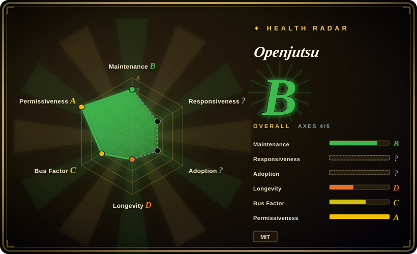
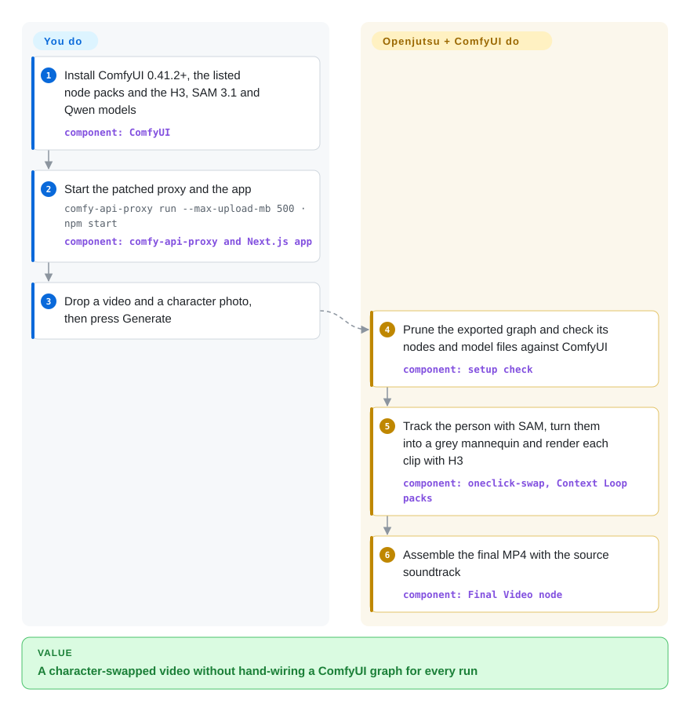
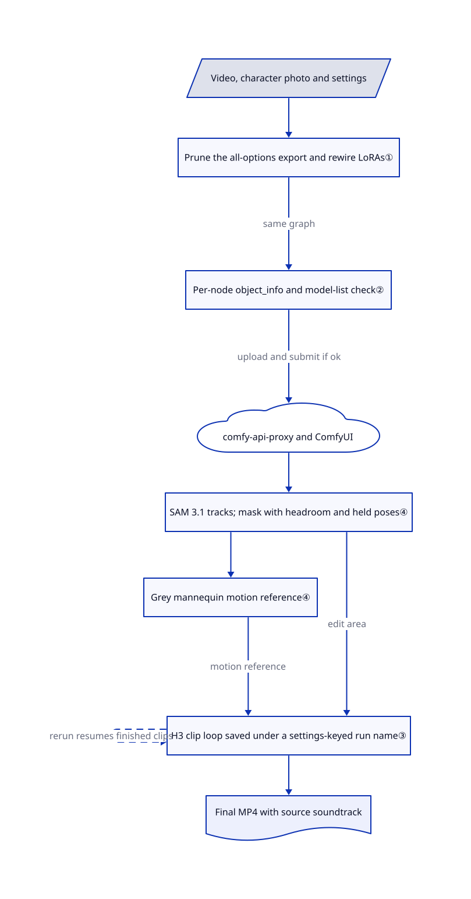

# Openjutsu

You like a clip but want someone else in it, and the ComfyUI route means installing a dozen node packs and hand-editing a graph for every run. Openjutsu puts a local web page over a prepared ComfyUI video-edit workflow: drop the video and a character photo, press Generate, and only the tracked person is redrawn while camera, cuts and soundtrack stay.

## When to use

You make short videos or test ideas for a channel, and you have a dance clip, a street interview or a two-person scene that already works. You want a different character in it: the same moves, framing and sound, but your own photo as the person. A hosted service would take the footage off your machine and charge per clip; building it yourself in ComfyUI (a node-graph app for running image and video models) means wiring SAM tracking, masks, a clip loop and MiniMax H3 (an open-weights video model that can edit inside a mask) by hand, then re-wiring whenever you turn an option on or off.

Openjutsu is the choice when you already have, or are willing to set up, an NVIDIA GPU with ComfyUI and want that pipeline behind buttons: Simple (replace the biggest person), Advanced (1–4 people matched to roles per shot), Object swap (hair, clothes, background, add or remove a thing), From picture (re-pose a character picture with FLUX first) and two post-processing passes. Against a hosted Genjutsu-style service it trades minutes of setup and your own GPU time for local footage and no per-clip bill; against raw ComfyUI it trades graph freedom for a preflight check, pruned graphs and resumable clip runs that the app manages for you.

## When NOT to use

- **You only need a new face on the same body, or need it in real time.** Use FaceFusion (not indexed). Openjutsu regenerates the whole masked person with a video diffusion model; the README measures 6–13 minutes for a 6-second 480p clip on an RTX 4060 Ti, far beyond a face-swapper's per-frame cost.
- **You do not have an NVIDIA GPU with roughly 16 GB VRAM and 64 GB system RAM.** Use a hosted service such as Higgsfield Genjutsu (not a repo) instead. The only tested setup is a 16 GB card with 64 GB RAM, the H3 INT8 weights stream from system memory, and the Comfy Developer Platform deployment path is marked "Not tested yet".
- **You want to change the pipeline itself or use another video model.** Work in [ComfyUI](../../on-device-ml/local-image-generation/comfyui.md) directly, or use Wan2.2's Animate replacement mode (not indexed). Openjutsu edits shipped API exports by hard-coded node ids and titles; a re-exported graph that renumbers nodes breaks it until `NODES` in `lib/simple.ts` is updated.
- **You plan commercial output with Fix faces.** Leave Fix faces off or replace its detectors. The README states that InsightFace `buffalo_l` is non-commercial research only and the Ultralytics YOLO weights are AGPL-3.0; the app's MIT license does not cover the models, and the MiniMax H3 community license adds a "MiniMax H3" UI notice for commercial products and written authorization above US$20M yearly revenue.
- **You lack consent from the person being replaced or intend to pass the result off as them.** Re-shoot with consenting talent, or use the Background or Object-swap modes that keep the original person. The MiniMax H3 license lists impersonation without consent among prohibited uses, and the app adds no watermark or provenance mark of its own [推断: no watermark or C2PA code found in the reviewed `lib/` and workflow exports].
- **Your footage is long 1080p, or the person appears in mirrors or windows.** Cut a shorter part with **Part to use** or render at 736p first. Issue #44 reports a `MemoryError` on a 125-second 1080p video because every frame is decoded at native size, and the README says reflections bring the original person's look back.
- **You need a multi-user hosted product or a responsive upstream.** Build your own service on the [ComfyUI](../../on-device-ml/local-image-generation/comfyui.md) API with your own auth, or pin and fork this repo. Openjutsu is a single-owner app behind one shared password, and at verification 42 pull requests sat unmerged with no maintainer comment on any issue.

## Comparison

| Alternative | In index | Our verdict | Tradeoff |
|---|---|---|---|
| Higgsfield Genjutsu | not a repo | Choose the hosted service when you lack a 16 GB NVIDIA GPU or want results without installing anything; choose Openjutsu when footage must stay local and you will run the GPU yourself. | Closed SaaS by Higgsfield and the product Openjutsu names as its model: no setup, but per-use cost, upload of your footage, and no access to the pipeline. |
| [ComfyUI](../../on-device-ml/local-image-generation/comfyui.md) | ✅ | Choose raw ComfyUI when you will design or alter the graph, swap models or debug nodes; choose Openjutsu when the H3 swap pipeline is what you want and you would rather press buttons than re-wire options per run. | ComfyUI gives full graph freedom under GPL-3.0; Openjutsu adds preflight checks, per-request pruning and resumable runs, but only for its shipped exports. |
| Wan2.2 (Animate) | not indexed | Choose Wan2.2-Animate when you want an Apache-2.0 model with its own character replacement inference code; choose Openjutsu when you want the MiniMax H3 path with tracking, multi-person roles and object edits already behind a UI. Not added in this tab batch. | Wan gives a single model family and scripts; Openjutsu gives an app over a different model whose community license carries commercial notice and revenue-threshold terms. |
| FaceFusion | not indexed | Choose FaceFusion when only the face must change and speed matters; choose Openjutsu when body, hair, clothes or a whole person must change while the motion stays. Not added in this tab batch. | Face-only per-frame swapping is far cheaper and mature (2023 onward); full-person regeneration costs minutes per clip and a large GPU. |
| comfy-reshoot | not indexed | Choose Comfy's reference app when you are building your own one-purpose Comfy front end and want the official starting pattern; choose Openjutsu when you want this specific swap product ready to run. Not added in this tab batch. | comfy-reshoot is a small template Openjutsu follows; Openjutsu is a large, feature-dense app tied to H3 and a dozen node packs. |

## Quick start

Install ComfyUI 0.41.2 or newer, the custom-node packs listed in the README (most via ComfyUI Manager), and the H3, SAM 3.1 and Qwen3-VL model files in their `ComfyUI/models` folders. Then start comfy-api-proxy (a small Python server that exposes ComfyUI as a job API) after patching it with the repo's `patch_proxy.py`, and start the app with `npm ci`, `npm run build` and `npm start`; on Windows `start_openjutsu.bat` does those steps and waits for ComfyUI. Open `http://127.0.0.1:3000`, drop a video and a character photo, and press **Generate**. The app then checks that every node and model file the chosen graph needs is installed, uploads your files, submits the pruned graph and streams progress; ComfyUI does the tracking and rendering, and the finished MP4 keeps the source soundtrack. You remain responsible for the GPU, the model downloads and their licenses, checking the mask on tricky footage, and choosing the right person and consent for the result.

<!-- flow-steps:begin (generated from flows/openjutsu.json by tools/flow_card.py — do not edit) -->

Text version of the flow

1. **You**: Install ComfyUI 0.41.2+, the listed node packs and the H3, SAM 3.1 and Qwen models — component: `ComfyUI`
2. **You**: Start the patched proxy and the app — `comfy-api-proxy run --max-upload-mb 500 · npm start` — component: `comfy-api-proxy and Next.js app`
3. **You**: Drop a video and a character photo, then press Generate
4. **Openjutsu**: Prune the exported graph and check its nodes and model files against ComfyUI — component: `setup check`
5. **Openjutsu**: Track the person with SAM, turn them into a grey mannequin and render each clip with H3 — component: `oneclick-swap, Context Loop packs`
6. **Openjutsu**: Assemble the final MP4 with the source soundtrack — component: `Final Video node`

**Value**: A character-swapped video without hand-wiring a ComfyUI graph for every run

<!-- flow-steps:end -->

## Key techniques

<!-- mechanism:begin (generated from mechanisms/openjutsu.json by tools/mechanism_card.py; do not edit) -->

Text version of the mechanism

- Video, character photo and settings
- Prune the all-options export and rewire LoRAs①
- Per-node object_info and model-list check②
- comfy-api-proxy and ComfyUI
- SAM 3.1 tracks; mask with headroom and held poses④
- Grey mannequin motion reference④
- H3 clip loop saved under a settings-keyed run name③
- Final MP4 with source soundtrack

- Video, character photo and settings → Prune the all-options export and rewire LoRAs①
- Prune the all-options export and rewire LoRAs① → Per-node object_info and model-list check② (same graph)
- Per-node object_info and model-list check② → comfy-api-proxy and ComfyUI (upload and submit if ok)
- comfy-api-proxy and ComfyUI → SAM 3.1 tracks; mask with headroom and held poses④
- SAM 3.1 tracks; mask with headroom and held poses④ → Grey mannequin motion reference④
- Grey mannequin motion reference④ → H3 clip loop saved under a settings-keyed run name③ (motion reference)
- SAM 3.1 tracks; mask with headroom and held poses④ → H3 clip loop saved under a settings-keyed run name③ (edit area)
- H3 clip loop saved under a settings-keyed run name③ → H3 clip loop saved under a settings-keyed run name③ (rerun resumes finished clips) [optional/fallback]
- H3 clip loop saved under a settings-keyed run name③ → Final MP4 with source soundtrack

<!-- mechanism:end -->

### 1. Prune one exported graph per request instead of keeping one graph per option

- **Problem:** Hat fix, No lip-sync, mask margin, motion-reference size and up to four LoRAs (small add-on weight files) multiply into many graph variants that would drift apart if maintained by hand.
- **How:** Each workflow is exported once from ComfyUI with every optional group on. Per request, `lib/simple.ts` deletes the unused nodes by id or title and re-points their consumers (Grow Mask reads People Mask directly when the hat fix is off), and `lib/model.ts` replaces the single "DMAD LoRA" node with a chain of the chosen LoRAs. A final pass throws if any input still links to a deleted node.
- **Limits:** The edits key on hard-coded node ids and titles; re-exporting a graph that renumbers nodes requires updating `NODES`, and `npm test` only checks the shipped exports. Graphs you author yourself get none of this.
- **Source:** [node ids and pruning:88–153](https://github.com/D3voz/openjutsu/blob/7fe118bb5a61fcfac0148e1bfea3dd29884dbf26/lib/simple.ts#L88-L153), [LoRA chain rewrite:47–74](https://github.com/D3voz/openjutsu/blob/7fe118bb5a61fcfac0148e1bfea3dd29884dbf26/lib/model.ts#L47-L74), [README rebuild note](https://github.com/D3voz/openjutsu/blob/7fe118bb5a61fcfac0148e1bfea3dd29884dbf26/README.md#L158).

### 2. Check the live ComfyUI install before uploading anything

- **Problem:** A missing node pack or model file would otherwise surface minutes into a job, after a video of up to 500 MB has been uploaded.
- **How:** The setup route builds the same pruned graph the job would run, asks ComfyUI's `/object_info/<type>` for only that graph's node types, maps each missing type to a pack name and install link, and compares every loader's file name with ComfyUI's list for that model folder. It also probes the route added by the websocket reconnect fix, which registers no node.
- **Limits:** It proves registration and file names, not Python dependencies, model integrity or free VRAM; a pack that failed to import looks the same as a missing one.
- **Source:** [pack table and inspection:31–117](https://github.com/D3voz/openjutsu/blob/7fe118bb5a61fcfac0148e1bfea3dd29884dbf26/lib/setup.ts#L31-L117), [setup route:8–22](https://github.com/D3voz/openjutsu/blob/7fe118bb5a61fcfac0148e1bfea3dd29884dbf26/app/api/setup/route.ts#L8-L22), [README scope of the check](https://github.com/D3voz/openjutsu/blob/7fe118bb5a61fcfac0148e1bfea3dd29884dbf26/README.md#L60).

### 3. Resume by clip, but give each setting combination its own run

- **Problem:** Each clip takes minutes, so a crash or a rerun should not redo finished clips, yet a changed model or motion size must not reuse clips made without it.
- **How:** The video is cut into overlapping clips on H3's frame grid (17k+5 frames, 39 frames of context). The Context Loop pack saves each finished clip under the plan's `run_name`; Openjutsu inserts a string-concatenate node that appends a hash of non-default model components or a motion-size suffix, so those settings land in a separate run while default reruns resume.
- **Limits:** Saved clips live in ComfyUI's `output/` folder, so a fresh serverless worker cannot resume. Only the settings the code appends are separated, and the page's clip estimate is exact only for footage without hard cuts.
- **Source:** [run-name hash:76–88](https://github.com/D3voz/openjutsu/blob/7fe118bb5a61fcfac0148e1bfea3dd29884dbf26/lib/model.ts#L76-L88), [motion suffix and run name:154–170](https://github.com/D3voz/openjutsu/blob/7fe118bb5a61fcfac0148e1bfea3dd29884dbf26/lib/simple.ts#L154-L170), [clip estimate:1–41](https://github.com/D3voz/openjutsu/blob/7fe118bb5a61fcfac0148e1bfea3dd29884dbf26/lib/clips.ts#L1-L41), [README resume note](https://github.com/D3voz/openjutsu/blob/7fe118bb5a61fcfac0148e1bfea3dd29884dbf26/README.md#L129), [serverless note](https://github.com/D3voz/openjutsu/blob/7fe118bb5a61fcfac0148e1bfea3dd29884dbf26/README.md#L190).

### 4. Show H3 a grey mannequin, not the original person

- **Problem:** If the motion reference shows the original person, H3 copies their face, hair and clothes back onto the new character.
- **How:** SAM 3.1 tracks people; the companion node pack unions the largest tracks into a mask with headroom above the head and holds each pose for a few frames. It then turns the masked people into light-grey figures whose blur scales with their height, keeping pose and shading but not identity. Only that grown area is regenerated, with the character photo as reference.
- **Limits:** Reflections still show the original person and bring their look back. The mask and mannequin code sits in a separate single-file pack (about 138 KB of `__init__.py`, 6 stars) with no recorded tested revision.
- **Source:** [H3GreyMannequins:1224–1265](https://github.com/D3voz/comfyui-h3-oneclick-swap/blob/e44a56e92920000e675d14be484aea0d7498d63e/__init__.py#L1224-L1265), [person mask and H3PeopleMask:1273–1345](https://github.com/D3voz/comfyui-h3-oneclick-swap/blob/e44a56e92920000e675d14be484aea0d7498d63e/__init__.py#L1273-L1345), [README how it works](https://github.com/D3voz/openjutsu/blob/7fe118bb5a61fcfac0148e1bfea3dd29884dbf26/README.md#L138), [README reflection limit](https://github.com/D3voz/openjutsu/blob/7fe118bb5a61fcfac0148e1bfea3dd29884dbf26/README.md#L121).

## Tech stack

- **App:** Next.js 16 with React 19 and TypeScript; one large client component plus API routes for jobs, setup, models, presets and From picture.
- **Comfy integration:** `@comfyorg/sdk` 0.5.0 for uploads, submission and raw job-event streams, forwarded to the browser as server-sent events.
- **Pipelines:** ComfyUI API-format JSON workflows, regenerated by JavaScript build scripts pasted into ComfyUI's browser console and by Python scripts for Fix faces and From picture.
- **Models in the shipped graphs:** MiniMax H3 (INT8 ref2va video model, Qwen3-VL 32B text encoder, video and audio VAEs), SAM 3.1, Qwen3-VL 8B as default describer, FLUX.3 Klein for From picture, optional SolarRenderer LoRAs.
- **Tests and CI:** `node --test` suites for pruning, setup, HTTP handling and pipelines, plus `tsc --noEmit` and a production build in GitHub Actions.

## Dependencies

- An NVIDIA GPU; the only tested machine is an RTX 4060 Ti 16 GB with 64 GB system RAM.
- ComfyUI 0.41.2 or newer, plus about a dozen custom-node packs (Context Loop 0.7.3+, Fantastic PromptBuilder, KJNodes, VideoHelperSuite, the author's oneclick-swap, image-detail-contrast and websocket-reconnect-fix packs, and per-feature packs for faces, colours, SolarRenderer and normal maps).
- Model weights totalling tens of gigabytes, downloaded separately, each under its own license.
- Node.js 22.6 or newer; Python with `comfy-api-proxy` 0.1.6, patched in place by `patch_proxy.py`; FFmpeg for video assembly.
- Optional: a Comfy Developer Platform deployment with an API key instead of a local GPU (documented, untested upstream).

## Ops difficulty

**High.** Setup spans three processes (ComfyUI, the patched proxy, the Next.js app), a node-pack list whose working revisions are only partly recorded, and model files the app cannot download for you. The one-click launcher is Windows-only, and on Windows ComfyUI needs `AIOHTTP_NOSENDFILE=1` or downloads can hang after a seek. Rendering is slow and memory-bound: minutes per clip at 480p, about 2.5x slower at 1080p, and long native-resolution sources can exhaust RAM. Remote hosting needs `OPENJUTSU_PASSWORD` (at least 12 characters) and HTTPS; the app refuses to start password-free on a non-loopback address, but one password covers every job.

## Health & viability

- **Maintenance (2026-11-18):** created 2026-10-26; the imported history starts 2026-10-24 and the last commit is 2026-10-30, so nothing has landed for 19 days. No releases or tags exist. Treat it as a fast-built snapshot, not a versioned dependency.
- **Governance:** a user-owned repository with two committers (D3voz 52 commits, mixbag 22). Of 42 pull requests, none from outside contributors was merged and 38 come from one account; issues show no maintainer replies. [推断: from the issue and PR API, not a statement by the author] Upstream responsiveness is currently low.
- **Lindy and adoption:** 23 days old with 2,451 stars and 383 forks. Attention is high but there is no maintenance history to lean on; the Lindy prior gives this almost no weight yet.
- **Ecosystem risk:** the core swap nodes live in the same author's `comfyui-h3-oneclick-swap` (6 stars, created 2026-10-24), and the pipeline depends on fast-moving H3 node packs and ComfyUI core versions; any of them can break a job without a change here.
- **License:** the app is MIT (copyright 2026 D3voz, verified in `LICENSE`). Model terms are separate and decide commercial use: MiniMax H3 community license, InsightFace non-commercial, Ultralytics AGPL-3.0.

## Caveats (unverified)

- [未验证: no NVIDIA GPU or model downloads in this review] No video was rendered; swap quality, the 6–13 minute timing and the 16 GB / 64 GB requirement are author-reported.
- [推断: no watermark or C2PA code found in the reviewed `lib/` files and workflow exports] Outputs carry no provenance mark from the app; a ComfyUI node or model could still add one.
- [推断: from the issue and PR API on 2026-11-18] Low maintainer responsiveness is based on 42 unmerged PRs and no maintainer comments; the author may still be working privately.
- [未验证: Comfy Developer Platform deployment not exercised] The README itself marks the cloud deployment path "Not tested yet".
- [未验证: model license texts read only for MiniMax H3] InsightFace and Ultralytics terms are as the README states; their license texts were not checked in this review.
- [未验证: no reproduction environment] Issue #46 (failure on silent input video) was filed after the last commit, although `lib/comfy.ts` inserts silence for soundless sources; whether it still fails was not reproduced.
