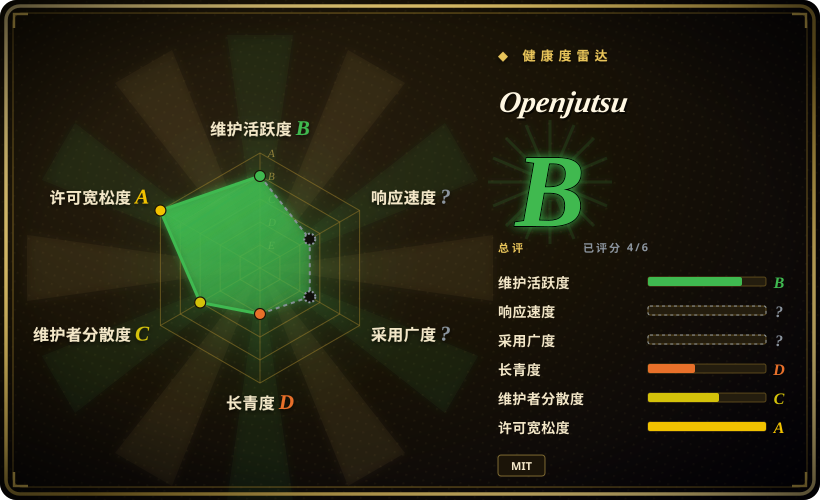
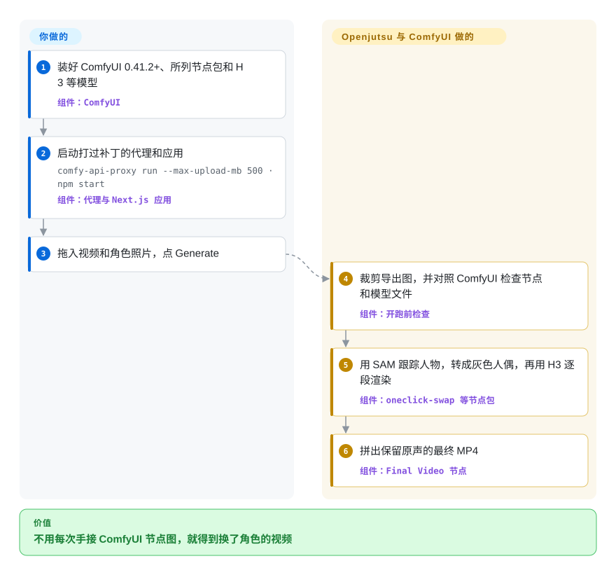
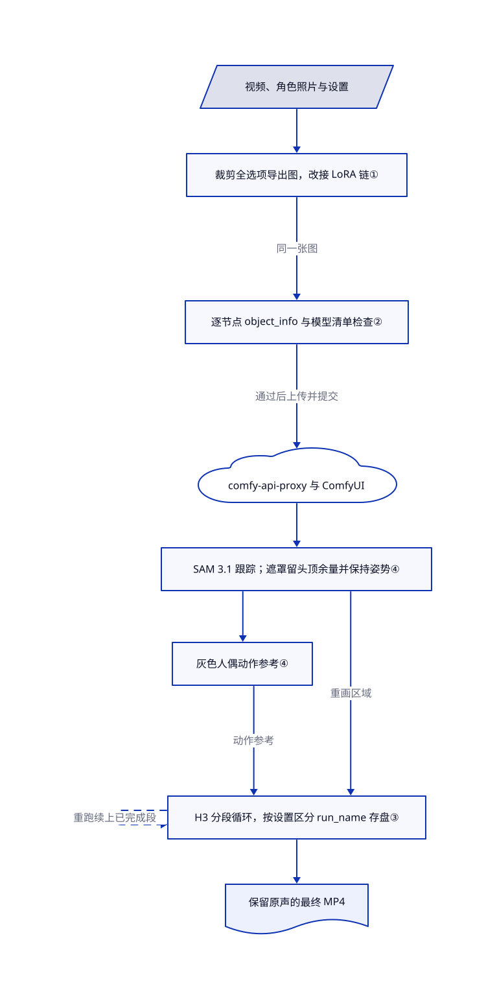

# Openjutsu

一段视频你很满意，只想把里面的人换成别人；自己在 ComfyUI 里做，要装十几个节点包，每跑一次还得手改一遍节点图。Openjutsu 在一套现成的 ComfyUI 视频编辑流程外面套了个本地网页：拖进视频和一张角色照片，点 Generate，只重画被跟踪的那个人，镜头、剪辑点和原声都不动。

## 何时使用

你做短视频或给频道试创意，手上有一段舞蹈、街采或双人对戏的素材，本身已经能用。你想换个角色进去：动作、构图、声音照旧，人换成你给的照片。托管服务要把素材传出本机，还按条收费；自己在 ComfyUI（一个用节点图跑图像和视频模型的程序）里搭，就得亲手接 SAM 跟踪、遮罩、分段循环和 MiniMax H3（一个能在遮罩范围内改视频的开放权重视频模型），每开关一个选项又要重接一次。

如果你已经有、或者愿意搭一台带 ComfyUI 的 NVIDIA 显卡机器，想把这条流程变成几个按钮，就选它：Simple（换掉画面里最大的人）、Advanced（1–4 个角色，逐镜头按身份匹配）、Object swap（换发型、衣服、背景，增删物件）、From picture（先用 FLUX 把角色图摆成视频里的姿势）以及两个后期修复。和 Genjutsu 这类托管服务比，它用几十分钟安装和自己的显卡时间，换来素材不出本机、不按条付费；和直接用 ComfyUI 比，它放弃改图的自由，换来开跑前检查、按请求裁剪节点图和可续跑的分段渲染，这些都由应用替你管。

## 何时不用

- **你只想换脸、身体不变，或者要实时换。** 用 FaceFusion（未收录）。Openjutsu 用视频扩散模型重画整个被遮罩的人；README 实测 RTX 4060 Ti 上 480p 的 6 秒片段要 6–13 分钟，远高于逐帧换脸的成本。
- **你没有约 16 GB 显存、64 GB 内存的 NVIDIA 显卡机器。** 改用 Higgsfield Genjutsu 这类托管服务（非仓库）。唯一测过的配置是 16 GB 显卡加 64 GB 内存，H3 的 INT8 权重靠系统内存流式加载；Comfy Developer Platform 云端部署路径写明“尚未测试”。
- **你要改流程本身，或换别的视频模型。** 直接在 [ComfyUI](../../on-device-ml/local-image-generation/comfyui.zh.md) 里做，或用 Wan2.2 的 Animate 替换模式（未收录）。Openjutsu 按写死的节点 id 和标题去改导出的 API 工作流；重新导出后节点编号一变，就得先改 `lib/simple.ts` 里的 `NODES`。
- **你打算商用，而且要用 Fix faces。** 关掉 Fix faces，或换掉它的检测模型。README 写明 InsightFace `buffalo_l` 只许非商业研究使用，Ultralytics YOLO 权重是 AGPL-3.0；应用本身的 MIT 不覆盖模型。MiniMax H3 社区许可证还要求商用产品在界面上标注“MiniMax H3”，年收入超过 2000 万美元须另行书面授权。
- **被换掉的人没同意，或者你想冒充他。** 请找同意出镜的人重拍，或用保留原人物的 Background、Object swap 模式。MiniMax H3 许可证把未经同意的冒充列为禁止用途，而应用自己不加水印或来源标记 [推断：在审阅的 `lib/` 与工作流导出里没找到水印或 C2PA 代码]。
- **素材是长段 1080p，或画面里有镜子、玻璃倒影。** 先用 **Part to use** 截一段，或先按 736p 渲染。Issue #44 报告一段 125 秒 1080p 视频因按原分辨率解码全部帧而 `MemoryError`；README 也说倒影会把原人物的样子带回来。
- **你要多人共用的托管产品，或需要上游及时响应。** 用 [ComfyUI](../../on-device-ml/local-image-generation/comfyui.zh.md) 的 API 自己写服务并自带鉴权，或固定提交后自行 fork。Openjutsu 是单一所有者应用，所有人共用一个密码；验证时有 42 个 PR 未合并，所有 issue 都没有维护者回复。

## 横向对比

| 替代品 | 是否收录 | 我们的评价 | 取舍 |
|---|---|---|---|
| Higgsfield Genjutsu | 非仓库 | 没有 16 GB NVIDIA 显卡、或什么都不想装时选托管服务；素材必须留在本地、愿意自己跑显卡时选 Openjutsu。 | Higgsfield 的闭源 SaaS，也是 Openjutsu 自称对标的产品：免安装，但按次付费、素材要上传、流程不可见。 |
| [ComfyUI](../../on-device-ml/local-image-generation/comfyui.zh.md) | 已收录 | 要自己设计或改节点图、换模型、排查节点时用原生 ComfyUI；想要的就是这条 H3 换人流程、宁愿点按钮也不想每次重接选项时选 Openjutsu。 | ComfyUI 在 GPL-3.0 下给你完整的改图自由；Openjutsu 加了开跑前检查、按请求裁剪和可续跑，但只对它自带的导出图有效。 |
| Wan2.2（Animate） | 未收录 | 想要 Apache-2.0 模型、并且它自带角色替换推理代码时选 Wan2.2-Animate；想要 MiniMax H3 路线、并且跟踪、多人身份匹配和物件编辑都已做成界面时选 Openjutsu。本批标签未收录。 | Wan 给一个模型家族加脚本；Openjutsu 给的是另一个模型上的应用，而那个模型的社区许可证带商用标注和收入门槛条款。 |
| FaceFusion | 未收录 | 只换脸、看重速度时选 FaceFusion；要在保留动作的前提下换身体、发型、衣服乃至整个人时选 Openjutsu。本批标签未收录。 | 逐帧只换脸便宜得多，项目也成熟（2023 年起）；整人重画每段要几分钟，还要大显存。 |
| comfy-reshoot | 未收录 | 你在做自己的单一用途 Comfy 前端、想从官方样板起步时选 Comfy 的参考应用；想直接跑这套换人产品时选 Openjutsu。本批标签未收录。 | comfy-reshoot 是 Openjutsu 参照的小模板；Openjutsu 是功能密集的大应用，绑定 H3 和十几个节点包。 |

## 快速上手

先装 ComfyUI 0.41.2 或更新版本、README 列出的自定义节点包（多数能在 ComfyUI Manager 里按名字找到），再把 H3、SAM 3.1 和 Qwen3-VL 的模型文件放进 `ComfyUI/models` 下对应的文件夹。然后用仓库里的 `patch_proxy.py` 给 comfy-api-proxy（把 ComfyUI 包装成任务接口的小型 Python 服务）打补丁并启动它，再用 `npm ci`、`npm run build`、`npm start` 启动应用；Windows 上双击 `start_openjutsu.bat` 会把这些步骤做完并等待 ComfyUI 就绪。打开 `http://127.0.0.1:3000`，拖入视频和角色照片，点 **Generate**。之后由应用检查所选流程需要的节点和模型文件是否都已安装，上传文件，提交裁剪后的节点图并实时显示进度；跟踪和渲染在 ComfyUI 里完成，最终 MP4 保留原声。显卡、模型下载及其许可证、难素材上的遮罩检查，以及选对人、取得当事人同意，仍然是你的事。

<!-- flow-steps:begin (generated from flows/openjutsu.json by tools/flow_card.py — do not edit) -->

流程文字版

1. **你**：装好 ComfyUI 0.41.2+、所列节点包和 H3 等模型 — 组件：`ComfyUI`
2. **你**：启动打过补丁的代理和应用 — `comfy-api-proxy run --max-upload-mb 500 · npm start` — 组件：`代理与 Next.js 应用`
3. **你**：拖入视频和角色照片，点 Generate
4. **Openjutsu**：裁剪导出图，并对照 ComfyUI 检查节点和模型文件 — 组件：`开跑前检查`
5. **Openjutsu**：用 SAM 跟踪人物，转成灰色人偶，再用 H3 逐段渲染 — 组件：`oneclick-swap 等节点包`
6. **Openjutsu**：拼出保留原声的最终 MP4 — 组件：`Final Video 节点`

**价值**：不用每次手接 ComfyUI 节点图，就得到换了角色的视频

<!-- flow-steps:end -->

## 技术要点

<!-- mechanism:begin (generated from mechanisms/openjutsu.json by tools/mechanism_card.py; do not edit) -->

机制文字版

- 视频、角色照片与设置
- 裁剪全选项导出图，改接 LoRA 链①
- 逐节点 object_info 与模型清单检查②
- comfy-api-proxy 与 ComfyUI
- SAM 3.1 跟踪；遮罩留头顶余量并保持姿势④
- 灰色人偶动作参考④
- H3 分段循环，按设置区分 run_name 存盘③
- 保留原声的最终 MP4

- 视频、角色照片与设置 → 裁剪全选项导出图，改接 LoRA 链①
- 裁剪全选项导出图，改接 LoRA 链① → 逐节点 object_info 与模型清单检查②（同一张图）
- 逐节点 object_info 与模型清单检查② → comfy-api-proxy 与 ComfyUI（通过后上传并提交）
- comfy-api-proxy 与 ComfyUI → SAM 3.1 跟踪；遮罩留头顶余量并保持姿势④
- SAM 3.1 跟踪；遮罩留头顶余量并保持姿势④ → 灰色人偶动作参考④
- 灰色人偶动作参考④ → H3 分段循环，按设置区分 run_name 存盘③（动作参考）
- SAM 3.1 跟踪；遮罩留头顶余量并保持姿势④ → H3 分段循环，按设置区分 run_name 存盘③（重画区域）
- H3 分段循环，按设置区分 run_name 存盘③ → H3 分段循环，按设置区分 run_name 存盘③（重跑续上已完成段）〔可选／兜底〕
- H3 分段循环，按设置区分 run_name 存盘③ → 保留原声的最终 MP4

<!-- mechanism:end -->

### 1. 每次请求裁剪同一张导出图，而不是每种选项维护一张图

- **解决：** 帽子修复、不对口型、遮罩边距、动作参考尺寸，再加最多四个 LoRA（小型附加权重文件），组合起来会有很多张图，手工维护迟早互相走样。
- **做法：** 每条工作流只从 ComfyUI 导出一次，所有可选分组都打开。每次请求时，`lib/simple.ts` 按 id 或标题删掉不用的节点，并把下游输入改接（关掉帽子修复时，Grow Mask 直接读 People Mask）；`lib/model.ts` 把唯一的“DMAD LoRA”节点换成所选 LoRA 串成的链。最后检查一遍，若还有输入连着已删除的节点就直接报错。
- **边界：** 改动依赖写死的节点 id 和标题；重新导出导致节点重新编号时必须更新 `NODES`，`npm test` 也只校验仓库自带的导出图。你自己搭的图享受不到这些。
- **源码：** [节点 id 与裁剪第 88–153 行](https://github.com/D3voz/openjutsu/blob/7fe118bb5a61fcfac0148e1bfea3dd29884dbf26/lib/simple.ts#L88-L153)、[LoRA 链改写第 47–74 行](https://github.com/D3voz/openjutsu/blob/7fe118bb5a61fcfac0148e1bfea3dd29884dbf26/lib/model.ts#L47-L74)、[README 重建说明](https://github.com/D3voz/openjutsu/blob/7fe118bb5a61fcfac0148e1bfea3dd29884dbf26/README.md#L158)。

### 2. 上传之前先查一遍正在运行的 ComfyUI

- **解决：** 缺一个节点包或模型文件，原本要等任务跑了几分钟、最大 500 MB 的视频都传完了才暴露。
- **做法：** setup 接口先生成任务实际要跑的那张裁剪后的图，只针对图里用到的节点类型逐个查询 ComfyUI 的 `/object_info/<type>`，把缺失类型对应到节点包名和安装链接，再把每个加载器填的文件名和 ComfyUI 在该模型目录下列出的文件比对。它还会探测 websocket 重连修复包注册的路由，因为那个包不注册任何节点。
- **边界：** 只能证明节点已注册、文件名存在，证明不了 Python 依赖、模型完整性或显存够不够；导入失败的节点包和没装的看起来一样。
- **源码：** [节点包表与检查第 31–117 行](https://github.com/D3voz/openjutsu/blob/7fe118bb5a61fcfac0148e1bfea3dd29884dbf26/lib/setup.ts#L31-L117)、[setup 接口第 8–22 行](https://github.com/D3voz/openjutsu/blob/7fe118bb5a61fcfac0148e1bfea3dd29884dbf26/app/api/setup/route.ts#L8-L22)、[README 检查范围](https://github.com/D3voz/openjutsu/blob/7fe118bb5a61fcfac0148e1bfea3dd29884dbf26/README.md#L60)。

### 3. 按段续跑，但不同设置组合各跑各的

- **解决：** 每段要渲染好几分钟，崩溃或重跑不该把做完的段再做一遍；可换了模型或动作参考尺寸，又不能沿用旧设置下渲染的段。
- **做法：** 视频按 H3 的帧网格（17k+5 帧）切成互相重叠的段，每段带 39 帧上下文。Context Loop 节点包把每个完成的段按计划节点的 `run_name` 存盘；Openjutsu 插入一个字符串拼接节点，把非默认模型组件的哈希或动作尺寸后缀拼到 `run_name` 上，于是这些设置落进单独的一次运行，默认设置下重跑则能续上。
- **边界：** 存好的段在 ComfyUI 的 `output/` 目录里，全新的无服务器实例续不上。只有代码拼进去的那些设置会被区分；页面上的段数估计只对没有硬切的素材准确。
- **源码：** [run_name 哈希第 76–88 行](https://github.com/D3voz/openjutsu/blob/7fe118bb5a61fcfac0148e1bfea3dd29884dbf26/lib/model.ts#L76-L88)、[动作尺寸后缀与 run_name 第 154–170 行](https://github.com/D3voz/openjutsu/blob/7fe118bb5a61fcfac0148e1bfea3dd29884dbf26/lib/simple.ts#L154-L170)、[分段估计第 1–41 行](https://github.com/D3voz/openjutsu/blob/7fe118bb5a61fcfac0148e1bfea3dd29884dbf26/lib/clips.ts#L1-L41)、[README 续跑说明](https://github.com/D3voz/openjutsu/blob/7fe118bb5a61fcfac0148e1bfea3dd29884dbf26/README.md#L129)、[无服务器说明](https://github.com/D3voz/openjutsu/blob/7fe118bb5a61fcfac0148e1bfea3dd29884dbf26/README.md#L190)。

### 4. 给 H3 看灰色人偶，而不是原来的人

- **解决：** 动作参考里如果是原来的人，H3 会把他的脸、头发和衣服抄回新角色身上。
- **做法：** SAM 3.1 跟踪画面里的人；配套节点包把最大的几条轨迹合成一张遮罩，在头顶留出余量，并把每个姿势保留几帧。然后把被遮罩的人变成浅灰色人形，模糊程度随人物身高缩放，保留姿势和明暗、去掉身份特征。只重画这块扩大后的区域，参考图是角色照片。
- **边界：** 倒影里仍是原来的人，会把他的样子带回来。遮罩和人偶代码在另一个单文件节点包里（`__init__.py` 约 138 KB，6 个 star），没有记录测试过的版本。
- **源码：** [H3GreyMannequins 第 1224–1265 行](https://github.com/D3voz/comfyui-h3-oneclick-swap/blob/e44a56e92920000e675d14be484aea0d7498d63e/__init__.py#L1224-L1265)、[人物遮罩与 H3PeopleMask 第 1273–1345 行](https://github.com/D3voz/comfyui-h3-oneclick-swap/blob/e44a56e92920000e675d14be484aea0d7498d63e/__init__.py#L1273-L1345)、[README 工作原理](https://github.com/D3voz/openjutsu/blob/7fe118bb5a61fcfac0148e1bfea3dd29884dbf26/README.md#L138)、[README 倒影限制](https://github.com/D3voz/openjutsu/blob/7fe118bb5a61fcfac0148e1bfea3dd29884dbf26/README.md#L121)。

## 技术栈

- **应用：** Next.js 16、React 19、TypeScript；一个很大的客户端组件，加上任务、setup、模型、预设和 From picture 的 API 路由。
- **对接 Comfy：** `@comfyorg/sdk` 0.5.0 负责上传、提交和原始任务事件流，事件再以 SSE（服务器推送事件）转给浏览器。
- **流程：** ComfyUI API 格式的 JSON 工作流，由粘贴到 ComfyUI 浏览器控制台运行的 JavaScript 构建脚本生成，Fix faces 和 From picture 则用 Python 脚本生成。
- **自带图里的模型：** MiniMax H3（INT8 ref2va 视频模型、Qwen3-VL 32B 文本编码器、视频与音频 VAE）、SAM 3.1、默认描述模型 Qwen3-VL 8B、From picture 用的 FLUX.3 Klein、可选的 SolarRenderer LoRA。
- **测试与 CI：** `node --test` 覆盖裁剪、setup、HTTP 处理和各流程，GitHub Actions 里还跑 `tsc --noEmit` 和生产构建。

## 依赖

- NVIDIA 显卡；唯一测试过的机器是 RTX 4060 Ti 16 GB 加 64 GB 系统内存。
- ComfyUI 0.41.2 或更新版本，外加十来个自定义节点包（Context Loop 0.7.3+、Fantastic PromptBuilder、KJNodes、VideoHelperSuite，作者自己的 oneclick-swap、image-detail-contrast、websocket-reconnect-fix，以及换脸、调色、SolarRenderer、法线图等功能各自需要的包）。
- 合计数十 GB 的模型权重，需另行下载，各有各的许可证。
- Node.js 22.6 或更新版本；装有 `comfy-api-proxy` 0.1.6 的 Python，并由 `patch_proxy.py` 原地打补丁；拼装视频需要 FFmpeg。
- 可选：用 Comfy Developer Platform 部署加 API key 代替本地显卡（有文档，上游未测试）。

## 运维难度

**高。** 要同时跑三个进程（ComfyUI、打过补丁的代理、Next.js 应用），节点包清单里只有部分记录了可用版本，模型文件应用也不会替你下载。一键启动脚本只支持 Windows，而 Windows 上的 ComfyUI 还得设 `AIOHTTP_NOSENDFILE=1`，否则拖动进度条后下载可能卡死。渲染又慢又吃内存：480p 每段要几分钟，1080p 约慢 2.5 倍，长段原分辨率素材可能把内存吃光。远程托管必须设置 `OPENJUTSU_PASSWORD`（至少 12 个字符）并走 HTTPS；没设密码时应用拒绝在非回环地址启动，但一个密码就能看所有任务。

## 健康度与可持续性

- **维护（2026-11-18）：** 仓库 2026-10-26 创建，导入的历史从 2026-10-24 开始，最后一次提交在 2026-10-30，已经 19 天没有新提交。没有任何 release 或 tag。应把它当作一份快速做出来的快照，而不是有版本的依赖。
- **治理：** 个人账号下的仓库，两位提交者（D3voz 52 次，mixbag 22 次）。42 个 PR 中没有任何外部贡献被合并，其中 38 个来自同一个账号；issue 里看不到维护者回复。[推断：依据 issue 与 PR 接口数据，并非作者声明] 目前上游响应度偏低。
- **Lindy 与采用：** 23 天，2,451 个 star、383 个 fork。关注度高，但没有任何维护历史可依，Lindy 先验在这里几乎不加分。
- **生态风险：** 核心换人节点在同一作者的 `comfyui-h3-oneclick-swap` 里（6 个 star，2026-10-24 创建），整条流程还依赖快速变化的 H3 节点包和 ComfyUI 核心版本；其中任何一个变动都可能让任务坏掉，而本仓库一行没改。
- **许可证：** 应用本身是 MIT（`LICENSE` 中版权人为 2026 D3voz，已核对）。模型条款另算，决定能否商用：MiniMax H3 社区许可证、InsightFace 非商业、Ultralytics AGPL-3.0。

## 存疑（未验证）

- [未验证：本次审阅没有 NVIDIA 显卡，也未下载模型] 没有实际渲染视频；换人效果、6–13 分钟的耗时和 16 GB／64 GB 的配置要求都来自作者自述。
- [推断：在审阅的 `lib/` 文件和工作流导出里没找到水印或 C2PA 代码] 应用本身不给输出加来源标记；ComfyUI 节点或模型本身仍可能加。
- [推断：依据 2026-11-18 的 issue 与 PR 接口数据] 维护者响应低的判断来自 42 个未合并 PR 和零维护者回复；作者可能仍在私下开发。
- [未验证：未实际跑 Comfy Developer Platform 部署] README 自己也把云端部署路径标为“尚未测试”。
- [未验证：只读了 MiniMax H3 的许可证全文] InsightFace 和 Ultralytics 的条款按 README 的说法记录，本次没有核对其许可证原文。
- [未验证：没有复现环境] Issue #46（输入视频无音轨时失败）提交于最后一次提交之后，而 `lib/comfy.ts` 已会为无声素材插入静音；是否仍会失败没有复现。
