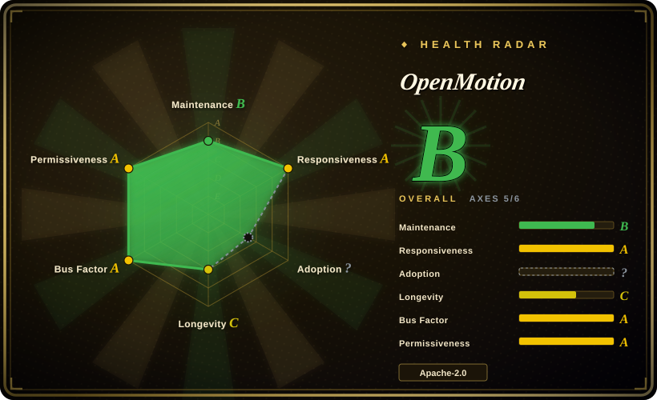
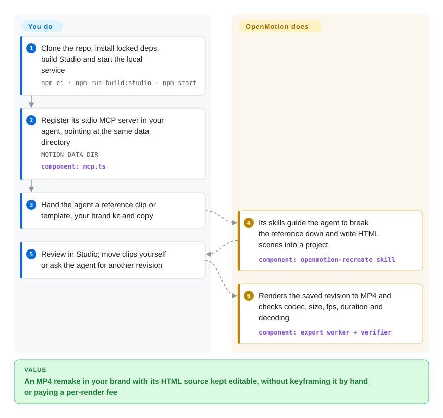
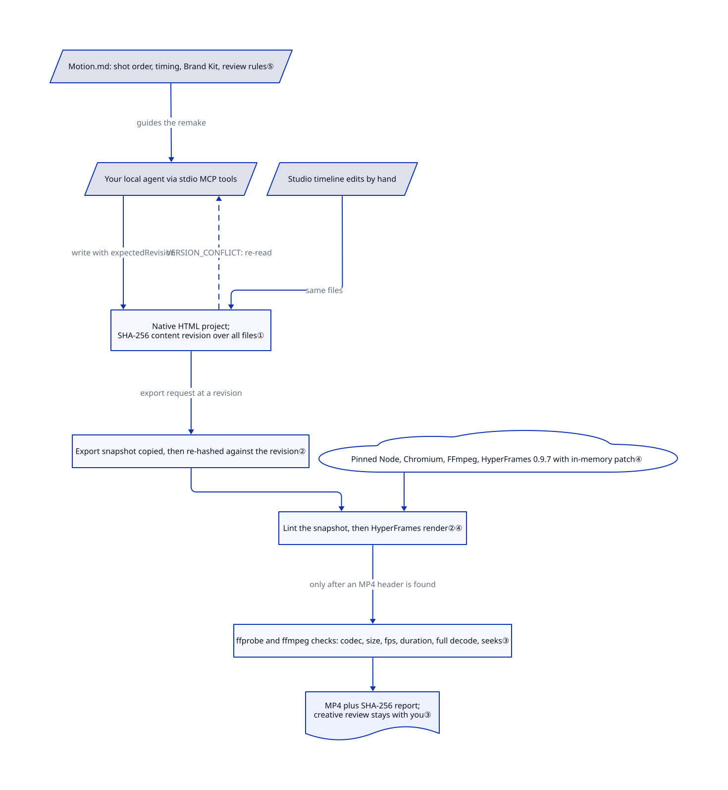

# OpenMotion

Someone hands you a 30-second launch video and says "make ours like this", and in a normal editor that means re-keying every title, transition and timing by hand, with nothing you can reuse next time. OpenMotion lets the coding agent you already use rebuild the clip as an editable HTML project with your logo and copy, which you then trim on a timeline and render to MP4 on your own machine.

## When to use

You run marketing or devrel for a software product and keep getting the same request: a competitor's or a well-known brand's launch clip, product demo or talking-head explainer is circulating, and you are asked for one in your brand by Friday. Doing it in CapCut or Premiere means watching the reference frame by frame, rebuilding every animated title and UI callout by hand, and redoing it all when the copy changes. You already work in Claude Code, Codex or a similar agent, and you would rather describe the change ("keep the reveal, replace the middle scene with our screen recording, hold the end card two more seconds") than drag keyframes.

You reach for OpenMotion because it gives that agent a local video studio to work in. The agent studies the reference with the bundled skills, records shot order and timing in a Motion.md file, writes the scenes as HTML, CSS and GSAP animation (a JavaScript animation library) into a project, and pulls generated images, video, music or narration through your own provider keys. You open the same project in Studio, move clips yourself or ask for another pass, and export an MP4 while keeping the source. Pick it over [Hypit](hypit.md) when you want an Apache-2.0 app and a timeline you can edit by hand rather than a non-OSI agent pipeline; pick it over [HyperFrames](../render-engines/hyperframes.md) alone when you need the Studio, project versioning and recreation workflow rather than just the renderer.

## When NOT to use

- **You came for HTML Anything (Markdown to a designed HTML page, WeChat/X export).** That app now lives only on the [`legacy` branch](https://github.com/nexu-io/openmotion/tree/legacy), last commit 2026-10-13, and `main` no longer contains it. For a maintained agent-driven HTML artifact generator, use [Open Design](../../ai-design-generation/open-design.md), the same team's desktop studio.
- **You only need to know how a reference was made, or what a remake will cost.** Use [rea-video](rea-video.md). OpenMotion assumes you want to rebuild the clip; it does not classify shots as filmed, AI-generated or code-built, and its agent will happily try to code a shot that should have been filmed.
- **You need deterministic HTML-to-MP4 rendering inside your own pipeline or CI.** Call [HyperFrames](../render-engines/hyperframes.md) directly, or [Remotion](../render-engines/remotion.md) for a React codebase. OpenMotion pins HyperFrames 0.9.7 while upstream is at 0.9.65 (2026-11-18), runs one export at a time per data directory, and ships packaged runtimes only for macOS arm64 and Windows x64.
- **The job is cutting long real footage: multicam, color, many takes.** Use a professional NLE such as DaVinci Resolve (not a repo), [OpenCut](../../media-processing/video-editing/opencut.md) for simple open-source timeline cuts, or [video-use](video-use.md) when an agent should cut takes from a transcript. OpenMotion's strength is motion graphics written as code with media layered in, not frame-accurate editing of hours of camera files.
- **Your environment forbids default-on telemetry or plaintext key files.** Usage events go to an OpenMotion PostHog collector by default until you set `OPENMOTION_TELEMETRY=0` or `DO_NOT_TRACK=1`, and provider keys are stored as plaintext `secrets.json` (mode 0600) under the data directory with no OS keychain. If that cannot be configured away in your setup, render with HyperFrames or Remotion and your own scripts.
- **You need a stable product to standardize a team on.** The repository switched products on `main` in November 2026, v0.1.0 shipped on 2026-11-17 after the version series restarted, and most of the 11.1k stars were earned by HTML Anything. Pin a commit or the npm `@openmotion/app` version, and plan for workflow and tool-name changes.
- **You plan to publish a near-copy of someone else's ad.** The 300+ catalog references are real brand films (Notion, Stripe, OpenAI and others); the Apache-2.0 license covers the app, not those brands, footage or music. Use the structure, then supply your own material, which the project's own Motion.md and Brand Kit flow assumes.

## Comparison

| Alternative | In index | Our verdict | Tradeoff |
|---|---|---|---|
| [Hypit](hypit.md) | ✅ | When you want a viral clip cloned into batch variants by swapping face, words and B-roll, pick Hypit; pick OpenMotion when the remake must stay editable on a visual timeline under an OSI license. | Hypit anchors edits to words in its SVML markup and ships near-daily, but under a modified non-OSI Apache license; OpenMotion is Apache-2.0 with a Studio editor, but its product is about a week old on `main`. |
| [HyperFrames](../render-engines/hyperframes.md) | ✅ | When you only need HTML compositions rendered to MP4 by a script or agent, use HyperFrames directly; choose OpenMotion when you also want Studio, versioned projects, reference recreation and media generation around it. | OpenMotion is built on HyperFrames and adds the app layer, but pins 0.9.7 and patches two engine bundles in memory, so engine fixes reach you later than they reach HyperFrames users. |
| [rea-video](rea-video.md) | ✅ | Run rea-video first when you need a shot-by-shot verdict on how a reference was made and a cost-aware remake plan; switch to OpenMotion when you are ready to rebuild the code-made shots and edit the cut. | rea-video measures and plans but renders nothing; OpenMotion renders and edits but does not tell you which shots should be filmed or generated instead. |
| [OpenMontage](../creation-workflows/open-montage.md) | ✅ | When the video starts from a topic or script rather than a reference clip, pick OpenMontage's research-to-render pipelines; pick OpenMotion when you are matching an existing reference's pacing in your brand. | OpenMontage covers research, scripting and many production styles under AGPL-3.0; OpenMotion narrows to reference and template recreation with a hand-editable timeline under Apache-2.0. |
| CapCut / Claude Motion | not a repo | Use a hosted editor when non-technical staff will do the edit and nobody runs a local agent; use OpenMotion when the agent should own the rebuild and the source must stay on your machine. | Hosted tools need no Node, Chromium or FFmpeg setup but keep projects in their format and cloud; OpenMotion keeps HTML source and media locally, and you pay your own agent and model providers. |

## Quick start

From a checkout, run `npm ci`, `npm run build:studio` and `npm start` with Node.js 26.11.1, Chrome or Chromium and FFmpeg available; the launcher prints a `studioUrl` you open in the browser. Then register the stdio MCP server (a local process your agent talks to through the Model Context Protocol) by pointing your agent's MCP config at `mcp.ts` with the same `MOTION_DATA_DIR` (the folder where projects, exports and keys live); Codex users can run `bash scripts/install-motion.command` instead, and the README offers a one-line instruction for agents to install it themselves. You supply the reference clip or a catalog template, your brand material and copy, and optional media-provider API keys in Model Settings; the agent, guided by the five `openmotion-*` skills, does the breakdown and writes the scenes. OpenMotion keeps project versions, previews in Studio, renders the MP4 and checks the file, while visual and audio acceptance stay your job, and any model usage is billed to your own accounts.

<!-- flow-steps:begin (generated from flows/openmotion.json by tools/flow_card.py — do not edit) -->

Text version of the flow

1. **You**: Clone the repo, install locked deps, build Studio and start the local service — `npm ci · npm run build:studio · npm start`
2. **You**: Register its stdio MCP server in your agent, pointing at the same data directory — `MOTION_DATA_DIR` — component: `mcp.ts`
3. **You**: Hand the agent a reference clip or template, your brand kit and copy
4. **OpenMotion**: Its skills guide the agent to break the reference down and write HTML scenes into a project — component: `openmotion-recreate skill`
5. **You**: Review in Studio; move clips yourself or ask the agent for another revision
6. **OpenMotion**: Renders the saved revision to MP4 and checks codec, size, fps, duration and decoding — component: `export worker + verifier`

**Value**: An MP4 remake in your brand with its HTML source kept editable, without keyframing it by hand or paying a per-render fee

<!-- flow-steps:end -->

## Key techniques

<!-- mechanism:begin (generated from mechanisms/openmotion.json by tools/mechanism_card.py; do not edit) -->

Text version of the mechanism

- Motion.md: shot order, timing, Brand Kit, review rules⑤
- Your local agent via stdio MCP tools
- Studio timeline edits by hand
- Native HTML project; SHA-256 content revision over all files①
- Export snapshot copied, then re-hashed against the revision②
- Pinned Node, Chromium, FFmpeg, HyperFrames 0.9.7 with in-memory patch④
- Lint the snapshot, then HyperFrames render②④
- ffprobe and ffmpeg checks: codec, size, fps, duration, full decode, seeks③
- MP4 plus SHA-256 report; creative review stays with you③

- Motion.md: shot order, timing, Brand Kit, review rules⑤ → Your local agent via stdio MCP tools (guides the remake)
- Your local agent via stdio MCP tools → Native HTML project; SHA-256 content revision over all files① (write with expectedRevision)
- Studio timeline edits by hand → Native HTML project; SHA-256 content revision over all files① (same files)
- Native HTML project; SHA-256 content revision over all files① → Your local agent via stdio MCP tools (VERSION_CONFLICT: re-read) [optional/fallback]
- Native HTML project; SHA-256 content revision over all files① → Export snapshot copied, then re-hashed against the revision② (export request at a revision)
- Export snapshot copied, then re-hashed against the revision② → Lint the snapshot, then HyperFrames render②④
- Pinned Node, Chromium, FFmpeg, HyperFrames 0.9.7 with in-memory patch④ → Lint the snapshot, then HyperFrames render②④
- Lint the snapshot, then HyperFrames render②④ → ffprobe and ffmpeg checks: codec, size, fps, duration, full decode, seeks③ (only after an MP4 header is found)
- ffprobe and ffmpeg checks: codec, size, fps, duration, full decode, seeks③ → MP4 plus SHA-256 report; creative review stays with you③

<!-- mechanism:end -->

### 1. Refuse stale writes with a content revision

- **Problem:** The agent and a person in Studio edit the same HTML files, so an agent that read the project a minute ago can silently overwrite a timing fix made since.
- **How:** The project revision is a SHA-256 over the list of every file's path, size and hash. Write tools require `expectedRevision`; the server compares it before writing, re-hashes the HTML on disk, and accepts only one known difference — Studio's deterministic element IDs appearing as exactly the next version. Reads re-check the revision after reading and fail with `VERSION_CONFLICT` if it moved.
- **Limits:** A conflict means "read again"; there is no merge or automatic retry. The process lock covers OpenMotion's own tools, so the docs state it cannot fully serialize with Studio while Studio is writing to disk.
- **Source:** [revision hash:432](https://github.com/nexu-io/openmotion/blob/bd26bbc992572c5a96ff16b67f6f933f3512a126/workspace.ts#L432), [write check and ID tolerance:470–500](https://github.com/nexu-io/openmotion/blob/bd26bbc992572c5a96ff16b67f6f933f3512a126/phase1.ts#L470-L500), [re-check after read:249](https://github.com/nexu-io/openmotion/blob/bd26bbc992572c5a96ff16b67f6f933f3512a126/phase1.ts#L249), [lock boundary note:35](https://github.com/nexu-io/openmotion/blob/bd26bbc992572c5a96ff16b67f6f933f3512a126/docs/hyperframes.md#L35).

### 2. Render from a frozen snapshot, not the live project

- **Problem:** A render that reads the working folder can mix edits made while it waits in the queue, so the MP4 matches no version anyone approved.
- **How:** An export request copies every project file into `jobs/<id>/project`, then confirms that both the copy and the live project still hash to the requested revision before queueing; it also records the expected width, height, fps and duration. The worker lints that snapshot with the pinned engine, renders it, and refuses to mark the job done unless the output starts with an MP4 `ftyp` header.
- **Limits:** One export runs at a time (`EXPORT_BUSY`), with a 30-minute job deadline and a 25-minute render timeout; snapshots are deleted afterwards, so the project version, not the job folder, is what you keep.
- **Source:** [snapshot and double hash check:555–582](https://github.com/nexu-io/openmotion/blob/bd26bbc992572c5a96ff16b67f6f933f3512a126/workspace.ts#L555-L582), [lint, render and header check:128–160](https://github.com/nexu-io/openmotion/blob/bd26bbc992572c5a96ff16b67f6f933f3512a126/server.ts#L128-L160).

### 3. Verify the file technically and name what is left for a human

- **Problem:** A renderer can exit with success and still produce a file with the wrong size, a dropped audio track or frames that fail to decode.
- **How:** After render, ffprobe checks the MP4 container, H.264 yuv420p video, exact dimensions and frame rate, the audio policy (silent, required or optional, AAC only) and duration within one frame. ffmpeg then decodes the whole file with errors treated as fatal, seeks to the first, middle and last frames, and the report records the file's SHA-256 and confirms it did not change during the check.
- **Limits:** The report lists its own `remainingChecks`: frames against the brief, playback in the target player, and whether the sound is the intended sound. Automatic verification runs for phase-one MCP exports; a passing report says nothing about creative quality.
- **Source:** [verifyExport:48–145](https://github.com/nexu-io/openmotion/blob/bd26bbc992572c5a96ff16b67f6f933f3512a126/scripts/verify-export.ts#L48-L145), [verification inside the export job:153–158](https://github.com/nexu-io/openmotion/blob/bd26bbc992572c5a96ff16b67f6f933f3512a126/server.ts#L153-L158).

### 4. Pin the whole render toolchain and patch the engine in memory

- **Problem:** HTML-to-video output depends on the exact browser, encoder and engine build, so "works on my machine" turns into different frames on a colleague's.
- **How:** A runtime lock pins Node 26.11.1, Chromium 156.0.8078.47, FFmpeg 9.0.2 and HyperFrames 0.9.7, with a download URL and SHA-256 per platform. A Node load hook rewrites two pinned HyperFrames bundles in memory (canvas capture attributes and a retry for `ERR_NO_BUFFER_SPACE`) and throws if the expected code is not found exactly, so an engine upgrade fails loudly instead of running unpatched.
- **Limits:** Locked targets are macOS arm64 and Windows x64 only. The pin trails upstream HyperFrames by dozens of releases, and the patch is marked in source as a shortcut to remove once upstream handles it.
- **Source:** [runtime lock](https://github.com/nexu-io/openmotion/blob/bd26bbc992572c5a96ff16b67f6f933f3512a126/scripts/runtime-lock.json), [capture patch hook:1–25](https://github.com/nexu-io/openmotion/blob/bd26bbc992572c5a96ff16b67f6f933f3512a126/shared/hyperframes-capture-fix.mjs#L1-L25), [engine notes:41](https://github.com/nexu-io/openmotion/blob/bd26bbc992572c5a96ff16b67f6f933f3512a126/docs/hyperframes.md#L41).

### 5. Write the reference's motion down separately from the code

- **Problem:** An agent asked to "make it like this" either copies the reference too literally or loses its pacing, and the next remake starts from zero.
- **How:** Motion.md records shot order, timing, transitions, sound cues, review rules and a Brand Kit section (names, facts, logo, voice, approved assets), and can reference a separate `DESIGN.md` for visual tokens. The project keeps intent (Motion.md), procedure (`SKILL.md`), implementation (HTML/CSS/JS) and proof (paired previews and hashes) as separate layers, so a later remake swaps content without rewriting the motion language.
- **Limits:** It is a document convention the agent reads, not a format the renderer enforces; the v0.2 package spec is a draft, and the docs state Studio does not automatically import packages or guarantee rendered fidelity.
- **Source:** [layer table:47–58](https://github.com/nexu-io/openmotion/blob/bd26bbc992572c5a96ff16b67f6f933f3512a126/docs/motion-md.md#L47-L58), [Motion.md overview](https://github.com/nexu-io/openmotion/blob/bd26bbc992572c5a96ff16b67f6f933f3512a126/docs/motion-md.md).

## Tech stack

- **Application runtime:** Node.js with `--experimental-strip-types` running TypeScript directly (`server.ts`, `mcp.ts`, `phase1.ts`, `workspace.ts`); native `node:http`; local files and JSON for projects, versions and jobs.
- **Studio UI:** React 19, Vite 6, Tailwind CSS 4, Zustand, CodeMirror and Dockview; the editor front end is a fork of the HyperFrames 0.9.7 Studio, built in-repo (`studio/`, Apache-2.0).
- **Video engine:** `hyperframes` and `@hyperframes/*` 0.9.7 packages, GSAP 3.15.0, `puppeteer-core` driving Chromium, FFmpeg/FFprobe for encoding and checks.
- **Agent surface:** a local stdio MCP server with sixteen public tool names, five core skills (`openmotion-director`, `-production`, `-recreate`, `-template-to-video`, `-video-to-template`), a Codex plugin manifest and a generator for per-host adapter bundles.
- **Model gateway:** provider adapters for Atlas Cloud, fal.ai, OpenAI-compatible endpoints and a local Codex image path, with persisted generation jobs.
- **Content:** a catalog of 287 template/reference folders in `library/templates/catalog/` at the reviewed commit, plus Brand Kits and fonts with their own notices.

## Dependencies

- Node.js 26.11.1 for source runs (README; `package.json` `engines` says `>=22.18.0`), npm, and Git with LFS left off unless you want the full reference media.
- Chrome or Chromium and FFmpeg/FFprobe on the machine for preview and export; packaged npm/ZIP installs download pinned copies on first use for macOS arm64 and Windows x64.
- A local agent that can call stdio MCP tools (Claude Code, Codex, WorkBuddy, DeepSeek Harness have documented setups) or a shell-capable agent using the pinned CLI.
- Optional: API keys for media providers (Atlas Cloud, fal.ai and others) for generated images, video, music and voice; a signed-in Codex CLI for the local image path.
- Network on first install for npm packages and native runtime downloads; usage telemetry to the OpenMotion collector unless disabled.

## Ops difficulty

**Medium for one person on a Mac or Windows laptop; high as shared infrastructure.** The happy path is a few npm commands plus one MCP entry, but every part has a moving piece: a pinned Node version newer than most machines have, a browser and FFmpeg the renderer must find, a background service that keeps running after the launcher exits, and an agent host whose MCP registration you have to confirm actually loaded. Exports queue one at a time per data directory, and projects, keys and exports all sit under `MOTION_DATA_DIR`, which you must keep outside the checkout and back up yourself. Telemetry and plaintext key storage need explicit decisions in a managed environment. There is no multi-user server mode.

## Health & viability

- **Maintenance (2026-11-18):** very active — 100+ commits in the last 30 days, last push 2026-11-18, first stable release v0.1.0 on 2026-11-17 and npm `@openmotion/app` at 0.1.0 with a parallel test channel. The scorer still grades maintenance B because only 5 of the last 13 weeks had default-branch commits: the quiet HTML Anything tail before the product replaced it on `main` around 2026-11-11. This is launch momentum, not a long track record.
- **Governance and backing:** owned by the `nexu-io` organization, the team behind [Open Design](../../ai-design-generation/open-design.md); the scorer counts 32 contributors in 12 months with the top one at 18% of commits, and a release bot holds the most commits of any single account. The roadmap and publication are vendor-controlled, and the README links to OpenDesign's paid model subscription.
- **Age and Lindy:** the repository dates from 2026-05, but the OpenMotion product on `main` is about a week old at verification and the version series restarted at 0.0.1/0.1.0. Treat it as new: the Lindy prior gives it almost no weight, and the rename shows the team will repurpose a repository.
- **Adoption signals:** 11.1k stars and 1.1k forks are largely inherited from HTML Anything (about 9.0k stars on 2026-09-28); npm shows about 2.3k downloads of `@openmotion/app` in the month to 2026-11-16. Real usage of the video product is not yet measurable.
- **Risk flags:** default-on usage telemetry, plaintext provider keys, a pinned engine far behind upstream with an in-memory patch, third-party template and brand material under their own terms, and a 37-issue / 30-PR open backlog on 2026-11-18. The code license is Apache-2.0 with no relicense history.

## Caveats (unverified)

- [未验证: no local install or render run in this review] Whether a full recreation (reference → Studio → verified MP4) works end to end on a given machine and agent host; only the source paths and documented checks were read.
- [推断: from the 2026-09-28 page snapshot and 2026-11-18 API] The share of stars earned before the product switch is estimated from those two counts (8,961 then 11,125), not measured.
- [未验证: README marketing figures] "22 local agents", "300+ Motion.md guides" and "10+ multimodal providers" are the project's own counts; the adapter guide documents setups for four hosts, and 287 catalog folders were counted in the tree.
- [未验证: product not a repository] "Claude Motion" is named by the README as the product OpenMotion replaces; its scope and availability were not checked.
- [推断: from `docs/usage.md` and the runtime lock] Linux works only from source with your own Chromium and FFmpeg; no Linux runtime target is locked, and Linux acceptance is not claimed by the docs.
- [未验证: legacy branch not exercised] The HTML Anything app on the `legacy` branch was not run; whether it still works with current agent CLIs is unknown.
