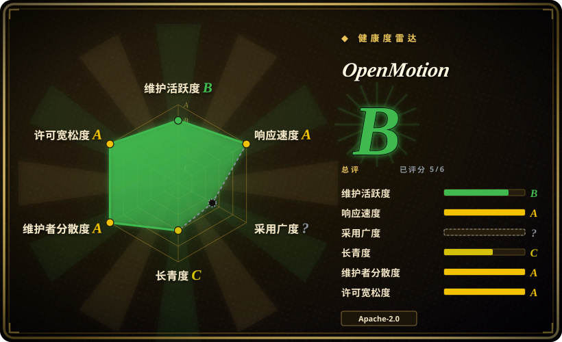
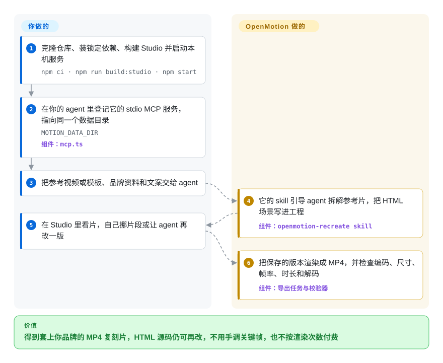
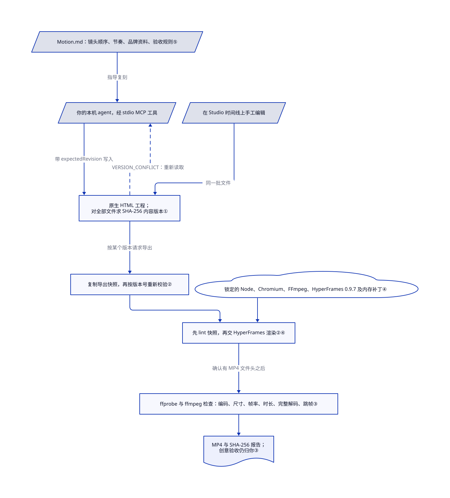

# OpenMotion

有人丢给你一条 30 秒的发布视频，说“照这个给我们也做一条”。放进普通剪辑软件，就得把每个标题、转场和节奏重新手调一遍，做完也留不下能复用的东西。OpenMotion 让你已经在用的编码助手把这条片子重建成可编辑的 HTML 工程，换上你的 logo 和文案，你再在时间线上微调，在自己电脑上渲染成 MP4。

## 何时使用

你在一家软件公司做市场或开发者关系，总接到同一种需求：竞品或某个知名品牌的发布短片、产品演示或口播讲解正在流传，要你周五前出一条自己品牌的版本。用剪映或 Premiere 做，意味着逐帧看参考片，手工重做每个动效标题和界面标注，文案一改又全部返工。你本来就在 Claude Code、Codex 这类 agent 里工作，宁可直接说“保留揭晓那一下，把中间那场换成我们的录屏，结尾卡多停两秒”，也不想拖关键帧。

这时你会想到 OpenMotion，因为它给这个 agent 配了一个本机视频工作室。agent 用自带的 skill 拆解参考片，把镜头顺序和节奏记进 Motion.md 文件，用 HTML、CSS 和 GSAP（一个 JavaScript 动画库）把场景写进工程，并用你自己的服务商密钥生成图片、视频、音乐或旁白。你在 Studio 里打开同一个工程，自己挪片段，或让 agent 再改一版，导出 MP4 的同时保留源码。和 [Hypit](hypit.zh.md) 比，你要的是 Apache-2.0 的应用和能手动编辑的时间线，而不是非 OSI 许可的 agent 流水线；和单用 [HyperFrames](../render-engines/hyperframes.zh.md) 比，你需要的是 Studio、工程版本管理和复刻流程，而不只是渲染器。

## 何时不用

- **你要找的是 HTML Anything（Markdown 变成排好版的 HTML 页面，导出到微信或 X）。** 这个应用现在只留在 [`legacy` 分支](https://github.com/nexu-io/openmotion/tree/legacy)，最后一次提交在 2026-10-13，`main` 上已经没有它。要持续维护的 agent 驱动 HTML 产物生成器，用同一团队的桌面工作室 [Open Design](../../ai-design-generation/open-design.zh.md)。
- **你只想知道参考片是怎么做的，或者复刻要花多少钱。** 用 [rea-video](rea-video.zh.md)。OpenMotion 默认你要重建这条片子，它不会判断每个镜头是实拍、AI 生成还是代码做的，agent 也可能去用代码硬做一个本该实拍的镜头。
- **你要在自己的流水线或 CI 里做确定性的 HTML 转 MP4 渲染。** 直接调用 [HyperFrames](../render-engines/hyperframes.zh.md)，React 代码库则用 [Remotion](../render-engines/remotion.zh.md)。OpenMotion 把 HyperFrames 锁在 0.9.7，而上游在 2026-11-18 已到 0.9.65；同一数据目录一次只跑一个导出任务，打包好的运行时也只覆盖 macOS arm64 和 Windows x64。
- **活儿是剪大量实拍素材：多机位、调色、成堆的镜次。** 用 DaVinci Resolve 这类专业剪辑软件（非仓库），简单的开源时间线剪辑用 [OpenCut](../../media-processing/video-editing/opencut.zh.md)，想让 agent 按文字稿挑镜次就用 [video-use](video-use.zh.md)。OpenMotion 擅长的是用代码写动效、再叠上素材，不是逐帧精剪几个小时的摄像机文件。
- **你的环境不允许默认开启的遥测或明文密钥文件。** 默认会把使用事件发到 OpenMotion 的 PostHog 收集端，直到你设置 `OPENMOTION_TELEMETRY=0` 或 `DO_NOT_TRACK=1`；服务商密钥以明文 `secrets.json`（权限 0600）存在数据目录下，不用系统钥匙串。如果你的环境里关不掉这些，就用 HyperFrames 或 Remotion 加自己的脚本来渲染。
- **你要一个稳定产品让整个团队统一使用。** 这个仓库在 2026 年 11 月于 `main` 上换了产品，版本号重新起算后 v0.1.0 在 2026-11-17 才发布，1.11 万星里大部分是 HTML Anything 时期攒下的。请锁定某个提交或 npm 上 `@openmotion/app` 的版本，并预期工作流和工具名还会变。
- **你打算发布一条几乎照抄别人广告的片子。** 目录里 300 多个参考是真实的品牌片（Notion、Stripe、OpenAI 等），Apache-2.0 许可只覆盖这个应用，不覆盖那些品牌、素材和音乐。借它的结构，换上你自己的素材，这也是项目里 Motion.md 和品牌资料流程本来的前提。

## 横向对比

| 替代品 | 是否收录 | 我们的评价 | 取舍 |
|---|---|---|---|
| [Hypit](hypit.zh.md) | 已收录 | 想把一条爆款克隆出一批变体、靠换脸换词换空镜来量产时选 Hypit；复刻结果必须能在可视时间线上继续编辑、而且要 OSI 许可时选 OpenMotion。 | Hypit 把编辑锚定在 SVML 标记里的词上，几乎天天发版，但用的是改过的非 OSI Apache 许可；OpenMotion 是 Apache-2.0、带 Studio 编辑器，但它在 `main` 上的产品才一周左右。 |
| [HyperFrames](../render-engines/hyperframes.zh.md) | 已收录 | 只需要让脚本或 agent 把 HTML 合成渲染成 MP4 时，直接用 HyperFrames；还想要 Studio、带版本的工程、参考片复刻和素材生成时选 OpenMotion。 | OpenMotion 建在 HyperFrames 之上、多了应用层，但锁定 0.9.7 并在内存里给两个引擎包打补丁，引擎修复到你手里会比直接用 HyperFrames 晚。 |
| [rea-video](rea-video.zh.md) | 已收录 | 需要逐镜判断参考片怎么拍的、拿到按成本规划的复刻方案时，先跑 rea-video；准备动手重建代码可做的镜头、再剪辑成片时换到 OpenMotion。 | rea-video 只测量和规划，不渲染；OpenMotion 能渲染和编辑，但不会告诉你哪些镜头其实该去实拍或生成。 |
| [OpenMontage](../creation-workflows/open-montage.zh.md) | 已收录 | 视频从一个主题或脚本出发、没有参考片时，选 OpenMontage 从调研到渲染的流水线；要按一条现成参考片的节奏做出你的品牌版时，选 OpenMotion。 | OpenMontage 覆盖调研、写稿和多种制作风格，许可是 AGPL-3.0；OpenMotion 收窄到参考片和模板复刻，带可手动编辑的时间线，许可是 Apache-2.0。 |
| CapCut / Claude Motion | 非仓库 | 剪辑由不懂技术的同事来做、也没人在本机跑 agent 时，用托管的剪辑工具；要让 agent 负责重建、源码必须留在自己电脑上时，用 OpenMotion。 | 托管工具不用装 Node、Chromium、FFmpeg，但工程留在它们的格式和云端；OpenMotion 把 HTML 源码和素材留在本地，agent 和模型服务的费用由你自己的账户承担。 |

## 快速上手

在仓库目录里，准备好 Node.js 26.11.1、Chrome 或 Chromium 以及 FFmpeg，依次运行 `npm ci`、`npm run build:studio`、`npm start`，启动器会打印一个 `studioUrl`，在浏览器里打开即可。然后登记 stdio MCP 服务（agent 通过 Model Context Protocol 与之对话的本机进程）：在 agent 的 MCP 配置里指向 `mcp.ts`，并使用同一个 `MOTION_DATA_DIR`（存放工程、导出文件和密钥的目录）；Codex 用户也可以直接运行 `bash scripts/install-motion.command`，README 里还有一句可以让 agent 自己完成安装的指令。你负责提供参考视频或目录里的模板、品牌素材和文案，以及可选的媒体服务商 API 密钥（在 Model Settings 里填）；agent 在五个 `openmotion-*` skill 的引导下完成拆解并写出场景。OpenMotion 负责保存工程版本、在 Studio 里预览、渲染 MP4 并检查文件；画面和声音是否合格仍要你来验收，模型用量也记在你自己的账户上。

<!-- flow-steps:begin (generated from flows/openmotion.json by tools/flow_card.py — do not edit) -->

流程文字版

1. **你**：克隆仓库、装锁定依赖、构建 Studio 并启动本机服务 — `npm ci · npm run build:studio · npm start`
2. **你**：在你的 agent 里登记它的 stdio MCP 服务，指向同一个数据目录 — `MOTION_DATA_DIR` — 组件：`mcp.ts`
3. **你**：把参考视频或模板、品牌资料和文案交给 agent
4. **OpenMotion**：它的 skill 引导 agent 拆解参考片，把 HTML 场景写进工程 — 组件：`openmotion-recreate skill`
5. **你**：在 Studio 里看片，自己挪片段或让 agent 再改一版
6. **OpenMotion**：把保存的版本渲染成 MP4，并检查编码、尺寸、帧率、时长和解码 — 组件：`导出任务与校验器`

**价值**：得到套上你品牌的 MP4 复刻片，HTML 源码仍可再改，不用手调关键帧，也不按渲染次数付费

<!-- flow-steps:end -->

## 技术要点

<!-- mechanism:begin (generated from mechanisms/openmotion.json by tools/mechanism_card.py; do not edit) -->

机制文字版

- Motion.md：镜头顺序、节奏、品牌资料、验收规则⑤
- 你的本机 agent，经 stdio MCP 工具
- 在 Studio 时间线上手工编辑
- 原生 HTML 工程； 对全部文件求 SHA-256 内容版本①
- 复制导出快照，再按版本号重新校验②
- 锁定的 Node、Chromium、FFmpeg、HyperFrames 0.9.7 及内存补丁④
- 先 lint 快照，再交 HyperFrames 渲染②④
- ffprobe 与 ffmpeg 检查：编码、尺寸、帧率、时长、完整解码、跳帧③
- MP4 与 SHA-256 报告； 创意验收仍归你③

- Motion.md：镜头顺序、节奏、品牌资料、验收规则⑤ → 你的本机 agent，经 stdio MCP 工具（指导复刻）
- 你的本机 agent，经 stdio MCP 工具 → 原生 HTML 工程； 对全部文件求 SHA-256 内容版本①（带 expectedRevision 写入）
- 在 Studio 时间线上手工编辑 → 原生 HTML 工程； 对全部文件求 SHA-256 内容版本①（同一批文件）
- 原生 HTML 工程； 对全部文件求 SHA-256 内容版本① → 你的本机 agent，经 stdio MCP 工具（VERSION_CONFLICT：重新读取）〔可选／兜底〕
- 原生 HTML 工程； 对全部文件求 SHA-256 内容版本① → 复制导出快照，再按版本号重新校验②（按某个版本请求导出）
- 复制导出快照，再按版本号重新校验② → 先 lint 快照，再交 HyperFrames 渲染②④
- 锁定的 Node、Chromium、FFmpeg、HyperFrames 0.9.7 及内存补丁④ → 先 lint 快照，再交 HyperFrames 渲染②④
- 先 lint 快照，再交 HyperFrames 渲染②④ → ffprobe 与 ffmpeg 检查：编码、尺寸、帧率、时长、完整解码、跳帧③（确认有 MP4 文件头之后）
- ffprobe 与 ffmpeg 检查：编码、尺寸、帧率、时长、完整解码、跳帧③ → MP4 与 SHA-256 报告； 创意验收仍归你③

<!-- mechanism:end -->

### 1. 用内容版本号拒绝过期写入

- **解决：** agent 和在 Studio 里操作的人编辑的是同一批 HTML 文件，一分钟前读过工程的 agent 可能悄悄覆盖掉刚才手调的节奏。
- **做法：** 工程版本号是对全部文件的路径、大小和哈希列表求出的 SHA-256。写入类工具必须带 `expectedRevision`，服务端写入前先比对，再重新计算磁盘上 HTML 的哈希，只接受一种已知差异：Studio 自动补上的确定性元素 ID 恰好构成下一个版本。读取完成后还会再核对一次版本号，变了就报 `VERSION_CONFLICT`。
- **边界：** 冲突的意思是“重新读一遍”，没有合并，也不自动重试。进程锁只约束 OpenMotion 自己的工具，文档也写明它无法与正在写盘的 Studio 完全串行。
- **源码：** [版本哈希第 432 行](https://github.com/nexu-io/openmotion/blob/bd26bbc992572c5a96ff16b67f6f933f3512a126/workspace.ts#L432)、[写入校验与 ID 容差第 470–500 行](https://github.com/nexu-io/openmotion/blob/bd26bbc992572c5a96ff16b67f6f933f3512a126/phase1.ts#L470-L500)、[读后复核第 249 行](https://github.com/nexu-io/openmotion/blob/bd26bbc992572c5a96ff16b67f6f933f3512a126/phase1.ts#L249)、[锁边界说明第 35 行](https://github.com/nexu-io/openmotion/blob/bd26bbc992572c5a96ff16b67f6f933f3512a126/docs/hyperframes.md#L35)。

### 2. 从冻结的快照渲染，而不是从正在编辑的工程渲染

- **解决：** 渲染如果直接读工作目录，排队期间做的改动会混进去，最后的 MP4 不对应任何人批准过的版本。
- **做法：** 导出请求先把工程的全部文件复制到 `jobs/<id>/project`，确认副本和正在编辑的工程都仍然等于请求的版本号后才入队，同时记下预期的宽、高、帧率和时长。后台任务用锁定的引擎先 lint 这个快照，再渲染，输出文件开头没有 MP4 的 `ftyp` 头就不标记完成。
- **边界：** 一次只跑一个导出（否则报 `EXPORT_BUSY`），任务期限 30 分钟、渲染超时 25 分钟；快照用完即删，要留的是工程版本，不是任务目录。
- **源码：** [快照与双重哈希校验第 555–582 行](https://github.com/nexu-io/openmotion/blob/bd26bbc992572c5a96ff16b67f6f933f3512a126/workspace.ts#L555-L582)、[lint、渲染与文件头检查第 128–160 行](https://github.com/nexu-io/openmotion/blob/bd26bbc992572c5a96ff16b67f6f933f3512a126/server.ts#L128-L160)。

### 3. 从技术上验文件，并写明还剩什么要人来看

- **解决：** 渲染器可能返回成功，但文件尺寸不对、音轨丢了，或者某些帧解不出来。
- **做法：** 渲染后先用 ffprobe 检查 MP4 容器、H.264 yuv420p 视频流、精确的尺寸和帧率、音频策略（静音、必需或可选，只认 AAC）以及误差在一帧内的时长；再用 ffmpeg 把整个文件解码一遍，遇错即失败，并跳到首帧、中间帧和末帧各解一帧；报告记下文件的 SHA-256，并确认检查期间文件没被改动。
- **边界：** 报告自带 `remainingChecks`：对照脚本看画面、在目标播放器里播一遍、确认声音是不是想要的声音。自动校验只覆盖一期 MCP 导出；报告通过不代表创意质量过关。
- **源码：** [verifyExport 第 48–145 行](https://github.com/nexu-io/openmotion/blob/bd26bbc992572c5a96ff16b67f6f933f3512a126/scripts/verify-export.ts#L48-L145)、[导出任务内的校验第 153–158 行](https://github.com/nexu-io/openmotion/blob/bd26bbc992572c5a96ff16b67f6f933f3512a126/server.ts#L153-L158)。

### 4. 锁定整条渲染工具链，并在内存里给引擎打补丁

- **解决：** HTML 转视频的结果取决于浏览器、编码器和引擎的具体版本，“我这能跑”换到同事机器上就成了不同的画面。
- **做法：** 运行时锁文件钉死 Node 26.11.1、Chromium 156.0.8078.47、FFmpeg 9.0.2 和 HyperFrames 0.9.7，每个平台都写了下载地址和 SHA-256。一个 Node 加载钩子在内存里改写两个锁定版本的 HyperFrames 代码包（画布捕获属性，以及针对 `ERR_NO_BUFFER_SPACE` 的重试），找不到完全匹配的原代码就直接抛错，所以升级引擎会显式失败，而不是悄悄跑没打补丁的版本。
- **边界：** 锁定的目标只有 macOS arm64 和 Windows x64。锁定版本落后上游 HyperFrames 几十个版本，源码里也把这个补丁标为上游修好后要删掉的临时做法。
- **源码：** [运行时锁文件](https://github.com/nexu-io/openmotion/blob/bd26bbc992572c5a96ff16b67f6f933f3512a126/scripts/runtime-lock.json)、[捕获补丁钩子第 1–25 行](https://github.com/nexu-io/openmotion/blob/bd26bbc992572c5a96ff16b67f6f933f3512a126/shared/hyperframes-capture-fix.mjs#L1-L25)、[引擎说明第 41 行](https://github.com/nexu-io/openmotion/blob/bd26bbc992572c5a96ff16b67f6f933f3512a126/docs/hyperframes.md#L41)。

### 5. 把参考片的动效写成文档，和代码分开

- **解决：** 让 agent “照这个做”，它要么抄得太死，要么丢了节奏；下一次复刻又从零开始。
- **做法：** Motion.md 记录镜头顺序、节奏、转场、声音提示、验收规则，以及一个品牌资料小节（名称、事实、logo、语气、已批准素材），还可以引用独立的 `DESIGN.md` 管视觉 token。工程把意图（Motion.md）、步骤（`SKILL.md`）、实现（HTML/CSS/JS）和证据（成对预览与哈希）分成几层，下一次复刻换内容时不必重写动效语言。
- **边界：** 它是 agent 读的文档约定，渲染器不会强制执行；v0.2 包规范还是草案，文档也写明 Studio 不会自动导入这些包，也不保证渲染还原度。
- **源码：** [分层表第 47–58 行](https://github.com/nexu-io/openmotion/blob/bd26bbc992572c5a96ff16b67f6f933f3512a126/docs/motion-md.md#L47-L58)、[Motion.md 总览](https://github.com/nexu-io/openmotion/blob/bd26bbc992572c5a96ff16b67f6f933f3512a126/docs/motion-md.md)。

## 技术栈

- **应用运行时：** Node.js 带 `--experimental-strip-types` 直接运行 TypeScript（`server.ts`、`mcp.ts`、`phase1.ts`、`workspace.ts`）；原生 `node:http`；工程、版本和任务用本地文件与 JSON 存储。
- **Studio 界面：** React 19、Vite 6、Tailwind CSS 4、Zustand、CodeMirror 和 Dockview；编辑器前端从 HyperFrames 0.9.7 的 Studio 分叉而来，在仓库内构建（`studio/`，Apache-2.0）。
- **视频引擎：** `hyperframes` 与 `@hyperframes/*` 0.9.7 系列包、GSAP 3.15.0、驱动 Chromium 的 `puppeteer-core`，以及负责编码和检查的 FFmpeg/FFprobe。
- **agent 接口：** 本机 stdio MCP 服务，对外 16 个工具名；五个核心 skill（`openmotion-director`、`-production`、`-recreate`、`-template-to-video`、`-video-to-template`）；Codex 插件清单，以及按宿主生成适配包的脚本。
- **模型网关：** Atlas Cloud、fal.ai、OpenAI 兼容端点的服务商适配器，以及本机 Codex 出图通道，生成任务会持久化保存。
- **内容：** 审阅的提交里 `library/templates/catalog/` 下有 287 个模板或参考目录，另有品牌资料和字体，各自带许可说明。

## 依赖

- 源码运行用 Node.js 26.11.1（README 的要求；`package.json` 的 `engines` 写的是 `>=22.18.0`）、npm，以及 Git；除非要完整参考素材，否则不必开 LFS。
- 预览和导出需要本机有 Chrome 或 Chromium 和 FFmpeg/FFprobe；npm 或 ZIP 安装包在 macOS arm64 和 Windows x64 上首次使用时会下载锁定版本。
- 一个能调用 stdio MCP 工具的本机 agent（Claude Code、Codex、WorkBuddy、DeepSeek Harness 有现成的接入文档），或者能开终端、改用锁定 CLI 的 agent。
- 可选：媒体服务商的 API 密钥（Atlas Cloud、fal.ai 等），用来生成图片、视频、音乐和配音；要走本机出图通道还需要已登录的 Codex CLI。
- 首次安装要联网下载 npm 包和原生运行时；不关闭的话会向 OpenMotion 收集端发送使用数据。

## 运维难度

**一个人在 Mac 或 Windows 笔记本上用属中等，当成共享基础设施则偏高。** 顺利的话就是几条 npm 命令加一条 MCP 配置，但每一环都有变数：锁定的 Node 版本比多数机器上的新；渲染器要找得到浏览器和 FFmpeg；启动器退出后后台服务还在跑；agent 宿主到底有没有真的加载 MCP 也得你确认。同一数据目录的导出一次排一个，工程、密钥和导出文件都在 `MOTION_DATA_DIR` 下，你得把它放在仓库目录之外并自行备份。在受管环境里，遥测和明文密钥存储都需要明确决定怎么处理。它没有多用户服务模式。

## 健康度与可持续性

- **维护（2026-11-18）：** 非常活跃，最近 30 天提交超过 100 次，最后推送在 2026-11-18；第一个正式版 v0.1.0 发布于 2026-11-17，npm 上 `@openmotion/app` 为 0.1.0，另有一条测试通道。评分器仍给维护打 B，因为最近 13 周里只有 5 周在默认分支有提交：那是新产品约在 2026-11-11 替换 `main` 之前，HTML Anything 的安静尾声。现在的节奏是上线冲劲，谈不上长期记录。
- **治理与背后支持：** 归 `nexu-io` 组织所有，也就是 [Open Design](../../ai-design-generation/open-design.zh.md) 背后的团队；评分器统计 12 个月内有 32 位贡献者，头号贡献者占 18% 的提交，提交最多的单一账号是发版机器人。路线图和发布都由这家厂商掌控，README 里还链接到 OpenDesign 的付费模型订阅。
- **年龄与 Lindy：** 仓库建于 2026-05，但 `main` 上的 OpenMotion 产品在核验时只有一周左右，版本号也从 0.0.1/0.1.0 重新起算。把它当新项目看：Lindy 先验几乎给不了分量，而这次改名也说明团队会把一个仓库挪作他用。
- **采用信号：** 1.11 万星和 1.1 千个 fork 大多是 HTML Anything 时期继承来的（2026-09-28 时约 9.0 千星）；npm 显示截至 2026-11-16 的一个月里 `@openmotion/app` 下载约 2.3 千次。视频产品的真实使用量还量不出来。
- **风险信号：** 默认开启的使用遥测、明文存放的服务商密钥、远落后于上游且靠内存补丁的锁定引擎、各自有许可条款的第三方模板和品牌素材，以及 2026-11-18 时 37 个未关 issue、30 个未合 PR 的积压。代码许可是 Apache-2.0，没有改许可的历史。

## 存疑（未验证）

- [未验证：本次没有在本机安装或渲染] 一次完整复刻（参考片 → Studio → 通过校验的 MP4）在具体机器和 agent 宿主上能否跑通；只读了源码路径和文档里写的检查。
- [推断：依据 2026-09-28 页面快照和 2026-11-18 的 API 数据] 换产品前攒下的星数占比由这两个数（8,961 和 11,125）估算，不是测出来的。
- [未验证：README 宣传数字] “22 个本机 agent”“300 多份 Motion.md 指南”“10 多家多模态服务商”都是项目自己的说法；适配文档只写了四个宿主的接入方式，目录树里数出 287 个模板目录。
- [未验证：对方不是仓库] README 把 “Claude Motion” 列为 OpenMotion 要替代的产品，它的范围和可用性没有核实。
- [推断：依据 `docs/usage.md` 和运行时锁文件] Linux 只能从源码运行，并自备 Chromium 和 FFmpeg；锁文件没有 Linux 目标，文档也没有声称 Linux 通过验收。
- [未验证：没有运行 legacy 分支] `legacy` 分支上的 HTML Anything 应用没有实际跑过，它和当前各家 agent CLI 是否还兼容不清楚。
