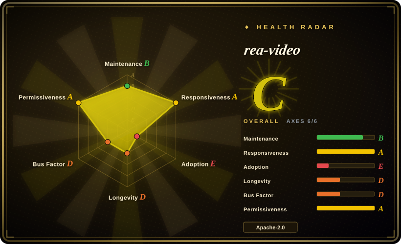
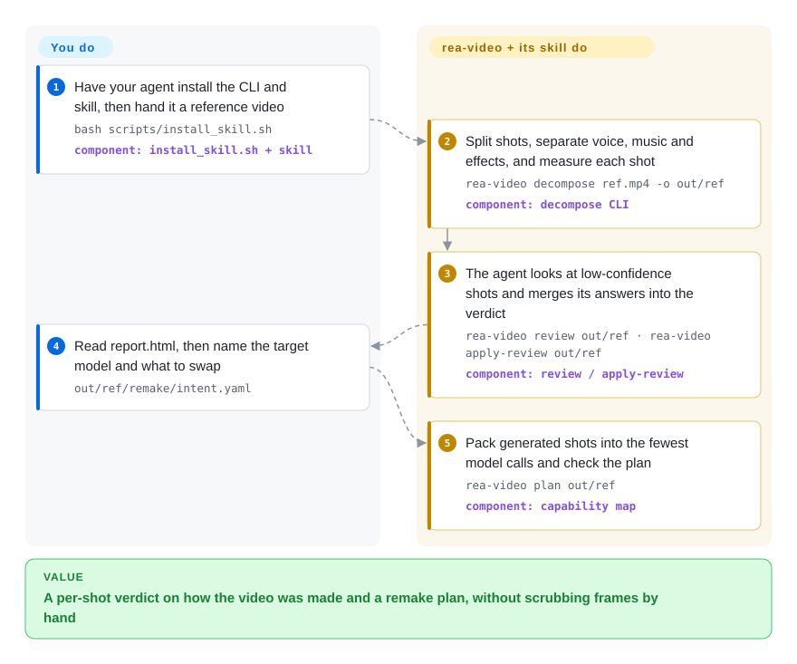
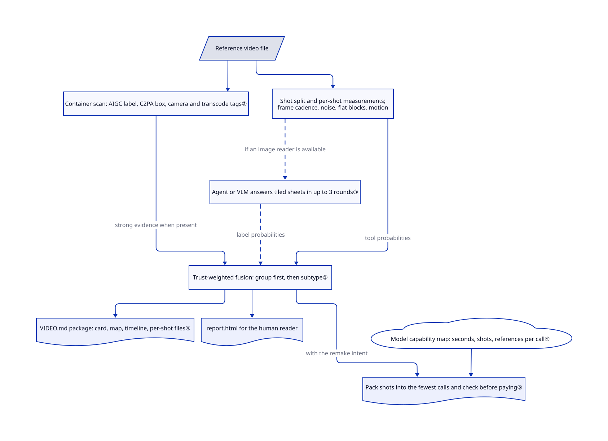

# rea-video

You want to copy a short video that works, but scrubbing it frame by frame you still cannot tell which shots were filmed on a phone, which came out of a video model and which are code-built motion graphics, so you do not know whether to book a shoot, buy generation credits or write a Remotion project. rea-video measures every shot (frame cadence, sensor noise, metadata labels), lets your coding agent look at the doubtful ones, and writes a per-shot verdict plus a remake plan sized to the model you will use.

## When to use

You run content for a brand or a creator account and someone sends you a 60-second ad: "make one like this for our product". Opening it in an editor tells you where the cuts are, but not that shots 3–7 are one AI generation sharing a set, shot 8 is a real screen recording you will have to capture yourself, and the music is probably a library track. Guessing wrong costs real money: a day of shooting for footage that was generated, or a stack of failed generations for shots that were filmed.

You reach for rea-video when you already work in Claude Code or Codex and want that answer as evidence, not vibes. The agent installs the CLI, runs `decompose`, reviews the low-confidence shots by looking at contact sheets, and hands you `report.html` plus a layered `VIDEO.md` package it can query later without re-reading the whole breakdown. It beats a one-click cloner such as Hypit when the question is *how was this made and what is the cheapest way to redo each shot*; it beats asking a vision model directly because the cut list, frame-rate fingerprints and AIGC metadata are measured, and the model only arbitrates where the measurements disagree.

## When NOT to use

- **You want a finished lookalike video, not a diagnosis.** Use [Hypit](hypit.md). rea-video renders nothing itself; the README says so, and AI shots only get made if you add the author's capsule-cinema (not indexed) or a hosted editor.
- **You only need shot boundaries or a scene list inside a pipeline.** Use PySceneDetect (not indexed). rea-video's cut detector is good (95% recall / 94% precision on nine hand-labelled clips per `eval/RESULTS.md`), but it arrives with OCR, ONNX audio-separation models downloaded on first run and a 40-plus-module analysis stack you do not need for cut times.
- **You need a defensible "this is AI" verdict for moderation, journalism or a dispute.** Verify signed content credentials with the C2PA tooling (contentauth/c2pa-rs, not indexed) and treat everything else as a lead. rea-video's labels are fused probabilities tuned on the author's own ~31 labelled videos; on first-seen Douyin commerce clips the tools alone scored 46.4% and on film-clip montages 15.5%, and its C2PA check only notices a manifest box in the first 8 MB without validating the signature.
- **Your agent cannot see images, you have no VLM key, and the clips are platform downloads.** Configure a vision model (Gemini or Doubao via an OpenAI-compatible endpoint) or use a hosted video-understanding API such as TwelveLabs (not a repo). Recompression wipes the noise evidence; the repo's own blind test found a text-only agent overturned the tools four times and was wrong twice, so the skill now forbids it from overriding the production-method call.
- **You are building a downstream integration that needs a stable output schema.** Pin a commit and validate with `videomd check`. The breakdown package was released as "Reel" in v0.1.0 on 2026-11-11 and renamed to VIDEO.md within the week, and there is no committed test suite or CI (`tests/` is git-ignored) to catch the next change.
- **Your agent must not carry sponsor pitches or run third-party installers.** Install the CLI with `pip` and drive it yourself, or delete `references/remake-tools.md` and `references/chatcut.md` from your copy of the skill. Those files tell the agent to end remake replies with a fixed ChatCut paragraph and, if you answer "continue", to run `curl -fsSL 'https://chatcut.io/install.sh?source=rea_video' | sh`.
- **You plan to repost or reuse the source footage, music or likeness.** Do not; re-shoot with material you hold rights to. The README limits use to learning structure, and the sample videos in `docs/cases/` are third-party clips that the Apache-2.0 license on the code does not cover.

## Comparison

| Alternative | In index | Our verdict | Tradeoff |
|---|---|---|---|
| [Hypit](hypit.md) | ✅ | Choose Hypit when you want a lookalike rendered quickly from a reference and do not care how the original was produced; choose rea-video when you need a shot-by-shot production verdict and a cost-aware remake plan before spending on generation or a shoot. | Hypit renders end to end under a non-OSI license; rea-video is Apache-2.0 and stops at analysis and planning, so rendering stays your job or another tool's. |
| PySceneDetect | not indexed | Choose PySceneDetect when you need cut timestamps or scene splits in a script or batch job; choose rea-video when the question after the cut list is "how was each shot made". Not added in this tab batch. | A 12-year-old BSD-3 library with a narrow job and few dependencies versus a three-week-old agent tool with heavy optional models and no committed tests. |
| C2PA tooling (contentauth/c2pa-rs) | not indexed | Choose the C2PA SDK and CLI when the file carries content credentials and you need a cryptographically checked provenance answer; choose rea-video for the far more common platform download whose metadata has been stripped. Not added in this tab batch. | C2PA gives a verifiable yes or no only when a manifest survives; rea-video always gives an answer, but a probabilistic one. |
| TwelveLabs / Gemini video understanding | not a repo | Choose a hosted video model when you want free-form questions answered about many videos through an API; choose rea-video when you want measured cut lists, metadata evidence and a remake plan that stay on your machine, using such a model only as an optional reviewer. | Hosted APIs are closed, per-call billed and opaque about evidence; rea-video runs offline by default but needs ffmpeg, Python and a capable agent to reach its best accuracy. |

## Quick start

The documented path is to tell a coding agent: "Install https://github.com/JuneYaooo/rea-video, then break down this video: /path/to/video.mp4". The agent runs `scripts/install_skill.sh`, which installs the `rea-video` command (falling back to pipx or a repo-local `.venv` when the system Python refuses pip) and symlinks the skill into `~/.claude/skills`, `~/.codex/skills` or `~/.agents/skills`; you need ffmpeg and Python 3.10–3.14. The skill then runs `rea-video decompose` to split shots and stems, `rea-video review` / `apply-review` so the agent can inspect contact sheets — grids of a shot's first, middle and last frames — and fold its answers in, and returns `report.html` for you and `out/ref/VIDEO.md` for later questions. A VLM (a vision-capable model reached through an OpenAI-compatible URL and key you supply via `--env-file`) is optional; without one the run stays offline and free. If you want a remake, you name the target model and the swaps in `remake/intent.yaml` and `rea-video plan` packs the shots into generation calls and checks them; actual generation, shooting the live shots and the bill for any model or hosted editor stay with you.

<!-- flow-steps:begin (generated from flows/rea-video.json by tools/flow_card.py — do not edit) -->

Text version of the flow

1. **You**: Have your agent install the CLI and skill, then hand it a reference video — `bash scripts/install_skill.sh` — component: `install_skill.sh + skill`
2. **rea-video**: Split shots, separate voice, music and effects, and measure each shot — `rea-video decompose ref.mp4 -o out/ref` — component: `decompose CLI`
3. **rea-video**: The agent looks at low-confidence shots and merges its answers into the verdict — `rea-video review out/ref · rea-video apply-review out/ref` — component: `review / apply-review`
4. **You**: Read report.html, then name the target model and what to swap — `out/ref/remake/intent.yaml`
5. **rea-video**: Pack generated shots into the fewest model calls and check the plan — `rea-video plan out/ref` — component: `capability map`

**Value**: A per-shot verdict on how the video was made and a remake plan, without scrubbing frames by hand

<!-- flow-steps:end -->

## Key techniques

<!-- mechanism:begin (generated from mechanisms/rea-video.json by tools/mechanism_card.py; do not edit) -->

Text version of the mechanism

- Reference video file
- Container scan: AIGC label, C2PA box, camera and transcode tags②
- Shot split and per-shot measurements; frame cadence, noise, flat blocks, motion
- Agent or VLM answers tiled sheets in up to 3 rounds③
- Trust-weighted fusion: group first, then subtype①
- VIDEO.md package: card, map, timeline, per-shot files④
- report.html for the human reader
- Model capability map: seconds, shots, references per call⑤
- Pack shots into the fewest calls and check before paying⑤

- Reference video file → Container scan: AIGC label, C2PA box, camera and transcode tags②
- Reference video file → Shot split and per-shot measurements; frame cadence, noise, flat blocks, motion
- Shot split and per-shot measurements; frame cadence, noise, flat blocks, motion → Agent or VLM answers tiled sheets in up to 3 rounds③ (if an image reader is available) [optional/fallback]
- Container scan: AIGC label, C2PA box, camera and transcode tags② → Trust-weighted fusion: group first, then subtype① (strong evidence when present)
- Shot split and per-shot measurements; frame cadence, noise, flat blocks, motion → Trust-weighted fusion: group first, then subtype① (tool probabilities)
- Agent or VLM answers tiled sheets in up to 3 rounds③ → Trust-weighted fusion: group first, then subtype① (label probabilities) [optional/fallback]
- Trust-weighted fusion: group first, then subtype① → VIDEO.md package: card, map, timeline, per-shot files④
- Trust-weighted fusion: group first, then subtype① → report.html for the human reader
- Model capability map: seconds, shots, references per call⑤ → Pack shots into the fewest calls and check before paying⑤
- Trust-weighted fusion: group first, then subtype① → Pack shots into the fewest calls and check before paying⑤ (with the remake intent)

<!-- mechanism:end -->

### 1. Let measurements and image readers vote with different weights per label

- **Problem:** Pixel statistics are reliable for some questions (is the frame frozen, is a flat image being panned) and unreliable for others (is this live action or AI), while a vision model is the reverse.
- **How:** Each shot gets deterministic probabilities and, when available, VLM or agent probabilities. They are combined by a weighted log-pool where the tools' trust varies by label (static hold 1.6, still-image pan 1.4, code render 1.0, live action and AI video 0.6, avatar 0.4). The fused vote first decides the group (generated, rendered, filmed, screen, still) and then the subtype, applies hard constraints such as "a frozen shot cannot be generated video", and when the tools and one image reader agree on a group, a third overconfident source cannot overturn it.
- **Limits:** The weights and thresholds were tuned on the author's labelled sets; the repo's own first-seen samples drop to 46.4% tools-only, and when two image readers agree against the tools the code deliberately does not flip the verdict. The prose doc (`docs/decompose.md`) lists slightly different weights from the code at this commit.
- **Source:** [label trust weights:63–72](https://github.com/JuneYaooo/rea-video/blob/e3858539514a51c28e0dd1724ded249a0b01be3d/rea_video/classify.py#L63-L72), [group-first fusion:517–577](https://github.com/JuneYaooo/rea-video/blob/e3858539514a51c28e0dd1724ded249a0b01be3d/rea_video/classify.py#L517-L577), [eval results](https://github.com/JuneYaooo/rea-video/blob/e3858539514a51c28e0dd1724ded249a0b01be3d/eval/RESULTS.md).

### 2. Read the container before judging the pixels

- **Problem:** A generator that declared itself, or a phone that stamped its model name, settles the question faster and more reliably than any image statistic.
- **How:** The probe flattens ffprobe tags and scans the first 8 MB of the file. It parses China's GB 45438-2025 implicit AIGC label (Label 1/2/3 plus producer code) as strong evidence, records camera make/model tags, names known generators, editors and renderers from metadata, and recognises WeChat and Douyin/TikTok transcode signatures so that "no sensor noise" stops pointing to AI on recompressed files.
- **Limits:** Platforms usually strip this metadata, and the skill warns that missing metadata is not evidence of "not AI". C2PA support is a byte search for a manifest box; the signature is not verified, and a box counts as AI only when a generator name is also found.
- **Source:** [AIGC label parser:113–131](https://github.com/JuneYaooo/rea-video/blob/e3858539514a51c28e0dd1724ded249a0b01be3d/rea_video/probe.py#L113-L131), [provenance scan and C2PA:137–190](https://github.com/JuneYaooo/rea-video/blob/e3858539514a51c28e0dd1724ded249a0b01be3d/rea_video/probe.py#L137-L190), [platform signatures:41–47](https://github.com/JuneYaooo/rea-video/blob/e3858539514a51c28e0dd1724ded249a0b01be3d/rea_video/probe.py#L41-L47).

### 3. Make the coding agent the vision model, in cheap rounds

- **Problem:** Many users have a multimodal agent but no separate VLM key, and sending every frame to a model at full size wastes tokens.
- **How:** `survey` lays the whole video onto overview sheets of small tiles placed by the picture-change curve, asks a typed question for each gap (cut, transition, same), and zooms only into gaps answered "transition" or "unsure", for at most three rounds. Answers use a compact option-and-probability format, so a round costs a few dozen tokens of output. `review` then writes per-shot tasks for low-confidence shots and `apply-review` fuses the agent's answers with the tools rather than overwriting them.
- **Limits:** It only works when the agent can actually see images; the skill forbids a text-only agent from overriding the production-method call. Audio questions (AI song or library music, light sound effects) cannot be answered by looking at stills.
- **Source:** [survey design notes:1–23](https://github.com/JuneYaooo/rea-video/blob/e3858539514a51c28e0dd1724ded249a0b01be3d/rea_video/survey.py#L1-L23), [review workflow in the skill:46–58](https://github.com/JuneYaooo/rea-video/blob/e3858539514a51c28e0dd1724ded249a0b01be3d/skills/rea-video/SKILL.md#L46-L58).

### 4. Write the breakdown as a layered package that states its own size

- **Problem:** A full breakdown runs to hundreds of thousands of tokens; an agent that loads `breakdown.json` to answer one question burns its context.
- **How:** The output folder is written as VIDEO.md: a card of about 150 tokens in front matter, an overview and a map of every file, a timeline with one line per shot, then one file per shot, with raw data last. Every file opens with front matter giving its approximate token count, and timeline keys ending in `~` mark the tools' inferences as opposed to what is visible or measured.
- **Limits:** The format is days old and was renamed from "Reel" after v0.1.0; the separate `videomd` package (1.2.0 on PyPI) and spec repo are young, and the token counts are a character-based estimate, not a tokenizer.
- **Source:** [package levels:1–11](https://github.com/JuneYaooo/rea-video/blob/e3858539514a51c28e0dd1724ded249a0b01be3d/rea_video/videomd.py#L1-L11), [token estimate:48–51](https://github.com/JuneYaooo/rea-video/blob/e3858539514a51c28e0dd1724ded249a0b01be3d/rea_video/videomd.py#L48-L51), [docs/videomd.md](https://github.com/JuneYaooo/rea-video/blob/e3858539514a51c28e0dd1724ded249a0b01be3d/docs/videomd.md).

### 5. Plan the remake against the target model's real limits

- **Problem:** Generating each AI shot separately is slow and inconsistent, but packing too much into one call breaks a model's duration or reference-image limits, and you only find out after paying.
- **How:** A YAML capability map records per-model limits (seconds per call, multi-shot support, number of reference images or videos). The planner picks the richest feed the model accepts (reference video, then keyframes, then first/last frame, then text), then a dynamic-programming packer puts consecutive AI shots into the fewest calls within those limits, preferring seams at story beats and scene changes and penalising units under 3 seconds. `checks()` flags over-limit references, very short units and malformed prompts before anything is generated.
- **Limits:** The plan is only as current as the capability map; the skill itself tells the agent to re-check the model's latest documentation and override entries locally. Live shots get a shooting plan, not footage, and code shots get a brief, not a finished Remotion project.
- **Source:** [generation design notes:1–19](https://github.com/JuneYaooo/rea-video/blob/e3858539514a51c28e0dd1724ded249a0b01be3d/rea_video/generation.py#L1-L19), [feed choice and packing:119–172](https://github.com/JuneYaooo/rea-video/blob/e3858539514a51c28e0dd1724ded249a0b01be3d/rea_video/generation.py#L119-L172), [capability map](https://github.com/JuneYaooo/rea-video/blob/e3858539514a51c28e0dd1724ded249a0b01be3d/rea_video/capabilities/README.md).

## Tech stack

- **Language:** Python ≥ 3.10, packaged with setuptools; one `rea-video` console script with about 30 subcommands (`decompose`, `survey`, `review`, `apply-review`, `plan`, `remake`, `assemble`, `eval` and others).
- **Vision and signal processing:** OpenCV (headless) and NumPy for cut detection, optical flow, noise and texture statistics; Pillow for contact sheets.
- **Audio:** ONNX Runtime running UVR MDX-Net (voice/music) and BandIt v2 (sound effects, weights CC BY-SA 4.0), plus STFT/HPSS measurements for BPM, key and beat alignment.
- **Optional extras:** RapidOCR for on-screen text (`[ocr]`), sherpa-onnx with SenseVoice for local speech recognition and speaker separation (`[asr]`).
- **Output:** `breakdown.json`, Markdown/HTML report (PDF via a local Chrome), VIDEO.md package validated by the `videomd` library.
- **Agent surface:** a Claude Code / Codex skill (`skills/rea-video/SKILL.md` plus 13 reference files) and a Claude plugin manifest.

## Dependencies

- ffmpeg and ffprobe on `PATH`.
- Python 3.10–3.14 (ONNX Runtime has no wheels for newer interpreters yet, per the installer).
- About 216 MB of audio-separation models downloaded on first run, plus about 160 MB (ASR) and 35 MB (speaker) models if `[asr]` is installed.
- Optional: an OpenAI-compatible VLM endpoint and key (`REA_VLM_BASE_URL` / `REA_VLM_API_KEY` / `REA_VLM_MODEL`); frames and short clips of your video are sent there when `--vlm` is used.
- Optional: Chrome / Chromium / Edge for `rea-video pdf`; capsule-cinema and model API keys for automated AI-shot generation.

## Ops difficulty

**Low to medium.** It is a local CLI with no service to run; the main friction is Python packaging. The installer handles PEP 668 "externally managed" Pythons by falling back to pipx or a `.venv`, and removes a conflicting `opencv-python` that the OCR extra pulls in. First runs download several hundred MB of models. It writes per-user memory and preferences to `~/.rea-video` and symlinks the skill into user-level agent directories, so uninstalling means removing those too. Accuracy depends on operating it well: passing the right `--lang` / `--ocr-lang`, having an image-capable agent or VLM for recompressed clips, and re-running `apply-review` after edits.

## Health & viability

- **Maintenance (2026-11-18):** very active. About 160 commits since the first on 2026-10-30, commits on most days, last push 2026-11-18; one release, v0.1.0 on 2026-11-11. Too new to show a maintenance pattern beyond launch momentum.
- **Governance and bus factor:** a user-owned repository; JuneYaooo has 140 of roughly 160 commits and every merged change goes through them. External PRs (Korean OCR, Bengali ASR, translations, bug fixes) are merged quickly with substantive replies. Bus factor is one.
- **Lindy and adoption:** 20 days old with 10.3k stars and 1.5k forks. That is launch-spike attention, not proven adoption; it is not published on PyPI, and there is no committed test suite or CI. The Lindy prior gives it almost no weight yet.
- **Backing and incentives:** a website, Discord and a paid sponsor (ChatCut) whose referral links and installer are embedded in the skill's remake guidance. That is a disclosed commercial tie, not a hidden one, but it shapes what the agent recommends.
- **License and content:** code is Apache-2.0 (copyright 2026 JuneYaooo, verified in `LICENSE` and `NOTICE`). Third-party model weights carry their own terms (BandIt v2 CC BY-SA 4.0), and the sample videos are platform downloads shown for comparison.

## Caveats (unverified)

- [未验证: no local run in this review] Accuracy figures (98–99.6% on labelled and holdout sets, 46.4% tools-only on first-seen commerce clips) are the author's measurements on the author's labels; nothing was re-run here.
- [推断: from commit counts and the issue/PR API on 2026-11-18] Bus factor of one and fast external-PR merging are read from 21 merged PRs and contributor counts, not stated by the author.
- [推断: compared `docs/decompose.md` with `rea_video/classify.py` at the reviewed commit] The fusion weights in the prose doc (0.6 for live action, AI and 3D; VLM weight 1.0) differ from the code (3D 0.5, avatar 0.4, VLM 0.7); the code was taken as authoritative.
- [未验证: no reproduction environment] Whether the ChatCut install path runs automatically in a given agent depends on that agent's sandbox and approval settings; the skill text instructs it but approval behaviour was not tested.
- [未验证: license of individual sample clips not checked] Rights status of the TikTok, Douyin and OiiOii clips in `docs/cases/` is not stated beyond "shown for comparison only".
- [推断: from the v0.1.0 release notes and the current tree] The rename from "Reel" (`docs/reel.md`, `reel.schema.json`) to VIDEO.md happened after the only tagged release, so v0.1.0 users have a different package layout from `main`.
