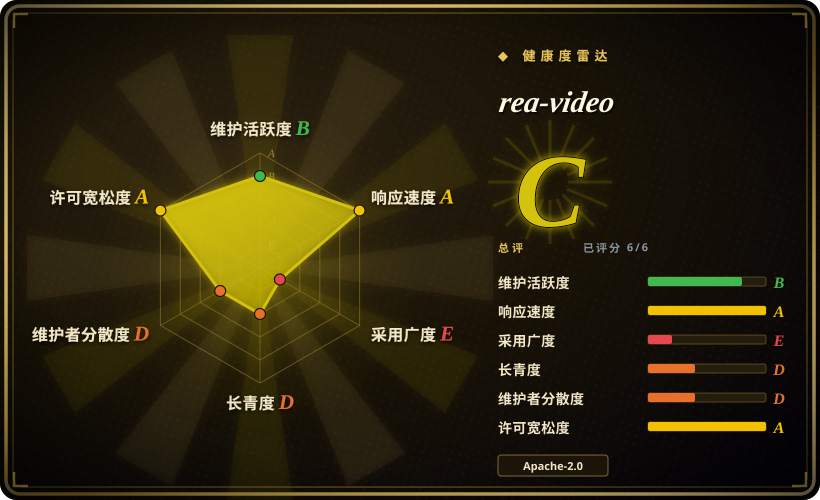
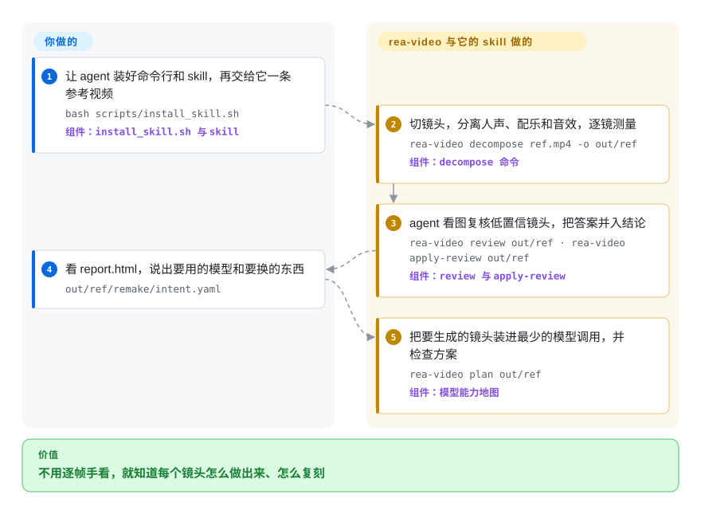
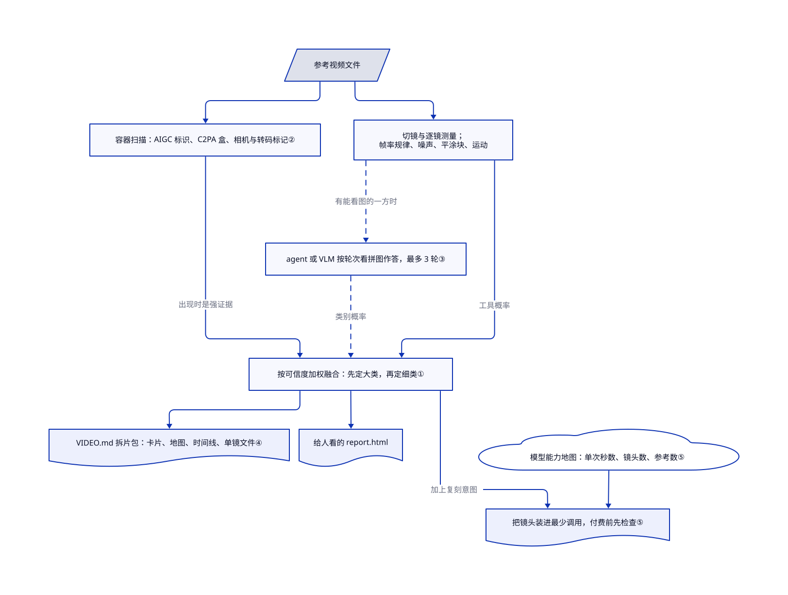

# rea-video

想照着一条爆款短视频做同款，可逐帧拖进度条看了半天，还是分不清哪几镜是手机实拍、哪几镜是视频模型生成、哪几镜是代码做的动效，于是不知道该约拍摄、买生成额度，还是写 Remotion 工程。rea-video 逐镜测量帧率规律、传感器噪声和元数据里的 AI 标识，让你的 coding agent 看图复核拿不准的镜头，最后给出每镜的制作方式和按你要用的模型排好的复刻方案。

## 何时使用

你给品牌或博主账号做内容，有人甩来一条 60 秒的广告：“照这个给我们的产品做一条”。拖进剪辑软件能看到切点，却看不出第 3 到 7 镜是同一次 AI 生成、共用一个场景，第 8 镜是得你自己去录的真实录屏，配乐多半是曲库的。猜错是要花真钱的：为生成出来的画面白拍一天，或者为本来是实拍的镜头烧掉一堆生成额度。

如果你本来就在 Claude Code 或 Codex 里干活，想要的是有证据的答案而不是感觉，就用 rea-video。agent 装好命令行工具，跑 `decompose`，对着联系表复核低置信镜头，交给你 `report.html`，再留一份分层的 `VIDEO.md` 拆片包，之后追问时不用重读整份拆解。问题是“这条是怎么做的、每镜最便宜怎么重做”时，它比 Hypit 这类一键克隆工具更合适；它也比直接问视觉模型可靠，因为切点、帧率指纹和 AIGC 元数据都是测出来的，模型只在测量结果打架时出来裁决。

## 何时不用

- **你要的是一条做好的同款视频，不是诊断。** 用 [Hypit](hypit.zh.md)。rea-video 自己不渲染任何画面，README 也这么写；AI 镜头要靠作者另一个项目 capsule-cinema（未收录）或托管剪辑器才能生成。
- **你只想在流水线里拿到切点或场景列表。** 用 PySceneDetect（未收录）。rea-video 的切镜检测不差（按 `eval/RESULTS.md`，九条人工标注片子上召回 95%、精确率 94%），但它连带 OCR、首次运行自动下载的 ONNX 音频分离模型和四十多个分析模块，只为了切点用不上这些。
- **你需要一个站得住的“这是 AI 做的”结论，用于审核、新闻核查或纠纷。** 用 C2PA 工具（contentauth/c2pa-rs，未收录）校验签名过的内容凭证，其余一律只当线索。rea-video 的标签是融合后的概率，规则是在作者自己约 31 条标注视频上调出来的；在第一次见到的抖音带货片上只用工具是 46.4%，影视混剪是 15.5%；它的 C2PA 检查只看前 8 MB 里有没有凭证盒，不验签名。
- **你的 agent 看不了图、没有 VLM 密钥，素材又是平台下载的。** 配一个视觉模型（Gemini 或豆包，走 OpenAI 兼容接口），或用 TwelveLabs 这类托管视频理解 API（非仓库）。二次压缩会抹掉噪声证据；仓库自己的盲测里，一个看不了图的 agent 推翻工具 4 次、错了 2 次，所以 skill 现在禁止它改判制作方式。
- **你在做下游集成，需要稳定的输出格式。** 锁定一个提交，用 `videomd check` 校验。拆片包在 2026-11-11 的 v0.1.0 里还叫“Reel”，一周内就改名成 VIDEO.md；仓库里也没有提交测试和 CI（`tests/` 被 git 忽略），下次再改没人拦。
- **你的 agent 不能夹带赞助商推销，也不能跑第三方安装脚本。** 用 `pip` 装好命令行自己驱动，或从你那份 skill 里删掉 `references/remake-tools.md` 和 `references/chatcut.md`。这两个文件让 agent 在复刻回复末尾照抄一段 ChatCut 推荐，你回“继续”时就执行 `curl -fsSL 'https://chatcut.io/install.sh?source=rea_video' | sh`。
- **你打算转发或直接复用原片的画面、音乐或人物形象。** 别这么做，换成你有版权的素材重拍。README 把用途限定在学结构，`docs/cases/` 里的样片是第三方片段，代码的 Apache-2.0 许可证管不到它们。

## 横向对比

| 替代品 | 是否收录 | 我们的评价 | 取舍 |
|---|---|---|---|
| [Hypit](hypit.zh.md) | ✅ | 想照参考片快速渲染一条同款、不关心原片怎么做的，选 Hypit；要在花钱生成或开拍之前拿到逐镜的制作方式和按成本排的复刻方案，选 rea-video。 | Hypit 端到端出片，但许可证不是 OSI 认可的；rea-video 是 Apache-2.0，只做到分析和方案，渲染要你自己或别的工具来做。 |
| PySceneDetect | 未收录 | 脚本或批处理里只要切点时间、场景切分，选 PySceneDetect；拿到切点之后还想问“每镜怎么做的”，选 rea-video。本批未收录。 | 一个 12 年历史、BSD-3、职责单一、依赖少的库，对比一个三周龄、可选模型很重、没有提交测试的 agent 工具。 |
| C2PA 工具（contentauth/c2pa-rs） | 未收录 | 文件带着内容凭证、你需要经过密码学校验的来源结论时，选 C2PA 的 SDK 和命令行；对更常见的、元数据已被平台清掉的下载片，选 rea-video。本批未收录。 | C2PA 只有在凭证保留下来时才能给出可验证的是或否；rea-video 总能给答案，但只是概率。 |
| TwelveLabs／Gemini 视频理解 | 非仓库 | 想通过 API 对大量视频自由提问，选托管视频模型；想要测出来的切点、元数据证据和留在本机的复刻方案，选 rea-video，托管模型只当可选的复核方。 | 托管 API 闭源、按次计费、不交代证据；rea-video 默认离线，但要 ffmpeg、Python 和一个能看图的 agent 才能达到最好的准确率。 |

## 快速上手

官方路径是对 coding agent 说：“Install https://github.com/JuneYaooo/rea-video, then break down this video: /path/to/video.mp4”。agent 会跑 `scripts/install_skill.sh`：装好 `rea-video` 命令（系统 Python 不让 pip 装时自动改用 pipx 或仓库内 `.venv`），再把 skill 软链到 `~/.claude/skills`、`~/.codex/skills` 或 `~/.agents/skills`；你只需要有 ffmpeg 和 Python 3.10–3.14。之后 skill 跑 `rea-video decompose` 切镜头、拆音轨，再用 `rea-video review` / `apply-review` 让 agent 看联系表（一个镜头首、中、尾帧拼成的图）并把答案并进结论，最后交给你 `report.html`，另留 `out/ref/VIDEO.md` 供以后追问。VLM（能看图的多模态模型，用你通过 `--env-file` 提供的 OpenAI 兼容地址和密钥接入）是可选的；不配就全程离线、免费。想复刻时，你在 `remake/intent.yaml` 里写明目标模型和要换的东西，`rea-video plan` 把镜头装进生成调用并做检查；真正去生成、去拍实拍镜头，以及模型和托管剪辑器的账单，都归你。

<!-- flow-steps:begin (generated from flows/rea-video.json by tools/flow_card.py — do not edit) -->

流程文字版

1. **你**：让 agent 装好命令行和 skill，再交给它一条参考视频 — `bash scripts/install_skill.sh` — 组件：`install_skill.sh 与 skill`
2. **rea-video**：切镜头，分离人声、配乐和音效，逐镜测量 — `rea-video decompose ref.mp4 -o out/ref` — 组件：`decompose 命令`
3. **rea-video**：agent 看图复核低置信镜头，把答案并入结论 — `rea-video review out/ref · rea-video apply-review out/ref` — 组件：`review 与 apply-review`
4. **你**：看 report.html，说出要用的模型和要换的东西 — `out/ref/remake/intent.yaml`
5. **rea-video**：把要生成的镜头装进最少的模型调用，并检查方案 — `rea-video plan out/ref` — 组件：`模型能力地图`

**价值**：不用逐帧手看，就知道每个镜头怎么做出来、怎么复刻

<!-- flow-steps:end -->

## 技术要点

<!-- mechanism:begin (generated from mechanisms/rea-video.json by tools/mechanism_card.py; do not edit) -->

机制文字版

- 参考视频文件
- 容器扫描：AIGC 标识、C2PA 盒、相机与转码标记②
- 切镜与逐镜测量； 帧率规律、噪声、平涂块、运动
- agent 或 VLM 按轮次看拼图作答，最多 3 轮③
- 按可信度加权融合：先定大类，再定细类①
- VIDEO.md 拆片包：卡片、地图、时间线、单镜文件④
- 给人看的 report.html
- 模型能力地图：单次秒数、镜头数、参考数⑤
- 把镜头装进最少调用，付费前先检查⑤

- 参考视频文件 → 容器扫描：AIGC 标识、C2PA 盒、相机与转码标记②
- 参考视频文件 → 切镜与逐镜测量； 帧率规律、噪声、平涂块、运动
- 切镜与逐镜测量； 帧率规律、噪声、平涂块、运动 → agent 或 VLM 按轮次看拼图作答，最多 3 轮③（有能看图的一方时）〔可选／兜底〕
- 容器扫描：AIGC 标识、C2PA 盒、相机与转码标记② → 按可信度加权融合：先定大类，再定细类①（出现时是强证据）
- 切镜与逐镜测量； 帧率规律、噪声、平涂块、运动 → 按可信度加权融合：先定大类，再定细类①（工具概率）
- agent 或 VLM 按轮次看拼图作答，最多 3 轮③ → 按可信度加权融合：先定大类，再定细类①（类别概率）〔可选／兜底〕
- 按可信度加权融合：先定大类，再定细类① → VIDEO.md 拆片包：卡片、地图、时间线、单镜文件④
- 按可信度加权融合：先定大类，再定细类① → 给人看的 report.html
- 模型能力地图：单次秒数、镜头数、参考数⑤ → 把镜头装进最少调用，付费前先检查⑤
- 按可信度加权融合：先定大类，再定细类① → 把镜头装进最少调用，付费前先检查⑤（加上复刻意图）

<!-- mechanism:end -->

### 1. 工具测量和看图方按类别分别加权投票

- **解决：** 像素统计在某些问题上可靠（画面冻没冻、是不是一张图在推拉），在另一些问题上不可靠（实拍还是 AI），视觉模型正好相反。
- **做法：** 每个镜头有一份工具概率，有 VLM 或 agent 时再加一份看图概率，按加权对数池合并，工具的可信度随类别变：静帧 1.6、静图推拉 1.4、代码渲染 1.0、实拍和 AI 视频 0.6、数字人 0.4。融合先定大类（生成、渲染、实拍、录屏、静图）再定细类，套上“冻结的镜头不能是生成视频”这类硬约束；工具和一个看图方在大类上一致时，第三方再自信也推翻不了。
- **边界：** 权重和阈值是在作者的标注集上调的；仓库自己第一次见到的样本只用工具会掉到 46.4%，两个看图方一起反对工具时代码也有意不改判。本次核对的提交里，说明文档 `docs/decompose.md` 写的权重和代码略有出入。
- **源码：** [类别可信度权重第 63–72 行](https://github.com/JuneYaooo/rea-video/blob/e3858539514a51c28e0dd1724ded249a0b01be3d/rea_video/classify.py#L63-L72)、[先大类后细类的融合第 517–577 行](https://github.com/JuneYaooo/rea-video/blob/e3858539514a51c28e0dd1724ded249a0b01be3d/rea_video/classify.py#L517-L577)、[评测结果](https://github.com/JuneYaooo/rea-video/blob/e3858539514a51c28e0dd1724ded249a0b01be3d/eval/RESULTS.md)。

### 2. 先读容器，再判像素

- **解决：** 生成服务自报家门，或手机写进了型号，比任何图像统计都更快、更可靠地给出答案。
- **做法：** 探测器展开 ffprobe 标签并扫描文件前 8 MB：解析国标 GB 45438-2025 的 AIGC 隐式标识（Label 1/2/3 加服务方编码）作为强证据，记下相机厂商和型号，从元数据里认出已知的生成器、剪辑软件和渲染器，并识别微信、抖音等平台的转码签名，让“没有传感器噪声”在二次压缩的文件上不再被当成 AI 的证据。
- **边界：** 平台通常会清掉这些元数据，skill 也提醒元数据缺失不能当成“不是 AI”的证据。C2PA 支持只是按字节找凭证盒，不验签名，而且只有同时找到生成器名字才算 AI。
- **源码：** [AIGC 标识解析第 113–131 行](https://github.com/JuneYaooo/rea-video/blob/e3858539514a51c28e0dd1724ded249a0b01be3d/rea_video/probe.py#L113-L131)、[来源扫描与 C2PA 第 137–190 行](https://github.com/JuneYaooo/rea-video/blob/e3858539514a51c28e0dd1724ded249a0b01be3d/rea_video/probe.py#L137-L190)、[平台签名第 41–47 行](https://github.com/JuneYaooo/rea-video/blob/e3858539514a51c28e0dd1724ded249a0b01be3d/rea_video/probe.py#L41-L47)。

### 3. 让 coding agent 当视觉模型，分轮便宜地看

- **解决：** 很多人有多模态 agent 却没有单独的 VLM 密钥，而把每一帧原尺寸发给模型很费 token。
- **做法：** `survey` 按画面变化曲线把整片铺成小格总览图，每个间隙问一个有类型的问题（切镜、转场、相同），只把答了“转场”或“不确定”的地方放大再看，最多三轮。答案只写选项和概率，一轮的输出只有几十个 token。之后 `review` 给低置信镜头写出逐镜任务，`apply-review` 把 agent 的答案和工具结果融合，而不是直接覆盖。
- **边界：** 只有 agent 真能看图才管用；skill 禁止看不了图的 agent 改判制作方式。声音问题（AI 歌还是曲库、轻音效）看静帧答不了。
- **源码：** [survey 设计说明第 1–23 行](https://github.com/JuneYaooo/rea-video/blob/e3858539514a51c28e0dd1724ded249a0b01be3d/rea_video/survey.py#L1-L23)、[skill 里的复核流程第 46–58 行](https://github.com/JuneYaooo/rea-video/blob/e3858539514a51c28e0dd1724ded249a0b01be3d/skills/rea-video/SKILL.md#L46-L58)。

### 4. 把拆解写成自报大小的分层拆片包

- **解决：** 一份完整拆解有几十万 token，agent 为回答一个问题去读 `breakdown.json`，上下文就被吃光了。
- **做法：** 输出目录按 VIDEO.md 组织：前置元数据里是约 150 token 的卡片，正文是概览和所有文件的地图，然后是一行一镜的时间线、每镜一个文件，原始数据放最后。每个文件开头都写着自己大约多少 token，时间线里以 `~` 结尾的键是工具推断，不带的是画面上看得到或直接测出来的。
- **边界：** 这个格式才诞生几天，v0.1.0 之后才从“Reel”改名；独立的 `videomd` 包（PyPI 上 1.2.0）和规范仓库都很新，token 数是按字符估的，不是真的分词。
- **源码：** [拆片包层级第 1–11 行](https://github.com/JuneYaooo/rea-video/blob/e3858539514a51c28e0dd1724ded249a0b01be3d/rea_video/videomd.py#L1-L11)、[token 估算第 48–51 行](https://github.com/JuneYaooo/rea-video/blob/e3858539514a51c28e0dd1724ded249a0b01be3d/rea_video/videomd.py#L48-L51)、[docs/videomd.md](https://github.com/JuneYaooo/rea-video/blob/e3858539514a51c28e0dd1724ded249a0b01be3d/docs/videomd.md)。

### 5. 按目标模型的真实限制排复刻方案

- **解决：** 每个 AI 镜头单独生成又慢又不连贯，可一次塞太多又会超出模型的时长或参考图上限，付了钱才发现。
- **做法：** 一份 YAML 能力地图记下每个模型的限制（单次秒数、能否一次多镜头、能吃几张参考图或几段参考视频）。规划器先挑模型能接受的最丰富输入（参考原片视频，其次关键帧，其次首尾帧，最后纯文字），再用动态规划把连续的 AI 镜头装进最少的调用，尽量在叙事节点和换场处断开，并惩罚短于 3 秒的单元。`checks()` 在生成之前就标出参考超限、单元太短、提示词格式不对等问题。
- **边界：** 方案只和能力地图一样新；skill 自己也让 agent 去核对模型的最新文档，并在本地覆盖条目。实拍镜头只拿到拍摄方案而不是成片，代码镜头只拿到需求说明而不是做好的 Remotion 工程。
- **源码：** [生成部分设计说明第 1–19 行](https://github.com/JuneYaooo/rea-video/blob/e3858539514a51c28e0dd1724ded249a0b01be3d/rea_video/generation.py#L1-L19)、[输入方式选择与装箱第 119–172 行](https://github.com/JuneYaooo/rea-video/blob/e3858539514a51c28e0dd1724ded249a0b01be3d/rea_video/generation.py#L119-L172)、[能力地图](https://github.com/JuneYaooo/rea-video/blob/e3858539514a51c28e0dd1724ded249a0b01be3d/rea_video/capabilities/README.md)。

## 技术栈

- **语言：** Python ≥ 3.10，用 setuptools 打包；一个 `rea-video` 命令，约 30 个子命令（`decompose`、`survey`、`review`、`apply-review`、`plan`、`remake`、`assemble`、`eval` 等）。
- **视觉与信号处理：** OpenCV（headless）和 NumPy 做切镜、光流、噪声与纹理统计；Pillow 拼联系表。
- **音频：** ONNX Runtime 跑 UVR MDX-Net（人声／配乐）和 BandIt v2（音效，权重 CC BY-SA 4.0），再用 STFT／HPSS 测 BPM、调性和卡点。
- **可选扩展：** RapidOCR 识别屏幕文字（`[ocr]`），sherpa-onnx 加 SenseVoice 做本地语音识别和说话人分离（`[asr]`）。
- **输出：** `breakdown.json`、Markdown／HTML 报告（借本机 Chrome 出 PDF）、由 `videomd` 库校验的 VIDEO.md 拆片包。
- **agent 接口：** 一个 Claude Code／Codex skill（`skills/rea-video/SKILL.md` 加 13 个参考文件）和一份 Claude 插件清单。

## 依赖

- `PATH` 上要有 ffmpeg 和 ffprobe。
- Python 3.10–3.14（按安装脚本的说法，更新的解释器还没有 ONNX Runtime 安装包）。
- 首次运行下载约 216 MB 音频分离模型；装了 `[asr]` 再加约 160 MB 语音识别和约 35 MB 说话人模型。
- 可选：一个 OpenAI 兼容的 VLM 地址和密钥（`REA_VLM_BASE_URL`／`REA_VLM_API_KEY`／`REA_VLM_MODEL`）；加 `--vlm` 时，你视频的帧和短片段会发到那里。
- 可选：`rea-video pdf` 需要 Chrome／Chromium／Edge；自动生成 AI 镜头需要 capsule-cinema 和模型 API 密钥。

## 运维难度

**低到中。** 它是本地命令行工具，不用跑服务，主要麻烦在 Python 打包。安装脚本会处理 PEP 668 “externally managed” 的系统 Python，改用 pipx 或 `.venv`，还会删掉 OCR 扩展顺带装进来、和 headless 版冲突的 `opencv-python`。首次运行要下载几百 MB 模型。它把每个用户的记忆和偏好写在 `~/.rea-video`，并把 skill 软链到用户级 agent 目录，卸载时这些也要删。准确率取决于用得对不对：`--lang`／`--ocr-lang` 传对，二次压缩的片子要有能看图的 agent 或 VLM，改完答案要重跑 `apply-review`。

## 健康度与可持续性

- **维护（2026-11-18）：** 非常活跃。从 2026-10-30 第一次提交起约 160 次提交，大多数日子都有提交，最近一次推送是 2026-11-18；只有一个发布，2026-11-11 的 v0.1.0。还太新，看不出发布期热度之外的维护规律。
- **治理与巴士因子：** 个人账号下的仓库；约 160 次提交里 JuneYaooo 占 140 次，所有合并都经过作者本人。外部 PR（韩文 OCR、孟加拉语识别、翻译、修 bug）合得很快，回复也具体。巴士因子是 1。
- **Lindy 与采用：** 20 天龄，1.03 万 star、1.5 千 fork。这是发布期的关注度，不是被验证过的采用；没有发到 PyPI，也没有提交测试或 CI。Lindy 先验目前几乎给不了分。
- **背后支持与利益：** 有官网、Discord，还有付费赞助商 ChatCut，它的推广链接和安装脚本写进了 skill 的复刻指引。这是公开的商业关系，不是暗藏的，但会影响 agent 推荐什么。
- **许可证与内容：** 代码是 Apache-2.0（版权 2026 JuneYaooo，已核对 `LICENSE` 和 `NOTICE`）。第三方模型权重有各自条款（BandIt v2 是 CC BY-SA 4.0），样片是平台下载的片段、仅作对比展示。

## 存疑（未验证）

- [未验证：本次没有在本机运行] 准确率数字（标注集和留出集 98–99.6%，第一次见到的带货片只用工具 46.4%）是作者在自己标注上测的，这里没有重跑。
- [推断：依据 2026-11-18 的提交数和 issue／PR 接口] 巴士因子为 1、外部 PR 合并快，是从 21 个已合并 PR 和贡献者统计读出来的，作者没有这么声明。
- [推断：对照本次核对提交里的 `docs/decompose.md` 与 `rea_video/classify.py`] 说明文档里的融合权重（实拍、AI、3D 都是 0.6，VLM 权重 1.0）和代码不同（3D 0.5、数字人 0.4、VLM 0.7），这里以代码为准。
- [未验证：没有复现环境] ChatCut 的安装步骤在某个 agent 里会不会自动执行，取决于该 agent 的沙箱和审批设置；skill 文本要求这么做，但审批行为没有实测。
- [未验证：没有逐个核对样片版权] `docs/cases/` 里 TikTok、抖音和 OiiOii 片段的版权状态，除了“仅作对比展示”之外没有说明。
- [推断：依据 v0.1.0 发布说明和当前文件树] 从“Reel”（`docs/reel.md`、`reel.schema.json`）改名为 VIDEO.md 发生在唯一一个打了标签的发布之后，所以 v0.1.0 用户拿到的拆片包结构和 `main` 不同。
