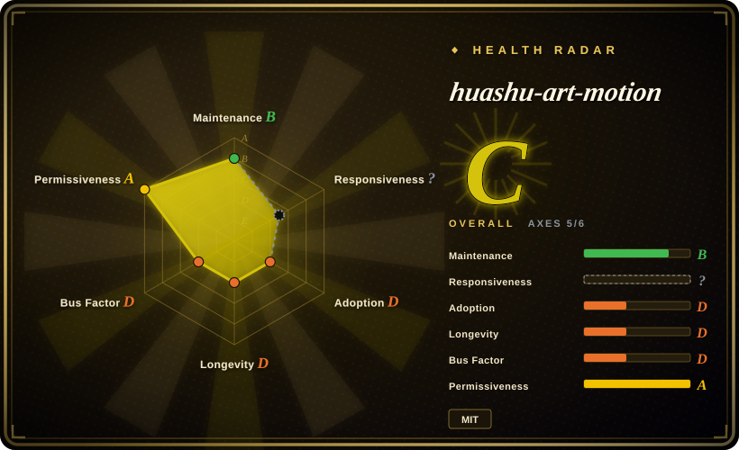
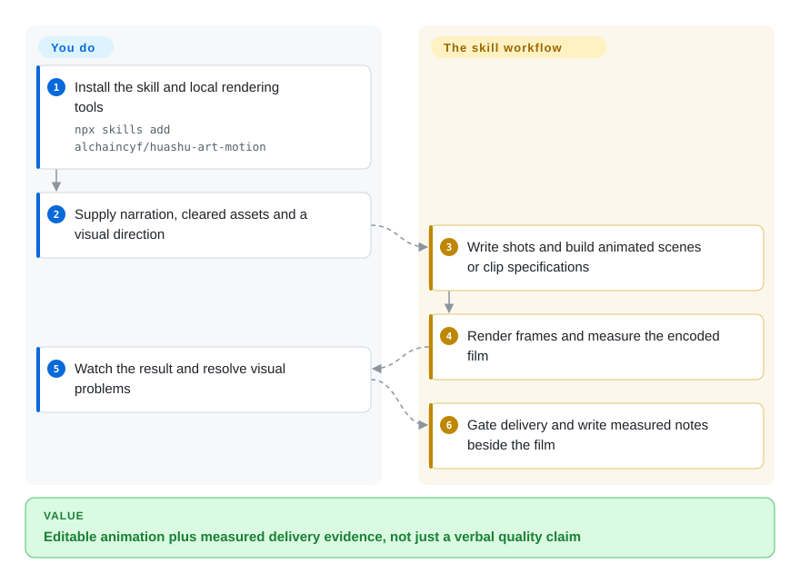
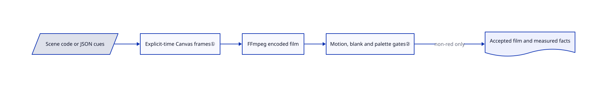

# huashu-art-motion

Your agent turns narration into a sequence of still cards with zooms instead of objects actually moving. This skill supplies shot-planning rules, art recipes and a Canvas renderer, then measures the finished film before delivery.

## When to use

You already use a coding agent and need a narrated explainer or art-style animation, not just a slideshow. You want editable scene code, shared palettes and short clips aligned to narration. Choose this over a bare rendering engine when the missing piece is art direction and motion-specific checks; choose a general engine when you already have your own visual system. The installed instructions are primarily Chinese, despite the English README.

## When NOT to use

- **You need a general HTML video engine rather than a prescribed workflow.** Pick [HyperFrames](hyperframes.md); this package mixes rendering code with strong personal art-direction rules and a mostly Chinese skill.
- **You already author reusable React compositions or need mature cloud rendering.** Evaluate [Remotion](remotion.md), including its company-license terms, rather than moving to this smaller Canvas engine.
- **Your inputs are existing takes to cut, not scenes to draw.** Pick [video-use](video-use.md); this project's core value is scene construction, not transcript-based take selection.
- **You want freely reusable demo characters.** Supply your own cleared assets with HyperFrames or another engine. The MIT grant excludes Huashu's likeness/frame libraries and Clawd fan-demo GIFs/film; fonts and stroke-order data retain separate licenses.
- **Portrait output must be reliable without testing each effect.** Use a validated [HyperFrames](hyperframes.md) composition or test a minimal clip first. Open issues #10 and #11 report landscape-coordinate assumptions in transitions/post-processing.

## Comparison

| Alternative | In index | Our verdict | Tradeoff |
|---|---|---|---|
| [HyperFrames](hyperframes.md) | ✅ | Choose HyperFrames for general HTML compositions; choose huashu-art-motion for reusable painting recipes and opinionated storyboard/delivery checks. | Broader engine integrations versus a compact Canvas workflow with a strong visual prescription. |
| [Remotion](remotion.md) | ✅ | Choose Remotion for React templates and cloud rendering; choose this skill for local art-directed clips without adopting a React composition project. | Mature engine ecosystem versus a young skill, with separate licensing constraints on both engines/assets to review. |
| [video-use](video-use.md) | ✅ | Choose video-use for cutting recorded takes; choose this skill when the scene must be constructed and animated in code. | Footage/transcript editing versus scene authoring and art-style control. |

## Quick start

Install the skill with `npx skills add alchaincyf/huashu-art-motion` and provide uv, FFmpeg and Playwright Chromium. Ask the agent for an animation, approve a visual direction, then supply your narration and cleared assets. The workflow writes a shot table, builds scene code or a JSON clip description, renders frames and encodes the film. It runs QA and `scripts/deliver.py` before copying the deliverable and writing measured delivery notes. You still approve visual quality, watch the film at normal speed and authorize any optional paid image/voice service; basic code animation does not need those accounts.

<!-- flow-steps:begin (generated from flows/huashu-art-motion.json by tools/flow_card.py — do not edit) -->

Text version of the flow

1. **You**: Install the skill and local rendering tools — `npx skills add alchaincyf/huashu-art-motion`
2. **You**: Supply narration, cleared assets and a visual direction
3. **huashu-art-motion**: Write shots and build animated scenes or clip specifications
4. **huashu-art-motion**: Render frames and measure the encoded film
5. **You**: Watch the result and resolve visual problems
6. **huashu-art-motion**: Gate delivery and write measured notes beside the film

**Value**: Editable animation plus measured delivery evidence, not just a verbal quality claim

<!-- flow-steps:end -->

## Key techniques

<!-- mechanism:begin (generated from mechanisms/huashu-art-motion.json by tools/mechanism_card.py; do not edit) -->

Text version of the mechanism

- Scene code or JSON cues
- Explicit-time Canvas frames①
- FFmpeg encoded film
- Motion, blank and palette gates②
- Accepted film and measured facts

- Scene code or JSON cues → Explicit-time Canvas frames①
- Explicit-time Canvas frames① → FFmpeg encoded film
- FFmpeg encoded film → Motion, blank and palette gates②
- Motion, blank and palette gates② → Accepted film and measured facts (non-red only)

<!-- mechanism:end -->

### 1. Drive frames by explicit time

- **Problem:** Browser animation based on wall-clock playback can skip frames during video capture.
- **How:** The Python renderer starts a loopback server, loads the Canvas page in Playwright, calls `prepare(t)` and `renderFrame(t)` for each frame, and pipes PNG bytes to FFmpeg. Clip specifications supply duration, size, cues and shared palettes.
- **Limits:** Grammar JavaScript is executed in the page, and Chromium launches with web security disabled. Treat scene code and assets as trusted local inputs, not sandboxed uploads; fonts and browser versions still affect reproducibility.
- **Source:** [Frame capture and encoding](https://github.com/alchaincyf/huashu-art-motion/blob/8a0d7d72ca65fcce6f8ba82c4a6c8dfe35b8422c/scripts/engine/render.py#L88-L157), [clip loading](https://github.com/alchaincyf/huashu-art-motion/blob/8a0d7d72ca65fcce6f8ba82c4a6c8dfe35b8422c/scripts/engine/clip.js#L31-L99).

### 2. Gate delivery on the encoded film

- **Problem:** An agent can describe a render as “dynamic” even when the output remains a slideshow.
- **How:** Delivery measures the MP4 for motion, blank intervals and dominant blue-purple backgrounds. A red result exits before copying; accepted output gets machine-written facts with a SHA-256 integrity marker.
- **Limits:** These are taste-specific heuristics, not a semantic quality score. The integrity marker detects edits, not dishonesty by an attacker. Missing independent review is recorded rather than automatically blocking delivery.
- **Source:** [Gate definitions](https://github.com/alchaincyf/huashu-art-motion/blob/8a0d7d72ca65fcce6f8ba82c4a6c8dfe35b8422c/scripts/film_gate.py#L5-L66), [delivery and integrity check](https://github.com/alchaincyf/huashu-art-motion/blob/8a0d7d72ca65fcce6f8ba82c4a6c8dfe35b8422c/scripts/deliver.py#L153-L221).

## Health & viability

- **2026-10-18 — active but tiny history.** Created 2026-10-06; releases v1.0.0, v1.1.0 and v1.2.0 arrived within ten days. The contributor snapshot has one author, so popularity does not reduce the bus factor.
- **Longevity.** Twelve days of public history supplies little Lindy evidence. Prefer pinning a reviewed version and keeping finished projects independent of future skill updates.
- **Licensing.** LICENSE names the author and grants MIT for code/documentation. README explicitly excludes likeness assets and fan-demo media; font and stroke-order notices remain separate. Do not treat the repository as uniformly MIT media.
- **Compatibility.** Upstream records successful installation for Claude Code, Codex and Kimi, but online regression only for Codex; the other runs were blocked by account conditions. Open portrait-coordinate bugs reinforce the need for per-project validation.

## Caveats (unverified)

- [未验证] No upstream renderer or model was run, so film quality, frame determinism and cross-platform performance were not reproduced; compatibility statements are upstream test reports.
- [推断] Based on creation date, releases and contributor snapshots, rapid iteration with one visible author leaves long-term maintenance unproven.
- [未验证] Character and demo-media rights were not individually audited. Use your own cleared assets; this page does not certify redistribution rights for every sample.
