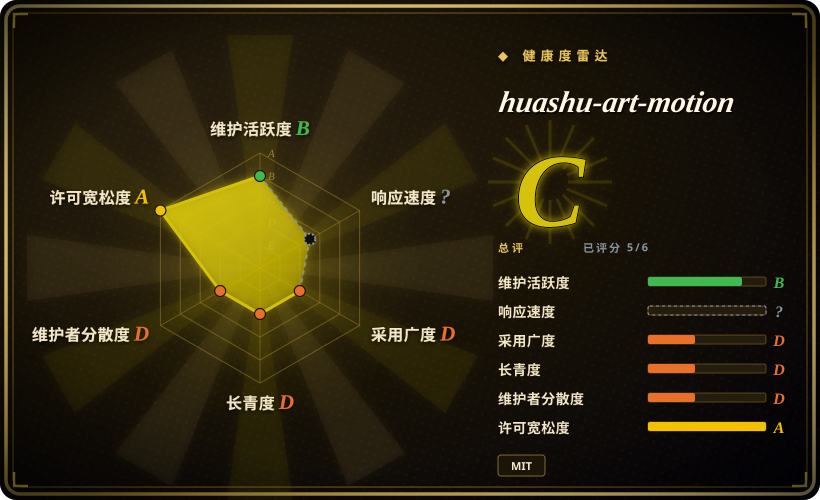
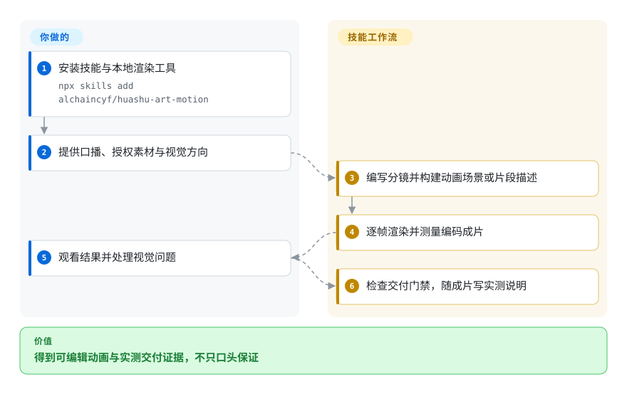

# huashu-art-motion

你让助手做口播动画，它却只交一串缓慢推近的静态卡片。这个技能提供分镜规则、画风配方和 Canvas 渲染器，并在交付前测量成片。

## 何时使用

你已经使用编码助手，要做口播解说或艺术风格动画，而不是幻灯片。你需要可改的场景代码、统一色板，以及对齐口播的短片段。缺美术指导和运动检查时，选它而不是裸渲染引擎；已有视觉体系时，通用引擎更直接。虽然有英文 README，安装后的技能指令仍主要是中文。

## 何时不用

- **只需要通用 HTML 视频引擎。** 选 [HyperFrames](hyperframes.zh.md)；本项目把渲染代码、个人美术偏好和中文工作流绑在一起。
- **已有 React 模板或需要成熟云渲染。** 评估 [Remotion](remotion.zh.md)，同时检查其企业许可，不必迁移到较小的 Canvas 引擎。
- **输入是待剪辑的实拍素材。** 选 [video-use](video-use.zh.md)；本项目核心是造场景，不是按转录挑选素材。
- **要自由复用示范人物。** 给 HyperFrames 等引擎提供自有授权素材。MIT 不包含花叔形象与帧库，也不包含 Clawd 同人示范的 GIF 和成片；字体、笔顺数据另有许可。
- **竖屏效果必须无需逐项验证。** 先用验证过的 [HyperFrames](hyperframes.zh.md) 模板，或做最小样片。开放问题 #10、#11 报告转场和后期效果仍有横屏坐标假设。

## 横向对比

| 替代品 | 是否收录 | 我们的评价 | 取舍 |
|---|---|---|---|
| [HyperFrames](hyperframes.zh.md) | ✅ | 通用 HTML 视频选 HyperFrames；需要绘画配方和明确分镜、交付规则时选本技能。 | 更广的引擎集成，或较紧凑但风格约束强的 Canvas 路线。 |
| [Remotion](remotion.zh.md) | ✅ | React 模板与云渲染选 Remotion；本地艺术片段且不想建 React 工程时选本技能。 | 成熟生态对比年轻技能，两者的引擎和素材许可都需单独核对。 |
| [video-use](video-use.zh.md) | ✅ | 剪已有录像选 video-use；要从代码构建并驱动画面选本技能。 | 录像转录剪辑，或场景创作与画风控制。 |

## 快速上手

用 `npx skills add alchaincyf/huashu-art-motion` 安装技能，准备 uv、FFmpeg 和 Playwright Chromium。向助手提出动画需求，确认视觉方向，再提供口播和有权使用的素材。工作流编写镜头表，生成场景代码或 JSON 片段描述，逐帧渲染并编码。交付前运行质量检查和 `scripts/deliver.py`，复制成片并写入实测说明。你仍须判断美术质量、正常速度看完整片，并授权可选收费图像或语音服务；基础代码动画不要求这些账号。

<!-- flow-steps:begin (generated from flows/huashu-art-motion.json by tools/flow_card.py — do not edit) -->

流程文字版

1. **你**：安装技能与本地渲染工具 — `npx skills add alchaincyf/huashu-art-motion`
2. **你**：提供口播、授权素材与视觉方向
3. **huashu-art-motion**：编写分镜并构建动画场景或片段描述
4. **huashu-art-motion**：逐帧渲染并测量编码成片
5. **你**：观看结果并处理视觉问题
6. **huashu-art-motion**：检查交付门禁，随成片写实测说明

**价值**：得到可编辑动画与实测交付证据，不只口头保证

<!-- flow-steps:end -->

## 技术要点

<!-- mechanism:begin (generated from mechanisms/huashu-art-motion.json by tools/mechanism_card.py; do not edit) -->

机制文字版

- 场景代码或 JSON 提示点
- 显式时间驱动 Canvas 帧①
- FFmpeg 编码成片
- 运动、空白与色板门禁②
- 获准成片与实测事实

- 场景代码或 JSON 提示点 → 显式时间驱动 Canvas 帧①
- 显式时间驱动 Canvas 帧① → FFmpeg 编码成片
- FFmpeg 编码成片 → 运动、空白与色板门禁②
- 运动、空白与色板门禁② → 获准成片与实测事实（仅非红灯）

<!-- mechanism:end -->

### 1. 用显式时间驱动画面

- **解决：** 按真实播放时钟录制浏览器动画，会因捕获速度不足而丢帧。
- **做法：** Python 渲染器启动回环服务器，用 Playwright 加载 Canvas 页面，每帧调用 `prepare(t)` 与 `renderFrame(t)`，把 PNG 送入 FFmpeg。片段描述提供时长、尺寸、提示点和统一色板。
- **边界：** 页面会执行语法脚本，Chromium 启动时关闭网页安全限制。场景与素材应视为可信本地输入，不能作为不可信上传的沙箱；字体和浏览器版本仍影响复现。
- **源码：** [逐帧捕获与编码](https://github.com/alchaincyf/huashu-art-motion/blob/8a0d7d72ca65fcce6f8ba82c4a6c8dfe35b8422c/scripts/engine/render.py#L88-L157)、[片段加载](https://github.com/alchaincyf/huashu-art-motion/blob/8a0d7d72ca65fcce6f8ba82c4a6c8dfe35b8422c/scripts/engine/clip.js#L31-L99)。

### 2. 对编码后的成片设交付门禁

- **解决：** 助手口头称“动感强”，并不能证明输出不是幻灯片。
- **做法：** 交付脚本直接测 MP4 的运动、空白区间和蓝紫底占比。红灯在复制前退出；通过后写入机器事实段及 SHA-256 完整性标记。
- **边界：** 这是特定审美的启发式规则，不是语义质量评分。完整性标记能查改动，不能认证攻击者诚实。缺独立审片只会记录，并不自动阻断交付。
- **源码：** [门禁定义](https://github.com/alchaincyf/huashu-art-motion/blob/8a0d7d72ca65fcce6f8ba82c4a6c8dfe35b8422c/scripts/film_gate.py#L5-L66)、[交付与完整性检查](https://github.com/alchaincyf/huashu-art-motion/blob/8a0d7d72ca65fcce6f8ba82c4a6c8dfe35b8422c/scripts/deliver.py#L153-L221)。

## 健康度与可持续性

- **2026-10-18：活跃但历史极短。** 创建于 2026-10-06，十天内发布 v1.0.0、v1.1.0、v1.2.0。贡献快照只有一位作者，热度不能降低单人维护风险。
- **年龄判断。** 公开十二天，几乎没有林迪证据。宜固定已审版本，让已完成工程不依赖未来技能更新。
- **许可。** LICENSE 署名作者，代码和文档按 MIT 授权。README 明确排除形象素材和同人示范媒体，字体、笔顺数据保留独立条款，不能把整库媒体当成 MIT。
- **兼容。** 上游记录三个宿主安装通过，但在线回归只在 Codex 完成，其余受测试账号限制。竖屏坐标缺陷报告也说明需要逐项目验证。

## 存疑（未验证）

- [未验证：未运行上游渲染与模型] 未复现成片质量、帧确定性和跨平台性能，兼容性来自上游测试报告。
- [推断：依据是创建日期、发布记录和贡献快照] 迭代快但可见作者单一，长期维护仍未证明。
- [未验证：未逐项审查人物与示范素材权利] 请提供自有授权素材；本页不认证每份示范图片或视频的再分发权。
