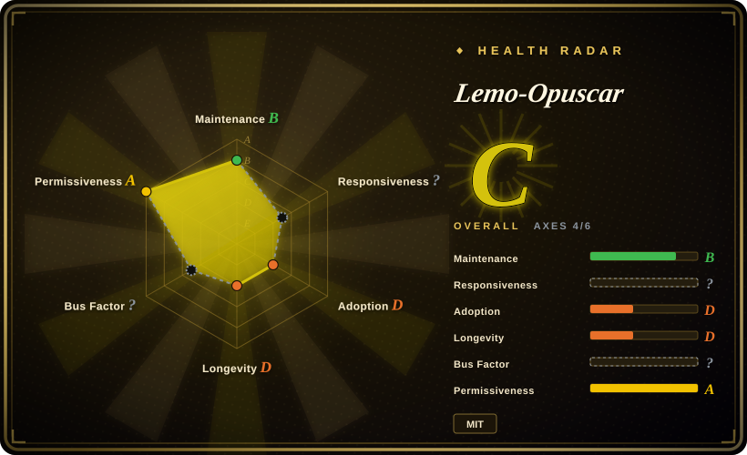
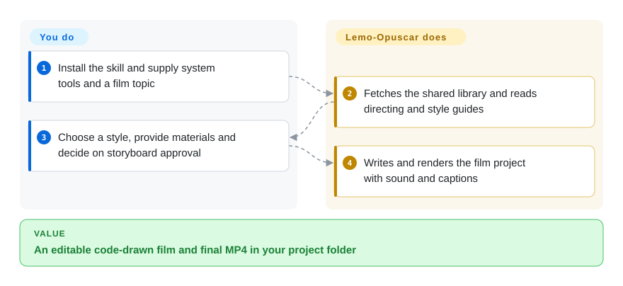
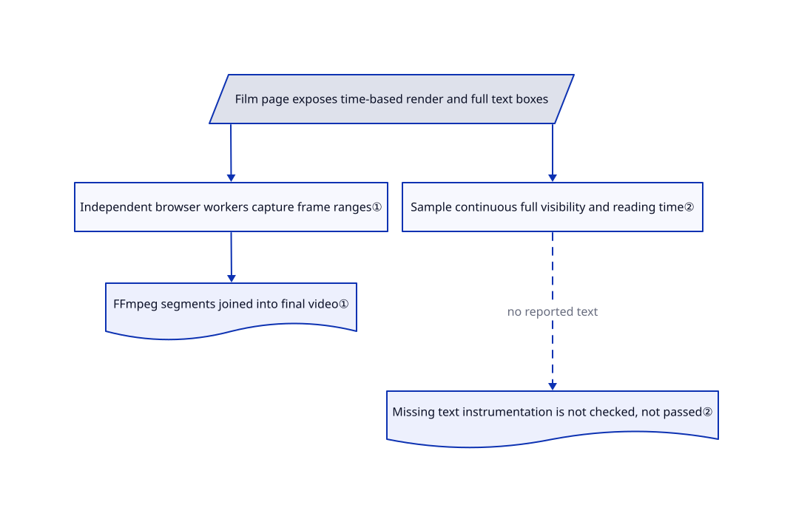

# Lemo-Opuscar

You want a watercolor story or an evidence-led satellite film, but do not want to redraw each frame or gamble on a video model's text. Lemo-Opuscar gives a coding agent film-style guides and a code-rendering toolkit to produce the shots, sound and final MP4.

## When to use

You already use a coding agent and have a short-film topic, a visual style and time to inspect a generated production. Instead of asking a video model for an opaque clip, you want editable Canvas/WebGL code, narration, a score and source-linked facts where the film makes factual claims. Choose it over HyperFrames when the missing piece is art direction and a library of styles, not just HTML-to-video rendering; choose anything2explainer when you instead want its fixed technical-explainer visual system and checkpoints.

## When NOT to use

- **Only a rendering engine for an existing composition:** choose [HyperFrames](render-engines/hyperframes.md); this pack adds directing instructions, style selection, audio production and a separate library checkout.
- **A mature React video platform with cloud rendering:** choose [Remotion](render-engines/remotion.md), subject to its license; Lemo-Opuscar is a young browser-frame toolkit, not a comparable render service.
- **A tightly governed fixed-style explainer:** consider [anything2explainer](anything2explainer.md), but its non-commercial license matters. Lemo's style variety and agent discretion trade against repeatability of direction.
- **Photoreal footage or editing existing takes:** use a video-generation service such as Runway, or an editor such as DaVinci Resolve, respectively; these are closed products, not this pack's code-drawn-film path.
- **No automatic dependency or library updates:** inspect and pin its setup workflow instead of adopting the default skill. It clones or updates a shared library and installs tiered dependencies; a bare skill file is not the complete installation.

## Comparison

| Alternative | In index | Our verdict | Tradeoff |
|---|---|---|---|
| [HyperFrames](render-engines/hyperframes.md) | ✅ | Choose HyperFrames when you already own the film workflow and need an HTML rendering engine; choose Lemo when reusable art direction and style prompts are the value. | Lemo bundles style guides, voice/music tools and review conventions; HyperFrames is a more general engine with Apache-2.0 licensing. |
| [Remotion](render-engines/remotion.md) | ✅ | Choose Remotion for a React team's parameterized video product and cloud-render ecosystem; choose Lemo for agent-directed short films with plain browser drawing. | Remotion has deeper engine infrastructure and its own commercial license; Lemo is smaller, locally rendered and much younger. |
| [anything2explainer](anything2explainer.md) | ✅ | Choose anything2explainer for a fixed motion-graphics explainer process with explicit checkpoints; choose Lemo when the story needs a named painting, cartoon or evidence-film style. | Lemo's code/docs are MIT and the looks vary; the alternative supplies a narrower method but is non-commercial. |

## Quick start

The documented Claude Code path adds the `lemomo-ai/lemo-opuscar` marketplace and installs `lemo-opuscar@lemolab`; other agents can copy the skill directory. Review setup first: on first use it obtains a shared library under `~/lemo-opuscar` and installs the required tool tiers. You supply Node 20+, FFmpeg, Python 3.11+ or uv, a coding-agent model and your topic, materials and permissions. Ask for a named style and decide whether to approve a storyboard; the agent reads directing/technical/style guides, writes the film project in your starting folder and renders the MP4. You still verify facts, asset rights and the final audio/video; Chinese edge-tts narration uses the network even though frames render locally.

<!-- flow-steps:begin (generated from flows/lemo-opuscar.json by tools/flow_card.py — do not edit) -->

Text version of the flow

1. **You**: Install the skill and supply system tools and a film topic
2. **Lemo-Opuscar**: Fetches the shared library and reads directing and style guides
3. **You**: Choose a style, provide materials and decide on storyboard approval
4. **Lemo-Opuscar**: Writes and renders the film project with sound and captions

**Value**: An editable code-drawn film and final MP4 in your project folder

<!-- flow-steps:end -->

## Key techniques

<!-- mechanism:begin (generated from mechanisms/lemo-opuscar.json by tools/mechanism_card.py; do not edit) -->

Text version of the mechanism

- Film page exposes time-based render and full text boxes
- Independent browser workers capture frame ranges①
- Sample continuous full visibility and reading time②
- FFmpeg segments joined into final video①
- Missing text instrumentation is not checked, not passed②

- Film page exposes time-based render and full text boxes → Independent browser workers capture frame ranges①
- Independent browser workers capture frame ranges① → FFmpeg segments joined into final video①
- Film page exposes time-based render and full text boxes → Sample continuous full visibility and reading time②
- Sample continuous full visibility and reading time② → Missing text instrumentation is not checked, not passed② (no reported text) [optional/fallback]

<!-- mechanism:end -->

### 1. Make each frame a function of time

- **Problem:** Parallel browser capture breaks when animation depends on playback history or unseeded randomness.
- **How:** The page exposes `window.render(t)` and duration. Each worker owns a browser, seeks directly to frame timestamps and pipes JPEGs to FFmpeg; encoded segments are concatenated and renamed to the final output. An output lock rejects concurrent writers.
- **Limits:** Determinism is a contract the authored page must follow, not something the renderer proves. Browser/GPU differences and missing resources still need review.
- **Source:** [Frame workers and output lock](https://github.com/lemomo-ai/lemo-opuscar/blob/a7fc26940f0031b5ac906b61993bb49dc4ff260f/core/render/video.mjs#L17-L71), [page contract](https://github.com/lemomo-ai/lemo-opuscar/blob/a7fc26940f0031b5ac906b61993bb49dc4ff260f/TECHNIQUE.md#L33-L93).

### 2. Check whether on-screen text can actually be read

- **Problem:** A technically rendered film can flash captions too briefly or crop a key number off-screen.
- **How:** `readcheck` samples the page's reported full text boxes across time and compares continuous full visibility against separate CJK and Latin reading rates plus padding. Missing text instrumentation returns “not checked,” not success.
- **Limits:** The page supplies its own text and boxes, so omitted or inaccurate instrumentation can hide a defect. The review guide still requires contact sheets and a full-speed viewing with sound.
- **Source:** [Reading-time checker](https://github.com/lemomo-ai/lemo-opuscar/blob/a7fc26940f0031b5ac906b61993bb49dc4ff260f/core/render/readcheck.mjs#L1-L51), [review loop](https://github.com/lemomo-ai/lemo-opuscar/blob/a7fc26940f0031b5ac906b61993bb49dc4ff260f/TECHNIQUE.md#L124-L149).

## Health & viability

- **2026-10-18:** created September 26, only 22 days old, with current commits. Treat the style catalog as reusable material, not evidence of a stable multi-year production dependency.
- LemoLab is the named copyright holder; the contributor list is overwhelmingly `lemomo-ai`. The catalog's popularity does not establish independent production reproduction.
- Code and documentation are MIT. Demo films and stills are separately CC BY 4.0; third-party assets retain their own licenses and attribution. Do not carry the root MIT label over to all gallery media.
- Prompts are explicitly tuned for the author's chosen model. Cross-model results and the stated production duration are not guaranteed by the tools.

## Caveats (unverified)

- [未验证：本次禁止运行上游工具与模型] Film quality, render performance, model portability and the README's 30–60 minute production estimate were not reproduced.
- [推断：依据是主动更新共享库的安装流程] Repeatable production should pin the library and tool versions rather than allowing the default update path to change them between films.
