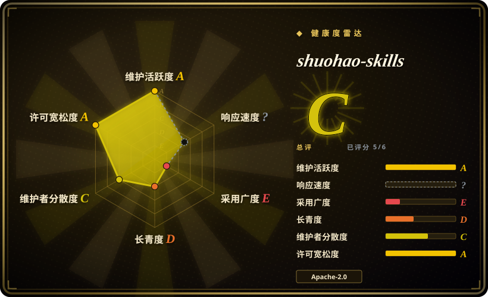
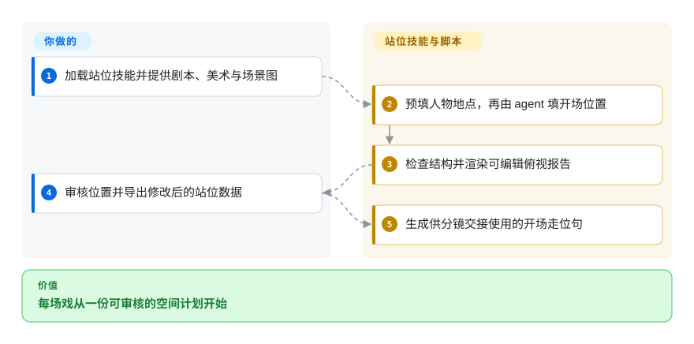

# shuohao-skills

短剧每生成一段，人物座位就换一次。这组技能先把小说变成人物、美术、剧本、站位和分镜记录，再交给制作环节。

## 何时使用

你在改编中文短剧，独立生成的片段总把人物、道具和开场位置接错。需要结构化前期材料和可执行检查，而非一键成片时，可以选这组技能。agent 创作内容，脚本校验结构，你在花费图像或视频生成费用前确认材料。

## 何时不用

- 要完整讲解视频而非短剧准备，选 [OpenMontage](open-montage.zh.md)。
- 要真实界面截图组成的产品宣传片，选 [video-shotcraft](video-shotcraft.zh.md)。
- 要确定性时间线渲染，选 [Remotion](render-engines/remotion.zh.md)，本项目不是渲染引擎。
- 要不改流程就生成全英文人物数据，应自建流程。英文报告界面不代表人物字段可写英文，部分校验明确拒绝英文。

## 横向对比

| 替代品 | 是否收录 | 我们的评价 | 取舍 |
| --- | --- | --- | --- |
| [OpenMontage](open-montage.zh.md) | ✅ | 要完整视频管线选 OpenMontage；要短剧人物和站位连续性选本组技能。 | 更广的生产自动化，对比专门且可审查的准备材料。 |
| [video-shotcraft](video-shotcraft.zh.md) | ✅ | 产品镜头和真实截图选 video-shotcraft；小说拆场与人物一致性选本组技能。 | 产品素材，对比叙事与空间规划。 |
| [Remotion](render-engines/remotion.zh.md) | ✅ | 要渲染代码时间线选 Remotion；要给外部生成器准备短剧材料选本组技能。 | 渲染运行时，对比提示词、数据契约和检查器；下游使用 Remotion 仍须另审许可。 |

## 快速上手

先审阅固定版本，再只把需要的技能目录交给能读 `SKILL.md` 的 agent。安装器会给 Claude Code 或 Codex 建软链，之后拉取更新立即生效。你提供原著，agent 逐阶段生成 JSON 和报告；Node 18+ 标准库脚本负责预填、校验和 HTML 展示，创作判断与生成费用仍归你。站位阶段需要 `script.json`，可补美术与场景图，再在可拖动报告中修改并导出 JSON。开场走位句仍需抄入分镜，尚无自动导入。来源为[使用路径](https://github.com/eternityspring/shuohao-skills/blob/d28a9c539b40523d081794b25ff9113016bd98e0/skills/novel-staging/SKILL.md)。

<!-- flow-steps:begin (generated from flows/shuohao-skills.json by tools/flow_card.py — do not edit) -->

流程文字版

1. **你**：加载站位技能并提供剧本、美术与场景图
2. **shuohao-skills**：预填人物地点，再由 agent 填开场位置
3. **shuohao-skills**：检查结构并渲染可编辑俯视报告
4. **你**：审核位置并导出修改后的站位数据
5. **shuohao-skills**：生成供分镜交接使用的开场走位句

**价值**：每场戏从一份可审核的空间计划开始

<!-- flow-steps:end -->

## 技术要点

<!-- mechanism:begin (generated from mechanisms/shuohao-skills.json by tools/mechanism_card.py; do not edit) -->

机制文字版

- 剧本、大纲与美术数据
- 确定性预填场次与人物①
- agent 识图并填写位置
- 八道结构检查②
- 可编辑报告与走位句

- 剧本、大纲与美术数据 → 确定性预填场次与人物①
- 确定性预填场次与人物① → agent 识图并填写位置
- agent 识图并填写位置 → 八道结构检查②
- 八道结构检查② → 可编辑报告与走位句

<!-- mechanism:end -->

### 1. 直接预填事实，不让模型重编

- **解决：** 让模型重写场次名单，可能改掉人物和地点身份。
- **做法：** 站位预填器从剧本复制集、场、地点和人物，再从大纲映射姓名，把位置字段留空交给 agent。
- **边界：** 只搬运输入事实，不核对原著，也不判断家具是否在画面里。
- **源码：** [预填实现](https://github.com/eternityspring/shuohao-skills/blob/d28a9c539b40523d081794b25ff9113016bd98e0/skills/novel-staging/scripts/novel-staging.mjs#L358-L383)。

### 2. 结构检查与认图判断分开

- **解决：** 看似合理的站位描述，可能漏人或让两人重叠。
- **做法：** 八道代码检查覆盖物件格式、人物、落点与群演，再从已确认位置生成走位句。按提示词推算与按图识别分开记录。
- **边界：** 不提供剧本会削弱人物核对；框格式合法也不证明物件真实存在，仍需 agent 和人认图。
- **源码：** [校验与走位句](https://github.com/eternityspring/shuohao-skills/blob/d28a9c539b40523d081794b25ff9113016bd98e0/skills/novel-staging/scripts/novel-staging.mjs#L395-L506)。

## 健康度与可持续性

- 截至 2026-10-18，仓库创建于 8 月，10 月仍有提交，多名贡献者可见，尚无标签发布。
- 作者说明在业余时间维护；有自测，说明明确尚无持续集成。[推断：依据是维护说明和短历史] 应固定版本，而不是把软链当作稳定产品接口。
- Apache-2.0 与 NOTICE 标明项目；外部图像和视频服务仍有独立收费与使用规则。

## 存疑（未验证）

- [未验证：本批禁止运行上游] 未执行校验器、HTML 交互和生成质量测试。
- [推断：依据是维护说明和短历史] 长期维护仍不确定，当前活跃不能代替 Lindy 证据。
