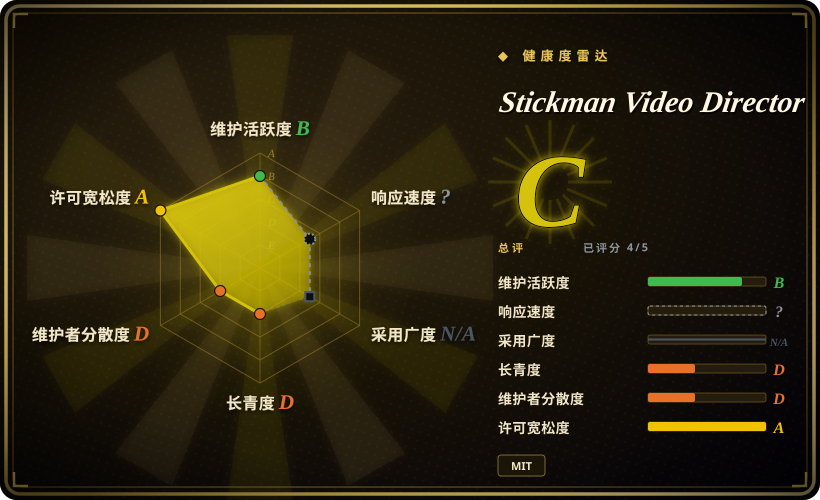

# Stickman Video Director

六段生成视频里，人物和旁白像换了六次。这个技能先让你确认导演方案，再把完整角色和声音约束放进每条独立片段提示词。

## 何时使用

你要做知识短片或生活故事，想用火柴人，不想拼素材镜头。直接进入生成器后，每段都得重写场景、角色和旁白描述。当缺的是稳定分镜、提示词包和确认关口，而不是渲染器或剪辑器时，选它。当前有四类风格、六种视觉选项，覆盖黑白线条、现代风、史前喜剧和彩色生活故事。

## 何时不用

- **期待一次调用就交付 MP4。** 选 [anything2explainer](anything2explainer.zh.md) 做代码渲染解说片；本技能只交提示词和剪辑建议。
- **文字必须准确，逐帧可重现。** 选 [HyperFrames](hyperframes.zh.md)；生成镜头有随机性，本技能通常还禁止片内出现文字。
- **已经会导演，只缺生成界面。** 直接用 Google Flow；本仓库增加规划指令，不提供视频模型或 API 集成。
- **声音身份必须完全相同。** 在剪辑器中使用连续的外部旁白轨道；重复声音描述只是提示层辅助，不是共享声音资产的保证。

## 横向对比

| 替代品 | 是否收录 | 我们的评价 | 取舍 |
|---|---|---|---|
| [anything2explainer](anything2explainer.zh.md) | ✅ | 完整代码渲染解说流水线选它；短篇生成式火柴人分镜选本技能。 | 自动化制作更多，但工具包有非商业条款；本技能更窄，只产提示词。 |
| [HyperFrames](hyperframes.zh.md) | ✅ | 可编辑准确文字和确定性图形选 HyperFrames；不写动画代码的生成角色场景选本技能。 | 浏览器渲染与模型波动、人工拼接之间取舍。 |
| Google Flow | 非仓库 | 已有导演方法时直接用 Flow；缺连续性和确认纪律时再加本技能。 | 托管商业生成服务，不是仓库；生成费用另算。 |

## 快速上手

把 `skills/directing-stickman-videos/` 复制到 agent 的技能目录，再给主题、画幅、时长和风格。缺少画幅或风格时必须先确认，未给时长则默认 60 秒。agent 先写导演方案，等你批准后才输出独立英文片段提示词。你把提示词提交到生成服务，再自行剪辑拼接和加字幕。技能本身不需要 API 或 MCP 配置，但助手和视频服务各有账号要求及费用。

<!-- flow-steps:begin (generated from flows/stickman-video-director.json by tools/flow_card.py — do not edit) -->

流程文字版

1. **你**：安装技能并提供主题、画幅、时长和风格
2. **Stickman Video Director**：起草含场景和旁白的导演方案
3. **你**：修改并明确批准当前方案
4. **Stickman Video Director**：输出独立片段提示词与连续性说明
5. **你**：到外部服务生成片段并剪辑成片

**价值**：经确认的故事变成连续一致的生成提示词包

<!-- flow-steps:end -->

## 技术要点

<!-- mechanism:begin (generated from mechanisms/stickman-video-director.json by tools/mechanism_card.py; do not edit) -->

机制文字版

- 主题与设置
- 当前导演方案①
- 明确批准；全局修改使批准失效①
- 冻结角色与完整声音约束②
- 独立片段提示词包②

- 主题与设置 → 当前导演方案①
- 当前导演方案① → 明确批准；全局修改使批准失效①
- 明确批准；全局修改使批准失效① → 冻结角色与完整声音约束②
- 冻结角色与完整声音约束② → 独立片段提示词包②

<!-- mechanism:end -->

### 1. 全局选择改变后，原批准失效

- **解决：** 选题获准，容易被误当成后续分镜或另一种布局也获准。
- **做法：** 技能将方案与生产分开。画幅、时长、风格、旁白或全局方向改变后，必须重排方案并重新取得明确批准。
- **边界：** 这些是宿主模型遵循的指令，不是强制状态机，也不是付款授权系统。
- **源码：** [设置与批准规则](https://github.com/kaomei/stickman-video-director/blob/5841335db851b5f0352cf77955147393b97beabc/skills/directing-stickman-videos/SKILL.md#L12-L39)。

### 2. 每条独立提示词都带完整连续性约束

- **解决：** 独立生成任务读不到上一个任务中“同一旁白”的背景。
- **做法：** 声音参考要求每段重复完整获准档案，包含口音、音色、音区、语速和录音处理。生产契约也把首尾帧状态与角色锚点写进自足的提示词。
- **边界：** 文字相同不保证画面和声音相同。参考文档要求试听，并明确三片段声音验收只对该样本有效。
- **源码：** [声音契约](https://github.com/kaomei/stickman-video-director/blob/5841335db851b5f0352cf77955147393b97beabc/skills/directing-stickman-videos/references/voice-continuity.md#L11-L39)、[提示词组装](https://github.com/kaomei/stickman-video-director/blob/5841335db851b5f0352cf77955147393b97beabc/skills/directing-stickman-videos/references/omni-flash-prompt-contract.md#L18-L49)。

## 健康度与可持续性

- **2026-10-18，年轻个人合集。** 建于 8 月 3 日，10 月仍更新风格与连续性规则；获取的 GitHub 发布列表为空。
- **维护集中。** 贡献者快照只有 kaomei。虽然有示例和星标，两个月历史仍缺 Lindy 证据。
- **许可与验证。** MIT 文件署名 Stickman Video Director contributors。树中有实际技能参考、场景用例和校验脚本，不只有展示视频。
- **采用判断。** 可作为可读导演模板，生成商行为和后续维护都不受技能控制。

## 存疑（未验证）

- [未验证：未调用付费视频服务] 未复现镜头质量、声音连续性，也未实测上游命名的 Omni Flash 生成路径当前是否可用。
- [推断：依据是提示词约束而非运行时门禁] 宿主模型可能跳过批准或连续性指令，付费生成前仍须人工检查。
