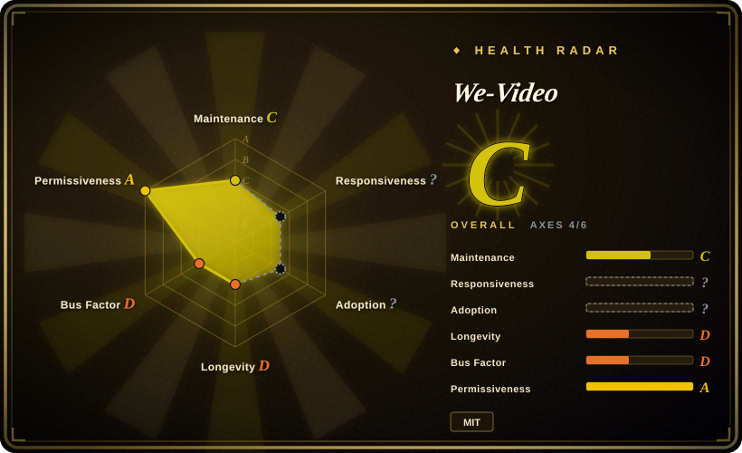
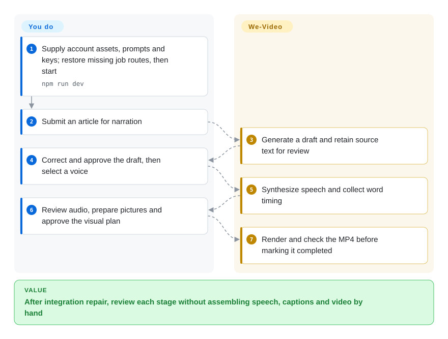
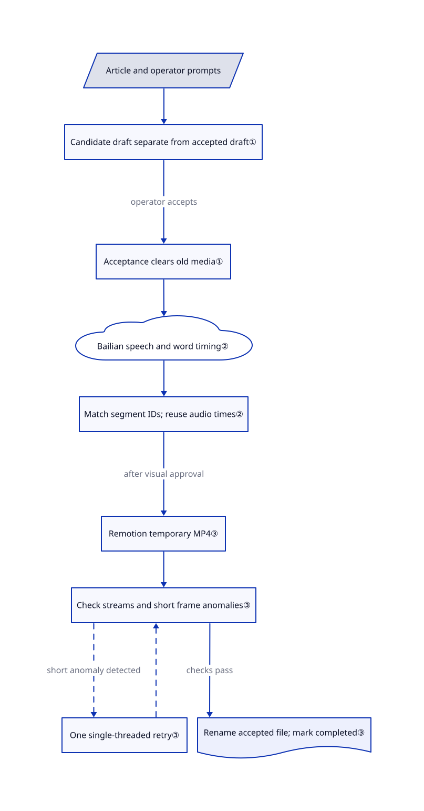

# We-Video

Turning one article into a branded explainer means checking the script, voice and pictures separately. We-Video supplies that review workbench and a checked MP4 renderer, but its public checkout omits several API handlers the interface needs.

## When to use

You develop a Chinese knowledge channel's production tools. An article needs to become a short branded explainer, but you want to correct a name before paying for speech, listen before planning pictures, and retain the intermediate files. We-Video offers React screens and local workers for those separate approvals, rather than treating the whole job as an unattended stock-footage slideshow.

Choose it as an implementation base when your team can complete the missing web-to-worker wiring and author its own account assets and prompts. Compared with MoneyPrinterTurbo, its distinguishing investment is editable narration, speech timing and visual plans, not immediate deployment. The public tree has substantial backend code; it is neither frontend-only nor a complete turnkey distribution.

## When NOT to use

- **You need a working fresh-clone WebUI today.** Choose [MoneyPrinterTurbo](moneyprinter-turbo.md) for the stock-footage-short workflow instead. At the reviewed SHA, the UI calls job snapshot, render and visual-plan generation endpoints whose route files are absent; `.gitignore` excludes most per-job API routes. See the [tree](https://github.com/hongqun/we-video/tree/6129b4fc11cc1c52a8df145bc40ee66c77e0f349/src/app/api/jobs), [UI calls](https://github.com/hongqun/we-video/blob/6129b4fc11cc1c52a8df145bc40ee66c77e0f349/src/components/Workspace.tsx#L505-L506) and [ignore rules](https://github.com/hongqun/we-video/blob/6129b4fc11cc1c52a8df145bc40ee66c77e0f349/.gitignore#L12-L23).
- **Your footage and narration must stay offline.** Use [Remotion](render-engines/remotion.md) directly with local assets and your own voice track. We-Video's documented narration path sends text to DeepSeek and Alibaba Bailian/CosyVoice; API keys and usage charges are your responsibility.
- **You want an agent to research and direct an entire film.** Choose [OpenMontage](open-montage.md) for its agent-driven pipeline. We-Video is an operator-facing workbench; the README's optional Remotion skills are development guidance, not its orchestrator.
- **You require a permissive open-source rendering engine.** Consider [HyperFrames](render-engines/hyperframes.md) under Apache-2.0 after reviewing its dependency terms. We-Video's own MIT license does not replace Remotion 4's company-size eligibility rules or third-party asset terms. The [pinned Remotion license](https://github.com/remotion-dev/remotion/blob/v4.0.505/LICENSE.md) requires a company license outside its free-license eligibility, including for-profit organizations above three employees.

## Comparison

| Alternative | In index | Our verdict | Tradeoff |
|---|---|---|---|
| [MoneyPrinterTurbo](moneyprinter-turbo.md) | ✅ | Pick MoneyPrinterTurbo when an operator needs topic-to-stock-footage shorts without repairing this checkout; pick We-Video as a development base for separate narration, audio and visual review. | MoneyPrinterTurbo offers a different, more appliance-like workflow; We-Video supplies editable review surfaces but leaves missing routes and account setup to you. |
| [Remotion](render-engines/remotion.md) | ✅ | Pick Remotion directly when you already own narration and assets and need React-defined frames; pick We-Video's code when the review workflow itself is what you want to reuse. | Direct engine use avoids the incomplete workbench; it also leaves script generation, speech integration and approval screens for you to build. Remotion's license applies in either route. |
| [OpenMontage](open-montage.md) | ✅ | Pick OpenMontage when a coding agent should research, source assets and direct production; pick We-Video's implementation when a human operator should review each narration stage in a browser. | OpenMontage adds agent orchestration and its own licensing and toolchain obligations; We-Video uses local application workers, not an agent session, but needs integration repair. |

## Quick start

The README documents Node.js 20+, `npm ci`, copies of `config_examples/.env.example` and `config_examples/pipeline.config.example.json`, then `npm run dev` on port 3100; this is not a complete fresh-checkout recipe. You must also set `APP_PASSWORD` and `SESSION_SECRET`, supply model keys, and create an account, logo, presenter pose and series prompts under the configured content directory. The examples supply a series configuration, not a complete account or the required narration/visual prompts. Complete the missing per-job API handlers before expecting the browser workflow to work; the flow below describes that conditional workflow, not a reproduced run. After repair, you supply the article, approve the draft, listen to the generated speech, prepare and approve visuals, and let its renderer create `output.mp4`; cloud text and speech charges, content rights and server operation stay with you.

<!-- flow-steps:begin (generated from flows/we-video.json by tools/flow_card.py — do not edit) -->

Text version of the flow

1. **You**: Supply account assets, prompts and keys; restore missing job routes, then start — `npm run dev`
2. **You**: Submit an article for narration
3. **We-Video**: Generate a draft and retain source text for review
4. **You**: Correct and approve the draft, then select a voice
5. **We-Video**: Synthesize speech and collect word timing
6. **You**: Review audio, prepare pictures and approve the visual plan
7. **We-Video**: Render and check the MP4 before marking it completed

**Value**: After integration repair, review each stage without assembling speech, captions and video by hand

<!-- flow-steps:end -->

## Key techniques

<!-- mechanism:begin (generated from mechanisms/we-video.json by tools/mechanism_card.py; do not edit) -->

Text version of the mechanism

- Article and operator prompts
- Candidate draft separate from accepted draft①
- Acceptance clears old media①
- Bailian speech and word timing②
- Match segment IDs; reuse audio times②
- Remotion temporary MP4③
- Check streams and short frame anomalies③
- One single-threaded retry③
- Rename accepted file; mark completed③

- Article and operator prompts → Candidate draft separate from accepted draft①
- Candidate draft separate from accepted draft① → Acceptance clears old media① (operator accepts)
- Acceptance clears old media① → Bailian speech and word timing②
- Bailian speech and word timing② → Match segment IDs; reuse audio times②
- Match segment IDs; reuse audio times② → Remotion temporary MP4③ (after visual approval)
- Remotion temporary MP4③ → Check streams and short frame anomalies③
- Check streams and short frame anomalies③ → One single-threaded retry③ (short anomaly detected) [optional/fallback]
- One single-threaded retry③ → Check streams and short frame anomalies③ [optional/fallback]
- Check streams and short frame anomalies③ → Rename accepted file; mark completed③ (checks pass)

<!-- mechanism:end -->

### 1. Keep candidate text separate and invalidate derived media

- **Problem:** Accepting an AI rewrite must not leave audio or video that still speaks the old draft.
- **How:** Revisions go into `pending-draft.json`; acceptance copies the selected draft to the formal file, clears the candidate, and removes downstream audio, manifest and output. Job records retain separate script, audio and visual approval timestamps.
- **Limits:** Files are local, not a distributed job database. JSON writes queue within one process and use temporary-file renames; this is not a cross-process transaction. The missing HTTP handlers still need to connect these operations to the UI.
- **Source:** [Draft acceptance and invalidation](https://github.com/hongqun/we-video/blob/6129b4fc11cc1c52a8df145bc40ee66c77e0f349/src/lib/narration.ts), [job persistence and approvals](https://github.com/hongqun/we-video/blob/6129b4fc11cc1c52a8df145bc40ee66c77e0f349/src/lib/jobs.ts).

### 2. Anchor visuals to speech instead of asking the model to invent timing

- **Problem:** Independently generated speech and scene durations can leave a picture on screen after the narrator has moved on.
- **How:** The speech module submits a whole marked-up narration to Bailian over WebSocket, collecting audio and word timing from that synthesis. The visual planner asks DeepSeek for text keyed by narration-segment IDs, rejects missing or foreign IDs, and assigns scene times from the confirmed audio rather than model-generated durations.
- **Limits:** This requires the configured speech service and user-supplied prompts. Segment-ID matching is structural validation, not a check that claims or pictures are correct; `validateNarrationDraft` currently performs no content checks.
- **Source:** [Speech synthesis](https://github.com/hongqun/we-video/blob/6129b4fc11cc1c52a8df145bc40ee66c77e0f349/src/lib/tts.ts#L707-L861), [segment matching and scene times](https://github.com/hongqun/we-video/blob/6129b4fc11cc1c52a8df145bc40ee66c77e0f349/src/lib/visual-planner.ts#L71-L85), [disabled narration validation](https://github.com/hongqun/we-video/blob/6129b4fc11cc1c52a8df145bc40ee66c77e0f349/src/lib/narration.ts#L45-L50).

### 3. Publish a rendered file only after media checks

- **Problem:** A successful rendering call can still produce a malformed or briefly corrupted video.
- **How:** The worker renders H.264/AAC to a temporary MP4, checks streams, dimensions, frame rate, pixel format and duration with `ffprobe`, then scans frame-brightness differences with `ffmpeg`. Detected short anomalies trigger one single-threaded retry; only an accepted file is renamed to `output.mp4` and marked completed.
- **Limits:** The brightness heuristic uses a threshold of 10 and pairs spikes within three frames. It does not judge factual accuracy, layout quality or all visual defects; mathematical videos skip this frame scan. This implementation was read, not executed.
- **Source:** [Render checks, retry and publication](https://github.com/hongqun/we-video/blob/6129b4fc11cc1c52a8df145bc40ee66c77e0f349/src/server/render-job.ts), [frame-difference detector](https://github.com/hongqun/we-video/blob/6129b4fc11cc1c52a8df145bc40ee66c77e0f349/src/lib/render-integrity.ts#L72-L124), [detector fixtures](https://github.com/hongqun/we-video/blob/6129b4fc11cc1c52a8df145bc40ee66c77e0f349/src/tests/render-integrity.test.ts).

## Tech stack

- TypeScript; Next.js 16.3.0, React 19.2.3 and Remotion 4.0.505, as pinned in [package.json](https://github.com/hongqun/we-video/blob/6129b4fc11cc1c52a8df145bc40ee66c77e0f349/package.json).
- Zod validates configuration and render data; local JSON files store jobs and artifacts. `tsx` child processes run narration, speech and visual-planning workers.
- Three.js / React Three Fiber support model scenes; Sharp processes images. Bundled Noto and ZCOOL fonts carry separate OFL texts; the template attribution identifies React Video Editor and RemotionUI sources.

## Dependencies

- Node.js 20+ per README; POSIX shell commands in npm scripts. The asset-sync predev/prebuild hook requires a complete local account configuration before starting or building.
- DeepSeek text API and Bailian speech API keys for the documented narration workflow. Account JSON, series JSON, fixed prompt files, logo and presenter images are operator-owned inputs, not included complete examples.
- Chrome Headless Shell for rendering, plus system `ffmpeg` and `ffprobe` for the project's own media checks. The renderer can download its browser if absent.
- Writable job storage and a reachable application origin for signed artifact URLs. No database server appears in the reviewed persistence path. Remotion development skills are optional, not runtime dependencies.

## Ops difficulty

**High for first deployment; medium after integration repair.** Missing API routes, required personal configuration and unpublished prompts make the initial task development, not just installation. The development script binds `0.0.0.0`, whereas production start binds loopback; configure the shared password, session secret and HTTPS cookie setting before exposing it. Back up job data and manage disk use yourself: the cleanup code scans legacy `rNNN` subdirectories, while current jobs write media directly in the task directory, so do not rely on its documented 15-day retention for current-layout media.

## Health & viability

- **Maintenance, 2026-10-22:** created 2026-10-15 and last pushed 2026-10-17; not archived, but no published GitHub releases. The package's `1.0.0` field is not evidence of a tested release distribution.
- **Governance and longevity:** the contributor endpoint returned only `hongqun`; the owner is a personal account. Seven days of public history cannot establish long-term durability. Treat it as a forkable implementation, not a proven infrastructure dependency.
- **Adoption and support:** 38 stars and eight forks are attention signals, not deployment evidence. [Issue 1](https://github.com/hongqun/we-video/issues/1) asks whether the backend is open; it has no comments as of verification. Source inspection finds backend workers, but also the missing routes that make the question material.
- **Licensing:** the root MIT copyright names HongQun, and one of 163 source files is blob-identical to the declared template source and retains its attribution header. Do not read the health radar's root-license score as clearance for Remotion, bundled decoders, fonts or your own media.
- **Selection verdict:** prefer a development spike or selective module reuse. The public integration gaps are concrete blockers for a production appliance; the renderer's explicit preflight and publication checks are the most reusable part.

## Caveats (unverified)

- [未验证：static-only review; upstream execution was prohibited] Installation, model access, rendered output, costs and throughput were not reproduced. The README's approximately CNY 0.1/minute claim excludes any independently measured evidence here; do not budget from it.
- [未验证：the required routes and private account inputs were not published] Whether the maintainer's local installation completes the browser workflow is unknown. Missing routes are confirmed in the reviewed tree; a backend worker is not proof of an end-to-end usable distribution.
- [推断：based on one public contributor, seven days of history and no releases] Long-term support and production suitability remain unestablished; this is a risk judgment, not proof of abandonment.
- [推断：cleanup.ts visits only rNNN children, while jobs.ts uses the job root] Current-layout media can escape the retention sweep; this mismatch was established statically but not reproduced against a running instance.
