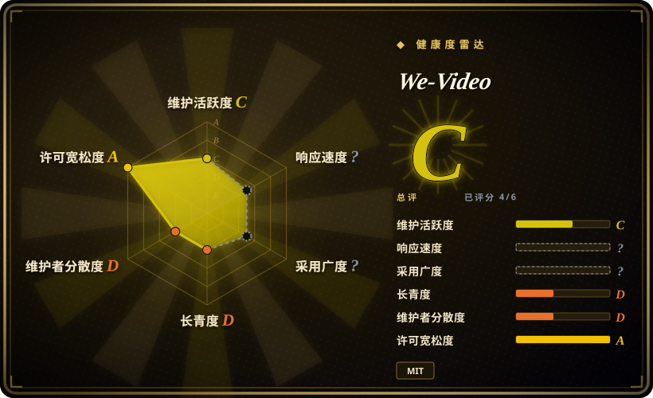
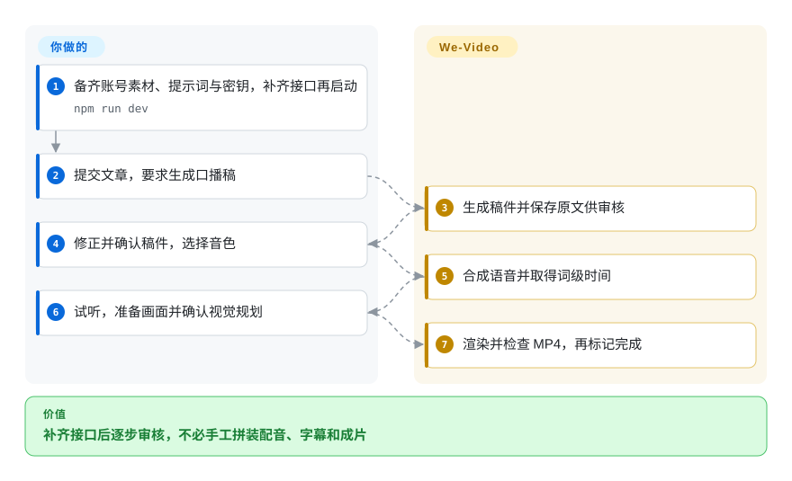
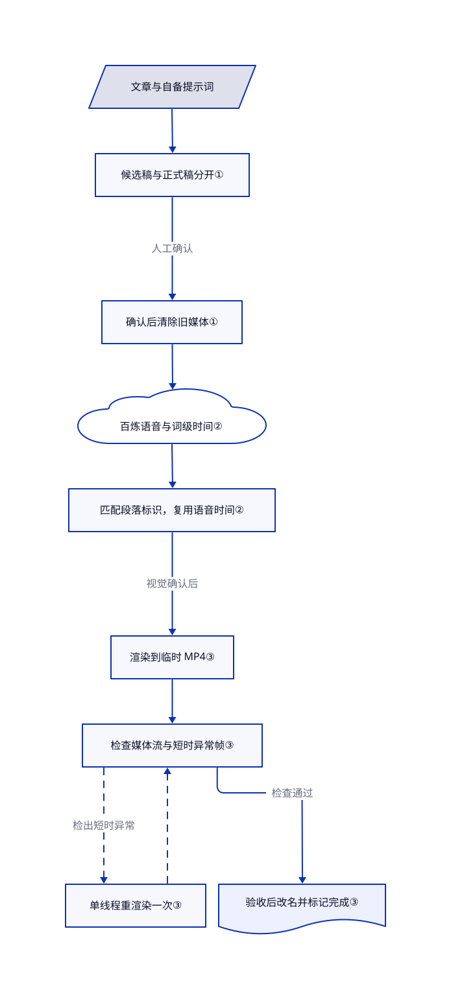

# We-Video

文章变讲解视频，要分别检查稿件、声音和画面。We-Video 提供分步审核工作台与带检查的 MP4 渲染器，但公开仓库缺少界面必需的部分接口。

## 何时使用

你为中文知识频道开发制作工具。一篇文章要做成品牌短片，但你想先改对人名，再花钱配音；先试听，再安排画面，并保留中间文件。We-Video 提供对应的审核界面与本地后台任务，不把整个过程压成无人审核的库存素材幻灯片。

团队能补齐缺失接口、编写账号配置和提示词时，可以把它当开发底座。相比 MoneyPrinterTurbo，它的投入重点是可编辑口播、语音时间轴与视觉规划，不是开箱即用。公开树包含实质后端代码，既不是纯前端，也不是完整可部署发行版。

## 何时不用

- **今天就要从新克隆启动完整工作台。** 库存素材短片先选 [MoneyPrinterTurbo](moneyprinter-turbo.zh.md)。核验提交缺少界面调用的任务快照、渲染与视觉规划生成接口，忽略规则排除了大部分任务级接口。证据见[文件树](https://github.com/hongqun/we-video/tree/6129b4fc11cc1c52a8df145bc40ee66c77e0f349/src/app/api/jobs)、[界面调用](https://github.com/hongqun/we-video/blob/6129b4fc11cc1c52a8df145bc40ee66c77e0f349/src/components/Workspace.tsx#L505-L506)和[忽略规则](https://github.com/hongqun/we-video/blob/6129b4fc11cc1c52a8df145bc40ee66c77e0f349/.gitignore#L12-L23)。
- **素材和口播必须离线。** 直接用 [Remotion](render-engines/remotion.zh.md) 合成本地素材与自备音轨。We-Video 的文档路径把文字交给 DeepSeek 与阿里百炼语音服务，密钥与调用费由你承担。
- **要让编程助手调研并导演整部影片。** 选 [OpenMontage](open-montage.zh.md) 的助手驱动管线。We-Video 面向人工操作；可选的 Remotion 技能只是开发指南，不是运行时调度器。
- **要求渲染引擎采用宽松开源许可。** 可考虑 Apache-2.0 的 [HyperFrames](render-engines/hyperframes.zh.md)，同时核查其依赖条款。We-Video 自有代码的 MIT 不覆盖 Remotion 4 的企业资格规则，也不覆盖第三方素材。[锁定版本的许可](https://github.com/remotion-dev/remotion/blob/v4.0.505/LICENSE.md)要求不符合免费资格的使用者购买企业许可，其中包括超过三名员工的营利组织。

## 横向对比

| 替代品 | 是否收录 | 我们的评价 | 取舍 |
|---|---|---|---|
| [MoneyPrinterTurbo](moneyprinter-turbo.zh.md) | ✅ | 操作员要直接从主题做库存素材短片，先选 MoneyPrinterTurbo；愿意开发分步审稿、试听和视觉审核，再复用 We-Video。 | 前者更接近现成工具，制作风格不同；后者有编辑审核界面，但缺失接口和账号初始化要自己补。 |
| [Remotion](render-engines/remotion.zh.md) | ✅ | 已有稿件与素材，只缺代码合成，直接选 Remotion；要复用人工审核流程，再取 We-Video 的实现。 | 直接用引擎可绕开不完整工作台，却要自建写稿、语音与审批界面；两条路都受引擎许可约束。 |
| [OpenMontage](open-montage.zh.md) | ✅ | 要编程助手调研、找素材并导演，选 OpenMontage；要人在浏览器逐步审核口播，才考虑补齐 We-Video。 | 前者提供助手编排，也带来自身许可和工具链要求；后者由本地程序执行，不靠助手会话，但接口尚需修补。 |

## 快速上手

上游文档要求 Node.js 20 以上，运行 `npm ci`，复制环境变量和流水线配置示例，再用 `npm run dev` 启动 3100 端口；这不是完整的新克隆启动方案。你还要填写 `APP_PASSWORD`、`SESSION_SECRET` 与模型密钥，创建账号、标志、人物姿态图和专题提示词。示例只有专题配置，没有完整账号和生成所需的口播、视觉提示词。先补齐缺失的任务级接口，再期待浏览器流程接通；下图描述补齐后的预期流程，不代表本次实跑。接通后，你提供文章、确认稿件、试听配音并准备画面，程序再渲染 `output.mp4`；模型调用费、内容权利与服务器维护仍由你负责。

<!-- flow-steps:begin (generated from flows/we-video.json by tools/flow_card.py — do not edit) -->

流程文字版

1. **你**：备齐账号素材、提示词与密钥，补齐接口再启动 — `npm run dev`
2. **你**：提交文章，要求生成口播稿
3. **We-Video**：生成稿件并保存原文供审核
4. **你**：修正并确认稿件，选择音色
5. **We-Video**：合成语音并取得词级时间
6. **你**：试听，准备画面并确认视觉规划
7. **We-Video**：渲染并检查 MP4，再标记完成

**价值**：补齐接口后逐步审核，不必手工拼装配音、字幕和成片

<!-- flow-steps:end -->

## 技术要点

<!-- mechanism:begin (generated from mechanisms/we-video.json by tools/mechanism_card.py; do not edit) -->

机制文字版

- 文章与自备提示词
- 候选稿与正式稿分开①
- 确认后清除旧媒体①
- 百炼语音与词级时间②
- 匹配段落标识，复用语音时间②
- 渲染到临时 MP4③
- 检查媒体流与短时异常帧③
- 单线程重渲染一次③
- 验收后改名并标记完成③

- 文章与自备提示词 → 候选稿与正式稿分开①
- 候选稿与正式稿分开① → 确认后清除旧媒体①（人工确认）
- 确认后清除旧媒体① → 百炼语音与词级时间②
- 百炼语音与词级时间② → 匹配段落标识，复用语音时间②
- 匹配段落标识，复用语音时间② → 渲染到临时 MP4③（视觉确认后）
- 渲染到临时 MP4③ → 检查媒体流与短时异常帧③
- 检查媒体流与短时异常帧③ → 单线程重渲染一次③（检出短时异常）〔可选／兜底〕
- 单线程重渲染一次③ → 检查媒体流与短时异常帧③〔可选／兜底〕
- 检查媒体流与短时异常帧③ → 验收后改名并标记完成③（检查通过）

<!-- mechanism:end -->

### 1. 候选稿独立保存，确认后清除旧媒体

- **解决：** 接受 AI 改稿后，旧音频和视频不能继续冒充新稿产物。
- **做法：** 修订先写入 `pending-draft.json`。确认时覆盖正式稿，清除候选文件，并删除下游音频、合成清单和成片。任务记录分别保存稿件、音频与视觉审批时间。
- **边界：** 状态保存在本地文件，不是分布式任务数据库。JSON 写入只在同一进程排队，并用临时文件改名；它不构成跨进程事务。缺失接口仍需把这些操作接到界面。
- **源码：** [稿件确认与下游失效](https://github.com/hongqun/we-video/blob/6129b4fc11cc1c52a8df145bc40ee66c77e0f349/src/lib/narration.ts)、[任务保存与审批记录](https://github.com/hongqun/we-video/blob/6129b4fc11cc1c52a8df145bc40ee66c77e0f349/src/lib/jobs.ts)。

### 2. 画面跟随语音时间轴，不让模型编时长

- **解决：** 语音和镜头分别生成时长，容易出现解说已换段、画面还没换的情况。
- **做法：** 语音模块把带停顿标记的整段稿件交给百炼，通过双向连接收回音频与词级时间。视觉规划让 DeepSeek 按口播段落标识提取文字，拒绝缺失或多余标识，再从确认音频取起止时间。
- **边界：** 依赖已配置的语音服务与自备提示词。段落匹配只检查结构，不检查事实或配图是否正确；当前稿件校验函数不执行内容检查。
- **源码：** [语音合成](https://github.com/hongqun/we-video/blob/6129b4fc11cc1c52a8df145bc40ee66c77e0f349/src/lib/tts.ts#L707-L861)、[段落匹配与镜头时间](https://github.com/hongqun/we-video/blob/6129b4fc11cc1c52a8df145bc40ee66c77e0f349/src/lib/visual-planner.ts#L71-L85)、[空实现的稿件校验](https://github.com/hongqun/we-video/blob/6129b4fc11cc1c52a8df145bc40ee66c77e0f349/src/lib/narration.ts#L45-L50)。

### 3. 媒体检查通过后才发布成片

- **解决：** 渲染调用成功，也可能产出格式错误或短暂花帧的视频。
- **做法：** 后台先输出临时 MP4，用 `ffprobe` 检查音视频流、尺寸、帧率、像素格式和时长，再用 `ffmpeg` 扫描相邻帧亮度差。发现短时异常就单线程重渲染一次，验收后才改名为 `output.mp4` 并标记完成。
- **边界：** 检测以亮度差 10 为阈值，寻找三帧内成对尖峰。它不判断事实、排版或所有视觉缺陷，数学视频还会跳过这项扫描。本次只读实现，没有执行。
- **源码：** [渲染检查、重试与发布](https://github.com/hongqun/we-video/blob/6129b4fc11cc1c52a8df145bc40ee66c77e0f349/src/server/render-job.ts)、[帧差检测](https://github.com/hongqun/we-video/blob/6129b4fc11cc1c52a8df145bc40ee66c77e0f349/src/lib/render-integrity.ts#L72-L124)、[检测样例](https://github.com/hongqun/we-video/blob/6129b4fc11cc1c52a8df145bc40ee66c77e0f349/src/tests/render-integrity.test.ts)。

## 技术栈

- TypeScript；[依赖清单](https://github.com/hongqun/we-video/blob/6129b4fc11cc1c52a8df145bc40ee66c77e0f349/package.json)锁定 Next.js 16.3.0、React 19.2.3 和 Remotion 4.0.505。
- Zod 校验配置与渲染数据，本地 JSON 保存任务和产物。后台通过子进程执行文稿、语音和视觉规划程序。
- Three.js 与 React Three Fiber 支持模型镜头，Sharp 处理图片。随附字体保留独立 OFL 文本，模板来源说明列出 React Video Editor 与 RemotionUI。

## 依赖

- 文档要求 Node.js 20 以上，包脚本使用 POSIX shell。开发和构建前会同步账号素材，账号配置不齐会阻止启动。
- 文档中的口播路径需要 DeepSeek 与百炼密钥。账号、专题、固定提示词、标志和人物图均由使用者提供，示例并未完整附带。
- 渲染需要无窗口浏览器，项目自身的媒体检查另需系统 `ffmpeg` 与 `ffprobe`。渲染器可在缺少浏览器时下载所需版本。
- 需要可写任务目录和渲染器可访问的应用地址，以读取带签名的素材链接。所读状态路径不依赖数据库服务，Remotion 开发技能不是运行依赖。

## 运维难度

**首次部署高，补齐后中等。** 缺失接口、个人配置和未附带提示词，让首次部署变成开发任务。开发脚本监听全部网卡，生产启动仅监听本机；对外开放前须配置共享密码、会话密钥和 HTTPS Cookie。任务数据要自己备份并管好磁盘：清理代码只扫描旧版 `rNNN` 子目录，当前任务却把媒体写在任务根目录，不能依赖文档里的十五天保留期清理当前布局。

## 健康度与可持续性

- **维护情况，截至 2026-10-22：** 10 月 15 日建库，17 日最后推送，未归档，也没有公开发行版。包里的 `1.0.0` 不代表存在经过验收的发行产物。
- **治理与寿命：** 贡献者接口仅返回 `hongqun`，所有者是个人账号。七天公开历史无法证明长期维护能力，宜看作可派生的实现，而非经过验证的基础依赖。
- **采用与响应：** 38 星、8 个派生仓库只能说明关注度，不能证明生产使用。[问题 1](https://github.com/hongqun/we-video/issues/1)询问后端是否开源，核验时没有评论。源码确有后台程序，但关键接口缺失，使这个问题并非空穴来风。
- **许可：** 根 MIT 版权人为 HongQun；163 个源码文件中，一个与声明来源的模板完全相同，并保留来源头注。健康雷达对根许可的评分，不替代渲染引擎、解码器、字体与个人素材的许可核查。
- **选型判断：** 优先用于开发验证或局部模块复用。接口缺口明确阻碍现成部署；渲染前检查与验收后发布，是较值得借用的实现。

## 存疑（未验证）

- [未验证：本次只读源码，任务禁止执行上游] 未复现安装、模型接通、成片质量、费用和吞吐。文档声称约每分钟 0.1 元，本次没有独立计量，不能据此预算。
- [未验证：必要接口与个人账号输入未公开] 不确定作者本机能否完整走通浏览器流程。文件树已证实缺少接口，存在后台程序不等于发行版端到端可用。
- [推断：依据是单一公开贡献者、七天历史和没有发行版] 长期支持与生产适用性尚未建立。这是风险判断，不代表项目已经停更。
- [推断：清理程序只访问旧版子目录，任务模块却写入任务根目录] 当前布局的媒体可能逃过保留期清理。已静态确认路径不一致，但未在运行实例复现。
