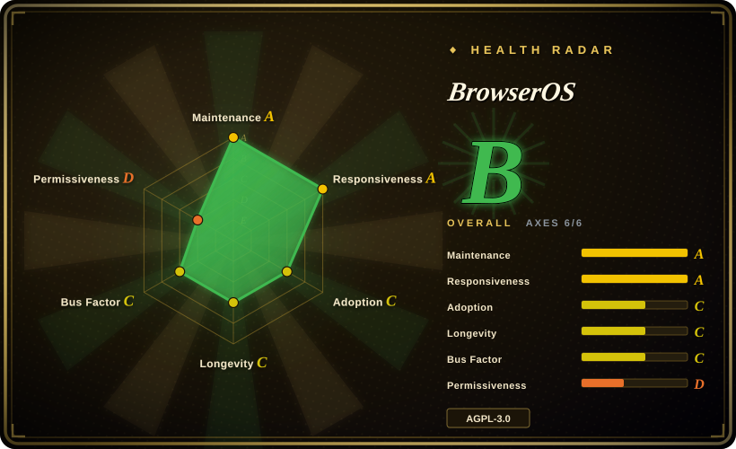
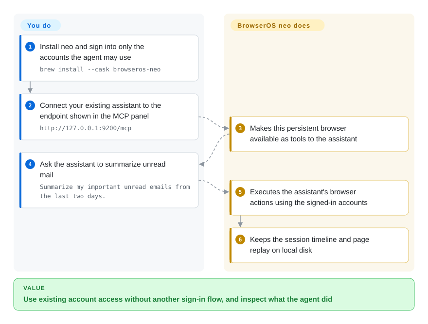
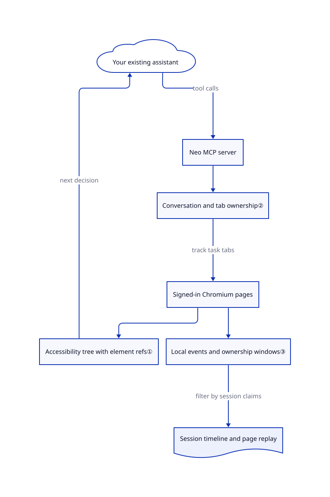

# BrowserOS

Your coding agent reaches an empty browser instead of the inbox you already signed into. BrowserOS neo gives it a separate, persistent browser with imported logins, its own task tabs, and a local record you can replay.

## When to use

You maintain internal reports across Gmail, Notion and a CRM. Your coding agent can write the summary, but a new automation profile stops at sign-in and asks you to repeat two-factor authentication. You want to let that existing agent use those accounts without handing over your daily Chrome window. Pick BrowserOS neo when a second Chromium browser, imported account state, parallel task tabs and an inspectable session history justify installing a whole browser rather than a Chrome extension.

This repository ships two products, not one interchangeable agent loop. **Neo** supplies browser tools to your existing MCP client; MCP is the protocol that lets an assistant call external tools. **BrowserOS**, the other browser, supplies its own new-tab/side-panel assistant and supports your model keys or local Ollama. The current root README leads with neo; the [assistant-browser README](https://github.com/browseros-ai/BrowserOS/blob/6967b953f4c92c50382f9661109b4cf21c26a553/README.BrowserOS.md#L26-L48) describes the second product. Choose the entry point before configuring a model.

## When NOT to use

- **A repeatable CI test must check several browser engines.** Choose [Playwright](../playwright-family/playwright.md), with assertions and clean contexts. BrowserOS is a Chromium application with real account state, not a cross-browser test runner.
- **You must keep the existing Chrome profile and require explicit tab borrowing.** Choose [BrowserSkill](browserskill.md), whose page describes that handoff. Neo installs another browser; its tab groups are task bookkeeping, not independent account sandboxes. Its [tab guide](https://github.com/browseros-ai/BrowserOS/blob/6967b953f4c92c50382f9661109b4cf21c26a553/docs/neo/tabs-and-isolation.mdx#L14-L24) says agents can see personal-tab titles and URLs.
- **Your Python application must own planning, retries and structured results.** Choose [browser-use](browser-use.md). Neo expects an external assistant to decide the next action; the separate BrowserOS assistant is an application, not a substitute for an embedded Python framework.
- **Page data must never reach a hosted model.** Prefer a deterministic local [Playwright](../playwright-family/playwright.md) script, or separately validate a fully local assistant setup. Local browser storage does not make Claude Code or another connected model local; the [privacy guide](https://github.com/browseros-ai/BrowserOS/blob/6967b953f4c92c50382f9661109b4cf21c26a553/docs/neo/privacy.mdx#L31-L47) explicitly separates provider traffic and default-on product telemetry.
- **You need permissively licensed code for a proprietary browser-control derivative.** Evaluate MIT-licensed [BrowserSkill](browserskill.md) instead. BrowserOS's root and agent-platform license texts are AGPL v3; retaining Chromium and component notices does not remove the platform's copyleft obligations.

## Comparison

| Alternative | In index | Our verdict | Tradeoff |
|---|---|---|---|
| [BrowserSkill](browserskill.md) | Indexed | Pick BrowserSkill when existing Chrome windows and explicit borrow approval are decisive; pick neo when a separate browser and built-in session replay are worth maintaining another profile. | Extension/daemon integration avoids a browser fork, while neo supplies its own application and account import. Neither removes the trust placed in a logged-in agent. |
| [browser-use](browser-use.md) | Indexed | Pick browser-use when your Python service must own the task loop; pick neo when Claude Code, Codex or another existing assistant should own it. | A programmable framework gives custom tools and result handling; neo gives an end-user dashboard and local browser-session history. browser-use also supports local browsers, not just its paid cloud. |
| [Playwright](../playwright-family/playwright.md) | Indexed | Pick Playwright for checked-in tests and cross-engine assertions; pick neo for occasional account-bound tasks whose next action comes from an assistant. | Explicit test code is reproducible and needs no model, but you maintain the workflow and authentication setup yourself. |

## Quick start

Install and open neo using the [documented download or Homebrew path](https://github.com/browseros-ai/BrowserOS/blob/6967b953f4c92c50382f9661109b4cf21c26a553/README.md#L31-L56); the macOS path first runs `brew tap browseros-ai/tap`, then `brew install --cask browseros-neo`. Import only the accounts you authorize the agent to use, or sign into those sites manually. In the new-tab MCP panel, connect your assistant and restart it, or copy the actual endpoint into a Streamable HTTP MCP client; the [manual example](https://github.com/browseros-ai/BrowserOS/blob/6967b953f4c92c50382f9661109b4cf21c26a553/docs/neo/mcp/manual.mdx#L66-L93) shows a Vercel AI SDK client at `http://127.0.0.1:9200/mcp`, but your displayed port is authoritative. Send the task from your assistant, not neo's address bar; neo executes browser tools and keeps the session record, while you supply the model subscription, account permissions and result checks. The other BrowserOS product uses `brew install --cask browseros` and its own provider settings instead; do not combine those two setup paths.

<!-- flow-steps:begin (generated from flows/browseros.json by tools/flow_card.py — do not edit) -->

Text version of the flow

1. **You**: Install neo and sign into only the accounts the agent may use — `brew install --cask browseros-neo`
2. **You**: Connect your existing assistant to the endpoint shown in the MCP panel — `http://127.0.0.1:9200/mcp`
3. **BrowserOS**: Makes this persistent browser available as tools to the assistant
4. **You**: Ask the assistant to summarize unread mail — `Summarize my important unread emails from the last two days.`
5. **BrowserOS**: Executes the assistant's browser actions using the signed-in accounts
6. **BrowserOS**: Keeps the session timeline and page replay on local disk

**Value**: Use existing account access without another sign-in flow, and inspect what the agent did

<!-- flow-steps:end -->

## Key techniques

<!-- mechanism:begin (generated from mechanisms/browseros.json by tools/mechanism_card.py; do not edit) -->

Text version of the mechanism

- Your existing assistant
- Neo MCP server
- Conversation and tab ownership②
- Signed-in Chromium pages
- Accessibility tree with element refs①
- Local events and ownership windows③
- Session timeline and page replay

- Your existing assistant → Neo MCP server (tool calls)
- Neo MCP server → Conversation and tab ownership②
- Conversation and tab ownership② → Signed-in Chromium pages (track task tabs)
- Signed-in Chromium pages → Accessibility tree with element refs①
- Accessibility tree with element refs① → Your existing assistant (next decision)
- Signed-in Chromium pages → Local events and ownership windows③
- Local events and ownership windows③ → Session timeline and page replay (filter by session claims)

<!-- mechanism:end -->

### 1. Return element references instead of asking the model for selectors

- **Problem:** A model needs actionable page structure without inventing a CSS selector for every button.
- **How:** The snapshot tool obtains an accessibility tree, a structured description of controls, and formats stable `ref=eN` references for subsequent actions. Interactive mode keeps actionable controls, headings and ancestor context; iframe content is included inline.
- **Limits:** References are invalidated by navigation or large changes. This reduces targeting ambiguity, not model mistakes; the external agent still decides what to do.
- **Source:** [Snapshot contract and handler, lines 16–23 and 51–102](https://github.com/browseros-ai/BrowserOS/blob/6967b953f4c92c50382f9661109b4cf21c26a553/packages/browseros-agent/crates/browseros-mcp/src/tools/snapshot.rs#L16-L102).

### 2. Track ownership per conversation, not just the active tab

- **Problem:** Parallel tasks can lose track of their tabs or clean up a tab borrowed from a person.
- **How:** The server keeps page-to-conversation and conversation-to-pages indexes under one read/write lock. Reassignment removes the previous owner, while retained groups track actual profile/window placement and mark borrowed groups separately.
- **Limits:** This is lifecycle accounting, not a credential-isolation boundary. The tab guide permits work on personal tabs when requested; a group color does not establish separate cookies or an authorization policy.
- **Source:** [Ownership indexes, borrowed-group marker and reassignment, lines 51–99 and 144–219](https://github.com/browseros-ai/BrowserOS/blob/6967b953f4c92c50382f9661109b4cf21c26a553/packages/browseros-agent/apps/claw-server/src/services/sessions/tab_ownership.rs#L51-L219), [user-tab behavior](https://github.com/browseros-ai/BrowserOS/blob/6967b953f4c92c50382f9661109b4cf21c26a553/docs/neo/tabs-and-isolation.mdx#L14-L24).

### 3. Reconstruct replay through recorded ownership windows

- **Problem:** A tab can serve several tasks over time; replay must attribute the right portion to each session.
- **How:** The replay service reads document-event streams through durable tab-ownership time windows, filters events to the session's claims and sorts the result by timestamp. SQLite indexes and local recording files back the dashboard rather than a required hosted recording service.
- **Limits:** Replay depends on captured events and can report gaps. It is page-event playback, not a complete screen video or proof that a task succeeded; the guide excludes canvas contents and mouse movement.
- **Source:** [Replay selection, lines 57–158](https://github.com/browseros-ai/BrowserOS/blob/6967b953f4c92c50382f9661109b4cf21c26a553/packages/browseros-agent/apps/claw-server/src/services/replay/builder.rs#L57-L158), [local stores, lines 88–113](https://github.com/browseros-ai/BrowserOS/blob/6967b953f4c92c50382f9661109b4cf21c26a553/packages/browseros-agent/apps/claw-server/src/app.rs#L88-L113), [recording limits](https://github.com/browseros-ai/BrowserOS/blob/6967b953f4c92c50382f9661109b4cf21c26a553/docs/neo/audit-and-replay.mdx#L61-L65).

## Tech stack

- Chromium patches and browser packaging use C++ and Python. The [build manifest](https://github.com/browseros-ai/BrowserOS/blob/6967b953f4c92c50382f9661109b4cf21c26a553/packages/browseros/pyproject.toml#L5-L23) requires Python 3.12+ for that developer tooling.
- Neo's backend uses Rust, Tokio, Axum, the Rust MCP SDK and SQLite through SeaORM. Its dashboard uses TypeScript, WXT and React. The [Rust workspace](https://github.com/browseros-ai/BrowserOS/blob/6967b953f4c92c50382f9661109b4cf21c26a553/packages/browseros-agent/Cargo.toml#L1-L68) declares Rust 1.94 as the minimum supported version, not a pinned toolchain.
- The other BrowserOS assistant uses a Bun server, Hono and AI SDK provider adapters; it is not the Rust neo server. The [agent workspace manifest](https://github.com/browseros-ai/BrowserOS/blob/6967b953f4c92c50382f9661109b4cf21c26a553/packages/browseros-agent/package.json#L112-L119) pins Bun 1.4.2 for development.

## Dependencies

- For the primary desktop path: the packaged neo browser, an HTTP MCP-capable assistant, its configured model and authorized website accounts. You do not need a separately administered database or model weights merely to expose browser tools.
- Official README download links cover macOS, Windows and Linux x64. The install guide still says neo has no Linux build, so validate the exact release asset for your platform rather than relying on that paragraph. Rust Linux ARM64 server assets are not evidence of an ARM64 browser installer.
- The root [AGPL v3 text](https://github.com/browseros-ai/BrowserOS/blob/6967b953f4c92c50382f9661109b4cf21c26a553/LICENSE#L1-L57) also exists in the agent platform. Its Cargo and package manifests specify `AGPL-3.0-or-later`. Chromium is a separately fetched base, not wholly relicensed AGPL; the repository preserves BSD-style notices in browser patches and a [Chromium license fixture](https://github.com/browseros-ai/BrowserOS/blob/6967b953f4c92c50382f9661109b4cf21c26a553/packages/browseros/bos_build/steps/patches/fixtures/LICENSE#L1-L27). [Ungoogled patches](https://github.com/browseros-ai/BrowserOS/blob/6967b953f4c92c50382f9661109b4cf21c26a553/LICENSE.ungoogled_chromium#L1-L31) have their own BSD-3-Clause notice; the license's named paths predate the current layout.
- Component exceptions matter: [agent-cursor](https://github.com/browseros-ai/BrowserOS/blob/6967b953f4c92c50382f9661109b4cf21c26a553/packages/browseros-agent/packages/agent-cursor/LICENSE#L1-L21) retains Cua AI's MIT notice; [acpx-ai-provider](https://github.com/browseros-ai/BrowserOS/blob/6967b953f4c92c50382f9661109b4cf21c26a553/packages/browseros-agent/packages/acpx-ai-provider/LICENSE#L1-L21) and [agent-mcp-manager](https://github.com/browseros-ai/BrowserOS/blob/6967b953f4c92c50382f9661109b4cf21c26a553/packages/browseros-agent/packages/agent-mcp-manager/LICENSE#L1-L21) carry Dani Akash's MIT notice. These exceptions do not license the whole backend as MIT.

## Ops difficulty

**Medium for desktop use; high for maintaining a browser fork.** You maintain another login-bearing profile, browser/server/extension updates and sensitive audit files under `~/.browserclaw/`. Local recordings do not prevent provider egress or telemetry: the Rust source sends product events with a persistent `install_id`, despite the privacy prose saying there is no user identifier; inspect and disable telemetry if your policy requires it ([event construction](https://github.com/browseros-ai/BrowserOS/blob/6967b953f4c92c50382f9661109b4cf21c26a553/packages/browseros-agent/apps/claw-server/src/analytics/service.rs#L209-L246)). The credential tool can list account metadata and fill saved credentials; passwords are not returned, but this is still powerful account access ([contract](https://github.com/browseros-ai/BrowserOS/blob/6967b953f4c92c50382f9661109b4cf21c26a553/packages/browseros-agent/crates/browseros-mcp/src/tools/credentials.rs#L1-L18)). Building Chromium yourself adds the documented roughly 100 GB source workspace, platform toolchains and hours of build time, not just a Bun install. The workspace also has a `postinstall` hook; review it before any future dependency installation.

## Health & viability

- **Maintenance, 2026-10-27:** the repository is public and unarchived. Releases independently update the neo browser (`0.51.2.4`, October 24), Rust server (`0.0.84`, October 26) and extension (`0.2.51.0`, October 27). Treat these as separate release streams, not one stable product version ([releases](https://github.com/browseros-ai/BrowserOS/releases)).
- **Governance:** the README identifies Felafax, Inc.; the contributor list is concentrated in `shadowfax92`, `felarof99` and `DaniAkash` among human accounts. The [CLA](https://github.com/browseros-ai/BrowserOS/blob/6967b953f4c92c50382f9661109b4cf21c26a553/CLA.md#L13-L38) grants broad contribution rights. This is vendor-led governance, not a foundation guarantee.
- **Durability and adoption:** created May 18, 2025; about seventeen months old, with roughly 14.1k stars on the verification date. [推断: based on repository age, release history and contributor concentration] Active development supports a trial, but the short history and product renaming give a weaker long-term prior than an established testing engine. Stars measure attention, not completed business tasks.
- **Operational risk:** open reports include [OpenCode 2.x config placement, #3002](https://github.com/browseros-ai/BrowserOS/issues/3002) and [Windows MCP screenshot timeouts, #3008](https://github.com/browseros-ai/BrowserOS/issues/3008). These are user reports, not reproduced defects in this assessment. Validate your exact client/OS combination before importing important accounts.

## Caveats (unverified)

- [未验证: upstream execution and browser installation were prohibited for this intake] Account import, MCP connectivity, replay fidelity and task success were researched from pinned docs/source, not exercised. No success-rate, token-saving or bot-evasion claim was validated.
- [未验证: release packages were not run on each platform] The README and install guide disagree about Linux neo availability. Published server assets and README links do not establish a working browser build for every architecture.
- [未验证: reporter environments were not reproduced] Issues #3002 and #3008 remain reports; open status does not prove the reviewed commit still has their symptoms.
- [推断: based on creation date, release cadence and the contributor sample] The durability verdict is a selection judgment, not a guarantee of vendor funding or future maintenance.
- [未验证: source review did not capture runtime traffic or audit every binary dependency] Local-only storage is not a zero-egress guarantee. The telemetry source is more specific than the privacy prose; Chromium's full third-party notice inventory must be reviewed for a redistributed build.
