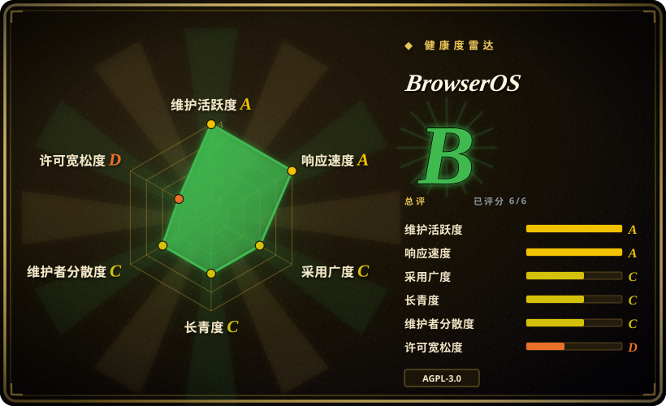
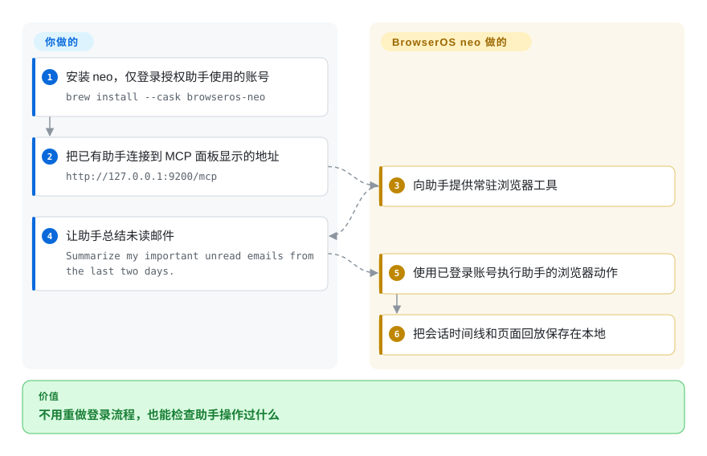
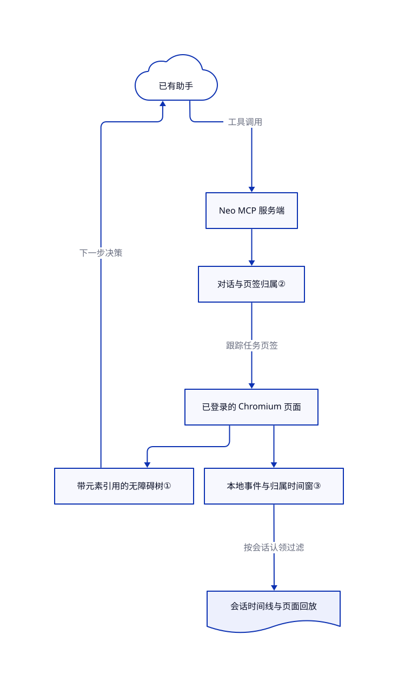

# BrowserOS

编码助手打开的浏览器没有登录态，读不了你已登录的邮箱。BrowserOS neo 给它另一个常驻浏览器，可导入账号、分配任务页签，并在本地回放操作。

## 何时使用

你需要从 Gmail、Notion 和客户管理系统汇总内部报表。编码助手能写总结，却卡在新浏览器的登录页，让你重做双重验证。你希望它操作这些账号，又不占用日常 Chrome 窗口。如果你愿意维护第二个浏览器和账号配置档，换取登录态导入、并行任务页签和可检查的操作记录，可以考虑 BrowserOS neo；只需扩展桥接时则不必引入整个浏览器。

仓库发布两个产品，不能当成同一个助手循环。**Neo** 向已有助手提供浏览器工具；MCP 是助手调用外部工具的协议。另一个 **BrowserOS** 自带新标签页和侧边栏助手，可配置自己的模型密钥或本地 Ollama。当前根说明主推 neo；[内置助手版说明](https://github.com/browseros-ai/BrowserOS/blob/6967b953f4c92c50382f9661109b4cf21c26a553/README.BrowserOS.md#L26-L48)描述另一个产品。先选入口，再决定在哪里配置模型。

## 何时不用

- **要在持续集成中重复检查多个浏览器引擎。** 选带断言和干净上下文的 [Playwright](../playwright-family/playwright.zh.md)。BrowserOS 是持有真实账号的 Chromium 应用，不是跨浏览器测试运行器。
- **必须沿用现有 Chrome，并逐次批准借用页签。** 选 [BrowserSkill](browserskill.zh.md)，其页面说明了借用交接。Neo 安装另一个浏览器；任务分组不是独立账号沙箱。[页签指南](https://github.com/browseros-ai/BrowserOS/blob/6967b953f4c92c50382f9661109b4cf21c26a553/docs/neo/tabs-and-isolation.mdx#L14-L24)明确说，助手能看见个人页签的标题和网址。
- **Python 应用需要掌握规划、重试和结构化结果。** 选 [browser-use](browser-use.zh.md)。Neo 让外部助手决定下一步；另一个 BrowserOS 内置助手也是应用，不等于可嵌入的 Python 框架。
- **网页数据绝不能交给托管模型。** 优先写本地确定性的 [Playwright](../playwright-family/playwright.zh.md) 脚本，或单独验证全本地助手配置。浏览器在本地存储，不代表连入的模型也在本地；[隐私指南](https://github.com/browseros-ai/BrowserOS/blob/6967b953f4c92c50382f9661109b4cf21c26a553/docs/neo/privacy.mdx#L31-L47)区分了模型提供方流量和默认开启的产品遥测。
- **要把代码用于闭源浏览器控制衍生品，要求宽松许可。** 改评估 MIT 许可的 [BrowserSkill](browserskill.zh.md)。BrowserOS 根目录与助手平台均提供 AGPL 第三版正文；保留 Chromium 和组件声明，不会消除平台的著佐权义务。

## 横向对比

| 替代品 | 是否收录 | 我们的评价 | 取舍 |
|---|---|---|---|
| [BrowserSkill](browserskill.zh.md) | 已收录 | 沿用现有 Chrome 窗口、明确批准借用时选 BrowserSkill；愿意维护另一份配置档，以换取独立浏览器和内置会话回放时选 neo。 | 扩展与守护进程免去浏览器分叉；neo 提供完整应用和账号导入。两者都要求信任持有登录态的助手。 |
| [browser-use](browser-use.zh.md) | 已收录 | Python 服务要自己掌握任务循环时选 browser-use；已有编码助手负责规划时选 neo。 | 框架便于扩展工具和处理结果；neo 提供用户看板和本地会话记录。browser-use 也支持本地浏览器，不仅是付费云。 |
| [Playwright](../playwright-family/playwright.zh.md) | 已收录 | 版本化测试和跨引擎断言选 Playwright；偶发、依赖账号、由助手决定下一步的任务选 neo。 | 显式测试代码可重复，不需要模型；代价是自己维护流程与认证准备。 |

## 快速上手

按[下载或 Homebrew 路径](https://github.com/browseros-ai/BrowserOS/blob/6967b953f4c92c50382f9661109b4cf21c26a553/README.md#L31-L56)安装并打开 neo；macOS 先执行 `brew tap browseros-ai/tap`，再执行 `brew install --cask browseros-neo`。仅导入授权助手操作的账号，也可手动登录对应网站。在新标签页的 MCP 面板连接助手并重启它，或把实际地址填入支持流式 HTTP 的 MCP 客户端；[手动接入示例](https://github.com/browseros-ai/BrowserOS/blob/6967b953f4c92c50382f9661109b4cf21c26a553/docs/neo/mcp/manual.mdx#L66-L93)给出 Vercel AI SDK 用法，示例地址为 `http://127.0.0.1:9200/mcp`，端口以界面显示为准。任务发给助手，不是发到 neo 地址栏；neo 执行浏览器工具并保存记录，你负责模型订阅、账号权限和结果核对。另一个 BrowserOS 产品使用 `brew install --cask browseros`，再配置其内置模型提供方；不要混用两条安装路径。

<!-- flow-steps:begin (generated from flows/browseros.json by tools/flow_card.py — do not edit) -->

流程文字版

1. **你**：安装 neo，仅登录授权助手使用的账号 — `brew install --cask browseros-neo`
2. **你**：把已有助手连接到 MCP 面板显示的地址 — `http://127.0.0.1:9200/mcp`
3. **BrowserOS**：向助手提供常驻浏览器工具
4. **你**：让助手总结未读邮件 — `Summarize my important unread emails from the last two days.`
5. **BrowserOS**：使用已登录账号执行助手的浏览器动作
6. **BrowserOS**：把会话时间线和页面回放保存在本地

**价值**：不用重做登录流程，也能检查助手操作过什么

<!-- flow-steps:end -->

## 技术要点

<!-- mechanism:begin (generated from mechanisms/browseros.json by tools/mechanism_card.py; do not edit) -->

机制文字版

- 已有助手
- Neo MCP 服务端
- 对话与页签归属②
- 已登录的 Chromium 页面
- 带元素引用的无障碍树①
- 本地事件与归属时间窗③
- 会话时间线与页面回放

- 已有助手 → Neo MCP 服务端（工具调用）
- Neo MCP 服务端 → 对话与页签归属②
- 对话与页签归属② → 已登录的 Chromium 页面（跟踪任务页签）
- 已登录的 Chromium 页面 → 带元素引用的无障碍树①
- 带元素引用的无障碍树① → 已有助手（下一步决策）
- 已登录的 Chromium 页面 → 本地事件与归属时间窗③
- 本地事件与归属时间窗③ → 会话时间线与页面回放（按会话认领过滤）

<!-- mechanism:end -->

### 1. 用元素引用代替让模型猜选择器

- **解决：** 模型需要可操作的页面结构，不应每次都编写按钮的 CSS 选择器。
- **做法：** 快照工具读取无障碍树，即控件的结构化描述，再输出供后续动作使用的稳定 `ref=eN` 引用。交互模式保留可操作控件、标题和祖先上下文，并把内嵌框架内容拼入树中。
- **边界：** 导航或较大页面变化会使引用失效。它减少定位歧义，不保证模型决策正确；下一步仍由外部助手决定。
- **源码：** [快照合同与处理器，第 16—23、51—102 行](https://github.com/browseros-ai/BrowserOS/blob/6967b953f4c92c50382f9661109b4cf21c26a553/packages/browseros-agent/crates/browseros-mcp/src/tools/snapshot.rs#L16-L102)。

### 2. 按对话记录归属，而非只记活动页签

- **解决：** 并行任务可能混淆页签，清理时也可能误关从人手里借来的页面。
- **做法：** 服务端把“页面到对话”和“对话到页面集合”两份索引放在同一把读写锁下。转移归属时移除旧拥有者；保留分组记录真实配置档与窗口位置，并单独标记借用分组。
- **边界：** 这是生命周期记账，不是凭据隔离。指南允许按请求操作个人页签；分组颜色不代表独立 cookie，也不能替代授权策略。
- **源码：** [归属索引、借用标记与转移，第 51—99、144—219 行](https://github.com/browseros-ai/BrowserOS/blob/6967b953f4c92c50382f9661109b4cf21c26a553/packages/browseros-agent/apps/claw-server/src/services/sessions/tab_ownership.rs#L51-L219)、[个人页签行为](https://github.com/browseros-ai/BrowserOS/blob/6967b953f4c92c50382f9661109b4cf21c26a553/docs/neo/tabs-and-isolation.mdx#L14-L24)。

### 3. 按归属时间窗重建会话回放

- **解决：** 同一页签可能先后服务多个任务，回放需要把正确片段归给各自会话。
- **做法：** 回放服务用持久化的页签归属时间窗切分文档事件流，仅保留会话认领期间的事件，再按时间排序。看板依赖 SQLite 索引和本地记录文件，不要求托管录制服务。
- **边界：** 回放依赖已经采集的事件，可能报告缺口。它是页面事件回放，不是完整屏幕录像，更不证明任务成功；指南排除了画布内容和鼠标移动。
- **源码：** [回放选择，第 57—158 行](https://github.com/browseros-ai/BrowserOS/blob/6967b953f4c92c50382f9661109b4cf21c26a553/packages/browseros-agent/apps/claw-server/src/services/replay/builder.rs#L57-L158)、[本地存储，第 88—113 行](https://github.com/browseros-ai/BrowserOS/blob/6967b953f4c92c50382f9661109b4cf21c26a553/packages/browseros-agent/apps/claw-server/src/app.rs#L88-L113)、[录制限制](https://github.com/browseros-ai/BrowserOS/blob/6967b953f4c92c50382f9661109b4cf21c26a553/docs/neo/audit-and-replay.mdx#L61-L65)。

## 技术栈

- Chromium 补丁和浏览器打包使用 C++、Python。[构建清单](https://github.com/browseros-ai/BrowserOS/blob/6967b953f4c92c50382f9661109b4cf21c26a553/packages/browseros/pyproject.toml#L5-L23)要求开发工具使用 Python 3.12 及以上。
- Neo 后端使用 Rust、Tokio、Axum、Rust MCP SDK，以及通过 SeaORM 访问的 SQLite。看板使用 TypeScript、WXT 和 React。[Rust 工作区](https://github.com/browseros-ai/BrowserOS/blob/6967b953f4c92c50382f9661109b4cf21c26a553/packages/browseros-agent/Cargo.toml#L1-L68)声明最低支持 Rust 1.94，并非精确锁定工具链。
- 另一个 BrowserOS 助手使用 Bun 服务端、Hono 和 AI SDK 提供方适配器，不能与 neo 的 Rust 服务端混为一谈。[助手工作区清单](https://github.com/browseros-ai/BrowserOS/blob/6967b953f4c92c50382f9661109b4cf21c26a553/packages/browseros-agent/package.json#L112-L119)固定开发环境使用 Bun 1.4.2。

## 依赖

- 桌面主路径需要打包好的 neo 浏览器、支持 HTTP MCP 的助手、助手已配置的模型，以及获授权的网站账号。仅开放浏览器工具，不需要另运维数据库，也不必下载模型权重。
- 官方根说明提供 macOS、Windows 和 Linux x64 下载链接。安装指南仍称 neo 没有 Linux 构建，应核对具体平台的发布资产，不能只信该段文字。Rust 服务端的 Linux ARM64 资产，不等于 ARM64 浏览器安装包。
- 根目录的 [AGPL 第三版正文](https://github.com/browseros-ai/BrowserOS/blob/6967b953f4c92c50382f9661109b4cf21c26a553/LICENSE#L1-L57)也存在于助手平台。Cargo 与包清单指定 `AGPL-3.0-or-later`。Chromium 是另行获取的底座，不是整体改为 AGPL；仓库在浏览器补丁中保留 BSD 风格声明，并有 [Chromium 许可测试夹具](https://github.com/browseros-ai/BrowserOS/blob/6967b953f4c92c50382f9661109b4cf21c26a553/packages/browseros/bos_build/steps/patches/fixtures/LICENSE#L1-L27)。[Ungoogled 补丁](https://github.com/browseros-ai/BrowserOS/blob/6967b953f4c92c50382f9661109b4cf21c26a553/LICENSE.ungoogled_chromium#L1-L31)另有 BSD-3-Clause 声明，但声明中的路径早于当前布局。
- 组件例外需要单独保留：[agent-cursor](https://github.com/browseros-ai/BrowserOS/blob/6967b953f4c92c50382f9661109b4cf21c26a553/packages/browseros-agent/packages/agent-cursor/LICENSE#L1-L21)保留 Cua AI 的 MIT 声明；[acpx-ai-provider](https://github.com/browseros-ai/BrowserOS/blob/6967b953f4c92c50382f9661109b4cf21c26a553/packages/browseros-agent/packages/acpx-ai-provider/LICENSE#L1-L21)与 [agent-mcp-manager](https://github.com/browseros-ai/BrowserOS/blob/6967b953f4c92c50382f9661109b4cf21c26a553/packages/browseros-agent/packages/agent-mcp-manager/LICENSE#L1-L21)保留 Dani Akash 的 MIT 声明。这不代表整个后端采用 MIT。

## 运维难度

**桌面使用中等；维护浏览器分叉较高。** 你需要维护另一份持有登录态的配置档、浏览器与服务端及扩展更新，以及 `~/.browserclaw/` 下的敏感审计文件。本地录制不阻止模型提供方流量或遥测：Rust 源码发送含持久化 `install_id` 的产品事件，而隐私文案称没有用户标识；有相关政策要求时应检查并关闭遥测（[事件构造](https://github.com/browseros-ai/BrowserOS/blob/6967b953f4c92c50382f9661109b4cf21c26a553/packages/browseros-agent/apps/claw-server/src/analytics/service.rs#L209-L246)）。凭据工具能列出账号元信息、填充已保存凭据；虽不返回密码，仍有较大的账号操作权限（[接口合同](https://github.com/browseros-ai/BrowserOS/blob/6967b953f4c92c50382f9661109b4cf21c26a553/packages/browseros-agent/crates/browseros-mcp/src/tools/credentials.rs#L1-L18)）。自行构建 Chromium，还需要文档所述约 100 GB 源码空间、平台工具链和数小时构建，不是只装 Bun 即可。工作区也配置了安装后钩子；未来安装依赖前应先审查。

## 健康度与可持续性

- **维护，截至 2026-10-27：** 仓库公开且未归档。Neo 浏览器、Rust 服务端和扩展分别发布：浏览器 `0.51.2.4` 于十月二十四日发布，服务端 `0.0.84` 于十月二十六日发布，扩展 `0.2.51.0` 于十月二十七日发布。应视作独立发布流，不能拼成一个稳定产品版本（[发布记录](https://github.com/browseros-ai/BrowserOS/releases)）。
- **治理：** 根说明标示 Felafax, Inc.；人类账号提交主要集中于 `shadowfax92`、`felarof99` 和 `DaniAkash`。[贡献协议](https://github.com/browseros-ai/BrowserOS/blob/6967b953f4c92c50382f9661109b4cf21c26a553/CLA.md#L13-L38)授予较广的贡献使用权。这是厂商主导，不是基金会担保。
- **寿命与采用：** 仓库创建于 2025-05-18，约十七个月；核验日约有 1.41 万星。[推断：依据为仓库年龄、当前发布记录及贡献集中度] 活跃开发支持试用，但历史短且产品正在更名，长期持续性先验弱于成熟测试引擎。星数代表关注，不等于完成业务任务的证据。
- **运行风险：** 尚开放的用户报告包括 [OpenCode 2.x 配置位置问题 #3002](https://github.com/browseros-ai/BrowserOS/issues/3002)和 [Windows MCP 截图超时 #3008](https://github.com/browseros-ai/BrowserOS/issues/3008)。本次未复现这些报告；导入重要账号前，应验证自己的客户端与操作系统组合。

## 存疑（未验证）

- [未验证：按本轮约束未执行上游或安装浏览器] 账号导入、MCP 连通、回放保真和任务成功均来自固定版本的文档与源码研究，未运行验证。未证实成功率、省 token 或反检测宣传。
- [未验证：未逐平台运行发布包] 根说明与安装指南对 Linux neo 可用性的描述冲突。服务端资产和下载链接不证明每种架构都有可用浏览器。
- [未验证：未复现用户环境] #3002、#3008 仍只是报告；开放状态不证明审阅提交仍有相同症状。
- [推断：依据为创建日期、发布节奏与贡献者样本] 可持续性结论是选型判断，不保证厂商资金或未来维护。
- [未验证：本轮只审查源码，未抓取运行网络流量或审计完整二进制依赖] 本地存储不等于零外发。遥测源码比隐私文案更具体；重新分发构建前，仍须检查 Chromium 完整第三方声明清单。
